# YourHRM — Kiến trúc dữ liệu (v0.5)

| Mục | Giá trị |
|---|---|
| Phiên bản | **0.5 — 2026-10-21** (đồng bộ với DDL v0.5 sau khi nhà tài trợ phê duyệt D1–D11 ngày 2026-10-21, [nhật ký quyết định](../../docs/00-project-management/decision-log.md) §10; v0.4 — 2026-10-17 là vòng review DDL: sơ đồ ER và văn bản được đồng bộ với DDL v0.4, nay là nguồn chuẩn; v0.3 — 2026-10-16 áp dụng các quyết định vòng 2 R2-01, R2-11, R2-12, R2-15, R2-16, R2-17, R2-18 trong [nhật ký quyết định](../../docs/00-project-management/decision-log.md) §7–§7.2; v0.2 áp dụng vòng 1; v0.1 là bản nháp để review) |
| Trạng thái | Baseline cho SRS và sprint 1. Các quyết định được ghi nhận thành ADR-0020 … ADR-0037; trạng thái từng ADR ở §16 |
| Tác giả | Data Architect |
| Đầu vào | [Architecture brief](../../docs/02-architecture/architecture-brief.md), [nhật ký quyết định](../../docs/00-project-management/decision-log.md), [BRD](../../docs/01-requirements/brd/BRD.md), [gap analysis](../../docs/01-requirements/brd/gap-analysis.md) §5/§6/§7/§9, BRD của các module §6–§7 |
| Mục tiêu | PostgreSQL 17 trên CloudNativePG (SA ADR-0002/0017); DDL giữ tương thích với 16+. Java 25 / Spring Boot 4 (OD-3; phương án dự phòng Boot 3.5 / Java 21 sẽ quyết định sau SP-1), Hibernate + jOOQ, modular monolith |
| Đồng bộ với | SA ADR-0002 (stack), 0003 (tenancy runtime, `saas.tenant_placement`, baseline capabilities), 0004 rev. 2 (outbox + polling relay; bus dựa trên DB ở Phase 1, Kafka ở Phase 2), 0006 (scope predicates, `report_scope`), 0009 (snapshot-first runs), 0010 (Legal Parameter Service), 0011 (job queue), 0012 (reporting), 0017 (CNPG, OpenBao, DR), 0019 (close hold, đã chấp nhận X-03) |
| DDL | [`ddl/`](ddl/) — **phủ mọi schema**: `000_extensions_roles.sql` (role, schema, helper `sys`, template outbox/inbox, cơ chế bypass purge), `001_saas.sql` (v0.4), `002_core.sql` (+ `audit`), `003_hr.sql`, `004_att.sql`, `005_pay.sql`, `006_rec.sql` (module Phase 2, tạo để review), **`007_publications.sql`** (mới: publication cho reporting store) và `ddl/reporting/100_rpt.sql` (reporting DB riêng, không load vào OLTP); trừ `001` (v0.4), tất cả là **v0.5 (2026-10-21)**. Smoke test v0.5 ngày 2026-10-21 trên PGlite 0.5.10 (PostgreSQL 18.6) cho `000`–`005`. **DDL là nguồn chuẩn**: khi tài liệu này và DDL khác nhau thì DDL đúng. Smoke test 2026-10-17 trên **PGlite 0.5.10 (PostgreSQL 18.6, WASM)** cho `000`→`006` và trên **PGlite 0.2.17 (PostgreSQL 16.4)** cho `006_rec` và `100_rpt` (pgcrypto/unaccent/`pg_stat_statements`/lz4 được stub khi cần): load sạch, RLS chéo tenant và fail-closed, exclusion constraint, FK ghép, masking view fail closed, máy trạng thái lần chạy lương và close hold, tính bất biến kết quả, `sys.cross_schema_grant_violations()` = 0. **Đã chạy trên PostgreSQL 17.11 thật (Docker, 2026-10-21):** `000`–`007` load không lỗi (5 cảnh báo `wal_level` dự kiến của publication), 255 bảng, 419 partition; [`tests/pg17_integration_check.sql`](tests/pg17_integration_check.sql) 10/10 PASS (không FK liên schema, RLS ENABLE+FORCE, guard X-02, phân loại P3, publication không có cột P3, cô lập tenant thực tế). Các bộ test hành vi theo module mới chạy trên PGlite; một lần chạy bằng Testcontainers trong CI vẫn là bắt buộc. Feed logical replication của `100_rpt` chưa test được (PGlite chỉ một instance). Lưu ý: các helper tenancy và `sys.create_outbox_inbox()` nằm trong `000` (schema `sys`), không phải `002`, vì `001_saas` cần đến chúng. |

**Những thay đổi trong v0.5 (2026-10-21, DDL v0.5 sau quyết định D1–D11 của nhà tài trợ).** D1: `att.attendance_result_hold` là nguồn duy nhất của close hold; `pay.run_attendance_version` thành bản phản chiếu theo `att_hold_id`, bỏ unique "một hold ACTIVE mỗi kỳ" (§7.4, §7.5, §8). D2: chấp nhận đóng băng kết quả từ `SUBMITTED` (§8). D3: thêm trạng thái lần chạy `CANCELLED` (§7.5, §8). D4: thêm `007_publications.sql` và bảng landing `att`/`pay` (§11). D5: thêm projection `att.ext_hr_employment`, `att.ext_hr_special_status` và hàm `att.protected_flags()` (§7.4). D6: không grant masking view nào cho `yhrm_reporting_ro` (§3.4, §9.4). D7: payload `rec.CandidateHired` không chứa P3 (§7.6, §9.1). D8: dữ liệu liên hệ của ứng viên là P3 (§7.6). D9: cơ chế bypass purge `yhrm_purger` + `sys.purge_bypass()` (§3.4, §3.7). D10: `pay.ext_att_result` khớp với `att` (§7.5). D11: sửa `100_rpt.sql` theo DDL (§11). **Sửa RLS của `audit.chain_anchor`:** `yhrm_app_core` vốn luôn có `SELECT` trên bảng này, nên bảng chưa bao giờ chỉ dành cho platform; từ v0.5, `002_core.sql` bật tenant RLS trên `audit.chain_anchor`, kèm policy `sealer_all` cho `yhrm_audit_sealer`. Ngoại lệ RLS nay chỉ còn `audit.chain_head` và `saas.platform_audit_event` (§3.5). §15.1: D1–D11 chuyển thành đã quyết định.

**Những thay đổi trong v0.4 (2026-10-17, vòng review DDL).** Mọi sơ đồ ER (§6, §7.1–§7.6, §11) được vẽ lại từ DDL v0.4 theo một quy ước duy nhất (§6, §7): cột chính, mọi entity có PK, `tenant_id` không vẽ, đường liền = FK trong schema, đường chấm = tham chiếu trong schema không FK, tham chiếu sang schema khác là ghi chú `soft <schema>`, đánh dấu P2; các schema lớn được tách thành sơ đồ con. 25 phát hiện của review được giải quyết trong sơ đồ và văn bản — **High:** H1 `hr.insurance_participation` và `hr.primary_employment.purpose` chỉ còn `PIT_FAMILY_DEDUCTION` (§7.3), H2 `hr.tax_residency` + `hr.vn_presence_period` (§7.3), H3 Attendance Result scope `PERIOD`/`EMPLOYMENT` và hold duy nhất theo kỳ × employment (§7.4), H4 `pay.si_contribution` theo từng `insurance_type` kể cả `TU` (§7.5, §8), H5 không có credential/MFA trong `saas`, Keycloak sở hữu (§2.1, §7.1), H6 `rpt.dim_employee.person_id` (§11), H7 `legal_entity_version.pit_declaration_frequency`/`oa_od_rate` (§7.2); **Medium:** M1 bỏ `legal_entity_version.min_wage_region`, M2 bỏ override vùng lương ở `core.location_version` (§6, §7.2), M3 override pháp lý mức `LOCATION` (§6), M4 giá trị `role_assignment.scope_type` (§7.2), M5 `user_account.person_id`/`identity_id` (§7.2), M6 `run_config_snapshot` dùng chung một-nhiều (§7.5, §8), M7 `people_watermark timestamptz`, M8 `calc_phase` tách khỏi `status` (§8), M9 `legal_entity_id`/`org_unit_id` trên dòng nhân viên của `att` (§7.4), M10 `si_contribution.run_employee_id` nullable + `source` `RUN`/`OPENING`/`ADJUSTMENT` (§7.5, §8, §13.2); **Low:** L1 cột `saas.tenant` (§7.1), L2 `religion_enc`/`ethnicity_enc`, L3 `person_identity_doc` (§7.3), L4 `leave_type_id`, L5 `attendance_result_line.period_start` (§7.4), L6 ngoại lệ đặt tên tháng của `pit_dependant` (§5.1), L7 `offer.sim_legal_pack_id`/`sim_override_version`/`expires_on` (§6, §7.6), L8 PK ở mọi entity + đánh dấu P2. Văn bản liên quan cũng được sửa: §2.1, §3.1, §7 (DDL đã có cho mọi schema), §8 (kết quả đóng băng từ `SUBMITTED`, bảng con `run_attendance_version`), §9.1, §10.1, §11 (schema landing đặt tên theo nguồn + view `rpt_raw`), §13.2, §15.1 (quyết định đang chờ D1–D9).

**Những thay đổi trong v0.3 (vòng 2, nhật ký quyết định §7–§7.2).** R2-01: Phase 1 **không có tích hợp ngoài trực tiếp (live)** — không có device connector hay tiếp nhận dữ liệu chấm công trực tiếp (`att.raw_punch` chỉ nhận lượt chấm công từ file xuất từ máy chấm công được import, §7.4), không có Kafka ở Phase 1 (outbox relay đẩy vào bus dựa trên DB trên `saas.job`, §9.1; SA ADR-0004 rev. 2), và reporting store được cấp dữ liệu bằng native logical replication (§11). R2-11: danh sách ngoại lệ X-02, bao gồm các dòng override của tenant trong `core.code_value`/`core.exchange_rate` và hai grant hạ tầng, được **chấp nhận** (§2.3). R2-12: các employment ở trạng thái `SUSPENDED` **không tính phí** (§11). R2-15: số tiền lương dạng plaintext có thể đọc được bằng DB credential của `hr`/`pay` — chấp nhận kèm biện pháp giảm thiểu (§15.2). R2-16: làm việc đồng thời tại nhiều pháp nhân — `hr.primary_employment` với quy tắc "mỗi người tối đa một employment chính cho mỗi mục đích trong mỗi khoảng thời gian" (§7.3). R2-17: mật khẩu PDF phiếu lương (`pay.payslip_delivery_preference`, P3, §7.5, §9.3). R2-18: các capability nền tảng luôn bật được ghi thành entitlement `BASELINE` (§7.1).

**Những thay đổi trong v0.2.** X-01: số tiền lương giữ dạng plaintext (P2) kèm biện pháp kiểm soát bù trừ; định danh, tài khoản ngân hàng và dữ liệu nhạy cảm đặc biệt vẫn được mã hóa (§9.3, ADR-0026). X-02: ngoại lệ đọc dữ liệu tham chiếu chỉ-đọc được liệt kê tường minh và được bảo vệ bằng một DB test và một rule ArchUnit (§2.3, ADR-0021). D-09: **không migrate từ Oracle**; §13 nay là **import số dư đầu kỳ** tổng quát (ADR-0037, thay thế ADR-0033) và các schema `stg_*`/`mig` bị loại bỏ. D-10: định nghĩa nhân viên tính phí (§11). X-05: tốc độ chấm công (§10.1). OD-9: không chấm công qua mobile ở Phase 1 (§7.4). D-01, D-03, Flyway Community: đã chấp nhận (§15).

Các mục đánh dấu **[spike]** cần chứng minh kỹ thuật trước khi quyết định chính thức. Các mục đánh dấu **[verify-legal]** theo quy ước của BRD.
Solution Architect (SA) chịu trách nhiệm container view, công nghệ bus, outbox relay, identity và payroll engine (ADR-0001 … 0019). Tài liệu này chịu trách nhiệm các bảng nằm bên dưới chúng.

---

## 1. Nguyên tắc

1. **Mỗi dữ liệu có một chủ sở hữu duy nhất** (gap-analysis §5). Một bảng nằm trong schema của module sở hữu dữ liệu đó. Các module khác giữ một *projection được cấp dữ liệu qua event* hoặc gọi API của module sở hữu. Chúng không bao giờ đọc bảng của module sở hữu.
2. **Cô lập được thực thi bởi database.** Mọi dòng thuộc tenant đều mang `tenant_id`. Row-level security (RLS) của PostgreSQL fail closed khi chưa thiết lập tenant. Guard ở tầng ứng dụng là lớp thứ hai, không phải lớp duy nhất.
3. **Thời gian là cột hạng nhất.** Hiệu lực nghiệp vụ dùng `valid_from`/`valid_to` với exclusion constraint. Lương, phân công và tham số pháp lý còn lưu cả transaction time, để hệ thống trả lời được câu hỏi "tại thời điểm X, theo hiểu biết vào ngày Y".
4. **Phép tính có thể tái lập.** Kết quả tính lương và chấm công là bất biến sau khi được duyệt. Chúng lưu các đầu vào, phiên bản legal pack, phiên bản cấu hình và phiên bản code đã sử dụng, và có thể tái lập trong 10 năm.
5. **Định danh, tài khoản ngân hàng và dữ liệu nhạy cảm đặc biệt được ứng dụng mã hóa bằng khóa riêng cho từng tenant**, nên hủy khóa là xóa dữ liệu (crypto-shredding), kể cả các bản sao trong replica, reporting store và file xuất. **Số tiền lương không được mã hóa ở mức cột** (X-01); chúng được bảo vệ bằng RLS, role theo module, masking view và audit truy cập.
6. **Schema tiến hóa không downtime.** Thay đổi là các migration expand/contract chỉ tiến (forward-only), và mọi database (shared pool hay dedicated) có cùng một schema.

---

## 2. Bản đồ schema và quyền sở hữu

### 2.1 Các schema

| Schema | Module sở hữu (code) | Nội dung | RLS |
|---|---|---|---|
| `sys` | Platform shared kernel | **Không có bảng.** Function, domain và trigger function: `uuid_v7()`, getter cho tenant context, helper RLS, helper partition, guard bất biến, `f_unaccent()` | n/a |
| `saas` | SaaS platform | Tenant + placement, gói dịch vụ, subscription, entitlement + baseline capability, đo lường sử dụng (`usage_record`), hóa đơn, support grant + nhật ký truy cập của operator, hàng đợi job, **legal parameter pack** + override của tenant, registry về consent/DSR/lưu trữ/archive, registry khóa (KEK của tenant, DEK theo chủ thể), platform audit. **Không có bảng credential, mật khẩu, MFA hay session**: Keycloak sở hữu chúng (SA ADR-0005); cấu hình IdP theo tenant và API client là Phase 2 và chỉ giữ tham chiếu tới Keycloak | Hỗn hợp: dòng platform (không RLS, chỉ role platform) và dòng tenant `(T)` có RLS |
| `core` | Core | Master data toàn cục (quốc gia, tiền tệ, đơn vị hành chính + mapping, ngân hàng, danh mục mã), hồ sơ tenant (`company_group`), pháp nhân, địa điểm, cây tổ chức, kiến trúc công việc, danh mục ngạch bậc, loại nhân viên, vị trí, trung tâm chi phí, user (liên kết Keycloak `identity_id`)/role/permission/data scope, workflow engine, thông báo, document service, thiết lập, đánh số, custom field (P2), gói tái cơ cấu (P2), SoD (P2), job import/export, tỷ giá. Lịch ngày lễ **không** nằm ở đây (T&A sở hữu) | Có (bảng toàn cục chỉ-đọc với ứng dụng và không có `tenant_id`) |
| `audit` | Core (component `audit`) | `audit_event` (partitioned, hash-chained), chain head và anchor | Có; grant chỉ cho phép append |
| `hr` | People | Person (+ giấy tờ định danh bổ sung, địa chỉ, liên hệ, trình độ), cư trú thuế TNCN + thời gian có mặt tại VN, employment, employment chính (thuế TNCN), tham gia bảo hiểm theo từng loại, assignment, hồ sơ lương, hợp đồng (+ phụ lục, tạm hoãn), quyết định, gia đình/người phụ thuộc, liên hệ khẩn cấp, tài khoản ngân hàng, giấy phép lao động, tình trạng đặc biệt, nghỉ việc, metadata tài liệu, nhật ký báo cáo pháp định; khen thưởng/kỷ luật/đánh giá/đào tạo/checklist (P2) | Có |
| `att` | Time & Attendance | Lịch ngày lễ (template toàn cục + bản sao của tenant), ca, mẫu lịch, gán lịch làm việc, roster (P2), thiết bị + ánh xạ enrolment, lượt chấm công, mã chấm công, bảng công ngày, điều chỉnh công, OT + sổ trần OT, loại/chính sách/đơn/sổ số dư nghỉ phép, công tác/làm việc từ xa (P2), kỳ chấm công, các phiên bản Attendance Result bất biến và close hold, projection | Có |
| `pay` | Payroll | Nhóm lương, lịch và kỳ lương, danh mục thành phần lương, công thức, cấu trúc lương, thang/khung lương, projection của People/T&A, đầu vào biến đổi, lần chạy (config snapshot dùng chung, phiên bản chấm công + hold, input snapshot), kết quả, unlock + lịch sử, lưu trữ nén, retro, đóng bảo hiểm theo từng loại, thuế TNCN, YTD, tờ khai (D02-LT, 05/KK, 05/QTT), chứng từ khấu trừ thuế, thu nhập vãng lai + cam kết 08/CK, phiếu lương + gửi phiếu, file ngân hàng, GL, khoản vay, lệnh khấu trừ, quyết toán khi nghỉ việc | Có |
| `rec` | Recruitment (P2) | Kế hoạch định biên, yêu cầu tuyển dụng, vị trí tuyển, pipeline, tin đăng, ứng viên (+ file, consent), giới thiệu, hồ sơ ứng tuyển, phỏng vấn, scorecard, đánh giá, offer, pre-boarding, bàn giao | Có |

Các schema `stg_*`/`mig` của v0.1 (database migrate từ Oracle) đã **bị loại bỏ** (D-09: không migrate từ Oracle). Số dư đầu kỳ khi go-live được đưa vào vùng staging trong các bảng import tổng quát của Core `core.import_job`/`import_row`/`import_reconciliation` (§13, ADR-0037), trong chính cluster của tenant và chịu RLS.

Mỗi schema của module còn chứa `outbox_event` và `inbox_message` riêng (§9.1) và bảng lịch sử Flyway riêng (§12).
Reporting store là một **database riêng biệt** (§11).

**Vì sao `audit` là schema riêng** dù Core sở hữu nó: nó cần grant riêng (chỉ INSERT cho mọi role module, UPDATE chỉ cho sealer), vòng đời partition/lưu trữ riêng, và mọi module đều ghi vào nó bên trong transaction nghiệp vụ của mình (NFR-CORE-008). Đây là schema **duy nhất** mà mọi role module được phép ghi.

**Vì sao `sys` không có bảng:** function và domain là code, không phải dữ liệu, và mọi schema đều cần chúng. Không có bảng nghĩa là không ai "sở hữu dữ liệu" ở đó.

### 2.2 Quy tắc giữa các schema (ADR-0022)

| Quy tắc | Quyết định |
|---|---|
| Foreign key **bên trong** một schema | Bắt buộc, và là khóa ghép: `(tenant_id, parent_id) → parent(tenant_id, id)`. Do đó một dòng không bao giờ tham chiếu được đến dòng của tenant khác. |
| Foreign key **giữa** các schema | **Không có, không ngoại lệ** — không tới `core`, kể cả tới `saas.tenant`. |
| Tham chiếu đến entity của module khác | Lưu ID của nó dưới dạng *soft reference* (`position_id uuid`, comment cột `-> core.position (soft)`). Ứng dụng kiểm tra nó qua API của module sở hữu tại thời điểm ghi. Tính toàn vẹn cuối cùng (eventual integrity) đến từ event của module sở hữu cộng với job kiểm tra tham chiếu mồ côi hằng đêm. |
| Tham chiếu master data **toàn cục** | Dùng **mã nghiệp vụ ổn định**, không dùng surrogate (`country_code char(2)`, `currency_code char(3)`, `admin_unit_code text`, `bank_code text`). Mã giữ nguyên qua các lần sao chép môi trường, DB dedicated, chuyển tenant và import. |
| Đọc dữ liệu hàng loạt của module khác | Qua một **projection được cấp dữ liệu qua event** trong schema của bên tiêu thụ, đặt tên `ext_<owner>_<entity>` (ví dụ `pay.ext_hr_salary`, `att.ext_core_location`). Mỗi dòng lưu `source_event_id` và `source_version`. Projection có thể dựng lại từ API của module sở hữu (job "re-sync"). |
| `tenant_id` | Không phải foreign key. Tính hợp lệ của nó được đảm bảo bởi RLS context, provisioning và job purge tenant. Một FK trỏ tới một dòng tenant "nóng" duy nhất còn khiến mọi lệnh insert phải lấy lock `FOR KEY SHARE` (áp lực multixact). |

**Lý do.** (a) PM baseline 3: các module không bao giờ chạm vào bảng của nhau. FK giữa các schema sẽ ràng buộc migration, thứ tự deploy và thứ tự xóa của chúng với nhau. (b) Khi đó role DB theo module (§3.4) có thể thực thi ranh giới bằng grant. (c) Payroll worker và tiếp nhận chấm công sau này có thể chuyển sang database riêng mà không phải viết lại schema. (d) Cái giá: toàn vẹn giữa các module trở thành eventual. Điều này được giảm thiểu bằng projection mang phiên bản, báo cáo đối soát và cơ chế bắt tay phiên bản khi khóa kỳ (gap §7).

### 2.3 Ma trận truy cập module → schema (DB grant)

| DB role | saas | core | audit | hr | att | pay | rec |
|---|---|---|---|---|---|---|---|
| `yhrm_app_saas` | RW | R (ref)¹ | INSERT | – | – | – | – |
| `yhrm_app_core` | R (ref)¹ + job² | RW | INSERT, SELECT | – | – | – | – |
| `yhrm_app_hr` | R (ref)¹ + job² | R (ref)¹ | INSERT | RW | – | – | – |
| `yhrm_app_att` | R (ref)¹ + job² | R (ref)¹ | INSERT | – | RW | – | – |
| `yhrm_app_pay` | R (ref)¹ + job² | R (ref)¹ | INSERT | – | – | RW | – |
| `yhrm_app_rec` | R (ref)¹ + job² | R (ref)¹ | INSERT | – | – | – | RW |

¹ **Ngoại lệ chỉ-đọc X-02 (chấp nhận 2026-10-16; toàn bộ danh sách dưới đây, bao gồm các dòng override của tenant trong `core.code_value`/`core.exchange_rate` và hai grant hạ tầng ở chú thích ², đã được chấp nhận là thuộc phạm vi X-02 tại R2-11)** — là những lần đọc giữa các schema duy nhất, tất cả đều là `SELECT`, được cấp cho group role `yhrm_app`:

| Đối tượng | Nội dung | Vì sao an toàn |
|---|---|---|
| `core.country`, `core.currency`, `core.admin_unit`, `core.admin_unit_mapping`, `core.bank`, `core.bank_branch`, `core.code_list` | Dữ liệu tham chiếu toàn cục thuần túy | Bất biến giữa các bản phát hành platform (`core.MasterDataReleased`), không có dữ liệu tenant |
| `core.code_value`, `core.v_code_value_effective`, `core.exchange_rate` | Dòng toàn cục + các override tham chiếu của chính tenant | RLS chỉ trả về dòng của chính tenant + dòng sentinel; dữ liệu tham chiếu, chỉ đọc |
| `saas.tenant` | Dòng của chính tenant (locale, múi giờ, trạng thái) | Policy `tenant_self_read` |

² Hạ tầng platform, không phải đọc dữ liệu (chấp nhận tại R2-11): `SELECT, INSERT` trên `saas.job` (enqueue trong transaction, ADR-0011) và `INSERT` trên `audit.audit_event` (ADR-0027). Các job phân phối event-bus ở Phase 1 trong `saas.job` chỉ mang con trỏ tới dòng outbox, không bao giờ mang payload nghiệp vụ (§9.1), nên grant này không làm lộ số tiền giữa các module.

Không bao gồm: các bảng tham số pháp lý (module khác dùng API của Legal Parameter Service; chỉ `yhrm_app_saas` đọc chúng), dữ liệu tenant của bất kỳ module nào khác, bất kỳ bảng số tiền nào. **Guard (chặn release):** (a) DB test `SELECT count(*) FROM sys.cross_schema_grant_violations()` = 0 (function trong `002_core.sql`, đọc `pg_class.relacl` và so sánh với allow-list này); (b) rule ArchUnit/jOOQ chỉ cho phép module X tham chiếu schema Y đối với các đối tượng này. Thêm mục mới cần sửa đổi ADR-0021.

---

## 3. Multi-tenancy ở tầng dữ liệu (ADR-0020, ADR-0021, ADR-0035, ADR-0036)

### 3.1 Mô hình

* **Shared pool (mặc định):** một PostgreSQL cluster cho mỗi region pool. Mọi tenant dùng chung các bảng, mọi bảng thuộc tenant có `tenant_id uuid NOT NULL`, và RLS được bật và **forced**.
* **Dedicated tier (Enterprise):** một database riêng (và thường là một cluster riêng) với **DDL giống hệt từng byte**, bao gồm `tenant_id` và RLS. Định tuyến tenant lấy từ `saas.tenant_placement` (SA ADR-0003). Giữ RLS trong DB chỉ có một tenant tốn rất ít, giữ được một luồng code duy nhất và là phòng thủ nhiều lớp (ADR-0036).
* **Platform cluster và placement class** (đồng bộ với SA overview: "schema `saas` nằm trong một platform cluster"). Mọi database có **cùng DDL**, gồm tất cả các schema. Điểm khác nhau là nơi mỗi bảng được coi là *nguồn chuẩn (authoritative)*:

  | Class | Nguồn chuẩn tại | Bản sao | Bảng |
  |---|---|---|---|
  | PLATFORM | platform cluster | không có | `saas.plan*`, `subscription*`, `invoice*`, `usage_record`, `support_grant`, `operator_access_log`, `tenant_key`, `subject_key`, `consent_record`, `data_subject_request`, `archive_manifest`, `platform_audit_event`, soạn thảo legal pack |
  | REPLICATED | platform cluster | logical replication chỉ-đọc tới mọi pool/dedicated cluster (`pub_platform_ref`) | `saas.tenant`, `tenant_placement`, `entitlement`, `baseline_capability`, `legal_param_*` (chỉ các pack đã publish), `retention_policy`, master data toàn cục của Core (`core.country`, `admin_unit`, `bank`, các dòng `code_value` toàn cục) |
  | LOCAL | từng cluster | không có | các schema module `core`/`audit`/`hr`/`att`/`pay`/`rec`, `saas.job` (queue; enqueue trong transaction nghiệp vụ, ADR-0011), mọi `outbox_event`/`inbox_message` |

  Giữ keyring (`subject_key`) trong platform cluster còn có nghĩa là bản backup của pool cluster không bao giờ chứa DEK đã wrap. **[spike: logical replication các bảng REPLICATED so với release job đẩy dữ liệu; xử lý xung đột cho các dòng `code_value` toàn cục]**

### 3.2 Tenant context cho mỗi transaction

```sql
-- issued by the application as the FIRST statement of every transaction
SELECT set_config('app.tenant_id', :tenantId, true),   -- true = transaction-local (SET LOCAL)
       set_config('app.user_id',   :userId,   true),
       set_config('app.request_id',:requestId,true),
       set_config('app.purpose',   :purpose,  true),    -- e.g. PAYROLL_RUN, ESS, SUPPORT_GRANT
       set_config('app.support_grant_id', :grantId, true),  -- operator sessions only (SA ADR-0003)
       set_config('app.mask_level', :maskLevel, true);      -- NONE | PII | PII_AND_PAY (masking views, §9.4)
```

* `sys.current_tenant_id()` trả về `NULLIF(current_setting('app.tenant_id', true), '')::uuid`. `NULLIF` là quan trọng: sau khi một `SET LOCAL` kết thúc, session trong pool vẫn giữ placeholder ở dạng `''`, không phải NULL.
* Policy so sánh `tenant_id = (SELECT sys.current_tenant_id())`. Scalar subquery trở thành một InitPlan được tính **một lần cho mỗi câu lệnh**, nên phép so sánh vẫn tận dụng được index.
* **Fail closed:** khi không có tenant, phép so sánh cho kết quả NULL, nên truy vấn không trả về dòng nào và mọi lệnh insert đều thất bại ở `WITH CHECK`.
* Spring: một `TenantAwareDataSource` / `TransactionSynchronization` chạy `set_config` ngay sau `BEGIN`. **Mọi** truy cập DB phải chạy bên trong `@Transactional` (kể cả read-only). Một rule ArchUnit cộng với kiểm tra lúc runtime (`sys.assert_tenant()` trong một hook kiểu `connectionInitSql` cho mỗi transaction) thực thi điều này. Context không bao giờ được thiết lập ở mức session.
* **Background job** (payroll worker, scheduler) thiết lập context theo từng tenant cho mỗi transaction. Job liên tenant lặp qua từng tenant. Chúng không bao giờ dùng role BYPASSRLS.

### 3.3 Connection pooling

* **PgBouncer ở transaction mode** đặt trước mỗi cluster. `SET LOCAL`/`set_config(..., true)` an toàn vì context mất đi cùng transaction.
* Bị cấm: `SET` ở mức session, session advisory lock (dùng `pg_advisory_xact_lock`), `LISTEN/NOTIFY` qua PgBouncer (relay dùng kết nối trực tiếp), và cursor `WITH HOLD`.
* Server-side prepared statement: PgBouncer ≥ 1.21 với `max_prepared_statements > 0` **[spike: pgJDBC + chế độ prepared-statement của PgBouncer 1.21+ dưới tải]**.
* Có một Hikari pool cho mỗi role module (sáu pool). Tổng số kết nối server bị giới hạn bởi `default_pool_size` của PgBouncer cho mỗi cặp (db, user). Payroll worker có PgBouncer pool riêng, nên một lần chạy lương không thể làm cạn tài nguyên của OLTP (NFR-SAAS-005).

### 3.4 Database role

| Role | Login | BYPASSRLS | Mục đích |
|---|---|---|---|
| `yhrm_owner` | không | **có** | Sở hữu mọi đối tượng. Chỉ được migrator dùng qua `SET ROLE`. BYPASSRLS cho phép backfill liên tenant trong migration. |
| `yhrm_migrator` | có | không (kế thừa qua `SET ROLE`) | Flyway. Thành viên của `yhrm_owner`. Chỉ CI/CD pipeline sử dụng. |
| `yhrm_app` | không | **không** | Group role mà mọi RLS policy nhắm tới. |
| `yhrm_app_{saas,core,hr,att,pay,rec}` | có | không | Mỗi module một login role, là thành viên của `yhrm_app`. Grant theo §2.3. |
| `yhrm_platform` | có | không | Back-office của operator. Có quyền DML trên các bảng platform trong `saas`, và **không** có grant nào trên các schema nghiệp vụ của tenant. Truy cập hỗ trợ của operator đi qua ứng dụng dưới một support grant (BR-SAAS-033) và được che dữ liệu tại đó. |
| `yhrm_relay` | có | không | Outbox polling relay (SA ADR-0004 rev. 2). Có thể `SELECT` và cập nhật `published_at` trên các bảng outbox (policy `TO yhrm_relay USING (true)`). Phase 1: `EXECUTE` trên `saas.enqueue_event_delivery()` (SECURITY DEFINER) để phân phối event thành các delivery job; Phase 2: publish lên Kafka thay vào đó. Không phải role module, nên nằm ngoài danh sách X-02. |
| `yhrm_cdc` | có | không | `REPLICATION`. **Chỉ dùng để cấp dữ liệu cho reporting store** (sửa đổi SA ADR-0012): Phase 1 dùng native logical replication với publication liệt kê cột (cột P3 không bao giờ được publish); Debezium trên standby là phương án cho Phase 2. |
| `yhrm_audit_sealer` | có | không | Niêm phong (seal) hash chain của audit (chỉ UPDATE các cột seal). |
| `yhrm_reporting_ro` | có | không | Dự định cho số ít báo cáo pháp định thời gian thực trên OLTP (ngoại lệ BR-SAAS-047). **Từ v0.5 (D6), role này không có grant nào trong OLTP** (không masking view, không bảng); báo cáo đi qua reporting store (§11). Role hiện không được dùng và có thể bị loại bỏ. |
| `yhrm_ops_ro` | có | không | `pg_monitor`, `pg_read_all_stats`. Không có dữ liệu bảng. |
| `yhrm_purger` | không | không | **D9.** Role đánh dấu dùng cho purge tenant: NOLOGIN, NOBYPASSRLS, không là thành viên của role nào và không có quyền nào. Ops chỉ `GRANT yhrm_purger TO yhrm_owner` trong cửa sổ purge (hai người phê duyệt, pgaudit) rồi `REVOKE` ngay sau đó; role ứng dụng không bao giờ được cấp role này (§3.7). |
| `yhrm_breakglass` | không | **có** | Cấp tạm thời cho một DBA có danh tính khi được hai người phê duyệt (BR-SAAS-036), pgaudit ghi log mọi câu lệnh. Tự động thu hồi sau ≤ 4 h. |

### 3.5 Phân loại bảng và mẫu RLS policy

| Class | `tenant_id` | Policy (áp dụng bởi `sys.enable_tenant_rls()`) | Ví dụ |
|---|---|---|---|
| **Thuộc tenant** | `NOT NULL` | `FOR ALL TO yhrm_app USING (tenant_id = cur) WITH CHECK (tenant_id = cur)` | gần như mọi bảng |
| **Toàn cục + tenant override được** | `NOT NULL`; dòng toàn cục dùng sentinel `sys.global_tenant_id()` = `00000000-0000-0000-0000-000000000000` | `SELECT` với `tenant_id IN (cur, global)`; chỉ ghi khi `tenant_id = cur` | `core.code_value`, bản sao template ngày lễ trong `att`, template `pay.salary_component` |
| **Toàn cục thuần túy** | không có | Không RLS. `SELECT` cấp cho các app role đối với các bảng Core (danh sách X-02, §2.3); `saas.legal_param_*` chỉ cho `yhrm_app_saas` (các module khác dùng LPS API); chỉ `yhrm_owner`/release job được ghi | `core.country`, `core.currency`, `core.admin_unit`, `core.bank`, `saas.legal_param_*` (các pack đã publish) |
| **Chỉ platform** | không có hoặc tùy chọn | Không grant cho app role của tenant | `saas.plan`, `saas.feature_flag`, `saas.invoice` (UI tenant đọc qua SaaS API) |

**Ngoại lệ RLS (bảng có `tenant_id` nhưng không bật RLS):** chỉ `audit.chain_head` và `saas.platform_audit_event`. Ngoại lệ này **chỉ đứng vững vì không có role module, role ứng dụng hay `yhrm_cdc` nào có grant trên hai bảng đó**; chỉ role platform/sealer truy cập được (`yhrm_audit_sealer`: `SELECT, INSERT, UPDATE` trên `chain_head`; `SELECT` + `UPDATE` các cột seal trên `platform_audit_event`). Thêm bất kỳ grant nào cho role ứng dụng thì phải bật RLS trước. `audit.chain_anchor` **không** còn là ngoại lệ: `yhrm_app_core` vốn có `SELECT` (để chạy `audit.verify_chain`), nên từ v0.5 bảng được bật tenant RLS, kèm policy `sealer_all` cho `yhrm_audit_sealer`. Kiểm tra catalogue ở §12 phải đưa đúng hai bảng ngoại lệ vào allow-list.

Việc phân giải override cho class toàn cục + tenant dùng `DISTINCT ON (list_code, value_code) … ORDER BY (tenant_id = sys.global_tenant_id())`, nên dòng của tenant che dòng toàn cục có cùng mã. Tenant có thể thêm hoặc vô hiệu hóa giá trị nhưng không thể sửa dòng toàn cục.

### 3.6 Index cho tenancy

* PK của mọi bảng thuộc tenant là `(tenant_id, id)`. Mọi index phụ **bắt đầu bằng `tenant_id`**, trừ khi đó là index kỹ thuật duy nhất toàn cục (ví dụ `outbox_event(published_at)`).
* Tính duy nhất của khóa nghiệp vụ là theo tenant: `UNIQUE (tenant_id, code)`, hoặc `(tenant_id, legal_entity_id, code)` khi cần.
* Các bảng lớn được partition theo khoảng thời gian, không theo hash tenant (§10). Tenant đủ lớn để cần partition riêng sẽ chuyển sang dedicated tier.

### 3.7 Xuất dữ liệu, offboarding và xóa tenant

| Bước | Cơ chế |
|---|---|
| Xuất dữ liệu (NFR-SAAS-019) | Một export job chạy theo từng module dưới app role của module với tenant context đã thiết lập: `COPY (SELECT …) TO STDOUT` dưới dạng NDJSON có phiên bản cho mỗi entity, cộng với tài liệu từ object storage. Các trường mã hóa được ứng dụng giải mã vào file xuất, bản thân file xuất được mã hóa bằng khóa hoặc mật khẩu do khách hàng cung cấp. Mục tiêu: 10k nhân viên ≤ 6 h. |
| Chấm dứt | `saas.tenant.state = TERMINATING`. Đăng nhập bị chặn và dữ liệu ở trạng thái chỉ-đọc trong 90 ngày (SaaS Q10). |
| Purge | (1) **Crypto-shred:** lên lịch cho KMS xóa KEK của tenant (§9.3). Từ thời điểm đó mọi cột mã hóa trong primary, replica, reporting store, file xuất và **backup** đều không đọc được. (2) Xóa dòng theo lô cho từng schema (`DELETE … WHERE tenant_id = $1` theo khối 10k dựa trên khoảng PK, có điều tiết). **Bypass có kiểm soát (D9):** job purge chạy dưới `yhrm_owner` (BYPASSRLS, chủ sở hữu mọi bảng). Ops chỉ cấp `yhrm_purger` cho `yhrm_owner` **trong cửa sổ purge**. Job chỉ bắt đầu khi `saas.tenant.state = 'TERMINATING'` (đã hết cửa sổ chỉ-đọc), sau đó đặt `app.purge_tenant_id` (cục bộ theo transaction) và `app.audit_mode = 'BATCH'`. `sys.purge_bypass(tenant)` trả về true khi và chỉ khi `app.purge_tenant_id` bằng tenant **và** `current_user` là thành viên của `yhrm_purger`. Phép kiểm tra chạy theo từng dòng trên `OLD.tenant_id`, nên không bao giờ mở dòng của tenant khác. Khi bypass đúng, mọi trigger append-only/bất biến (`sys.tg_forbid_change()`, `sys.tg_bitemporal_guard()` và các guard riêng của module) **chỉ cho phép DELETE**; UPDATE vẫn bị chặn. `audit.audit_event` **không bao giờ bị purge**: không có grant DELETE và không có bypass, vì phải giữ theo luật. `saas.operator_access_log` bị purge cùng tenant; chứng nhận purge được giữ trong `saas.platform_audit_event`. Lưu ý: superuser cũng vượt qua được kiểm tra thành viên (`pg_has_role`), nên không được chạy purge bằng superuser. DDL hiện có các helper trùng lặp theo schema (`core.tg_append_only`, `hr.tg_append_only`, `rec.tg_append_only`, `hr.tg_bitemporal_no_delete`) bên cạnh các helper dùng chung trong `sys`; sẽ hợp nhất ở vòng sau. (3) Xóa các dòng của tenant trong reporting store và prefix object storage. (4) Ghi chứng nhận purge vào platform audit, kèm số dòng của từng bảng. Dữ liệu plaintext trong backup hết hạn theo thời hạn lưu backup (35 ngày), điều này được thông báo bằng văn bản cho DPO. |
| Dedicated tier | Drop database sau khi xuất dữ liệu và hủy KEK. |
| Khôi phục theo tenant (NFR-SAAS-006) | Khôi phục PITR của cluster vào một instance tạm, sau đó sao chép các dòng của tenant vào một sandbox tenant qua định dạng export/import (không bao giờ `pg_restore` vào shared pool). |

---

## 4. Khóa và quy ước (ADR-0023, ADR-0034)

### 4.1 Khóa chính

* **Surrogate `id uuid`, UUIDv7**, do ứng dụng sinh (có thứ tự theo thời gian, nên insert vào B-tree luôn dồn về bên phải và độ phình index gần với bigint). Nó duy nhất toàn cục, an toàn để lộ ra trong API và event, có thể gộp giữa DB shared và dedicated, và biết trước khi insert (payload outbox, import idempotent). Hàm dự phòng trong SQL `sys.uuid_v7()` là giá trị mặc định của cột. Trên PostgreSQL 18 có thể thay bằng hàm có sẵn `uuidv7()`.
* `tenant_id uuid` (cũng là UUIDv7).
* **PK `(tenant_id, id)`** trên các bảng thuộc tenant. Điều này cho phép dùng FK ghép và giữ mọi entry index của một tenant nằm liền nhau. API vẫn định danh dòng chỉ bằng `id` (duy nhất toàn cục), và khi tra cứu thì bổ sung `tenant_id` từ context.
* `bigint` chỉ được dùng ở nơi thứ tự không có khoảng trống là mục đích chính: `audit.audit_event.chain_seq` và `saas.legal_param_pack.pack_version`. Lượt chấm công và dòng kết quả cũng dùng UUIDv7, để một quy tắc áp dụng ở mọi nơi.
* **Khóa nghiệp vụ** (`employee_no`, `code`, `number` của hợp đồng) là các unique constraint riêng và có thể sửa theo quy trình quản trị.

### 4.2 Đặt tên

| Đối tượng | Quy ước | Ví dụ |
|---|---|---|
| Schema, bảng, cột | `snake_case`, danh từ số ít, ASCII, tiếng Anh | `hr.salary_record` |
| Cột PK / FK | `id` / `<entity>_id` | `employment_id` |
| Soft reference giữa các schema | `<entity>_id` với comment `-> core.position (soft)` | `position_id` |
| Tham chiếu mã toàn cục | `<thing>_code` | `country_code`, `bank_code` |
| Boolean | `is_` / `has_` | `is_retro` |
| Thời điểm / ngày | `_at` (`timestamptz`) / `_date`, `valid_from`, `valid_to` (`date`) | `approved_at` |
| Tiền / số lượng / tỷ lệ | `_amount` + `currency_code`, `_qty`, `_rate` | `base_salary_amount` |
| Mã hóa / blind index / gợi ý hiển thị | `_enc` (`bytea`), `_bidx` (`bytea`), `_last4` (`text`) | `national_id_enc` |
| Constraint | `<table>_pk`, `<table>_<col>_fk`, `_uq`, `_ck`, `_ex` (exclusion) | `assignment_period_ex` |
| Index | `<table>_<cols>_ix` | `employment_person_ix` |
| Projection của module khác | `ext_<owner>_<entity>` | `pay.ext_hr_salary` |
| View | `v_<name>`; masking view `v_<table>_masked` | `hr.v_person_masked` |

### 4.3 Cột chuẩn

| Cột | Kiểu | Quy tắc |
|---|---|---|
| `tenant_id` | `uuid NOT NULL` | Bất biến. Trigger chặn mọi thay đổi. |
| `id` | `uuid NOT NULL DEFAULT sys.uuid_v7()` | |
| `created_at`, `created_by` | `timestamptz NOT NULL DEFAULT now()`, `uuid` | `created_by` = `core.user_account.id`, id của một system principal, hoặc id của API client (soft reference) |
| `updated_at`, `updated_by` | như trên | Trigger `sys.tg_touch()` thiết lập `updated_at`. Ứng dụng thiết lập `updated_by`. |
| `version` | `integer NOT NULL DEFAULT 0` | Optimistic lock (JPA `@Version`). Không dùng trên bảng append-only. |

Bảng append-only (lượt chấm công, outbox, audit, dòng kết quả, snapshot) chỉ mang `created_at`/`created_by`.

### 4.4 Chính sách xóa

* **Không dùng soft delete chung chung** (không dùng cờ `deleted_at`). Mỗi vòng đời được mô hình hóa tường minh: `status` (`DRAFT/ACTIVE/INACTIVE/CANCELLED`), ngày hiệu lực (`valid_to`), hoặc thay thế (supersession, ở các bảng bi-temporal).
* Hard delete chỉ được phép với các dòng `DRAFT` chưa từng có hiệu lực và với các dòng kỹ thuật (outbox, inbox, session hết hạn).
* Bản ghi có thời hạn lưu trữ theo luật (hợp đồng, bảng lương, BHXH/thuế TNCN, chấm công) chỉ được xóa bởi **retention scheduler** (do SaaS sở hữu): ẩn danh hóa, crypto-shred, rồi xóa, có bằng chứng trong audit log.

### 4.5 Kiểu liệt kê (enumeration)

| Loại | Lưu trữ | Lý do |
|---|---|---|
| State machine của hệ thống và tập kỹ thuật đóng (`status`, `run_type`, `assignment_type`) | `text` + `CHECK (col IN (...))` | Có thể thêm giá trị bằng `NOT VALID` + `VALIDATE` mà không cần `ALTER TYPE` nặng lock. Dễ đọc trong CDC và báo cáo. **Không dùng kiểu `ENUM` của PostgreSQL.** |
| Phân loại theo luật định (loại hợp đồng, lý do giảm BHXH, tình trạng cư trú thuế TNCN, quan hệ, dân tộc) | Danh mục mã toàn cục `core.code_value` (toàn cục thuần túy, có phiên bản) | Thuộc quy trình phát hành của platform. Mã được tham chiếu dạng text. |
| Danh sách tenant cấu hình được (lý do nghỉ phép, loại nhân viên, lý do nghỉ việc) | `core.code_value` toàn cục + tenant override | Tenant mở rộng mà không cần thay đổi schema. |
| Cấu hình module có hành vi (loại nghỉ phép, thành phần lương, mã chấm công) | Một bảng riêng trong module sở hữu | Nó có thuộc tính và quy tắc. |

### 4.6 Tiền, số lượng, làm tròn

* Các domain trong `sys`: `sys.money_amount = numeric(19,4)`, `sys.rate = numeric(12,8)` (8% BHXH vẫn chính xác, và hỗ trợ tỷ giá), `sys.quantity = numeric(12,4)` (giờ, ngày, nửa ngày).
* Mọi cột tiền có một cột đi kèm `currency_code char(3)` (mặc định `VND`), hoặc dòng kế thừa loại tiền từ header của nó (ví dụ `result_line` từ `payroll_run`).
* **VND không có đơn vị lẻ.** Các giá trị *phải trả hoặc phải kê khai* (lương thực nhận, thuế TNCN khấu trừ, đóng BHXH, dòng ngân hàng, tờ khai) được lưu **đã làm tròn tới 1 VND** trong `numeric(19,4)` (giữ scale cho hợp đồng USD và giá trị trung gian). Quy tắc làm tròn là cấu hình, không phải code: `pay.salary_component.rounding_mode` (`HALF_UP`, `DOWN`, `UP`, `HALF_EVEN`) và `rounding_unit` (1, 10, 100, 1000). Giá trị mặc định theo luật lấy từ legal pack (`ROUNDING.PIT`, `ROUNDING.SI`) **[verify-legal]**.
* Dòng kết quả giữ cả `amount` (đã làm tròn, giá trị chuẩn) và `amount_unrounded numeric(24,8)` để truy vết và đối soát từng đồng lẻ.
* Java dùng `BigDecimal` với `MathContext` tường minh. Cấm dùng số dấu phẩy động (NFR-PAY-002).

### 4.7 Ngày, giờ, múi giờ

* DB server và mọi session chạy với `TimeZone = 'UTC'`. Mọi thời điểm là `timestamptz`.
* **Ngày nghiệp vụ là `date`** theo lịch *địa phương* của địa điểm hoặc pháp nhân: ngày công, ngày hiệu lực, ngày của kỳ lương. Chúng không bao giờ được suy ra trong SQL từ `now()` mà không có múi giờ tường minh. Job kích hoạt chạy lúc 00:00 `Asia/Ho_Chi_Minh` (NFR-CORE-015).
* Giờ ca dùng `time` cộng cờ `crosses_midnight`. Lượt chấm công lưu `punch_at timestamptz` (chuẩn hóa về UTC), `local_ts timestamp` (giờ trên đồng hồ thiết bị, như khi nhận) và `tz_name text` (NFR-ATT-005).
* Kỳ năm-tháng được lưu là ngày đầu tháng (`date`, với `CHECK (date_trunc('month', m) = m)`), không lưu dạng chuỗi.
* Văn bản: encoding database UTF-8, collation ICU `und-x-icu` làm mặc định, và một collation ICU `vi-VN` dùng để sắp xếp tên. Tìm kiếm không phân biệt dấu dùng `sys.f_unaccent(lower(x))` với index GIN `pg_trgm` (NFR-CORE-011, NFR-PPL-009).

---

## 5. Ngày hiệu lực và bi-temporality (ADR-0024)

### 5.1 Pattern A — chỉ valid time (phần lớn master data)

```
valid_from  date NOT NULL,
valid_to    date NULL,                 -- exclusive; NULL = open-ended
valid_during daterange GENERATED ALWAYS AS (daterange(valid_from, valid_to, '[)')) STORED,
CONSTRAINT x_period_ck CHECK (valid_to IS NULL OR valid_to > valid_from),
CONSTRAINT x_period_ex EXCLUDE USING gist (tenant_id WITH =, <entity>_id WITH =, valid_during WITH &&)
```

* Các biên là **nửa mở `[valid_from, valid_to)`**. "Ngày kết thúc" hiển thị trên UI là `valid_to - 1`. Cách này tránh lỗi lệch một đơn vị kinh điển khi các khoảng liền kề nhau.
* Exclusion constraint cần `btree_gist` (cho phép so sánh bằng trên `uuid`) và đảm bảo không có chồng lấn. Khoảng trống được phép trừ khi entity quy định khác; "không có khoảng trống" do service kiểm tra.
* Cấu trúc: một **anchor table** giữ định danh và các thuộc tính bất biến (`core.org_unit`: `id`, `code`), và một **version table** giữ các thuộc tính theo ngày hiệu lực (`core.org_unit_version`). Việc sửa một phiên bản là các lệnh update thông thường được audit log ghi lại, như vậy là đủ cho master data cốt lõi.
* Dùng cho: pháp nhân, địa điểm, đơn vị tổ chức, vị trí, ngạch bậc, trung tâm chi phí, gán lịch làm việc, gán nhóm lương, tài khoản ngân hàng, đăng ký người phụ thuộc, tình trạng đặc biệt, địa chỉ, employment chính (`hr.primary_employment`), tham gia bảo hiểm (`hr.insurance_participation`), cư trú thuế (`hr.tax_residency`), giấy phép lao động.
* **Ngoại lệ đặt tên tường minh (review L6):** `hr.pit_dependant` dùng **khoảng tháng** `from_month`/`to_month` (`sys.month_date`, ngày đầu tháng; `to_month` là tháng **bao gồm**, NULL = mở) thay cho `valid_from`/`valid_to`, vì giảm trừ người phụ thuộc được đăng ký và tính theo tháng. Cột generated `month_range = daterange(from_month, to_month + 1 tháng, '[)')` đưa nó về cùng ngữ nghĩa nửa mở, và exclusion constraint `pit_dependant_claim_ex` dùng cột này. Tương tự, `hr.vn_presence_period` dùng `entry_date`/`exit_date` (cột generated `presence_period`).

### 5.2 Pattern B — bi-temporal (lương, phân công, tham số pháp lý; NFR-PPL-001, BR-PAY-072)

Pattern A cộng thêm transaction time trên cùng bảng:

```
recorded_at    timestamptz NOT NULL DEFAULT now(),   -- when this version became known
superseded_at  timestamptz NULL,                     -- when it stopped being the current knowledge
superseded_by  uuid NULL,                            -- the correcting row (soft, same table)
correction_reason text NULL,
EXCLUDE USING gist (tenant_id WITH =, <key> WITH =, valid_during WITH &&) WHERE (superseded_at IS NULL)
```

* **Dòng không bao giờ được update tại chỗ**, ngoại trừ việc đóng dấu `superseded_at`/`superseded_by`. Trigger `sys.tg_bitemporal_guard()` từ chối mọi thay đổi khác, và `DELETE` cũng bị từ chối. (Cột generated dạng stored có giá trị NULL trong `NEW` bên trong BEFORE trigger, nên guard bỏ qua `valid_during`. Điều này được phát hiện trong smoke test.)
* Transaction time là **timestamp của transaction** (`now()`), nên một lần thay thế và dòng thay thế của nó được tạo trong cùng một transaction sẽ có cùng thời điểm. "Theo hiểu biết vào ngày" có độ chi tiết theo từng transaction, đó là ngữ nghĩa mong muốn.
* **Thay đổi cho tương lai** (lương mới từ 1/1): đóng dòng hiện tại bằng cách thay thế nó và insert một bản sao với `valid_to = 2027-01-01`, rồi insert dòng mới. Tất cả diễn ra trong một transaction.
* **Điều chỉnh hồi tố** (lương tháng 3 bị sai): thay thế các dòng bị ảnh hưởng và insert các dòng đã sửa với cùng khoảng hiệu lực hoặc khoảng mới. Payroll phát hiện thay đổi vì `recorded_at` muộn hơn watermark của lần chạy, từ đó tạo ra các khoản điều chỉnh hồi tố (retro item) (gap §7.2 bước 7 và 13).
* Truy vấn:

```sql
-- as of business date :d, current knowledge
SELECT * FROM hr.salary_record
 WHERE tenant_id = :t AND employment_id = :e AND superseded_at IS NULL AND valid_during @> :d::date;

-- as of business date :d, as known on :k  (payroll reproduction, audit)
SELECT * FROM hr.salary_record
 WHERE tenant_id = :t AND employment_id = :e
   AND recorded_at <= :k AND (superseded_at IS NULL OR superseded_at > :k)
   AND valid_during @> :d::date;

-- all segments overlapping a pay period (proration)
SELECT * FROM hr.salary_record
 WHERE tenant_id = :t AND employment_id = :e AND superseded_at IS NULL
   AND valid_during && daterange(:p_start, :p_end, '[]');
```

* Index: một B-tree partial `(tenant_id, employment_id, valid_from) WHERE superseded_at IS NULL` cho luồng nóng, cộng với index GiST của exclusion constraint (cũng phục vụ `@>`/`&&`). Truy vấn toàn bộ lịch sử dùng `(tenant_id, employment_id, recorded_at)`.
* Định danh xuyên suốt các phiên bản: mỗi dòng phiên bản có `id` riêng (được snapshot và audit tham chiếu). Định danh nghiệp vụ ổn định là `employment_id` đối với lương, và `assignment_key` đối với phân công (một employment có thể giữ nhiều phân công đồng thời).
* Một thư viện Java dùng chung (`temporal-kit`) cài đặt các thao tác supersede/split/merge, nên service không bao giờ tự viết tay các lệnh update này.

### 5.3 Cơ cấu tổ chức theo thời điểm và data scope

`core.org_unit_version` lưu `parent_id` và một `path ltree` được vật chất hóa cho mỗi phiên bản. Cây tổ chức tại một thời điểm là `WHERE valid_during @> :d`. Một cây con là `path <@ :root_path`, được hỗ trợ bởi index GiST trên `path`. Path chỉ thay đổi khi một đợt tái cơ cấu kích hoạt phiên bản mới, và Core tính lại các phiên bản của các đơn vị con trong cùng gói (`reorg_package`). Mục tiêu: NFR-CORE-003 (2,000 đơn vị ≤ 1 s).

Data scope (SA chịu trách nhiệm thực thi): mọi dòng gắn với nhân viên trong `hr`, `att`, `pay` mang `legal_entity_id` và `org_unit_id` được phi chuẩn hóa (tại ngày của dòng, lấy từ phân công). Core phân giải scope của user thành một tập id đơn vị tổ chức (có cache, từ `core.org_unit_version.path`). Các module áp dụng `org_unit_id = ANY(:scopeIds)` trên các index `(tenant_id, org_unit_id, ...)`. RLS **chỉ** thực thi tenant, không thực thi data scope: scope phụ thuộc vào user và thay đổi theo ủy quyền, nên đưa nó vào RLS sẽ phá vỡ plan caching và ngân sách ≤ 20 ms (NFR-CORE-002).

---

## 6. Legal parameter pack (ADR-0025)

Chủ sở hữu: SaaS (gap §5 #1). Các entity `legal_param_set`/`pit_schedule` của BRD Payroll chuyển về đây (trong `pay` chúng chỉ còn là tập giá trị pháp lý đã phân giải bên trong `pay.run_config_snapshot.payload`, §8). Payroll, T&A, People, Core và Rec đọc qua API của Legal Parameter Service (SA chịu trách nhiệm API và caching), tại một ngày hiệu lực. DDL: `001_saas.sql`.

Quy ước sơ đồ (áp dụng cho §6, §7 và §11): chỉ thể hiện cột chính; mọi entity có dòng PK; đường liền = FK thật trong cùng schema; đường chấm (`..`) = tham chiếu trong cùng schema **không có FK** (bảng partition, dòng có thể bị ghi lại, dòng toàn cục dùng sentinel); tham chiếu sang schema khác **không bao giờ được vẽ**, chỉ ghi chú cột `soft <schema>`; phía cha `|o` = FK nullable. Bốn bảng pack (`definition`, `pack`, `value`, `table_row`) là bảng toàn cục thuần túy, không có `tenant_id`; `legal_param_override_set` và `legal_param_override` thuộc tenant và có `tenant_id` trong PK (không vẽ).

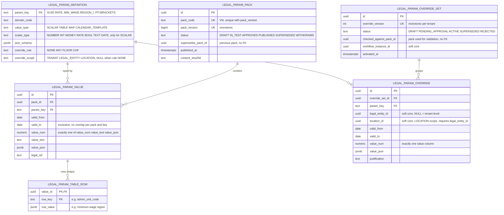

Quy tắc:

1. **Một pack là một snapshot lũy kế, bất biến.** Pack phiên bản *N* chứa **mọi** tham số kèm **toàn bộ lịch sử ngày hiệu lực** của nó: vài trăm khóa × vài khoảng thời gian, tức là nhỏ. "Giá trị của khóa K vào ngày D theo pack N" là một lần tra cứu duy nhất trong N. Các pack cũ vẫn truy vấn được mãi mãi, giúp tái lập được trong 10 năm mà không cần phát lại các delta. Trigger chặn mọi thay đổi khi pack đã ở trạng thái `PUBLISHED`.
2. Hình dạng giá trị: giá trị vô hướng trong `value_num` (hoặc `value_text`); giá trị có cấu trúc (biểu thuế TNCN lũy tiến, hệ số OT theo loại, lộ trình nghỉ hưu, `insurance.multi_contract_rule` theo từng loại bảo hiểm) trong `value_json`, được kiểm tra theo `definition.json_schema`. Do đó một cấu trúc biểu thuế TNCN mới **không cần thay đổi schema** (NFR-PAY-007). Các bảng ánh xạ lớn (đơn vị hành chính → vùng lương tối thiểu, khoảng 3,300 xã/phường sau đợt sắp xếp năm 2025) nằm trong `legal_param_table_row`. **Vùng lương tối thiểu không nằm trong Core** (review M1/M2): `core.legal_entity_version` và `core.location_version` chỉ giữ `admin_unit_code`; vùng được LPS phân giải từ mã đó.
3. **Publish** (vòng đời theo SA ADR-0010: `DRAFT → IN_TEST → APPROVED → PUBLISHED → SUPERSEDED`, cộng với `WITHDRAWN`): các pack đã publish tạo thành một thứ tự toàn phần theo `pack_code`. Chính xác một pack là *hiện hành*, và publish pack mới sẽ chuyển pack trước sang `SUPERSEDED` (nội dung không đổi, vẫn dùng để tái lập). Event `saas.LegalParameterPackPublished` (phiên bản pack, các khóa và ngày thay đổi) điều khiển việc vô hiệu hóa cache và phát hiện retro.
4. **Luật có hiệu lực hồi tố** (NFR-SAAS-016): pack sau có thể thay đổi giá trị cho các ngày trong quá khứ. Các kết quả đã duyệt giữ nguyên pack đã đóng dấu. Payroll so sánh pack đã đóng dấu với pack hiện hành cho các khóa và ngày bị ảnh hưởng, và đề xuất retro.
5. **Tenant override** chỉ được phép khi `override_rule <> NONE`, ở mức cụ thể nhất mà `override_scope` của định nghĩa cho phép (`TENANT`, `LEGAL_ENTITY` hoặc `LOCATION`; review M3). Một dòng override mức `LOCATION` mang `location_id` (soft `core.location`) và bắt buộc có `legal_entity_id` (`legal_param_override_loc_ck`); exclusion constraint khóa theo (set, khóa, pháp nhân, địa điểm, khoảng thời gian); trigger kiểm tra `override_rule` và mức scope tối đa của định nghĩa. Override vùng lương tối thiểu theo địa điểm (trước đây là `core.location_version.min_wage_region_override`, đã bỏ) nay là một override `LOCATION` ở đây:
   * `FLOOR`: giá trị của tenant phải ≥ giá trị luật định (ví dụ số ngày phép, mức lương tối thiểu dùng trong thang lương).
   * `CAP`: giá trị của tenant phải ≤ giá trị luật định (ví dụ trần OT nội bộ).
   * `ANY`: tự do lựa chọn (ví dụ phương pháp tính ngày công chuẩn mặc định).

   Việc kiểm tra chạy so với giá trị luật định **cho cùng các ngày** tại thời điểm kích hoạt, và chạy lại khi một pack mới được publish; vi phạm sẽ phát cảnh báo cho tenant admin và payroll SME. Các override được gom vào một `override_set` của tenant với `override_version` tăng đơn điệu, được phê duyệt qua workflow của Core và có audit. Các set đã kích hoạt là bất biến, và một thay đổi sẽ tạo ra phiên bản set mới.
6. **Đóng dấu phiên bản:** mọi phiên bản kết quả chấm công (`att.attendance_result.legal_pack_id` + `override_version`), lần chạy lương (`pay.payroll_run.legal_pack_id` + `legal_pack_version` + `override_version`), config snapshot của lần chạy, mô phỏng offer (`rec.offer.sim_legal_pack_id` + `sim_override_version`, review L7) và phép tính điều kiện tham gia bảo hiểm của People (`hr.insurance_participation.legal_pack_id` + `legal_pack_version`) đều lưu phiên bản pack và override. Lần chạy lương còn lưu `config_version` và `code_version` (NFR-SAAS-017).
7. DB dedicated nhận các pack đã publish qua replication. Pack là bảng toàn cục thuần túy không có `tenant_id`; override thuộc tenant.

Thứ tự phân giải tại thời điểm tính toán (ADR-0010: GLOBAL → TENANT → LEGAL_ENTITY → LOCATION, mức cụ thể hơn thắng) là: override của tenant theo địa điểm → override của tenant theo pháp nhân → override mức tenant → giá trị trong pack. Tập giá trị đã phân giải cho một lần chạy được đóng băng vào `pay.run_config_snapshot` (§7.5, §8).

---

## 7. Mô hình entity chính theo schema

Các sơ đồ được vẽ lại từ DDL v0.4 (nguồn chuẩn; khi sơ đồ và DDL khác nhau thì DDL đúng) và chỉ thể hiện các bảng và cột chính: PK, FK, khóa nghiệp vụ, cột trạng thái/loại kèm giá trị CHECK, cột ngày hiệu lực và các cột mà các bản sửa của vòng review nhắm tới. **Mọi bảng thuộc tenant còn có `tenant_id` là cột đầu tiên của PK** và các cột chuẩn (§4.3); `tenant_id` không được vẽ trên từng entity. Quy ước đường nối như ở §6: đường liền = FK thật trong cùng schema (FK ghép `(tenant_id, x_id)`), đường chấm (`..`) = tham chiếu trong cùng schema không có FK, tham chiếu sang schema khác chỉ là ghi chú cột `soft <schema>`; phía cha `|o` nghĩa là FK nullable. Entity Phase 2 được đánh dấu `P2` trong comment của dòng PK. Các schema lớn (`core`, `hr`, `att`, `pay`) được tách thành nhiều sơ đồ con; một entity đã vẽ ở sơ đồ con khác chỉ xuất hiện lại dưới dạng "stub" (chỉ dòng PK). DDL đã có cho **mọi** schema: `001_saas` … `006_rec` (xem `ddl/`); `rec` là module Phase 2 nhưng DDL đã được tạo để review.

### 7.1 `saas`

DDL `001_saas.sql`. Các bảng platform (`tenant`, `plan`, `plan_version`, `baseline_capability`, bảng pack) có PK `(id)` hoặc khóa tự nhiên; các bảng còn lại có `tenant_id` trong PK. `tenant_id` **không phải FK** (§2.2) — ngoại lệ duy nhất là `tenant_placement`, có FK tới `saas.tenant`; các quan hệ tới `TENANT` khác vì vậy được vẽ bằng đường chấm.

**Không có bảng credential, mật khẩu, MFA, session hay refresh token trong `saas`** (review H5): Keycloak là identity provider và sở hữu toàn bộ các dữ liệu đó trong database riêng của nó (SA ADR-0005; BR-SAAS-038/039/043). YourHRM chỉ giữ liên kết `core.user_account.identity_id` (Keycloak user id, soft) và dữ liệu phân quyền trong `core`.

Sơ đồ 7.1a — tenant, thương mại, tính phí:

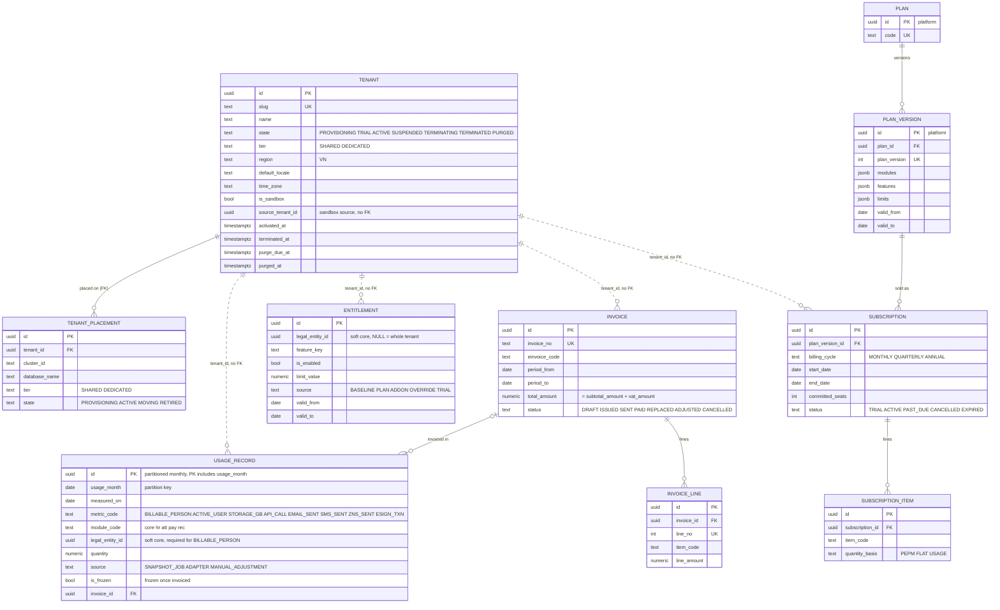

Sơ đồ 7.1b — keyring, quyền riêng tư, hỗ trợ, hàng đợi job:

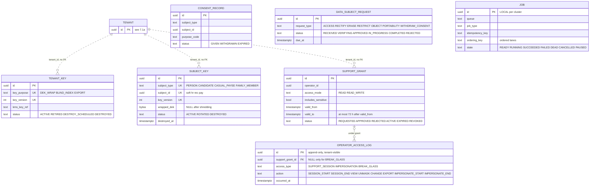

Ngoài ra trong `saas` (đều có trong DDL `001`): `baseline_capability` (bảng platform, được replicate; khóa `(feature_key, valid_from)`), `retention_policy (T)`, `archive_manifest (T)`, `platform_audit_event` (sentinel tenant, hash chain), cộng với các bảng tham số pháp lý (§6) và cặp `outbox_event`/`inbox_message` (§9.1). **Chưa có trong DDL v0.4** (sẽ thêm khi có BR tương ứng): `price_book`, `feature_flag`, `payment`, `operator_session` (hiện chỉ là soft id `operator_access_log.operator_session_id`), `security_incident`; **Phase 2:** `identity_provider_config (T)` (SSO, R2-04, BR-SAAS-041), `api_client (T)` (public API, BR-SAAS-056) — cả hai chỉ giữ tham chiếu tới object của Keycloak, không bao giờ giữ secret — và `webhook_subscription (T)` (R2-01). Bảng `mfa_factor`/`user_credential` của v0.3 **bị rút lại**: TOTP, OTP qua e-mail và mật khẩu do Keycloak quản lý. (Các bảng `import_batch`/`reconciliation_run` của v0.1 dành cho chương trình migrate từ Oracle đã bị bỏ; việc import khi go-live và đối soát của nó nằm trong `core.import_*`, §13.)

`saas.billing_party (T)` của v0.3 (định danh xuất hóa đơn của các pháp nhân thuộc tenant) **chưa có trong DDL v0.4**; định danh hóa đơn điện tử của pháp nhân hiện nằm ở `core.legal_entity_version.einvoice_identity`. Master data pháp nhân vẫn nằm ở Core (gap §5 #23).

**Đo lường sử dụng (D-10, BR-SAAS-012/013).** `saas.usage_record` được partition theo tháng trên `usage_month`; mỗi dòng là chỉ số × module × pháp nhân × ngày đo (`UNIQUE NULLS NOT DISTINCT`), và chỉ số `BILLABLE_PERSON` bắt buộc có `module_code` và `legal_entity_id`. Khi hóa đơn của tháng được phát hành, dòng được đóng băng (`is_frozen`, `frozen_at`, `invoice_id`); điều chỉnh sau đó là dòng `MANUAL_ADJUSTMENT` ở tháng kế tiếp (§11).

**Capability nền tảng luôn bật (R2-18, GAP-060; SA ADR-0003 quyết định 5).** `saas.baseline_capability` (bảng platform, được replicate) liệt kê các feature key mà mọi tenant đều có bất kể đã mua gì: `baseline.core` (Core), `baseline.people.master` (People cơ bản: person, employment, assignment, hồ sơ lương), `baseline.legal_params` (legal parameter pack qua LPS API), `baseline.pay.scales_bands` (thang/khung lương, gap §5 #7) và `baseline.att.excel_import` (import chấm công từ Excel, tạo ra một Attendance Result chuẩn). Entitlement resolver ghi một dòng `saas.entitlement` với `source = 'BASELINE'` cho mỗi tenant và mỗi key. `entitlement_baseline_ck` chỉ cho phép dòng BASELINE dưới dạng grant được bật trên toàn tenant, và `entitlement_period_ex` (một dòng cho mỗi tenant × feature × pháp nhân × khoảng thời gian) khi đó ngăn mọi dòng `OVERRIDE`/`PLAN` vô hiệu hóa nó trong cùng khoảng thời gian. Subscription của module thêm các dòng `PLAN`/`ADDON` cho đầy đủ tính năng của module.

### 7.2 `core`

DDL `002_core.sql` (cộng schema `audit`, §9.2). Bảng toàn cục (`admin_unit`, `permission`, `process_type`, `setting_definition`, …) không có `tenant_id`; mọi bảng còn lại có `tenant_id` trong PK. Bảng `[P2]` trong DDL được ghi `P2` ở dòng PK.

Sơ đồ 7.2a — tổ chức và master data:

```mermaid
erDiagram
  ADMIN_UNIT |o--o{ ADMIN_UNIT : "parent_code"
  ADMIN_UNIT |o--o{ LEGAL_ENTITY_VERSION : "admin_unit_code"
  ADMIN_UNIT |o--o{ LOCATION_VERSION : "admin_unit_code"
  LEGAL_ENTITY ||--o{ LEGAL_ENTITY_VERSION : "effective-dated"
  LEGAL_ENTITY ||--o{ LEGAL_ENTITY_BANK_ACCOUNT : "pays from"
  LEGAL_ENTITY ||--o{ LOCATION : "has"
  LOCATION ||--o{ LOCATION_VERSION : "effective-dated"
  LEGAL_ENTITY ||--o{ COST_CENTRE : "owns"
  ORG_UNIT ||--o{ ORG_UNIT_VERSION : "effective-dated"
  ORG_UNIT |o--o{ ORG_UNIT_VERSION : "parent_id"
  ORG_UNIT_TYPE ||--o{ ORG_UNIT_VERSION : "typed as"
  LEGAL_ENTITY ||--o{ ORG_UNIT_VERSION : "belongs to"
  LOCATION |o--o{ ORG_UNIT_VERSION : "located at"
  COST_CENTRE |o--o{ ORG_UNIT_VERSION : "charged to"
  JOB_FAMILY |o--o{ JOB_TITLE : "groups"
  GRADE_STRUCTURE ||--o{ GRADE : "levels"
  POSITION ||--o{ POSITION_VERSION : "effective-dated"
  POSITION |o--o{ POSITION_VERSION : "reports_to_position_id"
  ORG_UNIT ||--o{ POSITION_VERSION : "in"
  JOB_TITLE ||--o{ POSITION_VERSION : "of"
  LEGAL_ENTITY ||--o{ POSITION_VERSION : "employer"
  GRADE |o--o{ POSITION_VERSION : "grade_min_id, grade_max_id"
  ADMIN_UNIT {
    text admin_unit_code PK "global"
    text level "PROVINCE DISTRICT COMMUNE"
    text parent_code FK
    date valid_from
    date valid_to
    text replaced_by_code
  }
  LEGAL_ENTITY {
    uuid id PK
    text code UK
    text status "DRAFT ACTIVE DISSOLVED"
  }
  LEGAL_ENTITY_VERSION {
    uuid id PK
    uuid legal_entity_id FK
    date valid_from
    date valid_to
    text legal_name_vi
    text tax_code "10 or 13 digits"
    text si_unit_code
    text admin_unit_code FK "region resolved by LPS, no min_wage_region here"
    text tax_authority_code
    text pit_declaration_frequency "MONTHLY QUARTERLY"
    numeric oa_od_rate "BHTNLD-BNN rate, 0 to under 0.05"
    text oa_od_decision_ref
    jsonb einvoice_identity
  }
  LEGAL_ENTITY_BANK_ACCOUNT {
    uuid id PK
    uuid legal_entity_id FK
    text bank_code "global core.bank"
    bytea account_no_enc "P3"
    text purpose "SALARY SI TAX TRADE_UNION GENERAL"
    text status "ACTIVE INACTIVE"
  }
  LOCATION {
    uuid id PK
    uuid legal_entity_id FK
    text code UK
    text status "ACTIVE CLOSED"
  }
  LOCATION_VERSION {
    uuid id PK
    uuid location_id FK
    date valid_from
    date valid_to
    text location_type
    text admin_unit_code FK "no min_wage_region_override, see 6 rule 5"
    bool is_remote_area
    text time_zone
  }
  COST_CENTRE {
    uuid id PK
    uuid legal_entity_id FK
    text code UK
    date valid_from
    date valid_to
  }
  ORG_UNIT_TYPE {
    uuid id PK
    text code UK
  }
  ORG_UNIT {
    uuid id PK
    text code UK
  }
  ORG_UNIT_VERSION {
    uuid id PK
    uuid org_unit_id FK
    uuid parent_id FK
    ltree path "materialised, ends with org_unit_id"
    uuid org_unit_type_id FK
    uuid legal_entity_id FK
    uuid location_id FK
    uuid cost_centre_id FK
    uuid manager_position_id "no FK"
    uuid reorg_package_id FK "see 7.2d"
    text status "ACTIVE CLOSED"
    date valid_from
    date valid_to
  }
  JOB_FAMILY {
    uuid id PK
    text code UK
  }
  JOB_TITLE {
    uuid id PK
    uuid job_family_id FK
    text code UK
    text hazardous_category
  }
  GRADE_STRUCTURE {
    uuid id PK
    text code UK
  }
  GRADE {
    uuid id PK
    uuid grade_structure_id FK
    text code UK
    int rank_order
  }
  POSITION {
    uuid id PK
    text code UK
  }
  POSITION_VERSION {
    uuid id PK
    uuid position_id FK
    uuid org_unit_id FK
    uuid job_title_id FK
    uuid legal_entity_id FK
    uuid location_id FK
    uuid cost_centre_id FK
    uuid reports_to_position_id FK
    uuid grade_min_id FK
    uuid grade_max_id FK
    numeric fte_budget
    text status "PROPOSED ACTIVE FROZEN CLOSED"
    date valid_from
    date valid_to
  }
  EMPLOYEE_CATEGORY {
    uuid id PK
    text code UK
    bool is_probation
    bool is_expat
    bool counts_in_headcount
  }
```

Sơ đồ 7.2b — user, role, phân quyền:

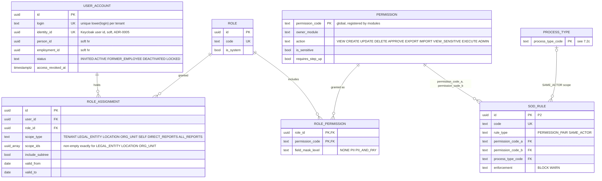

Sơ đồ 7.2c — workflow và thông báo:

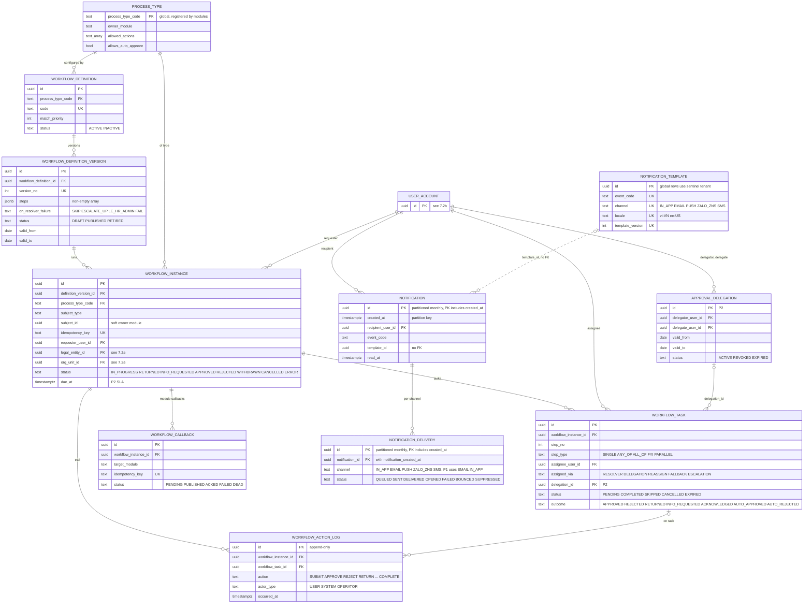

Sơ đồ 7.2d — tài liệu, thiết lập, đánh số, import/export, custom field, tái cơ cấu:

```mermaid
erDiagram
  DOCUMENT ||--o{ DOCUMENT_VERSION : "versions"
  DOCUMENT_TEMPLATE ||--o{ DOCUMENT_TEMPLATE_VERSION : "versions"
  DOCUMENT_TEMPLATE_VERSION |o--o{ DOCUMENT_VERSION : "generated from"
  SETTING_DEFINITION ||--o{ SETTING_VALUE : "values"
  SEQUENCE_DEFINITION ||--o{ SEQUENCE_COUNTER : "counters"
  IMPORT_JOB ||--o{ IMPORT_ROW : "staged rows"
  IMPORT_JOB ||--o{ IMPORT_RECONCILIATION : "checks"
  IMPORT_JOB |o--o{ IMPORT_JOB : "depends_on_job_id"
  DOCUMENT |o--o{ IMPORT_JOB : "uploaded file"
  DOCUMENT |o--o{ EXPORT_JOB : "result file"
  CUSTOM_FIELD_DEF ||--o{ CUSTOM_FIELD_VALUE : "values"
  REORG_PACKAGE ||--o{ REORG_CHANGE : "changes"
  REORG_PACKAGE ||--o{ REORG_MAPPING : "mappings"
  REORG_CHANGE |o--o{ REORG_MAPPING : "caused by"
  REORG_PACKAGE |o--o{ ORG_UNIT_VERSION : "activates"
  DOCUMENT {
    uuid id PK "metadata only, binary in object storage"
    text owner_module
    text owner_entity_type
    uuid owner_entity_id "soft owner module"
    uuid legal_entity_id FK
    text confidentiality "PUBLIC INTERNAL CONFIDENTIAL RESTRICTED"
    bool legal_hold
    int current_version_no
    text status "PENDING_SCAN ACTIVE QUARANTINED ARCHIVED PURGED"
  }
  DOCUMENT_VERSION {
    uuid id PK
    uuid document_id FK
    int version_no UK
    text object_key UK "prefixed by tenant_id"
    text sha256
    text source "UPLOAD GENERATED SIGNED IMPORT"
    uuid generated_from_template_version_id FK
    text scan_status "PENDING CLEAN INFECTED ERROR SKIPPED"
  }
  DOCUMENT_TEMPLATE {
    uuid id PK
    text code UK "unique with legal_entity_id"
    uuid legal_entity_id FK
    text status "ACTIVE INACTIVE"
  }
  DOCUMENT_TEMPLATE_VERSION {
    uuid id PK
    uuid document_template_id FK
    int version_no UK
    text source_format "DOCX HTML"
    text output_format "PDF DOCX"
    text status "DRAFT PUBLISHED RETIRED"
    date valid_from
    date valid_to
  }
  SETTING_DEFINITION {
    text setting_key PK "global"
    text value_type "BOOL INT DECIMAL TEXT ENUM DATE JSON"
    text_array allowed_levels "TENANT LEGAL_ENTITY LOCATION"
    bool is_effective_dated
  }
  SETTING_VALUE {
    uuid id PK
    text setting_key FK
    text scope_level "TENANT LEGAL_ENTITY LOCATION"
    uuid legal_entity_id FK
    uuid location_id FK
    jsonb value
    date valid_from
    date valid_to
  }
  SEQUENCE_DEFINITION {
    uuid id PK
    text code UK
    text scope_level "TENANT LEGAL_ENTITY"
    text reset_rule "NEVER YEARLY MONTHLY"
    bool is_gap_free
  }
  SEQUENCE_COUNTER {
    uuid id PK
    uuid sequence_definition_id FK
    uuid legal_entity_id FK
    text period_key UK "dash, YYYY or YYYY-MM"
    bigint current_value "row-locked, gap-free"
  }
  IMPORT_JOB {
    uuid id PK
    text import_type
    text owner_module
    text mode "STANDARD OPENING_BALANCE"
    date as_of_date "required for OPENING_BALANCE"
    uuid file_document_id FK
    uuid depends_on_job_id FK
    bytea wrapped_dek "per-job DEK"
    text status "UPLOADED PARSING PARSED VALIDATING VALIDATED RECONCILED SIGNED_OFF COMMITTING COMMITTED FAILED ROLLED_BACK CANCELLED PURGED"
    timestamptz signed_off_at
  }
  IMPORT_ROW {
    uuid id PK
    uuid import_job_id FK
    text sheet_name UK
    int row_no UK
    text business_key
    bytea payload_enc "P3, job DEK"
    text status "PARSED VALID WARNING ERROR COMMITTED SKIPPED"
  }
  IMPORT_RECONCILIATION {
    uuid id PK
    uuid import_job_id FK
    text check_code UK
    text grain_key UK
    numeric control_value
    numeric staged_value
    numeric committed_value
    text status "MATCHED MISMATCH WAIVED"
  }
  EXPORT_JOB {
    uuid id PK
    text export_type "TENANT_FULL MODULE_DATASET AUDIT_LOG DSR_ACCESS LIST"
    uuid requested_by FK "see 7.2b"
    uuid result_document_id FK
    text encryption_mode "TENANT_KEY CUSTOMER_KEY PASSWORD"
    text status "QUEUED RUNNING SUCCEEDED FAILED CANCELLED EXPIRED"
  }
  CUSTOM_FIELD_DEF {
    uuid id PK "P2"
    text target_schema UK "core hr att pay rec"
    text target_table UK
    text field_code UK
    text data_type "TEXT NUMBER DATE BOOL CODE"
    text pii_class "P0 P1 P2 P3"
  }
  CUSTOM_FIELD_VALUE {
    uuid id PK "P2"
    uuid custom_field_def_id FK "with target_schema, target_table"
    uuid target_id "soft target table"
    bytea value_enc "for P3 fields"
  }
  REORG_PACKAGE {
    uuid id PK "P2"
    text code UK
    date effective_date
    bool is_retro
    text status "DRAFT PENDING_APPROVAL APPROVED SCHEDULED ACTIVATING ACTIVE ACTIVATED_WITH_ERRORS REJECTED CANCELLED"
  }
  REORG_CHANGE {
    uuid id PK "P2"
    uuid reorg_package_id FK
    int seq_no UK
    text change_type "CREATE RENAME MOVE MERGE SPLIT DISSOLVE CHANGE_MANAGER CHANGE_COST_CENTRE CHANGE_ATTRIBUTES"
    uuid org_unit_id FK "see 7.2a"
  }
  REORG_MAPPING {
    uuid id PK "P2"
    uuid reorg_package_id FK
    uuid reorg_change_id FK
    text mapping_type "POSITION EMPLOYEE"
    uuid employment_id "soft hr"
    uuid to_org_unit_id FK "see 7.2a"
    text status "PROPOSED CONFIRMED APPLIED FAILED"
  }
  ORG_UNIT_VERSION {
    uuid id PK "see 7.2a"
  }
```

Toàn cục (không có `tenant_id`): `country`, `currency`, `admin_unit` (với `valid_from/valid_to`, `replaced_by_code`; mô hình hai cấp từ 2025, đơn vị ba cấp cũ được giữ kèm `valid_to`), `admin_unit_mapping` (cũ→mới, `MERGE/SPLIT/RENAME/RECODE`), `bank`, `bank_branch`, `code_list`, `permission`, `process_type`, `setting_definition`. `code_value`, `exchange_rate` và `notification_template` là loại "toàn cục + tenant override" (dòng toàn cục dùng sentinel tenant, §3.5; tỷ giá tham chiếu toàn cục VCB/SBV, tenant có thể thêm dòng riêng).

Ngoài ra trong `core`: `company_group` (một dòng cho mỗi tenant), cặp `outbox_event`/`inbox_message` (§9.1), và trong schema `audit`: `audit_event`, `chain_head`, `chain_anchor` (§9.2). **Lịch ngày làm việc/ngày lễ không nằm trong Core**: T&A sở hữu lịch (`att.holiday_calendar`, §7.4). Liên kết danh tính: `core.user_account.identity_id` là id user của Keycloak (soft, `UNIQUE` khi khác NULL); `person_id` và `employment_id` là soft reference tới `hr` (review M5). `role_assignment.scope_type` nhận đúng các giá trị `TENANT`, `LEGAL_ENTITY`, `LOCATION`, `ORG_UNIT`, `SELF`, `DIRECT_REPORTS`, `ALL_REPORTS`, và `scope_ids` không rỗng khi và chỉ khi scope là `LEGAL_ENTITY`/`LOCATION`/`ORG_UNIT` (review M4). Các bảng `custom_field_*`, `reorg_*`, `sod_rule` và `approval_delegation` là P2 (có schema, chưa dùng ở Phase 1); các cột SLA/escalation của workflow là nullable và thuộc P2.

### 7.3 `hr`

DDL `003_hr.sql`. Mọi bảng có `tenant_id` trong PK. Tham chiếu sang `core` (`legal_entity_id`, `org_unit_id`, `position_id`, `location_id`, …), `pay` và `saas.legal_param_pack` đều là soft. Bảng có comment `-- P2` trong DDL được ghi `P2` ở dòng PK.

Sơ đồ 7.3a — person và dữ liệu cá nhân:

```mermaid
erDiagram
  PERSON ||--o{ PERSON_IDENTITY_DOC : "extra documents"
  PERSON ||--o{ PERSON_ADDRESS : "lives at"
  PERSON ||--o{ PERSON_CONTACT : "reachable at"
  PERSON ||--o{ TAX_RESIDENCY : "PIT residency"
  PERSON ||--o{ VN_PRESENCE_PERIOD : "in Vietnam"
  DECISION |o--o{ TAX_RESIDENCY : "decision_id"
  PERSON ||--o{ EDUCATION_QUALIFICATION : "qualified"
  PERSON ||--o{ FAMILY_MEMBER : "has"
  PERSON ||--o{ EMERGENCY_CONTACT : "contacts"
  FAMILY_MEMBER |o--o{ EMERGENCY_CONTACT : "is"
  PERSON ||--o{ BANK_ACCOUNT : "owns"
  PERSON {
    uuid id PK
    text full_name
    date birth_date
    text gender_code
    text nationality_code
    bytea ethnicity_enc "P3"
    bytea religion_enc "P3"
    text national_id_type "CCCD CMND PASSPORT, current national id stays here"
    bytea national_id_enc "P3"
    bytea national_id_bidx
    bytea tax_code_enc "P3"
    bytea si_number_enc "P3"
    bytea hi_card_no_enc "P3"
    text si_book_custody "EMPLOYER EMPLOYEE RETURNED"
    text verification_status "UNVERIFIED VERIFIED VNEID_VERIFIED MISMATCH"
    text source "APP OPENING_LOAD REC_HANDOFF IMPORT"
  }
  PERSON_IDENTITY_DOC {
    uuid id PK
    uuid person_id FK
    text doc_type "PASSPORT WORK_VISA TEMP_RESIDENCE_CARD PERMANENT_RESIDENCE_CARD OLD_CMND OLD_CCCD OTHER"
    bytea doc_no_enc "P3"
    bytea doc_no_bidx "unique per live document"
    text doc_no_last4
    text issuing_country_code
    date issue_date
    date expiry_date
    text status "ACTIVE EXPIRED REVOKED SUPERSEDED"
  }
  PERSON_ADDRESS {
    uuid id PK
    uuid person_id FK
    text address_type "PERMANENT CURRENT TEMPORARY HOMETOWN BIRTH_PLACE"
    text province_code "global core.admin_unit"
    text commune_code "global core.admin_unit"
    text legacy_district_code "pre-2025 three-level"
    text mapping_status "NOT_NEEDED MAPPED UNMAPPED"
    date valid_from
    date valid_to
  }
  PERSON_CONTACT {
    uuid id PK
    uuid person_id FK
    text contact_type "MOBILE HOME_PHONE PERSONAL_EMAIL WORK_EMAIL WORK_PHONE OTHER"
    text contact_value
    bool is_primary
  }
  TAX_RESIDENCY {
    uuid id PK
    uuid person_id FK
    text status "RESIDENT NON_RESIDENT"
    text basis "DAYS_183 MONTHS_12 PERMANENT_RESIDENCE LEASE_183 NOT_MET TREATY_TIE_BREAKER"
    date valid_from
    date valid_to "no overlap among APPROVED rows"
    date arrival_date
    date departure_date
    smallint days_in_vn
    text source "APP PAYROLL_PROPOSAL OPENING_LOAD IMPORT"
    text approval_status "DRAFT PENDING_APPROVAL APPROVED REJECTED CANCELLED"
    uuid decision_id FK
  }
  VN_PRESENCE_PERIOD {
    uuid id PK
    uuid person_id FK
    date entry_date
    date exit_date "no overlap per person"
    uuid evidence_document_id "soft core"
  }
  EDUCATION_QUALIFICATION {
    uuid id PK
    uuid person_id FK
    text qualification_level_code
    bool is_highest
  }
  FAMILY_MEMBER {
    uuid id PK
    uuid person_id FK
    text relationship_code
    text full_name
    bytea national_id_enc "P3"
    bytea tax_code_enc "P3"
    bool is_disabled
  }
  EMERGENCY_CONTACT {
    uuid id PK
    uuid person_id FK
    uuid family_member_id FK
    smallint priority UK "1 to 9 per person"
    text phone
  }
  BANK_ACCOUNT {
    uuid id PK
    uuid person_id FK
    text bank_code "global core.bank"
    bytea account_no_enc "P3"
    bytea account_no_bidx
    text account_no_last4
    text split_type "REMAINDER PERCENT FIXED"
    date valid_from
    date valid_to
    text status "PENDING_VERIFICATION ACTIVE REJECTED CLOSED"
  }
  DECISION {
    uuid id PK "see 7.3c"
  }
```

Sơ đồ 7.3b — employment, employment chính, tham gia bảo hiểm, người phụ thuộc:

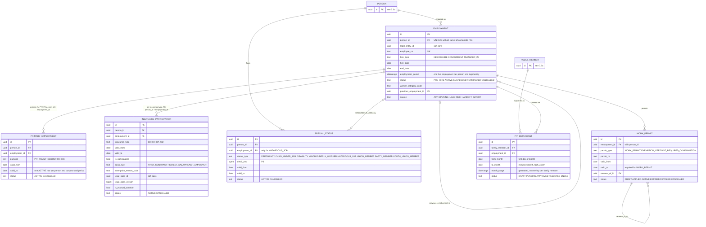

Sơ đồ 7.3c — phân công, hồ sơ lương, hợp đồng, quyết định:

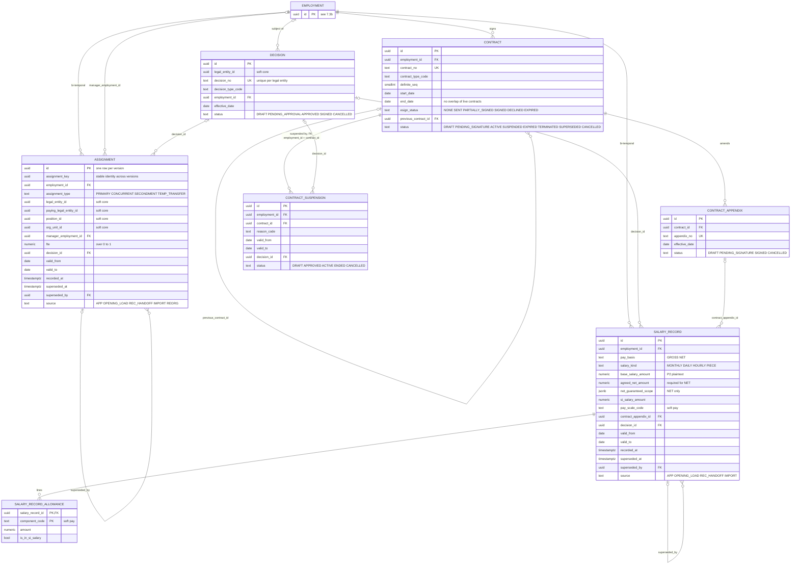

Sơ đồ 7.3d — nghỉ việc, tài liệu, báo cáo pháp định và các bảng P2:

```mermaid
erDiagram
  EMPLOYMENT ||--o{ SEPARATION : "one live row"
  DECISION |o--o{ SEPARATION : "decision_id"
  SEPARATION ||--o{ SEPARATION_SERVICE_PERIOD : "service periods"
  EMPLOYMENT |o--o{ SEPARATION_SERVICE_PERIOD : "source_employment_id"
  PERSON ||--o{ HR_DOCUMENT : "file of"
  EMPLOYMENT |o--o{ HR_DOCUMENT : "for employment"
  HR_DOCUMENT |o--o{ HR_DOCUMENT : "superseded_by_id"
  EMPLOYMENT ||--o{ DISCIPLINE_CASE : "P2"
  EMPLOYMENT ||--o{ REWARD : "P2"
  EMPLOYMENT ||--o{ APPRAISAL : "P2"
  PERSON ||--o{ CERTIFICATE : "P2"
  PERSON ||--o{ TRAINING_RECORD : "P2"
  CERTIFICATE |o--o{ TRAINING_RECORD : "certificate_id"
  CHECKLIST_TEMPLATE |o--o{ CHECKLIST : "template_id"
  EMPLOYMENT ||--o{ CHECKLIST : "P2"
  SEPARATION |o--o{ CHECKLIST : "offboarding"
  CHECKLIST ||--o{ CHECKLIST_TASK : "tasks"
  PERSON {
    uuid id PK "see 7.3a"
  }
  EMPLOYMENT {
    uuid id PK "see 7.3b"
  }
  DECISION {
    uuid id PK "see 7.3c"
  }
  SEPARATION {
    uuid id PK
    uuid employment_id FK
    text separation_type "RESIGNATION CONTRACT_EXPIRY MUTUAL_AGREEMENT EMPLOYEE_UNILATERAL EMPLOYER_UNILATERAL REDUNDANCY DISMISSAL PROBATION_FAILED RETIREMENT DEATH MISSING_DECLARED ENTITY_CLOSURE OTHER"
    text initiated_by "EMPLOYEE EMPLOYER MUTUAL AUTOMATIC"
    date notice_date
    smallint required_notice_days
    date last_working_date
    date termination_date
    date access_revocation_date
    text severance_type "NONE SEVERANCE_ALLOWANCE JOB_LOSS_ALLOWANCE"
    bool is_protected
    uuid payroll_result_ref "soft pay"
    uuid workflow_instance_id "soft core"
    text status "DRAFT SUBMITTED APPROVED SCHEDULED COMPLETED WITHDRAWN REJECTED CANCELLED"
  }
  SEPARATION_SERVICE_PERIOD {
    uuid id PK
    uuid separation_id FK
    text period_kind "WORKED RECOGNISED_PRIOR PAID_SEVERANCE PAID_JOB_LOSS EXCLUDED"
    date period_from
    date period_to
    uuid source_employment_id FK
  }
  HR_DOCUMENT {
    uuid id PK "metadata, binary in core document service"
    uuid person_id FK
    uuid employment_id FK
    text category_code
    uuid document_id "soft core"
    text confidentiality "INTERNAL CONFIDENTIAL RESTRICTED"
    uuid superseded_by_id FK
    text status "ACTIVE SUPERSEDED WITHDRAWN PURGED"
  }
  STATUTORY_REPORT {
    uuid id PK "submission log"
    uuid legal_entity_id "soft core"
    text report_type "LABOUR_BOOK_EXPORT LABOUR_CHANGE_6M LABOUR_FLUCTUATION_MONTHLY FOREIGN_WORKER INITIAL_DECLARATION"
    date period_start
    date period_end
    text status "DRAFT GENERATED SUBMITTED ACKNOWLEDGED CANCELLED"
  }
  DISCIPLINE_CASE {
    uuid id PK "P2"
    uuid employment_id FK
    text sanction_code "REPRIMAND EXTEND_RAISE DEMOTION DISMISSAL"
    text status "OPEN HEARING DECIDED EXPUNGED CLOSED CANCELLED"
  }
  REWARD {
    uuid id PK "P2"
    uuid employment_id FK
    text reward_type "CASH CERTIFICATE TITLE IN_KIND"
    text status "DRAFT PENDING_APPROVAL APPROVED PAID CANCELLED"
  }
  APPRAISAL {
    uuid id PK "P2"
    uuid employment_id FK
    text cycle_code UK
    text appraisal_type "PROBATION ANNUAL SEMI_ANNUAL QUARTERLY MONTHLY_KPI"
    text status "DRAFT SELF_REVIEW MANAGER_REVIEW CALIBRATION FINALISED CANCELLED"
  }
  CERTIFICATE {
    uuid id PK "P2"
    uuid person_id FK
    text certificate_type_code
    date expiry_date
  }
  TRAINING_RECORD {
    uuid id PK "P2"
    uuid person_id FK
    uuid certificate_id FK
    date bond_end_date
  }
  CHECKLIST_TEMPLATE {
    uuid id PK "P2"
    text event_type "ONBOARDING OFFBOARDING TRANSFER"
  }
  CHECKLIST {
    uuid id PK "P2"
    uuid employment_id FK
    uuid template_id FK
    uuid separation_id FK
    text status "OPEN COMPLETED CANCELLED"
  }
  CHECKLIST_TASK {
    uuid id PK "P2"
    uuid checklist_id FK
    smallint seq UK
    text status "OPEN DONE WAIVED CANCELLED"
  }
```

Ngoài ra: các view `hr.v_labour_book` (sổ quản lý lao động, BR-PPL-140) và `hr.v_labour_movement` (BR-PPL-141/142), các masking view `hr.v_person_masked`, `hr.v_person_identity_doc_masked`, `hr.v_bank_account_masked`, `hr.v_special_status_masked`, `hr.v_salary_record_masked`, `hr.v_salary_record_allowance_masked` (hai view lương fail closed với số tiền, §9.4), cặp `outbox_event`/`inbox_message`. `hr.emergency_contact` được tạo dù BR-PPL-018 là P2 (rẻ, tránh trường văn bản tự do). `hr.hr_document` chỉ giữ metadata; file nằm trong document service của Core. Số định danh quốc gia hiện hành (CCCD, hoặc hộ chiếu với người nước ngoài) **vẫn nằm trên `hr.person`**; `hr.person_identity_doc` chỉ chứa giấy tờ bổ sung (hộ chiếu, thị thực lao động, thẻ tạm trú/thường trú, CMND/CCCD cũ để đối chiếu BHXH/thuế), P3 (review L3). Tôn giáo và dân tộc là `religion_enc`/`ethnicity_enc` (P3, review L2).

Tài khoản ngân hàng thuộc về **person**, không thuộc employment, nên một tài khoản có thể phục vụ nhiều employment đồng thời. Payroll chọn tài khoản qua projection `pay.ext_hr_bank_split`.

**Cư trú thuế TNCN (review H2, BR-PPL-023).** `hr.tax_residency` là Pattern A theo person: `RESIDENT` (căn cứ `DAYS_183`, `MONTHS_12`, `PERMANENT_RESIDENCE`, `LEASE_183`) hoặc `NON_RESIDENT` (`NOT_MET`, `TREATY_TIE_BREAKER`), kèm ngày đến/đi, số ngày có mặt tại VN, tài liệu chứng minh và trạng thái phê duyệt; chỉ các dòng `APPROVED` không được chồng lấn. Payroll có thể đề xuất (`source = 'PAYROLL_PROPOSAL'`, từ `pay.residency_check`) nhưng People phê duyệt. `hr.vn_presence_period` ghi các lần nhập/xuất cảnh (không chồng lấn theo person) làm đầu vào cho phép đếm 183 ngày.

**Làm việc đồng thời tại nhiều pháp nhân (R2-16, GAP-031, BR-PPL-002/004; Phase 1, mức cơ bản).** Mỗi cá nhân thực có một `hr.person` trong mỗi tenant; mỗi quan hệ làm việc với một pháp nhân là một `hr.employment`. Mô hình dữ liệu hỗ trợ như sau:

| Quy tắc | Nơi thực thi |
|---|---|
| Tại một thời điểm, một người có tối đa một employment đang hiệu lực cho mỗi pháp nhân (làm thêm việc trong cùng pháp nhân = một assignment `CONCURRENT`) | `employment_person_le_ex` (exclusion constraint, `003_hr.sql`) |
| **Mỗi người tối đa một employment chính về thuế TNCN trong mỗi khoảng thời gian** — mục đích duy nhất là `PIT_FAMILY_DEDUCTION` (đơn vị sử dụng lao động áp dụng giảm trừ bản thân và người phụ thuộc; review H1) | `hr.primary_employment` + `primary_employment_ex`; FK ghép `(tenant_id, person_id, employment_id)` đảm bảo employment được chỉ định thuộc về chính người đó |
| **Tham gia BHXH/BHYT/BHTN/BHTNLĐ-BNN theo từng loại bảo hiểm** — kết quả áp dụng tham số pháp lý `insurance.multi_contract_rule` (R3-03) cho từng employment: `insurance_type` `SI`/`HI`/`UI`/`OA_OD`, `basis_rule` `FIRST_CONTRACT`/`HIGHEST_SALARY`/`EACH_EMPLOYER`, lý do miễn, phiên bản pack đã dùng | `hr.insurance_participation` (Pattern A): `insurance_participation_period_ex` (không chồng lấn theo employment × loại) và `insurance_participation_single_ex` (tối đa một employment tham gia cho mỗi người × loại khi quy tắc là `FIRST_CONTRACT`/`HIGHEST_SALARY`) `[verify-legal]` |
| Employment chính có thể thay đổi trong khi cả hai employment vẫn tiếp tục (ví dụ employment chính kết thúc, hoặc nhân viên đăng ký lại thuế TNCN) | `hr.primary_employment` là valid-time (Pattern A, §5.1): đóng dòng cũ, mở dòng mới; lịch sử được giữ lại |
| Người chỉ có một employment đang hiệu lực thì không cần dòng `primary_employment`; có từ hai trở lên thì mục đích `PIT_FAMILY_DEDUCTION` phải được chỉ định cho mọi ngày, và mỗi employment phải có dòng `insurance_participation` cho từng loại bảo hiểm | People service khi tuyển dụng/chấm dứt + job kiểm tra nhất quán hằng đêm (quy tắc liên dòng, không phải constraint) |
| Người phụ thuộc chỉ được đăng ký giảm trừ qua employment chính về thuế TNCN | `pit_dependant_claim_ex` (mỗi người phụ thuộc một lần đăng ký mỗi tháng) + quy tắc của People service trên `pit_dependant.employment_id` |
| Mỗi pháp nhân khấu trừ thuế TNCN trên khoản chi trả của chính mình; chỉ employment chính về thuế TNCN áp dụng giảm trừ gia cảnh; đóng và kê khai bảo hiểm theo `hr.insurance_participation` của từng loại | Payroll (đọc từ event/API của People vào `pay.employee_pay_profile.primary_purposes` và `pay.ext_hr_insurance_participation`; ghi `pay.si_contribution` theo từng `insurance_type`, §7.5) |
| Trần OT năm tính gộp giữa các pháp nhân | **Phase 2** (R2-08); trần OT ở Phase 1 tính theo từng employment (`att.ot_cap_ledger.cap_scope = 'LEGAL_ENTITY'`) |

Cờ boolean `hr.employment.is_primary` của v0.2 bị rút lại ở v0.3 vì nó không thể biểu diễn việc đổi employment chính trong khi cả hai employment vẫn tiếp tục. Mục đích `SOCIAL_INSURANCE` của `hr.primary_employment` trong v0.3 bị **rút lại ở v0.4** (H1): một "employment chính về BHXH" duy nhất không biểu diễn được quy tắc nhiều hợp đồng theo từng loại bảo hiểm của Luật BHXH 2024, nên nay là `hr.insurance_participation`. Event: các thay đổi chỉ định do People publish; tên event (đề xuất `people.PrimaryEmploymentChanged`, `people.InsuranceParticipationChanged`) cần được Integration analyst bổ sung vào danh mục gap §6.

### 7.4 `att`

DDL `004_att.sql`. Mọi bảng có `tenant_id` trong PK (bảng partition: PK còn gồm khóa partition). Tham chiếu tới `hr` (`employment_id`, `person_id`, `assignment_key`), `core` (`legal_entity_id`, `org_unit_id`, `location_id`), `pay` (`pay_group_id`, `payroll_run_id`) và `core.import_job` đều là soft. **Data scope (review M9):** các dòng gắn với nhân viên có khối lượng lớn (`raw_punch`, `daily_timesheet`, `timesheet_correction`, `overtime_request`, `overtime_result`, `leave_request`, `leave_balance_ledger`, `attendance_result_line`, cùng `business_trip`/`remote_work_request` P2) mang `legal_entity_id` + `org_unit_id` được phi chuẩn hóa tại ngày của dòng, với index `(tenant_id, org_unit_id, <ngày>)` (§5.3); `ot_cap_ledger` chỉ mang `legal_entity_id`.

Sơ đồ 7.4a — lịch, ca, mẫu lịch, thiết bị:

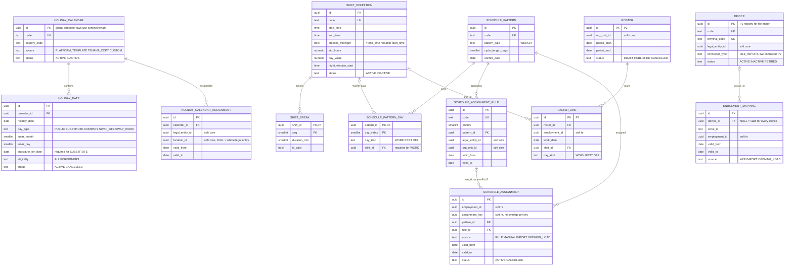

Sơ đồ 7.4b — lượt chấm công, bảng công ngày, làm thêm giờ:

```mermaid
erDiagram
  DEVICE |o..o{ RAW_PUNCH : "device_id, no FK (partitioned)"
  SHIFT_DEFINITION |o--o{ DAILY_TIMESHEET : "shift_id"
  DAILY_TIMESHEET |o..o{ TIMESHEET_CORRECTION : "daily_timesheet_id, no FK"
  OVERTIME_REQUEST |o--o{ OVERTIME_RESULT : "overtime_request_id"
  DEVICE {
    uuid id PK "see 7.4a"
  }
  SHIFT_DEFINITION {
    uuid id PK "see 7.4a"
  }
  RAW_PUNCH {
    uuid id PK "append-only, monthly partitions, PK includes work_date_hint"
    date work_date_hint "partition key = local_ts date"
    timestamptz punch_at
    timestamp local_ts
    text tz_name
    text source "IMPORT only in P1, DEVICE MOBILE WEB in P2"
    uuid device_id
    text terminal_code
    text enrol_id
    text direction "IN OUT UNKNOWN"
    text dedup_key UK "unique with work_date_hint"
    uuid import_job_id "soft core, required for IMPORT"
    uuid employment_id "soft hr, set when matched"
    uuid legal_entity_id "soft core, M9"
    uuid org_unit_id "soft core, M9"
    text validation_status "PENDING VALID QUARANTINED_UNMAPPED QUARANTINED_EXPIRED QUARANTINED_UNKNOWN_DEVICE IGNORED"
    bytea geo_enc "P2 only, P3, empty in P1"
  }
  ATTENDANCE_CODE {
    uuid id PK
    text code UK
    text code_kind "WORK LEAVE HOLIDAY TRIP WFH ABSENCE REST NOT_EMPLOYED SUSPENDED"
    text payroll_category
    text paid_by "EMPLOYER SI_FUND UNPAID NONE"
  }
  DAILY_TIMESHEET {
    uuid id PK "monthly partitions, PK includes work_date"
    uuid employment_id UK "soft hr, unique with work_date"
    date work_date UK "partition key"
    uuid legal_entity_id "soft core, M9"
    uuid org_unit_id "soft core, M9"
    uuid period_id "attendance period, no FK"
    uuid shift_id FK
    text day_type "WORKDAY REST_DAY PUBLIC_HOLIDAY SUBSTITUTE_HOLIDAY COMPANY_HOLIDAY"
    text day_status "SCHEDULED PRESENT PARTIAL ABSENT ON_LEAVE HOLIDAY REST INCOMPLETE NOT_EMPLOYED SUSPENDED"
    numeric worked_hours
    int late_min
    numeric night_hours
    int ot_candidate_min
    numeric day_value
    int calc_version
    uuid legal_pack_id "soft saas"
  }
  TIMESHEET_CORRECTION {
    uuid id PK
    uuid employment_id "soft hr"
    date work_date
    uuid daily_timesheet_id
    uuid legal_entity_id "soft core, M9"
    uuid org_unit_id "soft core, M9"
    text correction_type "MISSING_PUNCH WRONG_TIME FORGOT_CHECKIN CLIENT_SITE CODE_CHANGE ADMIN_EDIT"
    text source "ESS MSS ADMIN BULK IMPORT"
    text status "DRAFT PENDING APPROVED REJECTED CANCELLED APPLIED"
  }
  OVERTIME_REQUEST {
    uuid id PK
    uuid employment_id "soft hr"
    uuid legal_entity_id "soft core, M9"
    uuid org_unit_id "soft core, M9"
    date work_date
    int planned_minutes
    text source "PRE_APPROVAL DETECTED"
    text comp_choice "PAY"
    bool employee_consent "required for PENDING APPROVED"
    text status "DRAFT PENDING APPROVED REJECTED CANCELLED"
  }
  OVERTIME_RESULT {
    uuid id PK
    uuid employment_id UK "soft hr"
    date work_date UK
    text ot_category UK "OT-WD OT-RD OT-PH OT-WD-N OT-RD-N OT-PH-N"
    uuid legal_entity_id "soft core, M9"
    uuid org_unit_id "soft core, M9"
    int approved_minutes
    int paid_minutes
    uuid overtime_request_id FK
  }
  OT_CAP_LEDGER {
    uuid id PK
    uuid employment_id UK "soft hr"
    text period_kind UK "MONTH YEAR"
    date period_start UK
    uuid legal_entity_id "soft core"
    text cap_scope "LEGAL_ENTITY, cross-entity cap P2"
    text regime_code "STANDARD_200 EXTENDED_300"
    int cap_min
    int approved_min
  }
  EXT_HR_EMPLOYMENT {
    uuid employment_id PK "D5 projection, soft hr"
    uuid person_id "soft hr"
    uuid legal_entity_id "soft core"
    date hire_date
    date seniority_date
    date probation_end_date
    date last_working_date
    date termination_date "required when TERMINATED"
    text status "PRE_HIRE ACTIVE SUSPENDED TERMINATED CANCELLED"
    text worker_category_code
    uuid source_event_id
    bigint source_version
  }
  EXT_HR_SPECIAL_STATUS {
    uuid id PK "D5 projection"
    uuid source_record_id UK "hr.special_status id, soft"
    uuid person_id "soft hr"
    uuid employment_id "soft hr, only HAZARDOUS_JOB"
    text protection_type "PREGNANCY CHILD_UNDER_12M DISABILITY MINOR ELDERLY_WORKER HAZARDOUS_JOB, P2 pending DPO"
    date valid_from
    date valid_to "no overlap per scope and type"
  }
```

Sơ đồ 7.4c — nghỉ phép, công tác, làm việc từ xa:

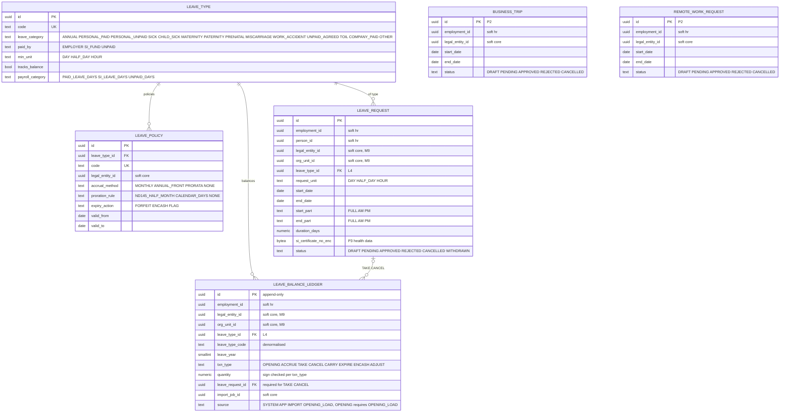

Sơ đồ 7.4d — kỳ chấm công, Attendance Result bất biến, close hold:

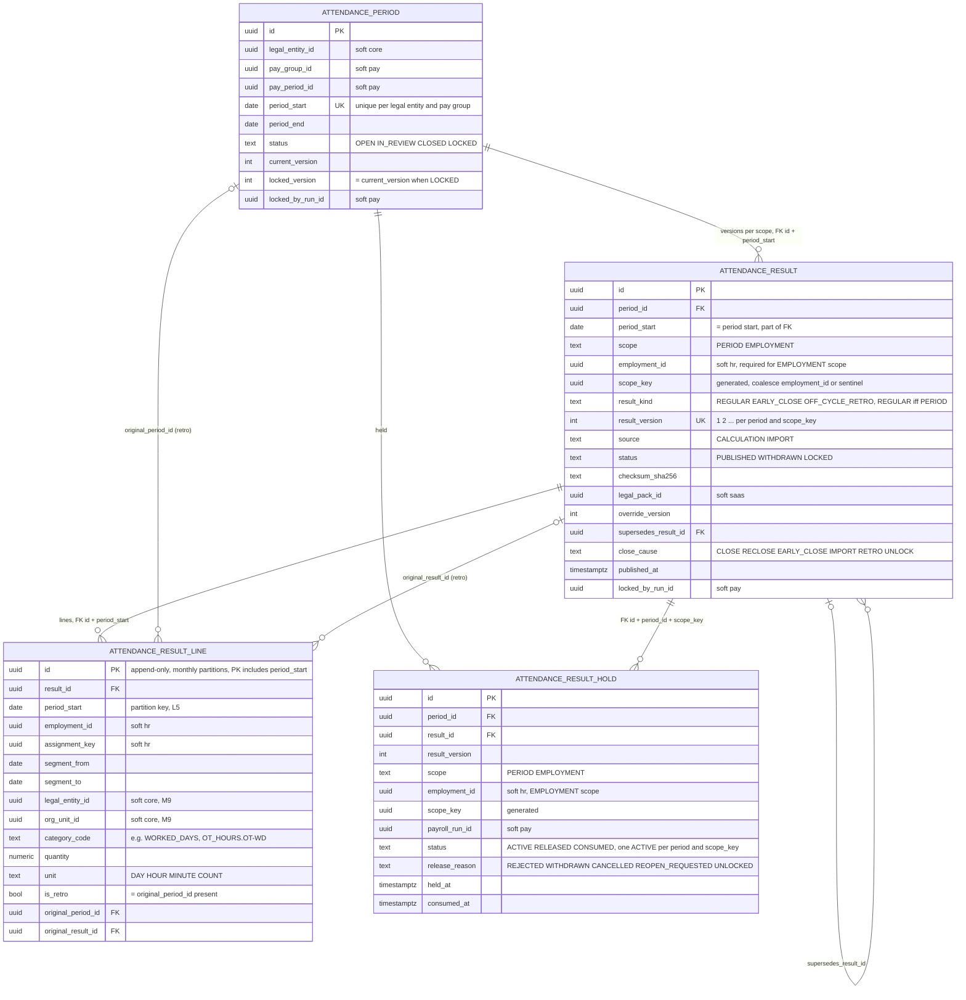

Quy tắc chính:

* `raw_punch` là append-only, được range-partition theo `work_date_hint` (theo tháng; `work_date_hint = local_ts::date`), và loại trùng bằng `UNIQUE (tenant_id, dedup_key, work_date_hint)` với `dedup_key = hash(terminal_code|enrol_id|punch_at)` (NFR-ATT-001). Việc tiếp nhận là một batch `INSERT … ON CONFLICT DO NOTHING`: ở Phase 1 từ bước commit import của một file xuất từ máy chấm công (mỗi chunk của import job là một chunk, `import_job_id` + `import_row_no` được giữ trên dòng), ở Phase 2 còn từ consumer của punch stream. Dòng chưa khớp được nhân viên nằm ở trạng thái `QUARANTINED_*` và khi đó không có `employment_id`/`legal_entity_id`/`org_unit_id`.
* `daily_timesheet` có thể thay đổi cho đến khi kỳ của nó ở trạng thái LOCKED. Nó được partition theo tháng theo `work_date` với `fillfactor = 80` để tận dụng HOT update, và duy nhất theo `(tenant_id, employment_id, work_date)`. Nó được tính lại thay vì sửa, và `calc_version` tăng lên sau mỗi lần tính lại.
* **Kết quả chấm công là bất biến.** Phạm vi của một Attendance Result là `scope = 'PERIOD'` (cả kỳ, `result_kind = 'REGULAR'`) hoặc `scope = 'EMPLOYMENT'` (một employment, dùng cho chốt sớm người nghỉ việc `EARLY_CLOSE` và kết quả retro off-cycle `OFF_CYCLE_RETRO`; review H3, R3-06, BR-ATT-075). `result_version` tăng theo (kỳ × `scope_key`, trong đó `scope_key = coalesce(employment_id, sentinel)`). Khóa lại kỳ sẽ tạo `result_version + 1`, và phiên bản trước chuyển sang `WITHDRAWN`; `attendance_result_live_uq` cho phép tối đa một phiên bản PUBLISHED/LOCKED (không tính OFF_CYCLE_RETRO) cho mỗi kỳ × scope.
* **Close hold** (SA ADR-0019, X-03): `att.attendance_result_hold (tenant_id, id, period_id, result_id, result_version, scope PERIOD|EMPLOYMENT, employment_id, scope_key, payroll_run_id, status ACTIVE/RELEASED/CONSUMED, held_at, released_at, release_reason, consumed_at)`. FK ghép `(tenant_id, result_id, period_id, scope_key)` buộc hold trỏ đúng kết quả của đúng kỳ và scope. Partial unique index `attendance_result_hold_active_uq` trên `(tenant_id, period_id, coalesce(employment_id, sentinel)) WHERE status = 'ACTIVE'`: **tối đa một hold ACTIVE cho mỗi kỳ × scope** — một hold mức kỳ, hoặc một hold cho mỗi employment khi chốt sớm người nghỉ việc (H3). Payroll giành hold khi submit qua T&A API chạy in-process. Thao tác mở lại kỳ kiểm tra hold ACTIVE trong cùng transaction (`SELECT … FOR UPDATE` trên dòng kỳ) và bị từ chối khi đang có hold. Hold không bao giờ hết hạn; nó chỉ được giải phóng (`REJECTED`, `WITHDRAWN`, `CANCELLED`, `REOPEN_REQUESTED`, `UNLOCKED`) hoặc tiêu thụ (lần chạy được duyệt → kết quả `LOCKED`) bởi hành động của Payroll. Khi được duyệt, hold chuyển sang `CONSUMED`, và kỳ chuyển sang LOCKED bằng `UPDATE att.attendance_period SET status='LOCKED', locked_version=:v WHERE id=:p AND current_version=:v AND status='CLOSED'`. Nhờ có hold nên lệnh này không thể ảnh hưởng tới 0 dòng, nhưng predicate vẫn được giữ làm guard. **`att.attendance_result_hold` là nguồn duy nhất của trạng thái close hold (D1, 2026-10-21).** Phía Payroll, `pay.run_attendance_version` chỉ là bản phản chiếu theo `att_hold_id` (§7.5) và không tự thực thi tính duy nhất của hold.
* Các delta hồi tố sau khi LOCKED là các dòng có `is_retro = true` và `original_period_id` (+ `original_result_id`, `retro_reason`), nằm trong kết quả của kỳ OPEN tiếp theo (hoặc một kết quả `OFF_CYCLE_RETRO` mức employment cho người nghỉ việc). `attendance_result_line` mang `period_start` làm cột thật để khóa partition nằm trong FK tới header (review L5).
* `ot_cap_ledger` (theo employment × tháng/năm, `cap_scope = 'LEGAL_ENTITY'` ở Phase 1) được cập nhật trong cùng transaction với việc duyệt OT, với `SELECT … FOR UPDATE` trên dòng ledger, giúp tuần tự hóa việc kiểm tra trần theo từng nhân viên.
* **Nguồn chấm công ở Phase 1 (OD-9, R2-01): chỉ import file.** Ở Phase 1 không có device connector trực tiếp hay endpoint tiếp nhận. Lượt chấm công đến dưới dạng các dòng `IMPORT` từ **template file xuất từ máy chấm công** (CSV/Excel xuất từ phần mềm máy chấm công của khách hàng, ánh xạ theo bố cục cột riêng của từng nhà cung cấp `device.file_layout_code`: enrol id, ngày-giờ, id thiết bị/terminal, cờ vào/ra nếu có) thông qua import engine của Core; `dedup_key` dùng terminal code trong file, nên import lại một file bị chồng lấn cũng không gây hại. Chấm công tổng hợp (số ngày/giờ theo nhân viên) dùng luồng import chấm công Excel riêng, tạo trực tiếp một Attendance Result (`source = 'IMPORT'`, capability nền tảng, R2-18). Nguồn `DEVICE` (connector trực tiếp, Phase 2), `MOBILE`/`WEB`, `geo_enc`, `photo_ref_enc` và geofence thuộc Phase 2; CHECK trên `source` (`IMPORT`) và `device.connector_type` (`FILE_IMPORT`) trong DDL Phase 1 sẽ được mở rộng (expand migration) ở Phase 2, và `raw_punch_p2_ck` giữ các cột P2 rỗng. `att.device` vẫn có ở Phase 1 làm registry các terminal, cùng `att.enrolment_mapping` cho việc import file.
* Nghỉ phép tham chiếu loại nghỉ bằng `leave_type_id` (FK tới `att.leave_type`; review L4); `leave_balance_ledger.leave_type_code` chỉ là bản sao phi chuẩn hóa để báo cáo. Các dòng `leave_balance_ledger` có `txn_type = 'OPENING'` (bắt buộc `source = 'OPENING_LOAD'`) là số dư khi go-live được nạp bởi `OB_LEAVE_BALANCE` (ADR-0037), mỗi employment × loại nghỉ phép × năm một dòng, ghi ngày là ngày go-live.
* **Ngày vào làm/nghỉ việc và lao động được bảo vệ (D5).** `att.ext_hr_employment` (PK `(tenant_id, employment_id)`) chiếu từ People các ngày vào làm, thâm niên, hết thử việc, ngày làm việc cuối, ngày chấm dứt, cùng trạng thái và loại lao động. `att.ext_hr_special_status` chiếu theo ngày hiệu lực những tình trạng được bảo vệ mà quy tắc T&A cần (`PREGNANCY`, `CHILD_UNDER_12M`, `DISABILITY`, `MINOR`, `ELDERLY_WORKER`, `HAZARDOUS_JOB`), khóa theo `source_record_id`. `HAZARDOUS_JOB` gắn với employment, các loại còn lại gắn với person. Projection **không** mang chi tiết (phân loại, `detail_enc`, tài liệu chứng minh, lý do override) và không chiếu các loại thành viên đoàn thể. Hàm `att.protected_flags(employment_id, date)` (SECURITY INVOKER, chỉ `yhrm_app_att` được EXECUTE) suy ra các cờ boolean tại ngày công. **Phân loại PII:** DDL `att` gắn `protection_type` là **P2** (sensitive-derived với `PREGNANCY`/`DISABILITY`), trong khi `hr.special_status.status_type` được gắn **P3-derived** cho các loại nhạy cảm. Mức P2 của projection **đang chờ DPO xác nhận**. Với người không có quyền xem dữ liệu nhạy cảm, dịch vụ chỉ hiển thị dấu "lao động được bảo vệ", không hiển thị loại.
* Ngoài ra: các projection được cấp qua event `ext_core_location`, `ext_hr_assignment`, `ext_pay_pay_group_assignment`, `ext_hr_employment`, `ext_hr_special_status` (không có FK, mang `source_event_id`/`source_version`), cặp `outbox_event`/`inbox_message`. Geofence/vùng Wi-Fi (BR-ATT-023) là P2 và chưa có bảng trong baseline.

### 7.5 `pay`

DDL `005_pay.sql`. Mọi bảng có `tenant_id` trong PK (bảng partition: PK còn gồm `period_month`). Tham chiếu tới `hr` (`employment_id`, `person_id`, `salary_record_id`, `bank_account_id`), `core` (`legal_entity_id`, `org_unit_id`, `cost_centre_id`, `grade_id`, `location_id`, `document_id`, `workflow_instance_id`, `import_job_id`), `att` (kỳ, kết quả, hold) và `saas.legal_param_pack` đều là soft. Giá trị pháp lý (tỷ lệ, trần, biểu thuế, giảm trừ, `insurance.multi_contract_rule`) **không** lưu ở đây mà đọc qua LPS. Mọi thứ là Phase 1 trừ chỗ ghi `P2`.

Sơ đồ 7.5a — nhóm lương, lịch lương, cấu hình thành phần, đầu vào:

```mermaid
erDiagram
  PAY_GROUP ||--o{ PAY_GROUP_RULE : "membership rules"
  PAY_GROUP ||--o{ PAY_CALENDAR : "yearly calendar"
  PAY_GROUP ||--o{ PAY_PERIOD : "periods"
  PAY_CALENDAR |o--o{ PAY_PERIOD : "published in"
  PAY_GROUP ||--o{ PAY_GROUP_ASSIGNMENT : "members"
  PAY_GROUP_RULE |o--o{ PAY_GROUP_ASSIGNMENT : "source RULE"
  SALARY_COMPONENT ||--o{ COMPONENT_VERSION : "versions"
  FORMULA ||--o{ FORMULA_VERSION : "versions"
  FORMULA |o--o{ COMPONENT_VERSION : "calc_method FORMULA"
  PAY_GROUP |o--o{ SALARY_STRUCTURE : "scoped to"
  SALARY_STRUCTURE ||--o{ STRUCTURE_LINE : "bundles"
  SALARY_COMPONENT ||--o{ STRUCTURE_LINE : "in"
  FORMULA |o--o{ STRUCTURE_LINE : "override formula"
  PAY_SCALE ||--o{ PAY_SCALE_STEP : "steps"
  SALARY_STRUCTURE |o--o{ EMPLOYEE_PAY_PROFILE : "salary_structure_id"
  PAY_PERIOD |o--o{ INPUT_BATCH : "for period"
  PAY_GROUP |o--o{ INPUT_BATCH : "for group"
  INPUT_BATCH |o--o{ VARIABLE_INPUT : "rows"
  PAY_PERIOD ||--o{ VARIABLE_INPUT : "period"
  SALARY_COMPONENT ||--o{ VARIABLE_INPUT : "component"
  PAY_GROUP {
    uuid id PK
    text code UK
    uuid legal_entity_id "soft core"
    text frequency "MONTHLY, SEMI_MONTHLY P2"
    smallint pay_day
    text std_day_method "FIXED_DAYS SCHEDULE_DAYS CALENDAR_DAYS FIXED_HOURS"
    text status "ACTIVE INACTIVE"
  }
  PAY_GROUP_RULE {
    uuid id PK
    uuid pay_group_id FK
    uuid legal_entity_id "soft core"
    smallint priority
    date valid_from
    date valid_to
  }
  PAY_CALENDAR {
    uuid id PK
    uuid pay_group_id FK
    smallint calendar_year UK
    text status "DRAFT PUBLISHED SUPERSEDED"
  }
  PAY_PERIOD {
    uuid id PK
    uuid pay_group_id FK "UNIQUE with id, target of run FK"
    uuid pay_calendar_id FK
    date period_month UK "first day of month"
    smallint period_seq UK "1, 2 only for SEMI_MONTHLY P2"
    date period_start
    date period_end "no overlap per pay group"
    date pay_date
    text status "OPEN INPUT_CUTOFF CLOSED"
  }
  PAY_GROUP_ASSIGNMENT {
    uuid id PK
    uuid employment_id "soft hr, no overlap of ACTIVE rows"
    uuid pay_group_id FK
    uuid pay_group_rule_id FK
    text source "RULE MANUAL OPENING_LOAD"
    date valid_from
    date valid_to
    text status "ACTIVE CANCELLED"
  }
  SALARY_COMPONENT {
    uuid id PK "global template rows use sentinel tenant"
    text code UK
    text component_type "EARNING ALLOWANCE DEDUCTION EMPLOYER_CONTRIBUTION INFORMATION"
    text status "ACTIVE INACTIVE"
  }
  COMPONENT_VERSION {
    uuid id PK
    uuid component_id FK
    date valid_from
    date valid_to
    text calc_method "FIXED FORMULA MANUAL IMPORT ATTENDANCE"
    uuid formula_id FK
    text pit_treatment "TAXABLE EXEMPT PARTIAL_EXEMPT"
    bool is_si_basis
    bool is_tu_basis
    text rounding_mode "HALF_UP DOWN UP HALF_EVEN"
    numeric rounding_unit "0.0001 0.01 1 10 100 1000"
    text status "DRAFT ACTIVE RETIRED"
  }
  FORMULA {
    uuid id PK
    text code UK
    text result_type "DECIMAL INTEGER BOOLEAN DATE TEXT"
  }
  FORMULA_VERSION {
    uuid id PK
    uuid formula_id FK
    int version_no UK
    text expression_sha256
    date valid_from
    date valid_to
    text status "DRAFT PUBLISHED RETIRED"
  }
  SALARY_STRUCTURE {
    uuid id PK
    text code UK
    uuid pay_group_id FK
    uuid grade_id "soft core"
    smallint priority
    date valid_from
    date valid_to
    text status "DRAFT ACTIVE INACTIVE"
  }
  STRUCTURE_LINE {
    uuid id PK
    uuid structure_id FK
    uuid component_id FK
    uuid formula_id FK
    int calc_order
  }
  PAY_SCALE {
    uuid id PK "baseline capability"
    text code UK
    text scale_type "AMOUNT COEFFICIENT"
    text status "DRAFT ACTIVE INACTIVE"
  }
  PAY_SCALE_STEP {
    uuid id PK
    uuid pay_scale_id FK
    uuid grade_id "soft core"
    text step_code
    numeric amount
    numeric coefficient
    date valid_from
    date valid_to
  }
  GRADE_BAND {
    uuid id PK
    uuid grade_id "soft core"
    uuid legal_entity_id "soft core"
    numeric min_amount
    numeric max_amount
    date valid_from
    date valid_to
  }
  EMPLOYEE_PAY_PROFILE {
    uuid id PK "People projection + payroll-only settings"
    uuid employment_id UK "soft hr"
    uuid person_id "soft hr"
    uuid legal_entity_id "soft core"
    text employment_status "PRE_HIRE ACTIVE SUSPENDED TERMINATED CANCELLED"
    text tax_residency "RESIDENT NON_RESIDENT, from hr.tax_residency"
    jsonb primary_purposes "from hr.primary_employment"
    uuid salary_structure_id FK
    text pit_method_override "PROGRESSIVE FLAT_10 FLAT_20 NONE"
  }
  INPUT_BATCH {
    uuid id PK
    uuid pay_group_id FK
    uuid pay_period_id FK
    text source "MANUAL IMPORT API PEOPLE_EVENT RECURRING, API P2"
    text status "DRAFT VALIDATED APPLIED ROLLED_BACK LOCKED"
  }
  VARIABLE_INPUT {
    uuid id PK
    uuid input_batch_id FK
    uuid pay_period_id FK
    uuid employment_id "soft hr"
    uuid component_id FK
    numeric amount
    text target_run_type "REGULAR OFFCYCLE BONUS FINAL_SETTLEMENT CORRECTION"
    text status "ACTIVE CANCELLED CONSUMED"
  }
```

Sơ đồ 7.5b — lần chạy lương, snapshot, kết quả, unlock, retro:

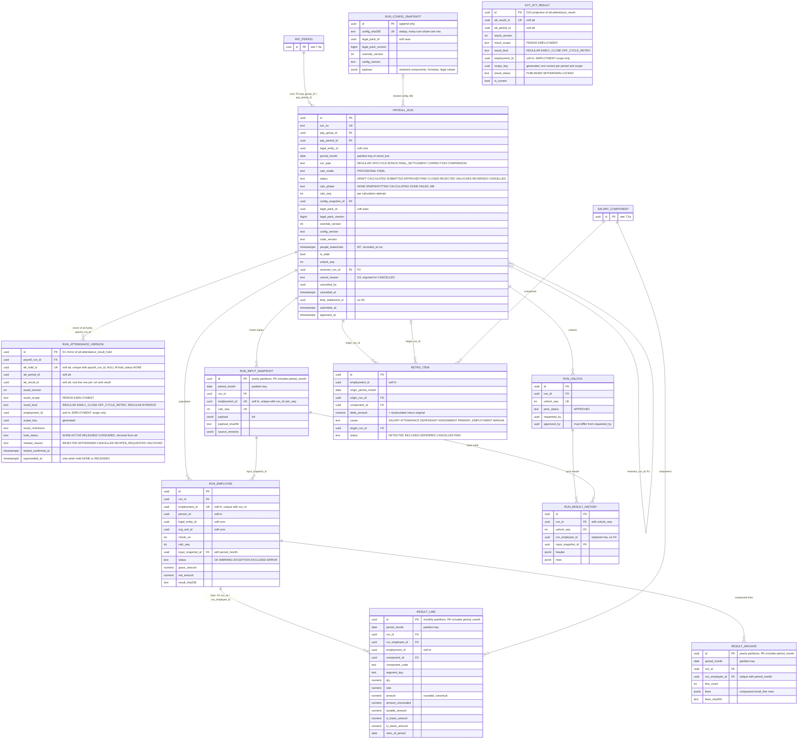

Sơ đồ 7.5c — BHXH, thuế TNCN, tờ khai, thu nhập vãng lai:

```mermaid
erDiagram
  PAYROLL_RUN |o--o{ SI_CONTRIBUTION : "source RUN"
  RUN_EMPLOYEE |o..o{ SI_CONTRIBUTION : "run_employee_id, no FK, M10"
  SI_CONTRIBUTION |o--o{ SI_CONTRIBUTION : "adjusts_id, superseded_by"
  SI_DECLARATION_LINE |o..o{ SI_CONTRIBUTION : "si_declaration_line_id, no FK"
  RUN_EMPLOYEE ||--o| PIT_WITHHOLDING : "one per run employee"
  PAYROLL_RUN |o--o{ YTD_BALANCE : "source RUN"
  SI_DECLARATION ||--o{ SI_DECLARATION_LINE : "lines"
  PIT_DECLARATION ||--o{ PIT_DECLARATION_LINE : "indicators"
  PIT_FINALISATION ||--o{ PIT_FINALISATION_LINE : "annex lines"
  CASUAL_PAYEE |o--o{ PIT_FINALISATION_LINE : "casual payee"
  PIT_CERTIFICATE_SERIES ||--o{ PIT_CERTIFICATE : "numbers"
  CASUAL_PAYEE |o--o{ PIT_CERTIFICATE : "casual recipient"
  PIT_CERTIFICATE |o--o{ PIT_CERTIFICATE : "replaces_id"
  CASUAL_PAYEE ||--o{ CASUAL_PAYMENT : "paid"
  CASUAL_PAYEE |o--o{ PIT_COMMITMENT : "commits"
  PIT_COMMITMENT |o--o{ CASUAL_PAYMENT : "NONE_COMMITMENT"
  PAYROLL_RUN |o--o{ CASUAL_PAYMENT : "casual run"
  PAYROLL_RUN {
    uuid id PK "see 7.5b"
  }
  RUN_EMPLOYEE {
    uuid id PK "see 7.5b"
  }
  SI_CONTRIBUTION {
    uuid id PK
    uuid employment_id "soft hr"
    uuid person_id "soft hr"
    uuid legal_entity_id "soft core"
    date contribution_month "first day of month"
    text insurance_type "SI HI UI OA_OD TU, one current row per employment month type"
    text source "RUN OPENING ADJUSTMENT"
    text status "CONTRIBUTE EXEMPT NO_CONTRIBUTION NOT_PARTICIPATING"
    numeric basis_amount
    numeric cap_amount
    numeric ee_amount "0 unless CONTRIBUTE"
    numeric er_amount "0 unless CONTRIBUTE"
    text rule_applied "SINGLE FIRST_CONTRACT HIGHEST_SALARY EACH_EMPLOYER"
    uuid run_id FK "required for RUN"
    uuid run_employee_id "nullable, no FK"
    uuid import_job_id "soft core, required for OPENING"
    uuid adjusts_id FK "required for ADJUSTMENT"
    timestamptz superseded_at
    uuid superseded_by FK
  }
  PIT_WITHHOLDING {
    uuid id PK
    uuid run_id FK "with run_employee_id"
    uuid run_employee_id FK
    uuid employment_id "soft hr"
    date tax_month
    text residency "RESIDENT NON_RESIDENT"
    text method "PROGRESSIVE FLAT_10 FLAT_20 NONE"
    bool is_family_deduction_applied "RESIDENT only"
    smallint dependant_count
    numeric pit_amount
    bigint legal_pack_version
  }
  YTD_BALANCE {
    uuid id PK
    uuid employment_id "soft hr"
    smallint tax_year
    date balance_month
    text balance_code
    numeric amount
    text source "RUN OPENING ADJUSTMENT"
    uuid run_id FK
    uuid import_job_id "soft core, required for OPENING"
  }
  SI_DECLARATION {
    uuid id PK
    uuid legal_entity_id "soft core"
    date declaration_month UK
    text form_code UK "D02_LT TK1_TS"
    smallint seq_no UK
    text status "DRAFT GENERATED EXPORTED SUBMITTED ACCEPTED REJECTED CANCELLED"
  }
  SI_DECLARATION_LINE {
    uuid id PK
    uuid declaration_id FK
    int line_no UK
    uuid employment_id "soft hr"
    text change_type "INCREASE DECREASE ADJUST_UP ADJUST_DOWN RETRO"
    text_array insurance_types "SI HI UI OA_OD"
  }
  PIT_DECLARATION {
    uuid id PK
    uuid legal_entity_id "soft core"
    text form_code UK "05_KK"
    text period_type "MONTH QUARTER, from legal_entity_version.pit_declaration_frequency"
    date period_start_month UK
    smallint supplement_seq UK
    text status "DRAFT GENERATED EXPORTED SUBMITTED ACCEPTED REJECTED CANCELLED"
  }
  PIT_DECLARATION_LINE {
    uuid id PK
    uuid declaration_id FK
    text indicator_code UK
    numeric value_amount
  }
  PIT_FINALISATION {
    uuid id PK "05/QTT"
    uuid legal_entity_id "soft core"
    smallint tax_year UK
    smallint supplement_seq UK
    text status "DRAFT CALCULATED APPROVED EXPORTED SUBMITTED CANCELLED"
  }
  PIT_FINALISATION_LINE {
    uuid id PK
    uuid finalisation_id FK
    text annex_code "05_1 05_2 05_3"
    uuid employment_id "soft hr"
    uuid casual_payee_id FK
  }
  PIT_FINALISATION_AUTH {
    uuid id PK
    uuid employment_id UK "soft hr, unique with tax_year"
    smallint tax_year UK
    text status "PENDING AUTHORISED DECLINED WITHDRAWN NOT_ELIGIBLE"
  }
  PIT_CERTIFICATE_SERIES {
    uuid id PK
    uuid legal_entity_id "soft core"
    text symbol UK
    int last_no "gap-free"
  }
  PIT_CERTIFICATE {
    uuid id PK
    uuid series_id FK
    int cert_no UK
    text recipient_kind "EMPLOYEE CASUAL"
    uuid employment_id "soft hr"
    uuid casual_payee_id FK
    text signature_status "UNSIGNED in P1, SIGNED P2"
    uuid replaces_id FK
    text status "DRAFT ISSUED CANCELLED REPLACED"
  }
  CASUAL_PAYEE {
    uuid id PK "own subject key"
    bytea national_id_enc "P3"
    bytea tax_code_enc "P3"
    bytea account_no_enc "P3"
    text residency "RESIDENT NON_RESIDENT"
    text status "ACTIVE INACTIVE ANONYMISED"
  }
  CASUAL_PAYMENT {
    uuid id PK
    uuid casual_payee_id FK
    uuid run_id FK
    uuid commitment_id FK
    text withholding_method "FLAT_10 FLAT_20 NONE_COMMITMENT NONE_BELOW_THRESHOLD"
    numeric gross_amount
    numeric pit_amount
    text status "DRAFT APPROVED PAID CANCELLED"
  }
  PIT_COMMITMENT {
    uuid id PK "08/CK"
    text payee_kind "EMPLOYEE CASUAL"
    uuid employment_id "soft hr"
    uuid casual_payee_id FK
    smallint tax_year
    text status "VALID EXCEEDED REVOKED EXPIRED INVALID"
  }
```

Sơ đồ 7.5d — phiếu lương, file ngân hàng, GL, khoản vay, quyết toán nghỉ việc:

```mermaid
erDiagram
  PAYROLL_RUN ||--o{ PAYSLIP : "publishes"
  RUN_EMPLOYEE ||..o{ PAYSLIP : "run_employee_id, no FK"
  PAYSLIP |o--o{ PAYSLIP : "supersedes_payslip_id"
  PAYSLIP ||--o{ PAYSLIP_DELIVERY : "deliveries"
  PAYROLL_RUN |o--o{ BANK_PAYMENT_FILE : "pays"
  BANK_FILE_TEMPLATE ||..o{ BANK_PAYMENT_FILE : "template_id, no FK"
  BANK_PAYMENT_FILE ||--o{ BANK_PAYMENT_LINE : "lines"
  RUN_EMPLOYEE |o..o{ BANK_PAYMENT_LINE : "run_employee_id, no FK"
  CASUAL_PAYMENT |o--o{ BANK_PAYMENT_LINE : "casual_payment_id"
  SALARY_COMPONENT ||--o{ GL_MAPPING : "mapped"
  PAYROLL_RUN ||--o{ GL_JOURNAL : "posts"
  GL_JOURNAL ||--o{ GL_JOURNAL_LINE : "lines"
  RUN_EMPLOYEE ||--o{ COST_ALLOCATION : "P2"
  PAYROLL_RUN |o--o{ LOAN : "disbursed_run_id"
  LOAN ||--o{ LOAN_SCHEDULE : "instalments"
  PAYROLL_RUN |o--o{ LOAN_SCHEDULE : "deducted in"
  SALARY_COMPONENT ||--o{ DEDUCTION_ORDER : "deducted as"
  PAYROLL_RUN |o--o{ FINAL_SETTLEMENT : "settled by"
  PAYROLL_RUN {
    uuid id PK "see 7.5b"
  }
  RUN_EMPLOYEE {
    uuid id PK "see 7.5b"
  }
  SALARY_COMPONENT {
    uuid id PK "see 7.5a"
  }
  CASUAL_PAYMENT {
    uuid id PK "see 7.5c"
  }
  PAYSLIP {
    uuid id PK
    uuid run_id FK
    uuid run_employee_id "no FK, superseded after UNLOCK"
    uuid person_id "soft hr"
    date period_month
    uuid document_id "soft core, PDF/A"
    text status "PENDING PUBLISHED WITHDRAWN SUPERSEDED"
    uuid supersedes_payslip_id FK
  }
  PAYSLIP_DELIVERY {
    uuid id PK
    uuid payslip_id FK
    text channel UK "EMAIL_PDF EMAIL_LINK PRINT"
    smallint attempt_no UK
    text attachment_sha256 "required for EMAIL_PDF"
    timestamptz password_set_at_used
    text status "QUEUED SENT BOUNCED FAILED PRINTED"
  }
  PAYSLIP_DELIVERY_PREFERENCE {
    uuid id PK
    uuid person_id UK "soft hr, one row per person"
    text channel "ESS_ONLY EMAIL_PDF"
    text email_target "WORK PERSONAL"
    bytea pdf_password_enc "P3, write-only"
    timestamptz password_set_at
    text status "ACTIVE PASSWORD_CLEARED"
  }
  BANK_FILE_TEMPLATE {
    uuid id PK "global rows use sentinel tenant"
    text code UK
    int template_version UK
    text bank_code "global core.bank"
    text file_format "CSV XLSX FIXED_WIDTH XML"
  }
  BANK_PAYMENT_FILE {
    uuid id PK
    uuid run_id FK "NULL for casual batches"
    uuid payer_bank_account_id "soft core"
    uuid template_id
    smallint file_seq UK
    numeric total_amount
    text status "GENERATED FINANCE_APPROVED SENT CONFIRMED PARTIALLY_REJECTED CANCELLED"
  }
  BANK_PAYMENT_LINE {
    uuid id PK
    uuid file_id FK
    int line_no UK
    uuid run_employee_id "exactly one of run_employee_id casual_payment_id"
    uuid casual_payment_id FK
    bytea account_no_enc "P3"
    numeric amount
    text transfer_type "SAME_BANK NAPAS CITAD CASH"
    text status "PENDING SENT PAID REJECTED"
  }
  GL_MAPPING {
    uuid id PK
    uuid component_id FK
    text cost_category "ANY DIRECT PRODUCTION_OVERHEAD SELLING ADMIN"
    text chart_of_accounts "TT200 TT133 OTHER"
    date valid_from
    date valid_to
  }
  GL_JOURNAL {
    uuid id PK
    uuid run_id FK
    text journal_no UK
    text export_format "CSV XLSX, API P2"
    text status "GENERATED EXPORTED CANCELLED"
  }
  GL_JOURNAL_LINE {
    uuid id PK
    uuid journal_id FK
    int line_no UK
    text account_code
    numeric debit_amount
    numeric credit_amount
  }
  COST_ALLOCATION {
    uuid id PK "P2"
    uuid run_id FK "with run_employee_id"
    uuid run_employee_id FK
    text basis "DEFAULT_ASSIGNMENT PERCENT PROJECT_TIME MANUAL"
    numeric pct
  }
  LOAN {
    uuid id PK
    uuid employment_id "soft hr"
    text loan_no UK
    text loan_type "LOAN SALARY_ADVANCE CASH_ADVANCE"
    text interest_method "NONE in P1, FLAT REDUCING P2"
    numeric outstanding_amount
    text source "APP OPENING PEOPLE_EVENT"
    uuid disbursed_run_id FK
    text status "DRAFT PENDING_APPROVAL ACTIVE PAUSED SETTLED WRITTEN_OFF CANCELLED"
  }
  LOAN_SCHEDULE {
    uuid id PK
    uuid loan_id FK
    smallint installment_no UK
    date due_month
    uuid run_id FK
    text status "SCHEDULED DEDUCTED PARTIAL SKIPPED CARRIED WAIVED"
  }
  DEDUCTION_ORDER {
    uuid id PK
    uuid employment_id "soft hr"
    text order_type "STATUTORY COURT_ORDER DAMAGE_COMPENSATION ADVANCE LOAN OTHER"
    uuid component_id FK
    text status "ACTIVE PAUSED COMPLETED CANCELLED"
  }
  FINAL_SETTLEMENT {
    uuid id PK
    uuid employment_id "soft hr"
    uuid termination_ref_id "soft hr termination case"
    date termination_date
    date deadline_date
    uuid run_id FK
    text severance_kind "SEVERANCE JOB_LOSS NONE"
    text status "OPEN CALCULATING CALCULATED APPROVED PAID CLOSED CANCELLED"
  }
```

Ngoài ra trong `pay`: các projection được cấp qua event `ext_hr_salary`, `ext_hr_bank_split`, `ext_hr_dependant_count`, `ext_hr_insurance_participation` (từ `hr.insurance_participation`, H1) và `ext_att_result` (con trỏ tới các phiên bản kết quả chấm công; **từ v0.5 khớp với `att`, D10**: `result_scope` `PERIOD`/`EMPLOYMENT`, `result_kind` `REGULAR`/`EARLY_CLOSE`/`OFF_CYCLE_RETRO`, `employment_id` chỉ có ở scope `EMPLOYMENT`, unique theo `att_result_id`, và `ext_att_result_current_uq` chỉ cho phép một phiên bản hiện hành cho mỗi kỳ × `scope_key`. Unique `(att_period_id, result_version)` cũ bị bỏ vì `att` đánh số phiên bản riêng cho từng scope); `residency_check` (đếm ngày cư trú, đề xuất cho People, H2); các masking view `v_run_employee_masked`, `v_result_line_masked`, `v_ext_hr_salary_masked`, `v_si_contribution_masked`, `v_pit_withholding_masked` (fail closed); cặp `outbox_event`/`inbox_message`. `pay_scale`/`pay_scale_step`/`grade_band` được sở hữu tại đây (gap §5 #7, capability nền tảng). `ytd_balance` theo employment × năm tính thuế × tháng × mã số dư; các dòng có `source = 'OPENING'` là các tháng trước go-live của năm tính thuế hiện tại được nạp bởi `OB_YTD_PAYROLL` (ADR-0037) và không bao giờ được tính lại.

**Lịch sử đóng bảo hiểm theo từng loại (review H4, M10).** `pay.si_contribution` có một dòng *hiện hành* cho mỗi employment × tháng × `insurance_type` (`SI`, `HI`, `UI`, `OA_OD`, `TU` — kinh phí công đoàn; `si_contribution_current_uq ... WHERE superseded_at IS NULL`), ghi `rule_applied` của quy tắc nhiều hợp đồng đã áp dụng. Nguồn của dòng nằm ở cột `source` (`RUN` | `OPENING` | `ADJUSTMENT`), tách khỏi `status` (`CONTRIBUTE` | `EXEMPT` | `NO_CONTRIBUTION` | `NOT_PARTICIPATING`): `RUN` bắt buộc `run_id`; `OPENING` không có `run_id`/`run_employee_id` và bắt buộc `import_job_id`; `ADJUSTMENT` bắt buộc `adjusts_id`. `run_employee_id` là nullable và không có FK (dòng `run_employee` bị ghi lại sau UNLOCK).

**Gửi phiếu lương qua e-mail dưới dạng PDF có mật khẩu (R2-17, GAP-057; SA ADR-0015).** `pay.payslip_delivery_preference (tenant_id, id, person_id, channel ESS_ONLY|EMAIL_PDF, email_target WORK|PERSONAL, pdf_password_enc bytea, password_set_at, password_set_by, subject_key_version, status ACTIVE|PASSWORD_CLEARED)` — mỗi người một dòng (một mật khẩu cho mọi employment của người đó). `pdf_password_enc` là **P3**: được mã hóa bằng subject DEK của người đó (§9.3), chỉ-ghi qua API (không bao giờ trả về, không bao giờ ghi log, không bao giờ có trong event hay payload của job), chỉ được giải mã trong bộ nhớ bởi job gửi phiếu lương qua e-mail. Mật khẩu do **nhân viên tự đặt trong ESS** với step-up (`acr ≥ 2`); HR và operator chỉ có thể xóa nó (buộc "đặt mật khẩu mới"), không bao giờ đọc hay đặt nó. Khi không có mật khẩu, e-mail không có file đính kèm, chỉ có thông báo và đường link ESS. `pay.payslip_delivery` ghi lại mỗi lần gửi (id phiếu lương, kênh, số lần thử, SHA-256 của file đính kèm đã mã hóa, người nhận, trạng thái, `password_set_at_used`); bản thân file PDF mã hóa là tạm thời (được tạo cho mỗi e-mail, chuyển cho kênh e-mail dưới dạng một object tồn tại ngắn trong prefix của tenant và bị xóa sau khi gửi, tối đa 24 h), trong khi phiếu lương lưu trữ vẫn là file PDF/A không mã hóa trong document service (PDF/A không cho phép mã hóa). Crypto-shred subject DEK cũng hủy luôn mật khẩu. Audit: đặt/xóa mật khẩu, mọi e-mail có file đính kèm, mọi lỗi (`audit.audit_event`, không chứa giá trị).

### 7.6 `rec` (Phase 2)

DDL `006_rec.sql` — **toàn bộ schema là Phase 2** (BRD 05 A-04); file được tạo ở v0.4 để schema, grant, phân loại PII và hợp đồng bàn giao sang People (`rec.CandidateHired` payload v1) được review cùng `000`–`003`. Không có gì ở Phase 1 ghi vào đây. Mọi bảng có `tenant_id` trong PK; tham chiếu tới `core`, `hr`, `saas.consent_record`, `saas.legal_param_pack` và `pay.salary_component` (theo mã) là soft.

Sơ đồ 7.6a — kế hoạch định biên, yêu cầu tuyển dụng, vị trí tuyển, ứng viên:

```mermaid
erDiagram
  STAFFING_PLAN |o--o{ STAFFING_PLAN : "previous_version_id"
  STAFFING_PLAN ||--o{ STAFFING_PLAN_LINE : "lines"
  STAFFING_PLAN_LINE |o--o{ REQUISITION : "funds, NULL = UNPLANNED"
  REQUISITION ||--o{ JOB_OPENING : "opens"
  PIPELINE_TEMPLATE |o--o{ JOB_OPENING : "pipeline"
  PIPELINE_TEMPLATE |o--o{ PIPELINE_STAGE : "template stages"
  JOB_OPENING |o--o{ PIPELINE_STAGE : "opening stages"
  JOB_OPENING ||--o{ JOB_POSTING : "published on"
  CANDIDATE |o--o{ CANDIDATE : "merged_into_id"
  CANDIDATE ||--o{ CANDIDATE_FILE : "files"
  CANDIDATE ||--o{ CANDIDATE_CONSENT_REF : "consents"
  REFERRAL_PROGRAM |o--o{ REFERRAL : "programme"
  CANDIDATE ||--o{ REFERRAL : "referred"
  JOB_OPENING ||--o{ REFERRAL : "for opening"
  STAFFING_PLAN {
    uuid id PK "P2"
    uuid legal_entity_id "soft core"
    text plan_code UK
    int plan_version UK
    uuid previous_version_id FK
    date period_start
    date period_end
    text status "DRAFT PENDING_APPROVAL RETURNED APPROVED REJECTED SUPERSEDED CANCELLED"
  }
  STAFFING_PLAN_LINE {
    uuid id PK "P2"
    uuid staffing_plan_id FK
    uuid org_unit_id "soft core"
    uuid position_id "soft core"
    int planned_hc
    numeric planned_fte
    numeric budget_cost_month_amount
    text core_sync_status "NOT_REQUIRED PENDING SYNCED FAILED"
  }
  REQUISITION {
    uuid id PK "P2"
    text code UK
    uuid legal_entity_id "soft core"
    uuid org_unit_id "soft core"
    uuid position_id "soft core"
    uuid staffing_plan_line_id FK
    text classification "WITHIN_PLAN OVER_PLAN UNPLANNED"
    int vacancies
    int filled_count
    text reason "NEW REPLACEMENT TEMPORARY"
    text salary_basis "GROSS NET"
    text status "DRAFT PENDING_APPROVAL RETURNED APPROVED REJECTED ON_HOLD FILLED CLOSED CANCELLED"
  }
  PIPELINE_TEMPLATE {
    uuid id PK "P2"
    text code UK
    bool is_default
  }
  JOB_OPENING {
    uuid id PK "P2"
    uuid requisition_id FK
    text code UK
    uuid pipeline_template_id FK
    text visibility "PUBLIC INTERNAL REFERRAL_ONLY"
    text status "DRAFT OPEN ON_HOLD FILLED CLOSED CANCELLED"
  }
  PIPELINE_STAGE {
    uuid id PK "P2"
    uuid pipeline_template_id FK "exactly one of template or opening"
    uuid job_opening_id FK
    smallint seq
    text code UK
    text stage_type "NEW SCREENING ASSESSMENT INTERVIEW OFFER PREBOARDING HIRED REJECTED WITHDRAWN"
  }
  JOB_POSTING {
    uuid id PK "P2"
    uuid job_opening_id FK
    text channel "CAREER_SITE INTERNAL_BOARD TOPCV VIETNAMWORKS ITVIEC LINKEDIN FACEBOOK EMAIL_INBOX AGENCY OTHER"
    text status "DRAFT PUBLISHING PUBLISHED FAILED UNPUBLISHED EXPIRED"
  }
  CANDIDATE {
    uuid id PK "P2, own subject key"
    text full_name
    bytea email_enc "P3 for candidates"
    bytea email_bidx "nulled by anonymiser"
    bytea phone_enc "P3"
    bytea id_doc_enc "P3"
    uuid employee_person_id "soft hr"
    uuid merged_into_id FK
    text status "ACTIVE MERGED CLOSED ANONYMISED"
    date retention_until
  }
  CANDIDATE_FILE {
    uuid id PK "P2"
    uuid candidate_id FK
    text file_type "CV COVER_LETTER DEGREE CERTIFICATE HEALTH_CERT ID_SCAN PHOTO JUDICIAL_RECORD OFFER_LETTER OTHER"
    uuid document_id "soft core"
    bytea parsed_enc "P3"
  }
  CANDIDATE_CONSENT_REF {
    uuid id PK "P2"
    uuid candidate_id FK
    text purpose_code "APPLICATION_PROCESSING TALENT_POOL GROUP_SHARING REFERRAL_CONTACT"
    uuid consent_record_id "soft saas"
    text cached_status "PENDING GIVEN WITHDRAWN EXPIRED LEGAL_BASIS"
  }
  REFERRAL_PROGRAM {
    uuid id PK "P2"
    text code UK
    numeric bonus_amount
    text qualifying_condition "HIRED PASSED_PROBATION DAYS_AFTER_START"
  }
  REFERRAL {
    uuid id PK "P2"
    uuid referral_program_id FK
    uuid referrer_employment_id "soft hr"
    uuid candidate_id FK
    uuid job_opening_id FK
    text status "SUBMITTED CONSENT_PENDING IN_PROCESS HIRED QUALIFIED BONUS_INSTRUCTED BONUS_PAID NOT_QUALIFIED REJECTED WITHDRAWN"
  }
```

Sơ đồ 7.6b — hồ sơ ứng tuyển, phỏng vấn, offer, bàn giao:

```mermaid
erDiagram
  CANDIDATE ||--o{ APPLICATION : "applies"
  JOB_OPENING ||--o{ APPLICATION : "receives"
  JOB_POSTING |o--o{ APPLICATION : "via posting"
  REFERRAL |o--o{ APPLICATION : "via referral"
  PIPELINE_STAGE |o--o{ APPLICATION : "current_stage_id"
  APPLICATION ||--o{ STAGE_HISTORY : "moves"
  PIPELINE_STAGE |o--o{ STAGE_HISTORY : "from_stage_id, to_stage_id"
  APPLICATION ||--o{ INTERVIEW : "schedules"
  INTERVIEW |o--o{ INTERVIEW : "rescheduled_from_id"
  INTERVIEW ||--o{ INTERVIEW_PANEL : "panel"
  INTERVIEW_PANEL ||--o| SCORECARD : "one per panelist"
  APPLICATION ||--o{ ASSESSMENT : "tests"
  APPLICATION ||--o{ OFFER : "versions"
  OFFER |o--o{ OFFER : "previous_offer_id, superseded_by"
  APPLICATION ||--o{ PREBOARDING_ITEM : "pre-boarding"
  APPLICATION ||--o{ HIRE_HANDOFF : "one live hand-off, FK candidate_id + application_id"
  OFFER ||--o{ HIRE_HANDOFF : "accepted offer, FK application_id + offer_id"
  REQUISITION ||--o{ HIRE_HANDOFF : "fills"
  CANDIDATE {
    uuid id PK "P2, see 7.6a"
  }
  JOB_OPENING {
    uuid id PK "P2, see 7.6a"
  }
  JOB_POSTING {
    uuid id PK "P2, see 7.6a"
  }
  REFERRAL {
    uuid id PK "P2, see 7.6a"
  }
  PIPELINE_STAGE {
    uuid id PK "P2, see 7.6a"
  }
  REQUISITION {
    uuid id PK "P2, see 7.6a"
  }
  APPLICATION {
    uuid id PK "P2"
    uuid candidate_id FK "unique with job_opening_id"
    uuid job_opening_id FK
    uuid job_posting_id FK
    uuid referral_id FK
    uuid current_stage_id FK
    text source_channel
    bool is_internal
    uuid internal_employment_id "soft hr"
    text status "ACTIVE ON_HOLD OFFERED READY_TO_HIRE HIRED REJECTED WITHDRAWN CLOSED"
    text preboarding_status "NOT_STARTED IN_PROGRESS READY WAIVED"
  }
  STAGE_HISTORY {
    uuid id PK "P2"
    uuid application_id FK
    uuid from_stage_id FK
    uuid to_stage_id FK
    text to_status
    timestamptz changed_at
  }
  INTERVIEW {
    uuid id PK "P2"
    uuid application_id FK
    smallint round_no
    text interview_type "ONSITE PHONE VIDEO"
    timestamptz scheduled_start_at
    uuid rescheduled_from_id FK
    text status "PROPOSED SCHEDULED RESCHEDULED COMPLETED CANCELLED NO_SHOW"
  }
  INTERVIEW_PANEL {
    uuid id PK "P2"
    uuid interview_id FK
    uuid user_account_id UK "soft core"
    text panel_role "LEAD INTERVIEWER OBSERVER"
  }
  SCORECARD {
    uuid id PK "P2"
    uuid interview_id FK "with interview_panel_id"
    uuid interview_panel_id FK
    text overall_recommendation "STRONG_NO NO MIXED YES STRONG_YES"
    text status "DRAFT SUBMITTED"
  }
  ASSESSMENT {
    uuid id PK "P2"
    uuid application_id FK
    text result "PENDING PASS FAIL INCONCLUSIVE"
    date expires_on
    text status "ASSIGNED IN_PROGRESS COMPLETED EXPIRED CANCELLED"
  }
  OFFER {
    uuid id PK "P2"
    uuid application_id FK
    int offer_version UK "unique with application_id"
    uuid previous_offer_id FK
    uuid superseded_by FK
    text salary_basis "GROSS NET"
    numeric base_salary_amount "P2 plaintext"
    numeric agreed_net_amount "required for NET"
    numeric net_estimate_amount
    uuid sim_legal_pack_id "soft saas, L7"
    int sim_override_version "L7, set together with sim_legal_pack_id"
    date sim_effective_date
    timestamptz simulated_at
    text status "DRAFT PENDING_APPROVAL APPROVED REJECTED SENT ACCEPTED DECLINED CHANGE_REQUESTED EXPIRED WITHDRAWN RENEGED SUPERSEDED"
    date expires_on "L7, required once SENT"
  }
  PREBOARDING_ITEM {
    uuid id PK "P2"
    uuid application_id FK
    text item_type_code UK
    bytea value_enc "P3"
    text status "PENDING SUBMITTED VERIFIED REJECTED WAIVED"
  }
  HIRE_HANDOFF {
    uuid id PK "P2"
    text handoff_type "NEW_HIRE INTERNAL_TRANSFER"
    uuid candidate_id FK
    uuid application_id FK
    uuid offer_id FK
    int offer_version
    uuid requisition_id FK
    smallint payload_version "1"
    text last_event_type "rec.CandidateHired rec.InternalTransferAccepted rec.HireAmended rec.HireWithdrawn"
    text people_status "PENDING ACCEPTED FAILED CANCELLED WITHDRAWN"
    uuid person_id "soft hr"
    uuid employment_id "soft hr"
  }
```

PII của ứng viên dùng subject key riêng cho từng ứng viên (`saas.subject_key`, `subject_type = 'CANDIDATE'`), nên việc hết hạn lưu trữ 12 tháng là thao tác hủy khóa cộng với ẩn danh hóa (NFR-REC-009). Các cột `_bidx` dùng blind-index key của tenant, không phải subject key, nên bộ ẩn danh hóa **phải** đặt NULL chúng (`candidate_anonymised_ck`). E-mail/điện thoại/địa chỉ là P2 với nhân viên nhưng được nâng lên **P3 với ứng viên** (D8, chấp nhận ngày 2026-10-21, **chờ DPO xác nhận**), để một lần hủy khóa xóa được mọi cách liên hệ hoặc định danh ứng viên. **Bàn giao sang People (D7):** event `rec.CandidateHired` (payload v1) không mang giá trị P3 nào; People lấy các nhóm dữ liệu P3 (định danh, MST, số sổ BHXH, tài khoản ngân hàng) qua API bàn giao của Recruitment theo `hire_id` (Phase 2). Số tiền offer là P2 plaintext (X-01), được bảo vệ bằng `rec.v_offer_masked` (fail closed); `rec.v_candidate_masked` che PII ứng viên. Mô phỏng offer được đóng dấu bằng `sim_legal_pack_id` + `sim_override_version` (thay cho `sim_param_version` đơn lẻ của v0.3) và hạn offer là `expires_on date` (quy tắc đặt tên §4.2: `_at` là `timestamptz`; review L7). Consent: registry là `saas.consent_record`; `rec.candidate_consent_ref` chỉ là soft reference + trạng thái cache, kiểm tra chuẩn là API `hasConsent()` của SaaS tại thời điểm xử lý. Không có việc so khớp ứng viên giữa các tenant.

---

## 8. Lưu trữ dữ liệu lương: bất biến, tái lập, lưu trữ dài hạn (ADR-0029)

| Vấn đề | Thiết kế (DDL `005_pay.sql`) |
|---|---|
| Đầu vào | Tại `INPUT_CUTOFF`/khi tính toán, mọi đầu vào của mọi nhân viên được **đóng băng** vào `pay.run_input_snapshot.payload` (`jsonb`, TOAST `lz4`), mỗi lần chạy × employment × `calc_seq` một dòng. Payload chứa hồ sơ lương, các đoạn lương kèm id bản ghi và `recorded_at`, các đoạn phân công, các dòng kết quả chấm công (kỳ, phiên bản, checksum), đầu vào biến đổi, khoản vay, số người phụ thuộc theo tháng, số dư lũy kế từ đầu năm (YTD), phân bổ tài khoản ngân hàng, tình trạng cư trú, tham gia bảo hiểm theo từng loại, và lịch sử BHXH cần cho việc áp trần. `payload_sha256` được tính trên JSON chuẩn hóa. Mốc hiểu biết của People là `payroll_run.people_watermark` (`timestamptz`, review M7): chỉ các phiên bản có `recorded_at <= people_watermark` được dùng, và thay đổi muộn hơn mốc này là nguồn phát hiện retro. |
| Cấu hình | `pay.run_config_snapshot` giữ các phiên bản thành phần lương đã phân giải, phiên bản công thức (văn bản biểu thức và hash), các dòng cấu trúc lương, quy tắc làm tròn, và **tập giá trị pháp lý đã phân giải** cho kỳ (`legal_pack_id` + `legal_pack_version` + `override_version` + chính các giá trị đó). Bảng là append-only và được **loại trùng theo `UNIQUE (tenant_id, config_sha256)`**: nhiều lần chạy dùng chung một dòng (`payroll_run.config_snapshot_id`, quan hệ một-nhiều; review M6), ghi bằng `INSERT … ON CONFLICT DO NOTHING` rồi dùng lại id. |
| Code | `payroll_run.code_version` = release tag của payroll engine cộng với phiên bản formula-sandbox. Các bản release được giữ dưới dạng container image trong 10 năm **[spike: chính sách lưu giữ/ký quỹ image]**. |
| Chấm công | Các phiên bản Attendance Result mà lần chạy dùng được ghi thành các dòng con `pay.run_attendance_version`, thay cho cột `jsonb attendance_versions` của v0.3. **Từ v0.5 (D1), bảng này là bản phản chiếu**: `att.attendance_result_hold` là nguồn duy nhất của close hold, và mỗi dòng phản chiếu một hold của `att` (`payroll_run_id`, `att_hold_id`, `att_result_id`, `result_version`, `result_scope` `PERIOD`/`EMPLOYMENT`, `result_kind`, `employment_id`, `scope_key`, `result_checksum`, `hold_status` `NONE`/`ACTIVE`/`RELEASED`/`CONSUMED`, `release_reason`, `locked_confirmed_at`, `superseded_at`), unique theo `(tenant_id, payroll_run_id, att_hold_id)`. Trong một lần chạy, mỗi kết quả chỉ được dùng một lần, và mỗi kỳ × scope có tối đa một phiên bản regular/early-close (`run_attendance_version_result_uq`, `run_attendance_version_scope_uq`, chỉ áp cho dòng chưa có `superseded_at`). Không có ràng buộc nào giữa các lần chạy: tính duy nhất của hold do `att` thực thi. SUBMITTED yêu cầu mọi dòng có hold ACTIVE; APPROVED tiêu thụ chúng (`CONSUMED`). |
| Kết quả | `run_employee` (header, tổng, `result_sha256`) và `result_line` (mỗi thành phần × đoạn một dòng, FK ghép `(tenant_id, run_id, run_employee_id)`). |
| Trạng thái và luồng ghi (SA ADR-0009) | `payroll_run.status` là vòng đời nghiệp vụ (`DRAFT`, `CALCULATED`, `SUBMITTED`, `APPROVED`, `PAID`, `CLOSED`, `REJECTED`, `UNLOCKED`, `REVERSED`, `CANCELLED`); **`calc_phase` là trạng thái kỹ thuật riêng** (`NONE`, `SNAPSHOTTING`, `CALCULATING`, `DONE`, `FAILED`; review M8). `SNAPSHOTTING`/`CALCULATING` chỉ được phép khi `status = 'DRAFT'`, và mọi trạng thái sau DRAFT/REJECTED/UNLOCKED yêu cầu `calc_phase = 'DONE'` (`payroll_run` CHECK). Khi `calc_phase = 'CALCULATING'`, các chunk worker ghi `run_employee` và `result_line` bằng `COPY` (xóa-và-ghi-lại idempotent theo từng chunk, khóa theo `run_id` + `chunk_no`, `calc_seq` tăng sau mỗi lần tính). Snapshot đầu vào được ghi một lần cho mỗi `calc_seq`, trong pha `SNAPSHOTTING`, trước khi bắt đầu tính toán. **`CANCELLED` (D3, 2026-10-21):** chỉ vào được từ `DRAFT`, `CALCULATED` hoặc `REJECTED` của một lần chạy chưa từng được duyệt (`approved_at IS NULL`). Trạng thái này bắt buộc `cancel_reason` không rỗng cùng `cancelled_by`/`cancelled_at`, yêu cầu mọi hold được phản chiếu phải được giải phóng trước (T&A API giải phóng với lý do `CANCELLED`), và là trạng thái cuối. |
| Tính bất biến | Trigger `pay.tg_run_immutable` chặn INSERT/UPDATE/DELETE trên `run_input_snapshot`, `run_employee`, `result_line` và `pit_withholding` **ngay khi lần chạy ở `SUBMITTED`** (D2: chặt hơn mốc `APPROVED` của bản trước, **đã chấp nhận ngày 2026-10-21**) hoặc trạng thái sau đó (`APPROVED`, `PAID`, `CLOSED`, `REVERSED`); header cũng bị đóng băng từ `SUBMITTED` (chỉ cột sổ sách vòng đời được đổi), và sau `SUBMITTED` `run_attendance_version` chỉ được đổi các cột hold. Đường duy nhất để sửa một lần chạy đã duyệt là `UNLOCKED` (đặc quyền, người duyệt khác người yêu cầu): một dòng `pay.run_unlock` (`unlock_seq`, trạng thái và tổng trước đó) được tạo, và kết quả trước đó của từng nhân viên được lưu vào `pay.run_result_history` (`header jsonb`, `lines jsonb`, FK tới `run_unlock` theo `(run_id, unlock_seq)`) trước khi tính lại. Không có gì đã duyệt bị mất. |
| Tái lập | Service "replay" nạp một config snapshot và một input snapshot, chạy engine phiên bản `code_version`, và so sánh hash với `result_sha256`. Một job định kỳ hằng tháng replay mẫu 0.5 % các lần chạy của năm trước (phát hiện sai lệch bằng golden-file, NFR-PAY-003/008). |
| Partitioning | `result_line` được range-partition theo `period_month` (theo tháng). PK `(tenant_id, id, period_month)`; index `(tenant_id, run_employee_id)` trên mỗi partition. `run_input_snapshot` và `result_archive` được partition **theo năm** trên `period_month`. |
| Khối lượng | 1M nhân viên × ~60 dòng × ~1.2 lần chạy mỗi tháng ≈ **72M dòng/tháng**, khoảng 0.86B dòng/năm, với ~150 B/dòng kể cả index ≈ 11 GB/tháng. |
| Lưu trữ (10 năm, BR-PAY-123) | Hot: 36 partition tháng online. Warm (tháng 37–120): mỗi tháng được **nén gọn** vào `pay.result_archive` (mỗi `run_employee` × `period_month` một dòng, `lines jsonb` nén lz4 + `lines_sha256`, nhỏ hơn khoảng 8×), sau đó partition dòng được detach và drop. Phiếu lương, tờ khai, snapshot, header lần chạy và `si_contribution`/`pit_withholding` được giữ online đủ 10 năm (khối lượng thấp). Sau 10 năm cộng thời điểm kết thúc employment, retention scheduler sẽ purge hoặc ẩn danh hóa **[verify-legal]**. |
| Báo cáo | `fact_payroll_line` trong reporting store giữ đủ 10 năm ở dạng cột (§11), nên phân tích không bao giờ chạm vào kho lưu trữ. |

`si_contribution` (mỗi employment × tháng × `insurance_type` một dòng hiện hành, gồm `SI`, `HI`, `UI`, `OA_OD`, `TU`; review H4) là master **lịch sử đóng bảo hiểm** (gap §5 #20). Nó cũng chứa các tháng trước go-live được nạp bởi template `OB_SI_HISTORY` (từ sổ BHXH của nhân viên / bảng C12 của VSS) với **`source = 'OPENING'`** (không có `run_id`/`run_employee_id`) và `import_job_id` bắt buộc (soft reference tới `core.import_job`), ADR-0037; `status` của các dòng này vẫn là trạng thái đóng (`CONTRIBUTE`, `EXEMPT`, …) (review M10).

---

## 9. Outbox/inbox, audit, bảo vệ PII

### 9.1 Transactional outbox và inbox (ADR-0028)

Mỗi schema của module có cùng một cặp bảng (template DDL trong `000_extensions_roles.sql`, procedure `sys.create_outbox_inbox(schema, app_role)`, được gọi ở cuối mỗi file module `001`–`006`):

| Bảng | Cột chính | Ghi chú |
|---|---|---|
| `<schema>.outbox_event` | `id` (= `event_id` của envelope, UUIDv7), `tenant_id`, `legal_entity_id`, `aggregate_type`, `aggregate_id`, `event_type`, `schema_version`, `occurred_at`, `effective_date`, `correlation_id`, `causation_id`, `is_retro`, `person_id`, `employment_id`, `payload jsonb`, `headers jsonb`, `created_at`, `published_at` | Envelope như trong gap §6. Được insert trong **cùng transaction** với thay đổi nghiệp vụ (NFR-PPL-002). Range-partition **theo ngày** theo `created_at`. Partition cũ hơn 7 ngày bị drop, nên không có `DELETE` và không có vacuum churn. |
| `<schema>.inbox_message` | PK `(consumer, event_id)`, `tenant_id`, `event_type`, `received_at`, `processed_at`, `status`, `attempts`, `last_error` | Tiêu thụ idempotent: handler insert dòng inbox và áp dụng hiệu ứng của nó trong một transaction, và bản trùng sẽ vướng PK. Partition theo tháng, lưu 90 ngày. |

* Relay (SA ADR-0004 rev. 2): một **polling relay** trong ứng dụng chạy ở `hrm-worker` thực thi `SELECT … WHERE published_at IS NULL ORDER BY id FOR UPDATE SKIP LOCKED LIMIT 500` (partial index `outbox_event_unpublished_ix`) qua kết nối trực tiếp (không qua PgBouncer) và thiết lập `published_at`. **Phase 1 (không có Kafka, R2-01):** trong cùng transaction nó gọi `saas.enqueue_event_delivery()`, hàm này insert một dòng `saas.job` cho mỗi consumer đã đăng ký (queue `events`, type `bus.Deliver`, `idempotency_key = consumer:event_id`, `ordering_key = consumer:aggregate_id`). `saas.claim_jobs()` chạy tối đa một job chưa kết thúc cho mỗi ordering key, cũ nhất trước, nên mỗi consumer thấy các event của một aggregate theo đúng thứ tự; retry, backoff, `DEAD` (trạng thái dead-letter ở Phase 1), replay bởi operator và chia sẻ công bằng giữa các tenant đến từ job framework. Payload của job chỉ là một con trỏ (cluster nguồn, schema, `event_id`, `created_at`); delivery worker đọc event qua kết nối relay và chạy handler của consumer trong transaction của module tiêu thụ với role và inbox riêng của nó. Các platform event của platform cluster (ví dụ `saas.LegalParameterPackPublished`) được relay enqueue trên từng pool cluster với sentinel tenant. **Phase 2:** relay publish lên Kafka với key `tenant_id:aggregate_id` thay vào đó; bảng và code consumer không đổi. Một delivery ở trạng thái `DEAD` phải được replay trong cửa sổ 7 ngày của outbox, nếu không consumer sẽ re-sync từ API của module sở hữu. Các dòng đã publish được giữ 7 ngày để có thể publish lại sau DR, khớp với việc partition theo ngày bị drop sau 7 ngày. Debezium **không** nằm trên luồng nghiệp vụ. Cờ `initial_load` của envelope (import số dư đầu kỳ, ADR-0037; trước đây là `migration`) được truyền trong `headers`.
* Role relay `yhrm_relay` đọc mọi tenant qua một policy riêng `USING (true)`. Các role ứng dụng chỉ thấy tenant của mình.
* PII trong payload được tối thiểu hóa (id cộng với *tên* các trường thay đổi). Các giá trị nhạy cảm (tài khoản ngân hàng, số giấy tờ định danh) không bao giờ nằm trong payload; consumer gọi API của module sở hữu (gap §6 `PersonalDataChanged` "minimised"). Quy tắc này áp dụng cả cho `rec.CandidateHired` (D7): People lấy dữ liệu P3 của ứng viên qua API Recruitment theo `hire_id`, không qua payload.

### 9.2 Audit log (ADR-0027)

* `audit.audit_event`: range partition theo tháng trên `occurred_at`; PK `(tenant_id, id, occurred_at)`. Các cột: loại/id của actor, `on_behalf_of_id`, `support_grant_id`, `operator_id`, hành động, schema/loại/id của đối tượng, `legal_entity_id`, `purpose`, `request_id`, `correlation_id`, `client_ip`, `user_agent`, `change jsonb` (diff trước/sau đã che), `is_sensitive_read`, cộng với các cột seal `chain_seq`, `prev_hash`, `row_hash`, `sealed_at`.
* **Ghi** diễn ra trong transaction nghiệp vụ: tường minh bởi service (ngữ nghĩa nghiệp vụ, các lần đọc nhạy cảm) và bởi trigger dòng chung `audit.tg_row_audit` trên các bảng cấu hình và HR. Cột mã hóa chỉ xuất hiện dưới dạng `"<encrypted:changed>"`.
* **Bằng chứng chống giả mạo:** việc seal là **bất đồng bộ** để tránh tuần tự hóa mọi transaction nghiệp vụ trên chain head của từng tenant. `audit.seal_batch(tenant)`, do `yhrm_audit_sealer` chạy vài giây một lần, lock `audit.chain_head(tenant)`, lấy các dòng chưa seal cũ hơn 2 s theo thứ tự `id`, và gán `chain_seq = last + 1` và `row_hash = sha256(prev_hash || canonical(row))`. Thứ tự chuỗi là thứ tự seal. Một dòng commit muộn đơn giản sẽ được seal muộn hơn.
* **Anchoring:** hằng ngày, chain head của mỗi tenant được ghi vào `audit.chain_anchor` và vào một bucket WORM (object-lock) ở data centre thứ hai tại VN. `audit.verify_chain(tenant, from_seq, to_seq)` tính lại hash. Mọi giả mạo trong DB đều phá vỡ hoặc chuỗi hoặc anchor.
* Grant: module chỉ có `INSERT`; sealer chỉ có thể cập nhật các cột seal (grant ở mức cột); không ai có `DELETE`. Partition được lưu trữ (detach → Parquet trong WORM storage) sau 24 tháng hot và giữ trong 10 năm (các hành động liên quan đến lương). Mục tiêu truy vấn: 1 năm cho một bản ghi ≤ 3 s (NFR-CORE-008), qua index `(tenant_id, object_type, object_id, occurred_at)` trên mỗi partition.
* Các event chỉ thuộc platform (operator đăng nhập, thay đổi gói) đi vào `saas.platform_audit_event` với cùng cơ chế chuỗi, dùng sentinel tenant.

### 9.3 Phân loại và mã hóa PII (ADR-0026)

| Class | Ví dụ | Bảo vệ |
|---|---|---|
| **P3 — định danh, tài khoản ngân hàng, dữ liệu nhạy cảm đặc biệt** | Số CCCD/hộ chiếu, MST cá nhân, số sổ BHXH, số tài khoản ngân hàng, tôn giáo, dân tộc, dữ liệu sức khỏe/y tế, khuyết tật, tọa độ GPS và tham chiếu ảnh selfie (chỉ Phase 2, OD-9), số định danh và MST của thành viên gia đình, giấy tờ định danh của ứng viên, các dòng import ở staging (`core.import_row.payload_enc`), mật khẩu PDF phiếu lương do nhân viên đặt (`pay.payslip_delivery_preference.pdf_password_enc`, R2-17) | **Envelope encryption ở tầng ứng dụng** (AES-256-GCM) trong `_enc bytea`. Blind index `_bidx` (HMAC-SHA256 với blind-index key của tenant, cắt còn 16 byte) ở nơi cần tra cứu bằng. Gợi ý hiển thị `_last4` ở nơi UI che dữ liệu. Truy cập được ghi log như một lần đọc nhạy cảm. |
| **P2 — thông tin cá nhân / lương bảo mật** | Số tiền lương (hồ sơ lương, dòng kết quả, phiếu lương), ngày sinh, địa chỉ, điện thoại, e-mail cá nhân, tên người phụ thuộc, kỷ luật | Plaintext trong DB: được bảo vệ bởi RLS + grant theo module + mã hóa lưu trữ (AES-256 ở mức volume/tương đương TDE) + **masking view** + phân quyền trường trong Core + audit. **Số tiền lương là P2 và không được mã hóa ở mức cột (quyết định X-01, 2026-10-16; đóng D-02/D-11).** Các biện pháp kiểm soát bù trừ, tất cả đều bắt buộc: RLS; chỉ `yhrm_app_hr`/`yhrm_app_pay` có grant trên các bảng số tiền (không bảng nào nằm trong danh sách X-02); masking view ẩn số tiền trừ khi `app.mask_level` ∈ (`NONE`, `PII`), fail closed khi chưa thiết lập (`hr.v_salary_record_masked`, các view tương đương bên payroll); che trường ở API; step-up cho view/xuất dữ liệu hàng loạt; audit đọc nhạy cảm; `people.SalaryChanged` chỉ được gửi tới consumer Payroll (bus job ở Phase 1 không mang payload; topic hạn chế bằng ACL ở Phase 2); credential động của OpenBao, không ai có quyền truy cập thủ công vào app credential, và pgaudit trên các DB session (R2-15); số tiền trong reporting store chỉ truy cập được qua reporting service (§11). |
| **P1 — nội bộ** | Họ tên, mã nhân viên, tổ chức, vị trí, e-mail công việc | RLS + grant. |
| **P0 — công khai/tham chiếu** | Master data toàn cục | không có |

Phân loại được đăng ký cho từng cột trong danh mục dữ liệu cá nhân (PD inventory) của SaaS (gap §5 #27) qua `COMMENT ON COLUMN … IS 'pii:P3 …'`. Một kiểm tra CI phân tích các comment và báo lỗi khi một cột mới không có phân loại.

**Phân cấp khóa:**

```
OpenBao transit (in VN; software root for the MVP, HSM-backed before the Enterprise tier, OD-10; SA ADR-0017) ─ tenant KEK (one per tenant, per purpose, rotatable; ref in saas.tenant_key)
   └─ wraps ─ subject DEK (one per data subject: person / candidate / casual payee; saas.subject_key.wrapped_dek)
          └─ encrypts ─ every P3 column of that subject (ciphertext header = key id + key version + nonce)
   └─ derives ─ tenant blind-index key (HKDF, never stored in plaintext)
   └─ wraps ─ import-job DEK (core.import_job.wrapped_dek) ─ encrypts staged rows; destroyed 30 days after commit
```

* **Tinh chỉnh so với SA ADR-0017:** SA mô tả DEK theo tenant được wrap bởi KEK của tenant. Thiết kế này thêm một cấp, **DEK theo từng chủ thể dữ liệu (per-subject DEK)**, để có thể crypto-shred một người hoặc một ứng viên mà không phải mã hóa lại toàn bộ tenant. Cấp KEK không đổi.
* **pgcrypto so với mã hóa ở tầng ứng dụng:** chọn tầng ứng dụng. Với pgcrypto, khóa sẽ đi trong văn bản SQL và xuất hiện trong `pg_stat_statements`/log, tiến trình DB sẽ thấy plaintext, và KMS theo tenant rất khó áp dụng. Envelope encryption ở tầng ứng dụng giữ khóa ngoài database và khiến crypto-shredding có ý nghĩa thực sự. `pgcrypto` vẫn được dùng cho `digest()` (hash của audit) và `gen_random_bytes()`.
* Chi phí: lần chạy lương chỉ giải mã những gì cần (tài khoản ngân hàng khi tạo file ngân hàng, MST cho tờ khai). Unwrap subject DEK là AES cục bộ với KEK của tenant đã cache, khoảng 10k lần unwrap trong < 1 s **[spike: benchmark với KMS được chọn + cache TTL]**.
* **Crypto-shredding:**
  * Mức chủ thể (xóa theo DSR, hết hạn lưu trữ ứng viên, hết thời hạn lưu trữ 10 năm): đặt `wrapped_dek = NULL`, `destroyed_at = now()`. Ciphertext trong DB, replica, reporting store và file xuất lập tức không đọc được. Backup vẫn chứa DEK đã wrap và hết hạn trong vòng 35 ngày, điều này được thông báo bằng văn bản cho DPO.
  * Mức tenant: lên lịch cho KMS hủy KEK của tenant. Mọi dữ liệu P3 của tenant, kể cả backup, trở nên không đọc được.
* Xoay vòng khóa: xoay vòng KEK sẽ wrap lại các DEK (chi phí thấp). Xoay vòng DEK mã hóa lại các cột của chủ thể theo kiểu lazy khi ghi, và một background job hoàn tất trong vòng 90 ngày.
* Tìm kiếm trên giá trị mã hóa chỉ hỗ trợ so khớp bằng (blind index). Không hỗ trợ tìm kiếm một phần hay tìm gần đúng trên số CCCD hoặc số tài khoản ngân hàng, điều này được chấp nhận theo thiết kế.

### 9.4 Masking view

* Các view `<schema>.v_<table>_masked` hiển thị gợi ý `_last4`, đặt NULL cho các cột `_enc` và làm tròn hoặc ẩn số tiền P2 theo cờ session `app.mask_level` (`NONE`, `PII`, `PII_AND_PAY`) được thiết lập cho mỗi transaction từ phân quyền trường của user hoặc từ support grant (BR-SAAS-034). Đây là các view với `security_barrier = true` và `security_invoker = true` (PG15+), nên RLS vẫn áp dụng cho bên gọi. Vì số tiền lương không được mã hóa (X-01), các view lương fail closed: `app.mask_level` chưa thiết lập sẽ ẩn số tiền (`hr.v_salary_record_masked` trong `003_hr.sql`; các view `pay` theo cùng template), trong khi các view PII mặc định là `PII`. **Grant (D6, 2026-10-21):** masking view chỉ được grant cho role của module sở hữu (`yhrm_app_hr`, `yhrm_app_pay`, `yhrm_app_rec`); **không** view nào được grant cho `yhrm_reporting_ro` (các grant cũ trong `hr` đã bị thu hồi, `pay` REVOKE tường minh). Role `yhrm_reporting_ro` không được dùng trong OLTP và có thể bị loại bỏ; báo cáo đi qua reporting store (§11).
* Các bản sao ngoài production (sandbox từ production, BR-SAAS-031) dùng **masking pipeline**: các cột P3 được mã hóa lại bằng khóa của sandbox tenant sau khi thay thế bằng dữ liệu giả có tính xác định, và tên cùng địa chỉ P2 được thay bằng tên tiếng Việt tổng hợp. Không có gì từ khóa production đến được môi trường ngoài production.

---

## 10. Partitioning, khối lượng, index, vacuum, lưu trữ (ADR-0030)

### 10.1 Ước tính khối lượng (kịch bản định cỡ: 500 tenant, 1,000,000 nhân viên; mục tiêu khi ra mắt là 200k = 1/5)

| Bảng | Yếu tố quyết định | Dòng / tháng | Dòng / năm | Dung lượng / năm (gồm idx) | Partitioning | Thời gian lưu hot trong OLTP |
|---|---|---|---|---|---|---|
| `att.raw_punch` | 1M × 4 lượt chấm công × 26 ngày | 104M | 1.25B | ~360 GB | range theo tháng trên `work_date_hint` | 25 tháng, sau đó lưu trữ (Parquet + manifest), khôi phục được trong ~2 ngày làm việc (ngưỡng đã chấp nhận, D-03) |
| `att.daily_timesheet` | 1M × 30 ngày | 30M | 360M | ~150 GB | range theo tháng trên `work_date` | 37 tháng, sau đó lưu trữ dạng nén gọn |
| `att.attendance_result_line` | 1M × ~15 loại × 1.3 phiên bản | 20M | 240M | ~50 GB | range theo tháng trên `period_start` | 10 năm (dòng hẹp) **[spike]** |
| `att.leave_balance_ledger` | ~3 giao dịch / nhân viên / tháng | 3M | 36M | ~8 GB | không có (index trên tenant, employment) | 10 năm |
| `pay.result_line` | 1M × 60 × 1.2 | 72M | 864M | ~130 GB | range theo tháng trên `period_month` | 36 tháng, sau đó `result_archive` |
| `pay.run_input_snapshot` | 1M × 1.2 × ~8 KB đã nén | 1.2M | 14M | ~110 GB | range **theo năm** trên `period_month` | 10 năm |
| `pay.result_archive` | 1M × 1.2 run_employee / tháng, từ tháng 37 (ước tính sơ bộ) | 1.2M | 14M | ~15 GB (nén ~8×) | range **theo năm** trên `period_month` | đến hết năm thứ 10 |
| `audit.audit_event` | ~40 event / nhân viên / tháng | 40M | 480M | ~250 GB | range theo tháng | 24 tháng hot, 10 năm lưu trữ |
| `*.outbox_event` | ~2× số lần ghi nghiệp vụ | ~60M | — | giữ ≤ 7 ngày | range theo ngày | 7 ngày |
| `saas.usage_record` | theo tenant × chỉ số × module × pháp nhân × ngày | 0.5M | 6M | nhỏ | range theo tháng trên `usage_month` | 25 tháng |
| `core.notification` | ~10 thông báo / nhân viên / tháng (ước tính sơ bộ) | 10M | 120M | ~40 GB | range theo tháng trên `created_at` | 13 tháng (drop partition, delivery trước) |
| `core.notification_delivery` | ~1.2 delivery / thông báo (ước tính sơ bộ) | 12M | 144M | ~40 GB | range theo tháng trên `created_at` | 13 tháng |

Tốc độ ghi đỉnh: các con số chấm công của X-05 (**duy trì 500/s toàn platform và 50/s mỗi tenant**, đột biến 1,000/s; đáp ứng 20,000/phút ≈ 333/s của NFR-SAAS-004) là mục tiêu của **Phase 2**, cùng với device connector trực tiếp và SP-3 (bị hoãn theo R2-01). Thiết kế bảng (append-only, partition theo tháng, batch `ON CONFLICT DO NOTHING`) được giữ nguyên để Phase 2 không cần mô hình hóa lại. Lượt chấm công ở Phase 1 chỉ đến từ các file xuất từ máy chấm công được import: một file của một địa điểm 2,000 nhân viên trong một tháng có khoảng 250k dòng, được import job commit theo từng chunk, nằm thoải mái trong khả năng insert theo batch. Payroll ghi 10k nhân viên × 60 dòng = 600k dòng trong ≤ 15 phút mỗi lần chạy, dùng batch insert kiểu `COPY` từ các worker (JDBC `reWriteBatchedInserts=true`).

Trên toàn platform, 1M nhân viên nghĩa là khoảng 1.1 TB/năm dữ liệu hot mới. Theo SA ADR-0003, **mỗi pool cluster chứa khoảng 100k nhân viên**, nên kịch bản định cỡ là khoảng 10 pool cluster (khi ra mắt: 2). Mỗi pool cluster tương ứng khoảng 110 GB/năm dữ liệu hot và đỉnh khoảng 100 lượt chấm công/s (một cluster 100k nhân viên vẫn có thể nhận toàn bộ đỉnh 500/s của platform khi đổi ca trong vùng; consumer theo batch sẽ hấp thụ). Một CNPG primary (16 vCPU / 128 GB, NVMe) cộng một sync standby là thoải mái ở quy mô đó. Mở rộng bằng cách **thêm pool cluster (nhóm tenant)**, được định tuyến giống dedicated tier, không bao giờ bằng cách chia bảng qua nhiều cluster. **[spike: SP-2 hiệu năng RLS và load test trên bộ dữ liệu tham chiếu trước khi go-live pilot]**

### 10.2 Quy tắc

* Quản lý partition: `pg_partman` 5.x nếu dịch vụ managed cho phép; nếu không thì dùng `sys.create_range_partitions()` đi kèm, do SaaS scheduler chạy. Partition được tạo trước 3 kỳ. Không có partition `DEFAULT` trên các bảng hot, vì dòng nằm ngoài khoảng phải báo lỗi rõ ràng. Dữ liệu số dư đầu kỳ (ADR-0037) chỉ đi vào các bảng không partition (`pay.ytd_balance`, `pay.si_contribution`, `att.leave_balance_ledger`, `pay.loan`), nên một lần go-live không bao giờ cần partition lùi ngày.
* Index trên bảng partition được tạo trên bảng cha (lan truyền xuống). Index mới trên bảng lớn được build cho từng partition bằng `CONCURRENTLY`, rồi attach.
* **Autovacuum:** các bảng append-only (`raw_punch`, `audit_event`, `result_line`) đặt `autovacuum_vacuum_insert_scale_factor = 0.05` và freeze mạnh khi partition đã đóng (`VACUUM (FREEZE)` khi đóng tháng). Các bảng update nhiều (`daily_timesheet`, `employee_pay_profile`, `ot_cap_ledger`) dùng `fillfactor = 80`, `autovacuum_vacuum_scale_factor = 0.02`, `autovacuum_analyze_scale_factor = 0.01`. Thiết lập toàn cục: `autovacuum_max_workers = 6`, `maintenance_work_mem = 2GB`.
* Các partition đã đóng cũ hơn cửa sổ hot được detach (`DETACH PARTITION … CONCURRENTLY`), xuất ra Parquet (thư mục phân theo tenant, mã hóa bằng KEK của tenant, trong object storage tại VN có object lock) và drop. Bảng manifest `saas.archive_manifest` ghi lại URI, số dòng và checksum. Khôi phục bằng cách attach lại vào một schema tạm khi có yêu cầu (DSR, audit, tranh chấp).
* Chính sách index: mọi FK đều có index. Danh sách dùng `(tenant_id, <filter>, <sort>)`. Partial index cho các dòng "hiện hành" (`WHERE superseded_at IS NULL`, `WHERE status = 'ACTIVE'`). GIN trigram trên tên đã bỏ dấu. Không tạo index chỉ trên các cờ có số lượng giá trị phân biệt thấp.

---

## 11. Mô hình dữ liệu báo cáo (ADR-0032)

Công nghệ (SA ADR-0012, sửa đổi cho Phase 1 theo R2-01): một **reporting store PostgreSQL 17 riêng biệt** tại VN (DDL `ddl/reporting/100_rpt.sql`, tương thích 16+; **không** load vào database OLTP). **Phase 1:** được cấp dữ liệu bằng **native logical replication** — mỗi schema module một publication trên mỗi OLTP cluster, với **column list** (PG 15+) loại bỏ mọi cột P3 `_enc`/`_bidx` và chỉ gồm các bảng mà star schema cần; reporting DB subscribe bằng role `yhrm_cdc` (slot trên standby nếu nhà cung cấp hỗ trợ standby decoding của PG 16+ **[spike SP-6]**). Không có Kafka, không có Kafka Connect. Độ tươi ≤ 15 phút (thông thường ≤ 2 phút; BR-SAAS-047). Superset (P2) kết nối với RLS. Các phép biến đổi được viết dưới dạng SQL model (kiểu dbt) do scheduler chạy. Nếu khối lượng sau 12 tháng vượt quá mức mà PostgreSQL thông thường phục vụ được trong 3 s (NFR-SAAS-003), cùng star schema đó sẽ được triển khai trên một columnar engine **[spike: Citus columnar hoặc ClickHouse host tại VN, với fact_payroll_line 1B dòng]**.

**Các lớp trong reporting DB (theo `100_rpt.sql`):**

| Lớp | Nội dung | Quyền |
|---|---|---|
| landing | Các schema **đặt tên đúng như schema nguồn OLTP** (`core`, `hr`, `att`, `pay`, `rec`), mỗi bảng landing khớp 1:1 với column list của publication tương ứng (`007_publications.sql`): native logical replication ánh xạ bảng được publish sang bảng subscriber có **cùng tên schema-qualified** và không đổi tên được, nên bảng landing không thể nằm trong một schema tên `rpt_raw`. Chỉ có các cột được publish (không bao giờ có P3). | Sở hữu bởi `yhrm_cdc` (subscription owner = apply role), không RLS |
| `rpt_raw` | Lớp đọc ổn định cho các SQL model: mỗi bảng landing một view `rpt_raw.<schema>_<table>` (ví dụ `rpt_raw.hr_employment`). Nếu Phase 2 chuyển sang Debezium → Kafka `cdc.*` → loader, loader ghi bảng thẳng vào đây và model không đổi. | Sở hữu bởi `yhrm_cdc`; chỉ `yhrm_rpt_transform` đọc được; không RLS |
| `rpt` | Star schema. `tenant_id` trên mọi fact/dimension (trừ lịch toàn cục `dim_date`), là cột đầu của mọi index, RLS với **cùng** context `app.tenant_id` cục bộ theo transaction như OLTP. Fact được partition theo tháng. | `yhrm_rpt_transform` ghi cho mọi tenant qua policy tường minh `USING (true)` (không BYPASSRLS, giống `yhrm_relay`); `yhrm_reporting_svc` (thành viên `yhrm_rpt_reader`) chỉ đọc |
| `rpt_sys` | Bản sao cục bộ các helper `sys` mà reporting DB cần (tenant context, template RLS, helper partition). Chỉ có function. | — |

**Phía publisher (D4, `007_publications.sql`, v0.5).** Mỗi schema module có một publication: `pub_rpt_core` (`legal_entity`, `legal_entity_version`, `location`, `location_version` không có `min_wage_region_override`, `cost_centre`, `org_unit`, `org_unit_version`, `position`, `position_version`), `pub_rpt_hr` (`person`, `employment`, `assignment`), `pub_rpt_att` (`attendance_result`, `attendance_result_line`, `leave_balance_ledger`, `daily_timesheet`), `pub_rpt_pay` (`payroll_run`, `run_employee`, `result_line`, `si_contribution`, `salary_component`) và `pub_rpt_rec` (`requisition`, `job_opening`, `pipeline_stage`, `application`, `stage_history`; PII ứng viên không được publish). Mỗi bảng có **column list tường minh**: không bao giờ chứa cột `_enc`/`_bidx` (blind index là HMAC dưới khóa của tenant, cũng không được rời OLTP), luôn chứa PK (= replica identity), và bỏ qua cột generated, văn bản tự do và cột nội bộ của engine. Nguồn partition (`att.daily_timesheet`, `att.attendance_result_line`, `pay.result_line`) được publish qua root (`publish_via_partition_root`), nên subscriber chỉ có một bảng landing cho mỗi nguồn. Grant cho `yhrm_cdc`: `USAGE` trên năm schema và `SELECT` ở mức cột trên đúng các cột được publish, **được suy ra từ `pg_publication_tables`** nên không thể lệch khỏi publication; cộng với một policy RLS đọc tất cả cho mỗi bảng được publish (`sys.grant_rls_read_all`, policy `read_all_yhrm_cdc`). Policy này cần thiết vì `yhrm_cdc` không có BYPASSRLS, nên lần copy ban đầu (một `SELECT` thường trên bảng có FORCE RLS) sẽ trả về 0 dòng nếu thiếu nó; việc giải mã WAL sau đó không chịu RLS. `yhrm_cdc` không có quyền nào khác trong OLTP (không ghi, không masking view, không `saas`/`audit`). `CREATE PUBLICATION` cần quyền `CREATE ON DATABASE`, nên `007` cấp quyền đó cho `yhrm_owner`. Feed cần `wal_level = logical`, `max_slot_wal_keep_size` có giới hạn và giám sát độ trễ slot (§14).

Thay đổi DDL trên các bảng đã publish tuân theo cùng quy tắc expand/contract cộng thêm một bước migration cho bảng landing và view `rpt_raw` (logical replication không mang DDL). User và reporting service chỉ đọc `rpt`. Trong sơ đồ dưới đây mọi bảng `rpt` (trừ `dim_date`) có `tenant_id` là cột đầu của PK (không vẽ); `rpt` **không có FK** — các quan hệ là phép join theo surrogate key `*_sk` (hoặc `date_key`), nên đều được vẽ bằng đường chấm.

Sơ đồ 11a — nhân sự, headcount, biến động, tuyển dụng:

```mermaid
erDiagram
  DIM_DATE ||..o{ FACT_HEADCOUNT_DAILY : "date_key"
  DIM_EMPLOYEE ||..o{ FACT_HEADCOUNT_DAILY : "employee_sk"
  DIM_LEGAL_ENTITY ||..o{ FACT_HEADCOUNT_DAILY : "legal_entity_sk"
  DIM_ORG_UNIT |o..o{ FACT_HEADCOUNT_DAILY : "org_unit_sk"
  DIM_POSITION |o..o{ FACT_HEADCOUNT_DAILY : "position_sk"
  DIM_LOCATION |o..o{ FACT_HEADCOUNT_DAILY : "location_sk"
  DIM_COST_CENTRE |o..o{ FACT_HEADCOUNT_DAILY : "cost_centre_sk"
  DIM_EMPLOYEE ||..o{ FACT_MOVEMENT : "employee_sk"
  DIM_ORG_UNIT |o..o{ FACT_MOVEMENT : "from_org_unit_sk, to_org_unit_sk"
  DIM_LEGAL_ENTITY |o..o{ FACT_RECRUITMENT_FUNNEL : "legal_entity_sk"
  DIM_EMPLOYEE ||..o{ REPORT_SCOPE : "employment_id"
  DIM_DATE {
    int date_key PK "global, no tenant_id"
    date calendar_date UK
    date month_start
    bool is_month_end
  }
  DIM_EMPLOYEE {
    bigint employee_sk PK "SCD2"
    uuid employment_id "joins report_scope"
    uuid person_id "H6, billable count"
    uuid legal_entity_id
    text employee_no
    text full_name "P1, anonymised by DSR"
    text employment_status "PRE_HIRE ACTIVE SUSPENDED TERMINATED CANCELLED"
    uuid org_unit_id
    date scd_valid_from
    date scd_valid_to "no overlap per employment_id"
    bool is_current
  }
  DIM_LEGAL_ENTITY {
    bigint legal_entity_sk PK "SCD2"
    uuid legal_entity_id
    text tax_code
    date scd_valid_from
    date scd_valid_to
  }
  DIM_ORG_UNIT {
    bigint org_unit_sk PK "SCD2"
    uuid org_unit_id
    ltree path
    uuid parent_org_unit_id
    date scd_valid_from
    date scd_valid_to
  }
  DIM_POSITION {
    bigint position_sk PK "SCD2"
    uuid position_id
    text status
    date scd_valid_from
    date scd_valid_to
  }
  DIM_LOCATION {
    bigint location_sk PK "SCD1"
    uuid location_id UK
    text admin_unit_code
    text min_wage_region "I II III IV, derived through LPS"
  }
  DIM_COST_CENTRE {
    bigint cost_centre_sk PK "SCD1"
    uuid cost_centre_id UK
    text code
  }
  FACT_HEADCOUNT_DAILY {
    date snapshot_date PK "monthly partitions"
    uuid employment_id PK
    int date_key
    uuid person_id "H6"
    uuid legal_entity_id "H6"
    bigint employee_sk
    bigint legal_entity_sk
    bigint org_unit_sk
    bigint position_sk
    bigint location_sk
    bigint cost_centre_sk
    text employment_status "PRE_HIRE ACTIVE SUSPENDED TERMINATED CANCELLED"
    numeric fte
    bool is_billable "only when ACTIVE"
  }
  FACT_MOVEMENT {
    date effective_date PK "monthly partitions"
    uuid movement_id PK
    bigint employee_sk
    bigint from_org_unit_sk
    bigint to_org_unit_sk
    text movement_type "HIRE REHIRE TERMINATION TRANSFER PROMOTION DEMOTION LE_TRANSFER SECONDMENT SUSPENSION RETURN_FROM_SUSPENSION CONCURRENT_START CONCURRENT_END DATA_CHANGE"
    smallint headcount_delta "-1 0 1"
  }
  FACT_RECRUITMENT_FUNNEL {
    date entered_date PK "P2, monthly partitions"
    uuid stage_history_id PK
    uuid application_id
    bigint legal_entity_sk
    text stage_type
    text outcome "ACTIVE HIRED REJECTED WITHDRAWN CLOSED"
  }
  REPORT_SCOPE {
    uuid user_account_id PK "from Core permission snapshots"
    uuid employment_id PK
    timestamptz snapshot_at
  }
```

Sơ đồ 11b — lương, BHXH, chấm công, nghỉ phép:

```mermaid
erDiagram
  DIM_EMPLOYEE ||..o{ FACT_PAYROLL_LINE : "employee_sk"
  DIM_PAY_COMPONENT ||..o{ FACT_PAYROLL_LINE : "component_sk"
  DIM_PAY_RUN ||..o{ FACT_PAYROLL_LINE : "run_sk"
  DIM_EMPLOYEE ||..o{ FACT_PAYROLL_EMPLOYEE_MONTH : "employee_sk"
  DIM_EMPLOYEE ||..o{ FACT_SI_CONTRIBUTION : "employee_sk"
  DIM_PAY_RUN |o..o{ FACT_SI_CONTRIBUTION : "run_sk"
  DIM_EMPLOYEE ||..o{ FACT_ATTENDANCE_DAILY : "employee_sk"
  DIM_ATT_CODE |o..o{ FACT_ATTENDANCE_DAILY : "att_code_sk"
  DIM_EMPLOYEE ||..o{ FACT_OT : "employee_sk"
  DIM_ATT_CODE ||..o{ FACT_OT : "att_code_sk"
  DIM_EMPLOYEE ||..o{ FACT_LEAVE : "employee_sk"
  DIM_LEAVE_TYPE ||..o{ FACT_LEAVE : "leave_type_sk"
  DIM_EMPLOYEE {
    bigint employee_sk PK "see 11a"
  }
  DIM_PAY_COMPONENT {
    bigint component_sk PK "SCD1"
    text component_code UK
    text component_type "EARNING ALLOWANCE DEDUCTION EMPLOYER_CONTRIBUTION INFORMATION NET"
  }
  DIM_PAY_RUN {
    bigint run_sk PK
    uuid payroll_run_id UK
    date period_month
    text run_type "REGULAR OFFCYCLE FINAL_SETTLEMENT BONUS CORRECTION COMPARISON"
    text calc_mode "PROVISIONAL FINAL"
    text status "DRAFT CALCULATED SUBMITTED APPROVED PAID CLOSED REJECTED UNLOCKED REVERSED CANCELLED"
  }
  DIM_ATT_CODE {
    bigint att_code_sk PK "SCD1"
    text category_code UK
    text category_group "WORKED NIGHT OT LEAVE ABSENCE HOLIDAY TRIP REMOTE OTHER"
    text ot_category "OT-WD OT-RD OT-PH OT-WD-N OT-RD-N OT-PH-N"
  }
  DIM_LEAVE_TYPE {
    bigint leave_type_sk PK "SCD1"
    text leave_type_code UK
    bool is_si_benefit
  }
  FACT_PAYROLL_LINE {
    date period_month PK "monthly partitions"
    uuid result_line_id PK
    int period_key
    bigint run_sk
    bigint employee_sk
    uuid employment_id
    bigint legal_entity_sk
    bigint component_sk
    numeric amount "P2, via reporting service only"
    numeric taxable_amount
    numeric si_basis_amount
    bool is_retro
    bool is_provisional
  }
  FACT_PAYROLL_EMPLOYEE_MONTH {
    date period_month PK "monthly partitions"
    uuid employment_id PK
    text currency_code PK
    uuid person_id
    bigint employee_sk
    numeric gross_amount
    numeric pit_amount
    numeric net_amount
    numeric er_oa_od_amount "renamed from er_oai_amount"
    numeric employer_cost_amount
  }
  FACT_SI_CONTRIBUTION {
    date contribution_month PK "monthly partitions"
    uuid si_contribution_id PK
    text insurance_type PK "SI HI UI OA_OD TU"
    bigint employee_sk
    bigint run_sk "NULL for source OPENING"
    text source "RUN OPENING ADJUSTMENT"
    numeric basis_amount
    numeric ee_amount
    numeric er_amount
    text contribution_status "CONTRIBUTE EXEMPT NO_CONTRIBUTION NOT_PARTICIPATING"
  }
  FACT_ATTENDANCE_DAILY {
    date work_date PK "monthly partitions"
    uuid employment_id PK
    int date_key
    bigint employee_sk
    bigint att_code_sk
    numeric worked_hours
    numeric ot_hours "generated sum of OT columns"
    int late_min
    int attendance_result_version
    bool is_provisional
  }
  FACT_OT {
    date work_date PK "monthly partitions"
    uuid ot_result_id PK
    bigint employee_sk
    bigint att_code_sk
    text ot_category "OT-WD OT-RD OT-PH OT-WD-N OT-RD-N OT-PH-N"
    numeric paid_hours
  }
  FACT_LEAVE {
    date leave_date PK "monthly partitions"
    uuid leave_request_id PK
    bigint employee_sk
    bigint leave_type_sk
    numeric quantity_days
    text status "APPROVED TAKEN CANCELLED"
  }
```

* Fact: `fact_headcount_daily` (snapshot định kỳ), `fact_movement` (tuyển dụng, nghỉ việc, điều chuyển, thăng chức, kèm lý do), `fact_payroll_line` và `fact_payroll_employee_month` (tổng hợp), `fact_attendance_daily`, `fact_ot`, `fact_leave`, `fact_si_contribution`, `fact_recruitment_funnel` (P2).
* Dimension: SCD2 cho `dim_employee`, `dim_org_unit` (có `path`), `dim_position`, `dim_legal_entity` (exclusion constraint chống chồng lấn khoảng SCD); SCD1 cho `dim_pay_component`, `dim_att_code`, `dim_leave_type`, `dim_location`, `dim_cost_centre`; cộng với `dim_date` (toàn cục) và `dim_pay_run`.
* **Cô lập tenant:** `tenant_id` có mặt trên mọi fact và dimension (trừ `dim_date`) và là cột đứng đầu của mọi index và PK. Cùng template RLS và context `app.tenant_id` được áp dụng, và reporting service thiết lập context giống hệt OLTP. **Data scope** lấy từ bảng `rpt.report_scope(tenant_id, user_account_id, employment_id)` (cộng `rpt.report_scope_tenant_wide` cho user có scope toàn tenant) được duy trì từ các snapshot phân quyền của Core (SA ADR-0006/0012). Mọi truy vấn fact đều join với nó theo `employment_id` (ví dụ view `rpt.v_fact_headcount_daily_scoped`), và `dim_employee` mang `employment_id` để phục vụ phép join đó. Tenant ở dedicated tier có reporting DB riêng.
* **PII:** không có dữ liệu P3 trong reporting store (publication liệt kê cột; không có CCCD, MST hay tài khoản ngân hàng). Họ tên được giữ (P1). Số tiền là P2 và chỉ hiển thị qua reporting service có kiểm tra quyền xem lương. Crypto-shredding: bộ ẩn danh hóa DSR cập nhật các thuộc tính tên trong `dim_employee` (`is_anonymised`), và purge tenant xóa theo `tenant_id`.
* **Tính phí (D-10, quyết định 2026-10-16):** đơn vị tính phí là **một người đang làm việc vào cuối tháng, theo từng pháp nhân**. `is_billable` vào ngày cuối tháng chỉ đúng với employment có trạng thái `ACTIVE` vào ngày đó (`NOT is_billable OR employment_status = 'ACTIVE'`). **`SUSPENDED` không tính phí (R2-12a, quyết định 2026-10-16)**; `PRE_HIRE`, `CANCELLED` hay `TERMINATED` có `end_date` trước ngày cuối tháng cũng không. Một người có một employment `ACTIVE` và một employment `SUSPENDED` trong cùng pháp nhân được tính phí một lần cho pháp nhân đó. Để đếm được, `dim_employee` mang `person_id` và `fact_headcount_daily` mang `person_id` + `legal_entity_id` (review H6); view `rpt.v_billable_person_month` đếm `DISTINCT (legal_entity_id, person_id)` có `is_billable` vào ngày cuối tháng, nên các phân công đồng thời trong một pháp nhân chỉ tính một lần, và một người làm việc cho hai pháp nhân của tenant được tính hai lần (D-10 giữ nguyên; R2-12b chưa được trả lời, nhật ký quyết định §7.2). Kết quả được ghi vào `saas.usage_record` (chỉ số `BILLABLE_PERSON`, theo tenant × module × pháp nhân × tháng) và được đóng băng khi hóa đơn đã phát hành; các trường hợp tuyển dụng/chấm dứt lùi ngày sau đó sẽ điều chỉnh vào hóa đơn kế tiếp, không bao giờ điều chỉnh hóa đơn đã phát hành.
* **Các lệch của v0.4 đã được sửa ở v0.5 (D4, D11):** (a) landing và view `rpt_raw` cho `att` (`attendance_result`, `attendance_result_line`, `leave_balance_ledger`, `daily_timesheet`) và `pay` (`payroll_run`, `run_employee`, `result_line`, `si_contribution`, `salary_component`) đã có (`rpt_raw.att_*`, `rpt_raw.pay_*`); (b) landing `core.location_version` không còn `min_wage_region_override` (M2), và `rpt.dim_location.min_wage_region` được model suy ra qua LPS; (c) `rpt.fact_si_contribution` dùng `insurance_type` `SI`/`HI`/`UI`/`OA_OD`/`TU`, có cột `source` `RUN`/`OPENING`/`ADJUSTMENT` (với `OPENING` thì `run_sk` phải NULL), và `contribution_status` giống hệt `pay.si_contribution`; `fact_payroll_employee_month.er_oai_amount` được đổi tên thành `er_oa_od_amount`; (d) `rpt.dim_pay_run.run_type` có thêm `COMPARISON`, và `status` có CHECK, gồm cả `CANCELLED` (D3). `rpt.dim_pay_component.component_type` cũng có thêm `ALLOWANCE`.
* **Khoảng trống còn lại:** `dim_att_code`, `dim_leave_type`, `fact_ot` và một số thuộc tính của `dim_pay_component` (nhóm, cờ chịu thuế/đóng BHXH, nhóm GL, thứ tự hiển thị) **chưa có nguồn được publish**: `att.attendance_code`, `att.leave_type`, `att.overtime_result` và `pay.component_version` không nằm trong publication nào. Cần mở rộng `007` + landing ở vòng sau.

---

## 12. Công cụ migration schema (ADR-0031)

* **Flyway Community** (SQL-first; giấy phép Community được chấp nhận 2026-10-16, đóng D-08), do CI/CD pipeline chạy dưới `yhrm_migrator` với `initSql = SET ROLE yhrm_owner`. Liquibase đã được cân nhắc (xem ADR); SQL-first phù hợp với một sản phẩm chỉ dùng PostgreSQL và sử dụng nhiều RLS, partitioning, exclusion constraint và function.
* Bố cục: `backend/<module>/src/main/resources/db/migration/<schema>/V<yyyymmddHHMM>__<desc>.sql` cộng với `R__<object>.sql` (repeatable migration cho view, function và policy). Có **một bảng lịch sử Flyway cho mỗi schema** (`<schema>.flyway_schema_history`), nên các module migrate độc lập với nhau. Thứ tự: `sys` → `saas` → `core`/`audit` → `hr` → `att` → `pay` → `rec`. Các file trong `database/postgresql/ddl/` là baseline thiết kế và trở thành `V1__baseline.sql` của từng module.
* **Forward-only:** không có down migration. Rollback = deploy phiên bản ứng dụng trước đó, điều này khả thi nhờ expand/contract.
* **Expand/contract** (NFR-SAAS-014): release N thêm mới (cột nullable, bảng mới, ghi kép); một backfill job chạy theo batch cho từng tenant với `set_config`; release N+1 chuyển luồng đọc; release N+2 drop cấu trúc cũ. Các rule lint (được thực thi bởi một SQL linter trong CI, `squawk`): `SET lock_timeout = '3s'` và `statement_timeout` trong mỗi migration; `CREATE INDEX CONCURRENTLY` (với `executeInTransaction=false`); `ADD CONSTRAINT … NOT VALID` rồi `VALIDATE CONSTRAINT`; không `ALTER COLUMN TYPE` trên bảng lớn; không đổi tên cột (thay vào đó: thêm + sao chép + drop); `NOT NULL` qua `CHECK (… IS NOT NULL) NOT VALID` + validate.
* **Fleet:** migration orchestrator áp dụng cùng một artifact cho các shared pool và cho mọi DB dedicated theo từng vòng (nội bộ → pilot → shared → dedicated). Database từ chối các phiên bản ứng dụng yêu cầu phiên bản schema cao hơn phiên bản đã áp dụng (kiểm tra khi khởi động dựa trên lịch sử Flyway).
* **Seed dữ liệu theo tenant là dữ liệu, không phải schema.** Provisioning (BR-SAAS-003, ≤ 10 phút) gọi các seed API của module để tạo các override danh mục mã của tenant, role mặc định, template workflow, loại nghỉ phép, template danh mục thành phần lương, và lịch ngày lễ sao chép từ template quốc gia. Dữ liệu tham chiếu toàn cục được phát hành bởi **release job** (`core.MasterDataReleased`, legal pack). Nó không bao giờ nằm trong Flyway, ngoại trừ các mã cấu trúc ban đầu mà constraint cần.
* Kiểm thử: Testcontainers PostgreSQL 16 chạy mọi migration từ đầu, cộng với nâng cấp từ snapshot của bản release gần nhất. **Bộ test RLS** tạo hai tenant và khẳng định rằng mỗi app role thấy 0 dòng chéo tenant trên mọi bảng (NFR-CORE-001). Một kiểm tra catalogue làm build thất bại khi bất kỳ bảng nào trong schema module thiếu `tenant_id` + RLS (trừ khi nằm trong allow-list). **Guard grant X-02** `sys.cross_schema_grant_violations()` phải trả về 0 dòng sau mỗi lần chạy migration (§2.3).

---

## 13. Import số dư đầu kỳ (ADR-0037; thay thế việc migrate từ Oracle, D-09)

**Không migrate từ Oracle** (D-09): YourHRM được xây dựng như một hệ thống mới và không chuyển lịch sử nào từ hệ thống cũ. Thiết kế v0.1 (migration database, các schema `stg_raw`/`stg_clean`/`mig`, bảng ánh xạ khóa và mã cũ, trích xuất nhất quán theo SCN, chạy song song) bị rút lại; ADR-0033 được thay thế bởi ADR-0037. Điều mà một lần go-live giữa năm vẫn cần là một **vị thế khởi đầu** chính xác, được nạp bằng một luồng import tổng quát, không phụ thuộc nguồn, mà mọi tenant mới đều dùng.

Chủ sở hữu: import engine của Core (GAP-005, BR-CORE-114) ở chế độ `OPENING_BALANCE`; mỗi template do module sở hữu dữ liệu chịu trách nhiệm, kiểm tra và commit. File của khách hàng lưu tại VN (object storage, prefix của tenant); nhà cung cấp không trích xuất gì từ hệ thống của khách hàng.

### 13.1 Pipeline và staging

```mermaid
flowchart LR
  X[Excel templates vi/en<br/>+ control sheet] -->|upload, malware scan, sha256| J[core.import_job<br/>mode OPENING_BALANCE, as_of_date G]
  J --> R[core.import_row<br/>payload_enc per-job DEK, preview]
  R --> V[Owner-module validators<br/>errors / warnings per row]
  V --> Q[core.import_reconciliation<br/>control vs staged]
  Q -->|all MATCHED or WAIVED + customer sign-off| C[Commit via owner ImportHandler<br/>hr / att / pay, chunked]
  C --> P[Post-commit check<br/>committed vs control]
```

| Bảng (DDL `002_core.sql`) | Mục đích | Quy tắc chính |
|---|---|---|
| `core.import_job` | Một lần upload của một template | `mode` (`STANDARD`/`OPENING_BALANCE`), `owner_module`, `template_version`, `as_of_date` (bắt buộc với số dư đầu kỳ), `tax_year`, `control_totals jsonb` (do khách hàng khai báo), `wrapped_dek` (DEK theo job), `depends_on_job_id` (master nhân viên trước), các cột ký xác nhận. CHECK: một job `OPENING_BALANCE` không thể sang `SIGNED_OFF`/`COMMITTING`/`COMMITTED` khi chưa có `signed_off_at` |
| `core.import_row` | Staging, mỗi dòng trong sheet một dòng | Toàn bộ dòng đã parse được mã hóa (`payload_enc`, AES-256-GCM, DEK của job) vì nó có thể chứa CCCD, MST hoặc số tài khoản ngân hàng; `preview jsonb` chỉ chứa các trường không nhạy cảm; `business_key` (employee_no, + tháng / loại nghỉ phép / số khoản vay) điều khiển upsert idempotent; các dòng trùng trong một file là lỗi kiểm tra dữ liệu, không phải lỗi constraint; `target_entity`/`target_id` sau khi commit |
| `core.import_reconciliation` | Báo cáo đối soát | Mỗi phép kiểm tra × mức chi tiết một dòng: `control_value`, `staged_value`, `committed_value`, `tolerance`, `status` (`MATCHED`/`MISMATCH`/`WAIVED`; miễn trừ cần có lý do và người thực hiện) |

Ranh giới module: Core không bao giờ đọc `hr`/`att`/`pay`. Module sở hữu đọc các dòng staging qua import API in-process của Core, tính giá trị staging và giá trị đã commit trong schema của chính nó (SPI `ReconciliationProvider`) rồi trả về. Không thêm grant giữa các schema nào (§2.3).

Lưu trữ: các dòng staging bị xóa và DEK của job bị hủy 30 ngày sau khi commit (`purge_due_at`); header của job và báo cáo đối soát được giữ làm bằng chứng go-live trong suốt thời hạn lưu trữ dữ liệu lương **[verify-legal]**.

### 13.2 Template và đích

| Loại import | Chủ sở hữu | Nội dung | Dòng đích |
|---|---|---|---|
| `OB_EMPLOYEE_MASTER` | People | Person (gồm CCCD, MST, số sổ BHXH), employment, phân công hiện tại, hồ sơ lương hiện tại (GROSS/NET), hợp đồng hiện tại, người phụ thuộc, tài khoản ngân hàng | `hr.*` với `source = 'OPENING_LOAD'` |
| `OB_YTD_PAYROLL` | Payroll | Theo nhân viên × tháng của năm tính thuế hiện tại trước G: tổng thu nhập, thu nhập chịu thuế, thuế TNCN đã khấu trừ, BHXH phần NLĐ/NSDLĐ, giảm trừ gia cảnh đã dùng, thực nhận | `pay.ytd_balance` (`source = 'OPENING'`) |
| `OB_SI_HISTORY` | Payroll | Theo nhân viên × tháng: mức đóng BHXH, chế độ, số tiền phần NLĐ/NSDLĐ, trạng thái đóng (sổ BHXH / VSS C12) | `pay.si_contribution` (`source = 'OPENING'`, mỗi `insurance_type` một dòng) |
| `OB_LEAVE_BALANCE` | T&A | Theo nhân viên × loại nghỉ phép × năm: số ngày được hưởng, đã nghỉ, chuyển sang, số dư cuối | `att.leave_balance_ledger` (`txn_type = 'OPENING'`) |
| `OB_LOAN` | Payroll | Theo nhân viên × khoản vay/tạm ứng: gốc, dư nợ, số kỳ trả còn lại | `pay.loan`, `pay.loan_schedule` |

Thứ tự: `OB_EMPLOYEE_MASTER` phải được commit trước; các template khác tham chiếu nhân viên theo `employee_no` và pháp nhân theo mã (nếu không thì kiểm tra dữ liệu thất bại). Địa chỉ cung cấp theo định dạng ba cấp trước năm 2025 được ánh xạ qua `core.admin_unit_mapping`.

### 13.3 "Số dư đầu kỳ tại ngày go-live" (thay thế "ngày đã biết" của lịch sử được migrate)

* Mọi job số dư đầu kỳ mang `as_of_date` = ngày go-live **G**.
* Master data được nạp dưới dạng **phiên bản có hiệu lực tại G**. `valid_from` là ngày bắt đầu thực tế từ template khi khách hàng biết (ngày vào làm, ngày hiệu lực của mức lương hiện tại), nếu không thì là G. Các phiên bản trước đó không được nạp.
* Các dòng bi-temporal (`hr.assignment`, `hr.salary_record`) có `recorded_at` = thời điểm nạp và `source = 'OPENING_LOAD'`. "Tại X, theo hiểu biết vào ngày Y" với Y trước thời điểm nạp sẽ trả về góc nhìn đầu kỳ; đây là một hạn chế được ghi nhận bằng văn bản.
* Lịch sử YTD và BHXH trước G là các đầu vào hằng tháng được tin cậy: không bao giờ tính lại, không bao giờ là đối tượng của retro. Lỗi phát hiện về sau được sửa bằng các điều chỉnh thủ công trong một lần chạy thường kỳ (có audit).
* Kỳ lương đầu tiên sau G dùng `pay.ytd_balance` (`OPENING`) + kết quả của chính nó cho thuế TNCN, nên quyết toán cuối năm 05/QTT và phép tính lương tháng 13/thưởng Tết thấy được toàn bộ năm tính thuế.
* Một job đã commit có thể được rollback bằng undo log của nó cho đến khi lần chạy lương đầu tiên của tenant được tính; sau đó chỉ có thể điều chỉnh.
* Event từ bước commit mang `initial_load = true` (consumer bỏ qua lời mời, thông báo và phát hiện retro; projection được re-sync); audit chạy ở chế độ `BATCH` với actor `IMPORT`.
* Diễn tập: toàn bộ pipeline chạy trước trong một **sandbox tenant** với cùng các file và phiên bản template.

### 13.4 Quy tắc kiểm tra dữ liệu (ví dụ; chặn trừ khi được miễn trừ)

Trùng người trong file hoặc trong tenant (cùng blind index CCCD, hoặc cùng họ tên + ngày sinh + điện thoại); thiếu hoặc sai CCCD (12 chữ số) hay MST (10/12 chữ số, hoặc CCCD dùng làm MST từ 2025 `[verify-legal]`); ngày vào làm sau ngày chấm dứt; hợp đồng chồng lấn; lương thấp hơn mức lương tối thiểu vùng tại G; mức đóng BHXH vượt trần của tháng; người phụ thuộc được hai nhân viên đăng ký; mã ngân hàng không có trong `core.bank`; đơn vị hành chính chưa được ánh xạ; số dư phép cuối kỳ thấp hơn −N ngày; dòng YTD hằng tháng cho các tháng từ G trở đi; số tiền BHXH phần NLĐ trong YTD khác với tổng số tiền phần NLĐ trong `OB_SI_HISTORY` cho cùng các tháng (kiểm tra chéo giữa các template); dư nợ khoản vay lớn hơn gốc.

### 13.5 Kiểm tra đối soát (cổng chặn trước khi commit; chạy lại sau khi commit)

| Kiểm tra | Mức chi tiết | Dung sai |
|---|---|---|
| Headcount | Pháp nhân × trạng thái × loại nhân viên, tại G | chính xác |
| Số dòng | theo template và sheet (số dòng = đã commit + bị từ chối + được miễn trừ) | chính xác |
| Lương YTD | nhân viên × tháng: tổng thu nhập, thu nhập chịu thuế, thuế TNCN đã khấu trừ, thực nhận; và tổng theo pháp nhân so với sheet kiểm soát | 0 VND |
| Thuế TNCN | nhân viên × năm tính thuế: thu nhập chịu thuế, giảm trừ gia cảnh (người phụ thuộc × số tháng), thuế đã khấu trừ | 0 VND |
| Lịch sử BHXH | nhân viên × tháng: mức đóng, phần NLĐ/NSDLĐ theo chế độ; số tháng đóng lũy kế | chính xác |
| Số dư nghỉ phép | nhân viên × loại nghỉ phép × năm: được hưởng, đã nghỉ, chuyển sang, số dư cuối | 0.0 ngày |
| Khoản vay/tạm ứng | nhân viên × khoản vay: dư nợ gốc | 0 VND |

Kết quả được ghi vào `core.import_reconciliation`; khách hàng ký xác nhận trong UI import (`import_job.signed_off_by/at`). Sau khi commit, module sở hữu tính lại `committed_value` từ các bảng đích của nó; mọi chênh lệch sẽ chặn lần chạy lương đầu tiên của tenant cho đến khi được giải quyết.

---

## 14. Backup, PITR, vận hành

* CloudNativePG với Barman Cloud (SA ADR-0017): base backup hằng ngày + lưu trữ WAL liên tục tới object storage của DC2 (`archive_timeout` 5 phút), cộng với một CNPG replica cluster ở DC2 có độ trễ vài giây, nên RPO ≤ 15 phút. Backup được mã hóa và giữ 35 ngày. Kiểm thử khôi phục chạy hằng quý (NFR-SAAS-006). Dedicated tier dùng cùng bộ công cụ với repository riêng.
* HA: 1 synchronous standby trong cùng DC (`synchronous_commit = remote_write` cho pool chứa payroll), cộng 1 asynchronous standby ở DC dự phòng (DR).
* Extension bắt buộc: `btree_gist`, `pgcrypto`, `pg_trgm`, `unaccent`, `ltree`, `pg_stat_statements`, `pgaudit`, và tùy chọn `pg_partman`. **[spike: xác nhận khả dụng trên dịch vụ managed PostgreSQL của nhà cung cấp cloud VN được chọn, hoặc tự quản lý trên VM/Kubernetes với CloudNativePG]**.
* Giám sát theo tenant: `pg_stat_statements` với comment tag `app.tenant_id` (prefix `/* tenant=… */` do JDBC interceptor thêm vào) để phát hiện tenant gây ồn (noisy tenant).

---

## 15. Quyết định, câu hỏi mở và rủi ro

### 15.1 Các quyết định kiến trúc dữ liệu (trạng thái 2026-10-16)

| # | Câu hỏi | Quyết định | Trạng thái |
|---|---|---|---|
| D-01 | Cái giá của việc **không có FK giữa các schema** (toàn vẹn eventual giữa các module, job đối soát) | Chấp nhận: không có FK giữa các schema (ADR-0022) | **Đã quyết định** (D-01) |
| D-02 | Phạm vi mã hóa: chỉ P3, hay cả số tiền lương | Chỉ P3; số tiền ở dạng plaintext kèm biện pháp kiểm soát bù trừ (§9.3, ADR-0026) | **Đã quyết định** (X-01) |
| D-03 | Cửa sổ lưu hot (lượt chấm công 25 tháng, bảng công 37, dòng kết quả 36), lưu trữ, khôi phục trong ~2 ngày làm việc | Chấp nhận (ADR-0030) | **Đã quyết định** (D-03) |
| D-04 | Thời hạn lưu trữ theo luật cho từng loại dữ liệu (10 năm cho dữ liệu lương; chấm công "10 năm sau khi chấm dứt employment") | Tư vấn pháp lý VN xác nhận `[verify-legal]` | Mở — pháp lý (nhật ký quyết định §3) |
| D-05 | Backup chứa dữ liệu P2 dạng plaintext trong ≤ 35 ngày sau khi xóa theo DSR | Chấp nhận và ghi nhận bằng văn bản; tuyên bố của DPO theo PDPL 2025 | Mở — DPO (nhật ký quyết định §3) |
| D-06 | Engine của reporting store (PostgreSQL hay columnar) | PostgreSQL trước; SP-6 | Mở — Sprint 3 |
| D-07 | Managed PostgreSQL tại VN hay tự quản lý (extension, logical replication, pg_partman, KMS) | Quyết định cùng với nhà cung cấp sau đợt đánh giá SP-7 kéo dài 2 tuần | Mở — theo sau OD-1 |
| D-08 | Phiên bản giấy phép Flyway | **Flyway Community** (ADR-0031) | **Đã quyết định** (nhật ký quyết định "Flyway") |
| D-09 | v0.1: lịch sử migrate từ Oracle và "ngày đã biết" của nó | **Không migrate từ Oracle.** Thay bằng import số dư đầu kỳ tổng quát; lịch sử trước go-live là góc nhìn đầu kỳ tại ngày go-live (§13, ADR-0037) | **Đã quyết định** (D-09); ADR-0033 bị thay thế |
| D-10 | Định nghĩa nhân viên tính phí | Người đang làm việc vào cuối tháng **theo từng pháp nhân**; một người ở hai pháp nhân được tính hai lần; `SUSPENDED` không tính phí (§11) | **Đã quyết định** (D-10; R2-12a) |
| D-11 | Xung đột SA/DA về mã hóa số tiền lương | Đã giải quyết: SA overview v0.2 không còn liệt kê số tiền lương là dữ liệu được mã hóa | **Đã đóng** (X-01) |
| D-12 | Role module đọc các bảng tham chiếu toàn cục của Core | Chấp nhận ngoại lệ chỉ-đọc, danh sách tường minh và guard DB/ArchUnit (§2.3, ADR-0021) | **Đã quyết định** (X-02); toàn bộ danh sách gồm các dòng override và grant hạ tầng được chấp nhận (R2-11) |
| D-13 | Làm việc đồng thời tại nhiều pháp nhân: mô hình cờ employment chính | `hr.primary_employment` theo ngày hiệu lực, mục đích duy nhất `PIT_FAMILY_DEDUCTION`, mỗi người tối đa một trong mỗi khoảng thời gian; bảo hiểm được mô hình hóa riêng theo từng loại trong `hr.insurance_participation` (v0.4, review H1); thay thế `hr.employment.is_primary` (§7.3) | **Đã quyết định** (R2-16, hỗ trợ cơ bản ở Phase 1); quy tắc nhiều hợp đồng về bảo hiểm (R3-03) `[verify-legal]` |
| D-14 | Cơ chế truyền event ở Phase 1 | Không có Kafka ở Phase 1: outbox + polling relay + delivery job trên `saas.job` với ordered lanes (§9.1); Kafka được bổ sung ở Phase 2 phía sau cùng outbox đó (SA ADR-0004 rev. 2) | Đề xuất (quyết định của SA, R2-01) |
| D-15 | Nguồn cấp dữ liệu cho reporting store ở Phase 1 | Native logical replication với column list thay cho Debezium → Kafka (§11; sửa đổi ADR-0012, ADR-0032) | Đề xuất (R2-01); SP-6 xác nhận standby decoding trên nhà cung cấp được chọn |
| D-16 | Lưu trữ mật khẩu PDF phiếu lương | Mật khẩu do nhân viên đặt, P3, mã hóa bằng subject DEK, chỉ-ghi (§7.5) | **Đã quyết định** (R2-17) |

**Quyết định vòng review DDL (D1–D11), đã quyết định ngày 2026-10-21** (nhà tài trợ đồng ý theo khuyến nghị của PM; [nhật ký quyết định](../../docs/00-project-management/decision-log.md) §10). DDL v0.5 đã áp dụng các quyết định này:

| # | Vấn đề | Quyết định (2026-10-21) | Trạng thái |
|---|---|---|---|
| D1 | Hai module cùng thực thi close hold | `att.attendance_result_hold` là nguồn duy nhất; `pay.run_attendance_version` chỉ là bản phản chiếu (bỏ unique một hold/kỳ) (§7.4, §7.5, §8) | **Đã quyết định** (2026-10-21) |
| D2 | Kết quả lương đóng băng từ `SUBMITTED` | Chấp nhận (chặt hơn `APPROVED`) (§8) | **Đã quyết định** (2026-10-21) |
| D3 | Lần chạy lương không có `CANCELLED` | Thêm `CANCELLED` (chỉ từ DRAFT/CALCULATED/REJECTED, có lý do, giải phóng hold) (§8) | **Đã quyết định** (2026-10-21) |
| D4 | Nguồn cấp reporting store chưa nối | Thêm `007_publications.sql` (column list loại cột P3, policy đọc cho `yhrm_cdc`) và bảng landing `att`/`pay` trong `100_rpt.sql` (§11) | **Đã quyết định** (2026-10-21) |
| D5 | T&A thiếu ngày vào làm/nghỉ việc, lao động được bảo vệ | Thêm projection `att.ext_hr_employment`; DDL thêm cả `att.ext_hr_special_status` và `att.protected_flags()` (§7.4) | **Đã quyết định** (2026-10-21); phân loại P2 của loại bảo vệ chờ DPO |
| D6 | Masking view và `yhrm_reporting_ro` | Thu hồi grant view cho `yhrm_reporting_ro`; báo cáo đi qua reporting store (§3.4, §9.4) | **Đã quyết định** (2026-10-21) |
| D7 | Payload `rec.CandidateHired` chứa P3 | Payload tối giản; People lấy dữ liệu P3 qua API Recruitment theo `hire_id` (Phase 2) (§7.6, §9.1) | **Đã quyết định** (2026-10-21) |
| D8 | Liên hệ ứng viên nâng lên P3 | Chấp nhận; DPO xác nhận (§7.6) | **Đã quyết định** (2026-10-21); chờ DPO xác nhận |
| D9 | Purge tenant bị chặn bởi trigger append-only | Cơ chế bypass có kiểm soát: role `yhrm_purger` + `sys.purge_bypass(tenant)` (chỉ DELETE, tenant ở trạng thái TERMINATING) (§3.7) | **Đã quyết định** (2026-10-21) |
| D10 | `pay.ext_att_result` lệch với `att` | Đồng bộ scope `PERIOD`/`EMPLOYMENT` + `result_kind`, unique theo `att_result_id` (§7.5) | **Đã quyết định** (2026-10-21) |
| D11 | `reporting/100_rpt.sql` lạc hậu | Sửa theo DDL v0.4/v0.5 (bỏ override vùng lương, loại bảo hiểm `OA_OD`/`TU`, `source`, `COMPARISON`/`CANCELLED`) (§11) | **Đã quyết định** (2026-10-21) |

Các quyết định liên quan được đưa ra ở nơi khác: X-03 close hold (§7.4, `att.attendance_result_hold`), X-05 năng lực tiếp nhận chấm công (§10.1), X-07 schema `saas`, OD-9 không chấm công qua mobile ở Phase 1 (§7.4), OD-10 key root bằng phần mềm cho MVP (§9.3).

### 15.2 Rủi ro

| Rủi ro | Tác động | Giảm thiểu |
|---|---|---|
| Thiếu `set_config` ở một luồng code nào đó (batch job, async listener) | Kết quả rỗng hoặc ghi thất bại (fail-closed), lỗi khó hiểu | Rule ArchUnit, gọi `sys.assert_tenant()` trong transaction template, integration test cho từng job |
| Plan RLS bị suy giảm trên các bảng partition lớn | Truy vấn chậm vào giờ cao điểm | Dạng InitPlan của policy, `tenant_id` đứng đầu mọi index, cổng `EXPLAIN` trong perf test |
| Độ phức tạp bi-temporal trong service | Hỏng dữ liệu trong lịch sử lương/phân công | Chỉ dùng thư viện `temporal-kit`, guard trigger, property-based test |
| Projection được cấp qua event bị lệch so với module sở hữu | Đầu vào tính lương sai | Phiên bản và watermark cho mỗi projection, so sánh checksum hằng đêm, job re-sync, cổng chặn tại INPUT_CUTOFF |
| KMS gặp sự cố | Không giải mã được, nên file ngân hàng, tờ khai và trang hồ sơ ESS bị lỗi | Cache KEK của tenant với TTL (ví dụ 1 h) chỉ trong bộ nhớ, KMS HA tại VN, chế độ suy giảm có che dữ liệu |
| Khối lượng vượt quá một primary (> 1M nhân viên hoặc tenant lớn) | Hiệu năng | Sharding pool theo nhóm tenant cộng với dedicated tier; cơ chế định tuyến đã có sẵn |
| Chất lượng dữ liệu số dư đầu kỳ (file Excel của khách hàng) | Sai quyết toán thuế TNCN, điều kiện hưởng BHXH hoặc phép; chậm go-live | Quy tắc kiểm tra chặn, kiểm tra chéo giữa các template, cổng đối soát có ký xác nhận, diễn tập trên sandbox (§13) |
| Số tiền lương ở dạng plaintext (X-01; SA AR-13) | Bị lộ qua DB credential hoặc break-glass | **Chấp nhận kèm biện pháp giảm thiểu (R2-15, 2026-10-16), được DPO ghi nhận trong DPIA:** (1) secrets vault — credential PostgreSQL động của OpenBao, TTL ngắn, xoay vòng ≤ 90 ngày, không có gì trong repo hay image; (2) **không ai có quyền truy cập thủ công vào credential của ứng dụng** — login role của module chỉ được cấp cho workload qua Kubernetes auth, không operator hay developer nào lấy được, con người chỉ dùng `yhrm_breakglass` (hai người phê duyệt, ≤ 4 h); (3) **audit truy cập DB** — pgaudit trên mọi session của con người và break-glass, ghi log kết nối cho mọi role, cảnh báo khi role module đăng nhập từ bên ngoài các app pod; cộng với role module chỉ cho `hr`/`pay`, masking view fail closed, audit đọc nhạy cảm |
| Thông lượng của bus dựa trên DB (D-14) | Relay bị trễ hoặc `saas.job` bị phình nếu khối lượng event tăng nhanh hơn kế hoạch | Claim theo batch, partial index, `fillfactor 80`, job đã xong được purge hằng ngày; SLO độ trễ relay p95 < 5 s; chuyển sang Kafka (Phase 2) khi chạm ngưỡng độ trễ hoặc khối lượng (SA ADR-0004 rev. 2) |
| Allow-list X-02 phình dần | Ranh giới module bị bào mòn qua các grant kiểu "chỉ thêm một cái nữa thôi" | `sys.cross_schema_grant_violations()` trong CI, rule ArchUnit, bắt buộc sửa đổi ADR |

---

## 16. Danh mục ADR (kiến trúc dữ liệu)

| ADR | Tiêu đề | Trạng thái |
|---|---|---|
| [0020](../../docs/02-architecture/adr/0020-shared-schema-rls-tenancy.md) | Multi-tenancy dùng chung schema với RLS và tenant context cục bộ theo transaction | Đã chấp nhận (2026-10-16, brief baseline 4; X-07) |
| [0021](../../docs/02-architecture/adr/0021-database-roles-and-privileges.md) | Database role và mô hình phân quyền | Đã chấp nhận (2026-10-16, X-02; danh sách ngoại lệ được chấp nhận tại R2-11; bổ sung grant cho relay trên `saas.enqueue_event_delivery()`, Đề xuất) |
| [0022](../../docs/02-architecture/adr/0022-schema-per-module-no-cross-schema-fk.md) | Mỗi module một schema; không có foreign key giữa các schema; projection | Đã chấp nhận (2026-10-16, D-01) |
| [0023](../../docs/02-architecture/adr/0023-primary-key-strategy-uuidv7.md) | Chiến lược khóa chính: UUIDv7 và khóa tenant ghép | Đề xuất |
| [0024](../../docs/02-architecture/adr/0024-effective-dating-and-bitemporality.md) | Ngày hiệu lực và bi-temporality một phần | Đề xuất |
| [0025](../../docs/02-architecture/adr/0025-legal-parameter-pack-model.md) | Mô hình dữ liệu legal parameter pack và đóng dấu phiên bản | Đề xuất |
| [0026](../../docs/02-architecture/adr/0026-pii-encryption-crypto-shredding.md) | Phân loại PII, envelope encryption, crypto-shredding | Đã chấp nhận (2026-10-16, X-01) |
| [0027](../../docs/02-architecture/adr/0027-tamper-evident-audit-log.md) | Audit log chống giả mạo với cơ chế seal hash chain bất đồng bộ | Đề xuất |
| [0028](../../docs/02-architecture/adr/0028-outbox-inbox-tables.md) | Bảng transactional outbox và inbox theo từng module (delivery job ở Phase 1) | Đề xuất (rev. 2026-10-16, R2-01) |
| [0029](../../docs/02-architecture/adr/0029-payroll-result-storage.md) | Snapshot tính lương, kết quả bất biến và lưu trữ 10 năm | Đề xuất |
| [0030](../../docs/02-architecture/adr/0030-partitioning-and-archiving.md) | Partitioning, vòng đời dữ liệu và lưu trữ | Đã chấp nhận (2026-10-16, D-03) |
| [0031](../../docs/02-architecture/adr/0031-schema-migration-flyway.md) | Công cụ migration schema: Flyway, expand/contract chỉ tiến | Đã chấp nhận (2026-10-16, Flyway Community) |
| [0032](../../docs/02-architecture/adr/0032-reporting-store-data-model.md) | Reporting store: star schema được cấp dữ liệu qua replication với cô lập tenant | Đề xuất (rev. 2026-10-16, R2-01: native logical replication ở Phase 1) |
| [0033](../../docs/02-architecture/adr/0033-oracle-migration-staging-reconciliation.md) | Migrate từ hệ thống Oracle cũ: staging, bảng ánh xạ khóa, đối soát | Bị thay thế bởi ADR-0037 (D-09) |
| [0034](../../docs/02-architecture/adr/0034-money-time-conventions.md) | Quy ước về tiền, làm tròn, ngày và múi giờ | Đề xuất |
| [0035](../../docs/02-architecture/adr/0035-global-vs-tenant-reference-data.md) | Dữ liệu tham chiếu toàn cục so với dữ liệu tenant override được | Đã chấp nhận (2026-10-16, X-02) |
| [0036](../../docs/02-architecture/adr/0036-dedicated-database-tier.md) | Platform cluster, pool cluster và dedicated tier với schema giống hệt nhau (placement class, job queue) | Đề xuất |
| [0037](../../docs/02-architecture/adr/0037-opening-balance-import.md) | Import số dư đầu kỳ: template Excel, staging, kiểm tra dữ liệu, đối soát, commit | Đã chấp nhận (2026-10-16, D-09) |
