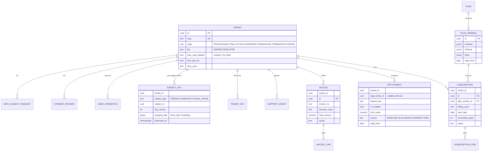
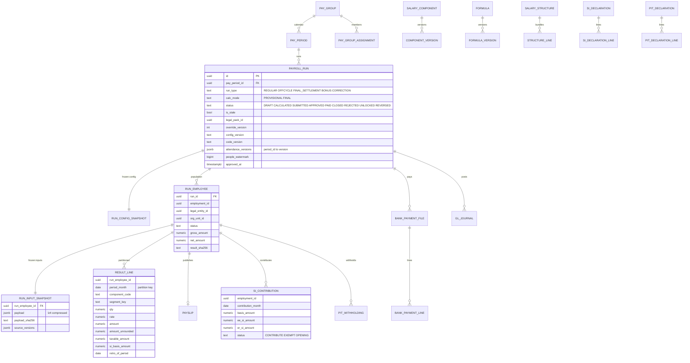
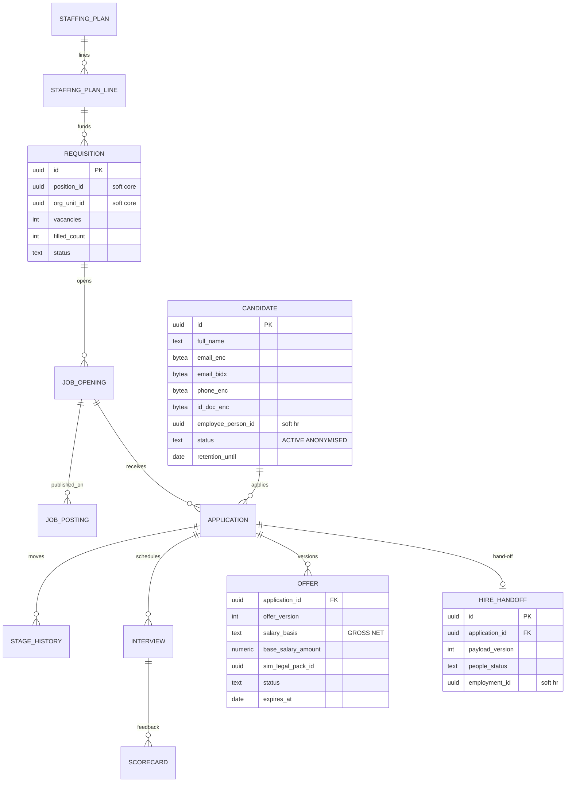
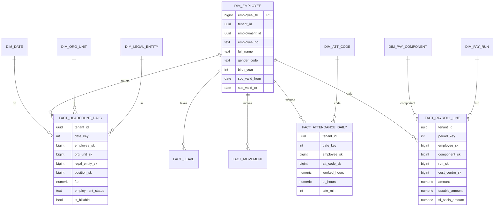
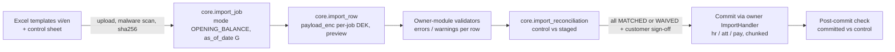

# YourHRM — Data Architecture (v0.3)

| Item | Value |
|---|---|
| Version | **0.3 — 2026-10-16** (round-2 decisions R2-01, R2-11, R2-12, R2-15, R2-16, R2-17, R2-18 of the [decision log](../../docs/00-project-management/decision-log.md) §7–§7.2 applied; v0.2 applied round 1; v0.1 was the draft for review) |
| Status | Baseline for SRS and sprint 1. Decisions recorded as ADR-0020 … ADR-0037; status per ADR in §16 |
| Author | Data Architect |
| Inputs | [Architecture brief](../../docs/02-architecture/architecture-brief.md), [decision log](../../docs/00-project-management/decision-log.md), [BRD](../../docs/01-requirements/brd/BRD.md), [gap analysis](../../docs/01-requirements/brd/gap-analysis.md) §5/§6/§7/§9, module BRDs §6–§7 |
| Target | PostgreSQL 17 on CloudNativePG (SA ADR-0002/0017); DDL kept compatible with 16+. Java 25 / Spring Boot 4 (OD-3; fallback Boot 3.5 / Java 21 decided after SP-1), Hibernate + jOOQ, modular monolith |
| Aligned with | SA ADR-0002 (stack), 0003 (tenancy runtime, `saas.tenant_placement`, baseline capabilities), 0004 rev. 2 (outbox + polling relay; Phase-1 DB-backed bus, Kafka Phase 2), 0006 (scope predicates, `report_scope`), 0009 (snapshot-first runs), 0010 (Legal Parameter Service), 0011 (job queue), 0012 (reporting), 0017 (CNPG, OpenBao, DR), 0019 (close hold, accepted X-03) |
| DDL | [`ddl/`](ddl/) — `000_extensions_roles.sql`, `001_saas.sql`, `002_core.sql`, `003_hr.sql`. **v0.1** was smoke-tested on PostgreSQL 16.4 (PGlite; pgcrypto/unaccent stubbed): all files loaded, cross-tenant reads and writes were blocked, no context = no rows, exclusion constraints, bi-temporal guard and audit tamper detection behaved as designed. **The v0.2 changes are NOT re-tested** (no PostgreSQL/Python available in this round; careful read-through only): `core.import_job`/`import_row`/`import_reconciliation` and `sys.cross_schema_grant_violations()` in `002`, `hr.v_salary_record_masked` and `source = 'OPENING_LOAD'` in `003`, audit actor `IMPORT`, comments in `000`/`001`. **The v0.3 changes are NOT tested either** (PostgreSQL and Python are not installed; read-through only): `saas.job.ordering_key`, `saas.claim_jobs()` ordered lanes, `saas.enqueue_event_delivery()`, entitlement source `BASELINE` and `saas.baseline_capability` in `001`; `hr.primary_employment` replacing `hr.employment.is_primary`, `employment_person_le_ex` in `003`; role comments in `000`. Note: the tenancy helpers live in `000` (schema `sys`), not `002`, because `001_saas` needs them. |

**What changed in v0.3 (round 2, decision log §7–§7.2).** R2-01: Phase 1 has **no live external integrations** — no device connector or punch ingestion (`att.raw_punch` gets punches only from imported device-export files, §7.4), no Kafka in Phase 1 (the outbox relay feeds a DB-backed bus on `saas.job`, §9.1; SA ADR-0004 rev. 2), and the reporting store is fed by native logical replication (§11). R2-11: the X-02 exception list including the tenant override rows of `core.code_value`/`core.exchange_rate` and the two plumbing grants is **accepted** (§2.3). R2-12: `SUSPENDED` employments are **not billable** (§11). R2-15: plaintext salary amounts readable with `hr`/`pay` DB credentials — accepted with mitigations (§15.2). R2-16: concurrent employment across legal entities — `hr.primary_employment` with "at most one primary employment per person per purpose per period" (§7.3). R2-17: payslip PDF password (`pay.payslip_delivery_preference`, P3, §7.5, §9.3). R2-18: baseline always-on capabilities as `BASELINE` entitlements (§7.1).

**What changed in v0.2.** X-01: salary amounts stay plaintext (P2) with compensating controls; identifiers, bank accounts and special-category data stay encrypted (§9.3, ADR-0026). X-02: the read-only reference-data exception is listed explicitly and guarded by a DB test and an ArchUnit rule (§2.3, ADR-0021). D-09: **no Oracle migration**; §13 is now the generic **opening-balance import** (ADR-0037, supersedes ADR-0033) and the `stg_*`/`mig` schemas are removed. D-10: billable-employee definition (§11). X-05: punch rates (§10.1). OD-9: no mobile punches in Phase 1 (§7.4). D-01, D-03, Flyway Community: accepted (§15).

Items marked **[spike]** need a technical proof before the decision is final. Items marked **[verify-legal]** follow the BRD convention.
The Solution Architect (SA) owns the container view, bus technology, outbox relay, identity and the payroll engine (ADR-0001 … 0019). This document owns the tables underneath them.

---

## 1. Principles

1. **One owner per datum** (gap-analysis §5). A table lives in the schema of the module that owns the datum. Other modules hold an *event-fed projection* or call the owner's API. They never read the owner's tables.
2. **Isolation enforced by the database.** Every tenant-owned row carries `tenant_id`. PostgreSQL row-level security (RLS) fails closed when no tenant is set. The application guard is the second layer, not the only one.
3. **Time is a first-class column.** Business validity uses `valid_from`/`valid_to` with exclusion constraints. Salary, assignment and legal parameters also keep transaction time, so the system can answer "as of X, as known on Y".
4. **Calculations are reproducible.** Payroll and attendance results are immutable once approved. They store the inputs, the legal-pack version, the config version and the code version they used, and stay reproducible for 10 years.
5. **Identifiers, bank accounts and special-category data are encrypted by the application with per-tenant keys**, so destroying keys deletes data (crypto-shredding), including copies in replicas, the reporting store and exports. **Salary amounts are not column-encrypted** (X-01); they are protected by RLS, module roles, masking views and access audit.
6. **The schema evolves without downtime.** Changes are forward-only expand/contract migrations, and every database (shared pool or dedicated) has the same schema.

---

## 2. Schema map and ownership

### 2.1 Schemas

| Schema | Owner module (code) | Content | RLS |
|---|---|---|---|
| `sys` | Platform shared kernel | **No tables.** Functions, domains and trigger functions: `uuid_v7()`, tenant-context getters, RLS helpers, partition helper, immutability guards, `f_unaccent()` | n/a |
| `saas` | SaaS platform | Tenants, plans, subscriptions, entitlements, flags, usage, invoices, support grants, identity (credentials, MFA, IdP config, API clients), **legal parameter packs**, consent/DSR/retention registries, key registry | Mixed: platform rows (no RLS, platform role only) and tenant rows `(T)` with RLS |
| `core` | Core | Global master data (country, currency, admin units + mapping, banks, code lists), legal entity, location, org tree, job architecture, grades catalogue, positions, cost centres, users/roles/data scope, workflow, notifications, documents, settings, custom fields, import/export jobs, exchange rates | Yes (global tables are read-only to apps and have no `tenant_id`) |
| `audit` | Core (`audit` component) | `audit_event` (partitioned, hash-chained), chain heads and anchors | Yes; append-only grants |
| `hr` | People | Person, employment, assignment, salary record, contract, decision, family/dependants, bank accounts, separation, documents meta, appraisal/training (P2) | Yes |
| `att` | Time & Attendance | Holiday calendars, shifts, patterns, schedule assignment, rosters, devices, punches, daily timesheets, OT, leave, business trips, attendance periods and result versions | Yes |
| `pay` | Payroll | Pay groups, calendars and periods, component catalogue, formulas, structures, pay scales/bands, pay profile projection, inputs, runs, snapshots, results, SI/PIT, payslips, bank files, GL, loans, final settlement | Yes |
| `rec` | Recruitment (P2) | Staffing plan, requisition, opening, posting, candidate, application, interview, offer, hand-off | Yes |

The v0.1 `stg_*`/`mig` schemas (Oracle migration database) are **removed** (D-09: no Oracle migration). Go-live opening balances are staged in Core's generic import tables `core.import_job`/`import_row`/`import_reconciliation` (§13, ADR-0037), in the tenant's own cluster under RLS.

Every module schema also contains its own `outbox_event` and `inbox_message` (§9.1) and its own Flyway history table (§12).
The reporting store is a **separate database** (§11).

**Why `audit` is its own schema** although Core owns it: it needs its own grants (INSERT-only for every module role, UPDATE only for the sealer), its own partitioning/retention lifecycle, and every module writes into it inside its business transaction (NFR-CORE-008). It is the **only** schema that all module roles may write to.

**Why `sys` holds no tables:** functions and domains are code, not data, and every schema needs them. Having no tables means nobody "owns data" there.

### 2.2 Cross-schema rules (ADR-0022)

| Rule | Decision |
|---|---|
| Foreign keys **inside** a schema | Mandatory, and composite: `(tenant_id, parent_id) → parent(tenant_id, id)`. A row can therefore never reference another tenant's row. |
| Foreign keys **across** schemas | **None, with no exceptions** — not to `core`, and not even to `saas.tenant`. |
| Referencing another module's entity | Store its ID as a *soft reference* (`position_id uuid`, column comment `-> core.position (soft)`). The application validates it through the owner's API at write time. Eventual integrity comes from owner events plus a nightly orphan-reference check. |
| Referencing **global** master data | Use the **stable business code**, not a surrogate (`country_code char(2)`, `currency_code char(3)`, `admin_unit_code text`, `bank_code text`). Codes survive environment copies, dedicated DBs, tenant moves and imports unchanged. |
| Reading another module's data in bulk | Through an **event-fed projection** in the consumer schema, named `ext_<owner>_<entity>` (for example `pay.ext_hr_salary`, `att.ext_core_location`). Each row stores the `source_event_id` and `source_version`. Projections are rebuildable from the owner API ("re-sync" job). |
| `tenant_id` | Not a foreign key. Its validity is guaranteed by RLS context, provisioning and the tenant purge job. An FK to a single hot tenant row would also take `FOR KEY SHARE` locks on every insert (multixact pressure). |

**Justification.** (a) PM baseline 3: modules never touch each other's tables. Cross-schema FKs would couple their migrations, deployment order and deletion order. (b) Per-module DB roles (§3.4) can then enforce the boundary with grants. (c) Payroll workers and punch ingestion can later move to their own database without rewriting the schema. (d) Cost: integrity across modules becomes eventual. This is mitigated by projections carrying versions, reconciliation reports and the period-close version handshake (gap §7).

### 2.3 Module → schema access matrix (DB grants)

| DB role | saas | core | audit | hr | att | pay | rec |
|---|---|---|---|---|---|---|---|
| `yhrm_app_saas` | RW | R (ref)¹ | INSERT | – | – | – | – |
| `yhrm_app_core` | R (ref)¹ + job² | RW | INSERT, SELECT | – | – | – | – |
| `yhrm_app_hr` | R (ref)¹ + job² | R (ref)¹ | INSERT | RW | – | – | – |
| `yhrm_app_att` | R (ref)¹ + job² | R (ref)¹ | INSERT | – | RW | – | – |
| `yhrm_app_pay` | R (ref)¹ + job² | R (ref)¹ | INSERT | – | – | RW | – |
| `yhrm_app_rec` | R (ref)¹ + job² | R (ref)¹ | INSERT | – | – | – | RW |

¹ **X-02 read-only exception (accepted 2026-10-16; the complete list below, including the tenant override rows of `core.code_value`/`core.exchange_rate` and the two plumbing grants of footnote ², was accepted as covered by X-02 in R2-11)** — the only reads across schemas, all `SELECT`, granted to the group role `yhrm_app`:

| Object | Content | Why it is safe |
|---|---|---|
| `core.country`, `core.currency`, `core.admin_unit`, `core.admin_unit_mapping`, `core.bank`, `core.bank_branch`, `core.code_list` | Pure global reference data | Immutable between platform releases (`core.MasterDataReleased`), no tenant data |
| `core.code_value`, `core.v_code_value_effective`, `core.exchange_rate` | Global rows + the tenant's own reference overrides | RLS returns own + sentinel rows only; reference data, read-only |
| `saas.tenant` | The tenant's own row (locale, time zone, state) | Policy `tenant_self_read` |

² Platform plumbing, not data reads (accepted R2-11): `SELECT, INSERT` on `saas.job` (transactional enqueue, ADR-0011) and `INSERT` on `audit.audit_event` (ADR-0027). Phase-1 event-bus delivery jobs in `saas.job` carry only a pointer to the outbox row, never the business payload (§9.1), so this grant does not expose amounts across modules.

Not covered: legal parameter tables (other modules use the Legal Parameter Service API; only `yhrm_app_saas` reads them), any other module's tenant data, any amount table. **Guards (release-blocking):** (a) DB test `SELECT count(*) FROM sys.cross_schema_grant_violations()` = 0 (function in `002_core.sql`, reads `pg_class.relacl` and compares with this allow-list); (b) ArchUnit/jOOQ rule allowing schema-Y references from module X only for these objects. A new entry needs an ADR-0021 amendment.

---

## 3. Multi-tenancy at the data level (ADR-0020, ADR-0021, ADR-0035, ADR-0036)

### 3.1 Model

* **Shared pool (default):** one PostgreSQL cluster per region pool. All tenants share the tables, every tenant-owned table has `tenant_id uuid NOT NULL`, and RLS is enabled and **forced**.
* **Dedicated tier (Enterprise):** a separate database (and normally a separate cluster) with **byte-identical DDL**, including `tenant_id` and RLS. Tenant routing comes from `saas.tenant_placement` (SA ADR-0003). Keeping RLS on in a single-tenant DB costs little, keeps one code path and is defence in depth (ADR-0036).
* **Platform cluster and placement classes** (aligned with the SA overview: "the `saas` schema lives in a platform cluster"). Every database has the **same DDL**, all schemas included. What differs is where each table is *authoritative*:

  | Class | Authoritative in | Copies | Tables |
  |---|---|---|---|
  | PLATFORM | platform cluster | none | `saas.plan*`, `subscription*`, `invoice*`, `support_grant`, `tenant_key`, `subject_key`, `consent_record`, `data_subject_request`, `archive_manifest`, `platform_audit_event`, legal-pack authoring |
  | REPLICATED | platform cluster | read-only logical replication to every pool/dedicated cluster (`pub_platform_ref`) | `saas.tenant`, `tenant_placement`, `entitlement`, `legal_param_*` (published packs only), `retention_policy`, Core global master data (`core.country`, `admin_unit`, `bank`, global `code_value` rows) |
  | LOCAL | each cluster | none | module schemas `core`/`audit`/`hr`/`att`/`pay`/`rec`, `saas.job` (queue; enqueued in the business transaction, ADR-0011), every `outbox_event`/`inbox_message` |

  Keeping the keyring (`subject_key`) in the platform cluster also means pool-cluster backups never contain wrapped DEKs. **[spike: logical replication of REPLICATED tables vs release-job push; conflict handling for global `code_value` rows]**

### 3.2 Tenant context per transaction

```sql
-- issued by the application as the FIRST statement of every transaction
SELECT set_config('app.tenant_id', :tenantId, true),   -- true = transaction-local (SET LOCAL)
       set_config('app.user_id',   :userId,   true),
       set_config('app.request_id',:requestId,true),
       set_config('app.purpose',   :purpose,  true),    -- e.g. PAYROLL_RUN, ESS, SUPPORT_GRANT
       set_config('app.support_grant_id', :grantId, true),  -- operator sessions only (SA ADR-0003)
       set_config('app.mask_level', :maskLevel, true);      -- NONE | PII | PII_AND_PAY (masking views, §9.4)
```

* `sys.current_tenant_id()` returns `NULLIF(current_setting('app.tenant_id', true), '')::uuid`. The `NULLIF` matters: after a `SET LOCAL` has ended, a pooled session still holds the placeholder as `''`, not NULL.
* Policies compare `tenant_id = (SELECT sys.current_tenant_id())`. The scalar subquery becomes an InitPlan that is evaluated **once per statement**, so the comparison stays index-friendly.
* **Fail closed:** without a tenant, the comparison is NULL, so the query returns no rows and every insert fails `WITH CHECK`.
* Spring: a `TenantAwareDataSource` / `TransactionSynchronization` runs `set_config` right after `BEGIN`. **Every** DB access must run inside `@Transactional` (read-only included). An ArchUnit rule plus a runtime check (`sys.assert_tenant()` in a `connectionInitSql`-like hook per transaction) enforces this. The context is never set at session level.
* **Background jobs** (payroll workers, schedulers) set the context per tenant per transaction. Cross-tenant jobs loop over tenants. They never use a BYPASSRLS role.

### 3.3 Connection pooling

* **PgBouncer in transaction mode** in front of each cluster. `SET LOCAL`/`set_config(..., true)` is safe because the context dies with the transaction.
* Forbidden: session `SET`, session advisory locks (use `pg_advisory_xact_lock`), `LISTEN/NOTIFY` through PgBouncer (the relay uses a direct connection), and `WITH HOLD` cursors.
* Server-side prepared statements: PgBouncer ≥ 1.21 with `max_prepared_statements > 0` **[spike: pgJDBC + PgBouncer 1.21+ prepared-statement mode under load]**.
* There is one Hikari pool per module role (six pools). Total server connections are bounded by PgBouncer `default_pool_size` per (db, user). Payroll workers get their own PgBouncer pool, so a payroll run cannot starve OLTP (NFR-SAAS-005).

### 3.4 Database roles

| Role | Login | BYPASSRLS | Purpose |
|---|---|---|---|
| `yhrm_owner` | no | **yes** | Owns every object. Used only via `SET ROLE` by the migrator. BYPASSRLS allows cross-tenant backfills in migrations. |
| `yhrm_migrator` | yes | no (inherits via `SET ROLE`) | Flyway. Member of `yhrm_owner`. Used only by the CI/CD pipeline. |
| `yhrm_app` | no | **no** | Group role that all RLS policies target. |
| `yhrm_app_{saas,core,hr,att,pay,rec}` | yes | no | One login role per module, member of `yhrm_app`. Grants per §2.3. |
| `yhrm_platform` | yes | no | Operator back-office. Has DML on platform tables in `saas`, and **no** grants on tenant business schemas. Operator support access goes through the application under a support grant (BR-SAAS-033) and is masked there. |
| `yhrm_relay` | yes | no | Outbox polling relay (SA ADR-0004 rev. 2). Can `SELECT` and update `published_at` on outbox tables (policy `TO yhrm_relay USING (true)`). Phase 1: `EXECUTE` on `saas.enqueue_event_delivery()` (SECURITY DEFINER) to fan events out as delivery jobs; Phase 2: publishes to Kafka instead. Not a module role, so outside the X-02 list. |
| `yhrm_cdc` | yes | no | `REPLICATION`. **Reporting-store feed only** (SA ADR-0012 amendment): Phase 1 native logical replication with column-listed publications (P3 columns never published); Debezium on a standby is a Phase-2 option. |
| `yhrm_audit_sealer` | yes | no | Seals the audit hash chain (UPDATE of seal columns only). |
| `yhrm_reporting_ro` | yes | no | Read-only role for the few OLTP-real-time statutory reports (BR-SAAS-047 exception), RLS applies. |
| `yhrm_ops_ro` | yes | no | `pg_monitor`, `pg_read_all_stats`. No table data. |
| `yhrm_breakglass` | no | **yes** | Granted temporarily to a named DBA on two-person approval (BR-SAAS-036), with pgaudit logging every statement. Revoked automatically after ≤ 4 h. |

### 3.5 Table classes and RLS policy templates

| Class | `tenant_id` | Policy (applied by `sys.enable_tenant_rls()`) | Examples |
|---|---|---|---|
| **Tenant-owned** | `NOT NULL` | `FOR ALL TO yhrm_app USING (tenant_id = cur) WITH CHECK (tenant_id = cur)` | almost everything |
| **Global + tenant-overridable** | `NOT NULL`; global rows use the sentinel `sys.global_tenant_id()` = `00000000-0000-0000-0000-000000000000` | `SELECT` where `tenant_id IN (cur, global)`; writes only `tenant_id = cur` | `core.code_value`, `att` holiday template copies, `pay.salary_component` templates |
| **Pure global** | none | No RLS. `SELECT` granted to app roles for the Core tables (X-02 list, §2.3); `saas.legal_param_*` only to `yhrm_app_saas` (others use the LPS API); writes only by `yhrm_owner`/release job | `core.country`, `core.currency`, `core.admin_unit`, `core.bank`, `saas.legal_param_*` (published packs) |
| **Platform-only** | none or optional | No grants to tenant app roles | `saas.plan`, `saas.feature_flag`, `saas.invoice` (read by tenant UI through the SaaS API) |

Override resolution for the global + tenant class uses `DISTINCT ON (list_code, value_code) … ORDER BY (tenant_id = sys.global_tenant_id())`, so a tenant row shadows the global row with the same code. Tenants can add or deactivate values but cannot edit global rows.

### 3.6 Indexing for tenancy

* The PK of every tenant-owned table is `(tenant_id, id)`. Every secondary index **starts with `tenant_id`** unless it is a globally unique technical index (for example `outbox_event(published_at)`).
* Uniqueness of business keys is per tenant: `UNIQUE (tenant_id, code)`, or `(tenant_id, legal_entity_id, code)` where needed.
* Partitioned big tables use time ranges, not tenant hashes (§10). A tenant big enough to need its own partitions goes to the dedicated tier.

### 3.7 Tenant export, offboarding and deletion

| Step | Mechanism |
|---|---|
| Export (NFR-SAAS-019) | An export job runs per module as the module app role with the tenant context set: `COPY (SELECT …) TO STDOUT` as versioned NDJSON per entity, plus documents from object storage. Encrypted fields are decrypted by the application into the export, which is itself encrypted with a customer-supplied key or password. Target: 10k employees ≤ 6 h. |
| Termination | `saas.tenant.state = TERMINATING`. Login is blocked and data stays read-only for 90 days (SaaS Q10). |
| Purge | (1) **Crypto-shred:** schedule KMS deletion of the tenant KEK (§9.3). From that moment every encrypted column in the primary, replicas, reporting store, exports and **backups** is unreadable. (2) Delete rows in batches per schema (`DELETE … WHERE tenant_id = $1` in chunks of 10k by PK range, throttled). (3) Delete the tenant's reporting-store rows and object-storage prefix. (4) Write a purge certificate to the platform audit, with row counts per table. Plaintext data in backups ages out with backup retention (35 days), which is documented to the DPO. |
| Dedicated tier | Drop the database after export plus KEK destruction. |
| Per-tenant restore (NFR-SAAS-006) | Restore the cluster PITR into a scratch instance, then copy the tenant's rows into a sandbox tenant through the export/import format (never `pg_restore` into the shared pool). |

---

## 4. Keys and conventions (ADR-0023, ADR-0034)

### 4.1 Primary keys

* **Surrogate `id uuid`, UUIDv7**, generated by the application (time-ordered, so B-tree inserts stay right-leaning and index bloat is close to bigint). It is globally unique, safe to expose in APIs and events, mergeable across shared and dedicated DBs, and known before insert (outbox payloads, idempotent imports). The SQL fallback `sys.uuid_v7()` is the column default. On PostgreSQL 18 it can be swapped for the built-in `uuidv7()`.
* `tenant_id uuid` (UUIDv7 as well).
* **PK `(tenant_id, id)`** on tenant-owned tables. This makes composite FKs possible and keeps all of a tenant's index entries adjacent. APIs still address rows by `id` alone (globally unique), and lookups add `tenant_id` from the context.
* `bigint` is used only where a gap-free order is the point: `audit.audit_event.chain_seq` and `saas.legal_param_pack.pack_version`. Punches and result lines also use UUIDv7, so one rule applies everywhere.
* **Business keys** (`employee_no`, `code`, contract `number`) are separate unique constraints and editable under governance.

### 4.2 Naming

| Object | Convention | Example |
|---|---|---|
| Schema, table, column | `snake_case`, singular nouns, ASCII, English | `hr.salary_record` |
| PK / FK column | `id` / `<entity>_id` | `employment_id` |
| Soft cross-schema reference | `<entity>_id` with comment `-> core.position (soft)` | `position_id` |
| Global code reference | `<thing>_code` | `country_code`, `bank_code` |
| Booleans | `is_` / `has_` | `is_retro` |
| Instants / dates | `_at` (`timestamptz`) / `_date`, `valid_from`, `valid_to` (`date`) | `approved_at` |
| Money / quantity / rate | `_amount` + `currency_code`, `_qty`, `_rate` | `base_salary_amount` |
| Encrypted / blind index / display hint | `_enc` (`bytea`), `_bidx` (`bytea`), `_last4` (`text`) | `national_id_enc` |
| Constraints | `<table>_pk`, `<table>_<col>_fk`, `_uq`, `_ck`, `_ex` (exclusion) | `assignment_period_ex` |
| Indexes | `<table>_<cols>_ix` | `employment_person_ix` |
| Projections of another module | `ext_<owner>_<entity>` | `pay.ext_hr_salary` |
| Views | `v_<name>`; masking views `v_<table>_masked` | `hr.v_person_masked` |

### 4.3 Standard columns

| Column | Type | Rule |
|---|---|---|
| `tenant_id` | `uuid NOT NULL` | Immutable. A trigger blocks changes. |
| `id` | `uuid NOT NULL DEFAULT sys.uuid_v7()` | |
| `created_at`, `created_by` | `timestamptz NOT NULL DEFAULT now()`, `uuid` | `created_by` = `core.user_account.id`, a system principal id, or an API client id (soft reference) |
| `updated_at`, `updated_by` | same | Trigger `sys.tg_touch()` sets `updated_at`. The application sets `updated_by`. |
| `version` | `integer NOT NULL DEFAULT 0` | Optimistic lock (JPA `@Version`). Not used on append-only tables. |

Append-only tables (punches, outbox, audit, result lines, snapshots) carry only `created_at`/`created_by`.

### 4.4 Deletion policy

* **No generic soft delete** (`deleted_at` flags are not used). Each lifecycle is modelled explicitly: `status` (`DRAFT/ACTIVE/INACTIVE/CANCELLED`), effective dating (`valid_to`), or supersession (bi-temporal tables).
* Hard delete is allowed only for `DRAFT` rows that never took effect and for technical rows (outbox, inbox, expired sessions).
* Records with a legal retention period (contracts, payroll, SI/PIT, attendance) are removed only by the **retention scheduler** (SaaS owner): anonymise, crypto-shred, then delete, with evidence in the audit log.

### 4.5 Enumerations

| Kind | Storage | Why |
|---|---|---|
| System state machines and closed technical sets (`status`, `run_type`, `assignment_type`) | `text` + `CHECK (col IN (...))` | Values can be added with `NOT VALID` + `VALIDATE` and no lock-heavy `ALTER TYPE`. They read well in CDC and reports. **PostgreSQL `ENUM` types are not used.** |
| Statutory classifications (contract type, SI decrease reason, PIT residency, relationship, ethnicity) | Global code list `core.code_value` (pure global, versioned) | Owned by the platform release workflow. Codes are referenced as text. |
| Tenant-configurable lists (leave reasons, employee category, separation reasons) | `core.code_value` global + tenant override | Tenants extend them without schema change. |
| Module configuration with behaviour (leave type, salary component, attendance code) | A proper table in the owning module | It has attributes and rules. |

### 4.6 Money, quantities, rounding

* Domains in `sys`: `sys.money_amount = numeric(19,4)`, `sys.rate = numeric(12,8)` (SI 8% stays exact, and FX rates are supported), `sys.quantity = numeric(12,4)` (hours, days, half-days).
* Every money column has a sibling `currency_code char(3)` (default `VND`), or the row inherits the currency from its header (for example `result_line` from `payroll_run`).
* **VND has no minor unit.** Values *payable or declared* (net pay, PIT withheld, SI contributions, bank lines, declarations) are stored **already rounded to 1 VND** in `numeric(19,4)` (scale kept for USD contracts and intermediate values). The rounding rule is configuration, not code: `pay.salary_component.rounding_mode` (`HALF_UP`, `DOWN`, `UP`, `HALF_EVEN`) and `rounding_unit` (1, 10, 100, 1000). Statutory defaults come from the legal pack (`ROUNDING.PIT`, `ROUNDING.SI`) **[verify-legal]**.
* Result lines keep both `amount` (rounded, authoritative) and `amount_unrounded numeric(24,8)` for traceability and penny reconciliation.
* Java uses `BigDecimal` with an explicit `MathContext`. Floating point is forbidden (NFR-PAY-002).

### 4.7 Dates, times, time zones

* The DB server and every session run in `TimeZone = 'UTC'`. All instants are `timestamptz`.
* **Business dates are `date`** in the *local* calendar of the location or legal entity: work date, effective dates, pay period dates. They are never derived inside SQL from `now()` without an explicit zone. Activation jobs run at 00:00 `Asia/Ho_Chi_Minh` (NFR-CORE-015).
* Shift times use `time` plus a `crosses_midnight` flag. Punches store `punch_at timestamptz` (normalised UTC), `local_ts timestamp` (device wall clock, as received) and `tz_name text` (NFR-ATT-005).
* Year-month periods are stored as the first day of the month (`date`, with `CHECK (date_trunc('month', m) = m)`), not as strings.
* Text: database encoding UTF-8, ICU collation `und-x-icu` as default, and an ICU `vi-VN` collation used for name sorting. Accent-insensitive search uses `sys.f_unaccent(lower(x))` with `pg_trgm` GIN indexes (NFR-CORE-011, NFR-PPL-009).

---

## 5. Effective dating and bi-temporality (ADR-0024)

### 5.1 Pattern A — valid time only (most master data)

```
valid_from  date NOT NULL,
valid_to    date NULL,                 -- exclusive; NULL = open-ended
valid_during daterange GENERATED ALWAYS AS (daterange(valid_from, valid_to, '[)')) STORED,
CONSTRAINT x_period_ck CHECK (valid_to IS NULL OR valid_to > valid_from),
CONSTRAINT x_period_ex EXCLUDE USING gist (tenant_id WITH =, <entity>_id WITH =, valid_during WITH &&)
```

* The bounds are **half-open `[valid_from, valid_to)`**. An "end date" shown in the UI is `valid_to - 1`. This avoids the classic off-by-one when ranges are contiguous.
* The exclusion constraint needs `btree_gist` (for the `uuid` equality) and guarantees there is no overlap. Gaps are allowed unless the entity says otherwise; "no gap" is checked by the service.
* Structure: an **anchor table** holds the identity and immutable attributes (`core.org_unit`: `id`, `code`), and a **version table** holds the effective-dated attributes (`core.org_unit_version`). Corrections to a version are plain updates captured by the audit log, which is enough for core master data.
* Used for: legal entity, location, org unit, position, job, grade, cost centre, schedule assignment, pay group assignment, bank account, dependant registration, special status, address.

### 5.2 Pattern B — bi-temporal (salary, assignment, legal parameters; NFR-PPL-001, BR-PAY-072)

Pattern A plus transaction time on the same table:

```
recorded_at    timestamptz NOT NULL DEFAULT now(),   -- when this version became known
superseded_at  timestamptz NULL,                     -- when it stopped being the current knowledge
superseded_by  uuid NULL,                            -- the correcting row (soft, same table)
correction_reason text NULL,
EXCLUDE USING gist (tenant_id WITH =, <key> WITH =, valid_during WITH &&) WHERE (superseded_at IS NULL)
```

* **Rows are never updated in place**, except to stamp `superseded_at`/`superseded_by`. The trigger `sys.tg_bitemporal_guard()` rejects any other change, and `DELETE` is rejected too. (Stored generated columns are NULL in `NEW` inside BEFORE triggers, so the guard ignores `valid_during`. This was found in the smoke test.)
* Transaction time is the **transaction timestamp** (`now()`), so a supersession and its replacement made in one transaction share the same instant. "As known on" has per-transaction granularity, which is the intended semantics.
* **Prospective change** (new salary from 1 Jan): close the current row by superseding it and inserting a copy with `valid_to = 2027-01-01`, then insert the new row. All of this happens in one transaction.
* **Retroactive correction** (the March salary was wrong): supersede the affected rows and insert corrected rows with the same or a new valid range. Payroll detects the change because `recorded_at` is later than the run's watermark, which creates retro items (gap §7.2 steps 7 and 13).
* Queries:

```sql
-- as of business date :d, current knowledge
SELECT * FROM hr.salary_record
 WHERE tenant_id = :t AND employment_id = :e AND superseded_at IS NULL AND valid_during @> :d::date;

-- as of business date :d, as known on :k  (payroll reproduction, audit)
SELECT * FROM hr.salary_record
 WHERE tenant_id = :t AND employment_id = :e
   AND recorded_at <= :k AND (superseded_at IS NULL OR superseded_at > :k)
   AND valid_during @> :d::date;

-- all segments overlapping a pay period (proration)
SELECT * FROM hr.salary_record
 WHERE tenant_id = :t AND employment_id = :e AND superseded_at IS NULL
   AND valid_during && daterange(:p_start, :p_end, '[]');
```

* Indexes: a partial B-tree `(tenant_id, employment_id, valid_from) WHERE superseded_at IS NULL` for the hot path, plus the GiST exclusion index (which also serves `@>`/`&&`). Full-history queries use `(tenant_id, employment_id, recorded_at)`.
* Identity across versions: every version row has its own `id` (referenced by snapshots and audit). The stable business identity is `employment_id` for salary, and `assignment_key` for assignment (one employment may hold several concurrent assignments).
* A shared Java library (`temporal-kit`) implements supersede/split/merge, so services never hand-write these updates.

### 5.3 As-of org structures and data scope

`core.org_unit_version` stores `parent_id` and a materialised `path ltree` per version. An as-of tree is `WHERE valid_during @> :d`. A subtree is `path <@ :root_path`, backed by a GiST index on `path`. A path changes only when a re-organisation activates a new version, and Core recomputes the descendants' versions in the same package (`reorg_package`). Target: NFR-CORE-003 (2,000 units ≤ 1 s).

Data scope (SA owns the enforcement): every employee-scoped row in `hr`, `att`, `pay` carries denormalised `legal_entity_id` and `org_unit_id` (as of the row's date, taken from the assignment). Core resolves a user's scope into a set of org unit ids (cached, from `core.org_unit_version.path`). Modules apply `org_unit_id = ANY(:scopeIds)` against indexes `(tenant_id, org_unit_id, ...)`. RLS enforces **only** the tenant, not data scope: scope is user-relative and changes with delegation, so putting it in RLS would defeat plan caching and the ≤ 20 ms budget (NFR-CORE-002).

---

## 6. Legal parameter packs (ADR-0025)

Owner: SaaS (gap §5 #1). The Payroll BRD entities `legal_param_set`/`pit_schedule` move here. Payroll, T&A, People, Core and Rec read through the Legal Parameter Service API (SA owns the API and caching), as of an effective date.


Rules:

1. **A pack is a cumulative, immutable snapshot.** Pack version *N* contains **every** parameter with its **whole effective-date history**: hundreds of keys × a few ranges, which is small. "Value of key K on date D under pack N" is a single lookup in N. Older packs stay queryable forever, which gives 10-year reproducibility without replaying deltas. A trigger blocks any change once the pack is `PUBLISHED`.
2. Value shapes: scalars in `value_num`; structured values (PIT brackets, OT multipliers by category, retirement roadmap) in `value_json`, validated against `definition.json_schema`. A new PIT schedule structure therefore needs **no schema change** (NFR-PAY-007). Large maps (admin unit → minimum-wage region, about 3,300 communes after the 2025 restructure) go to `legal_param_table_row`.
3. **Publishing** (lifecycle per SA ADR-0010: `DRAFT → IN_TEST → APPROVED → PUBLISHED → SUPERSEDED`, plus `WITHDRAWN`): published packs form a total order per `pack_code`. Exactly one pack is *current*, and publishing a new one moves the previous pack to `SUPERSEDED` (content unchanged, still used for reproduction). The event `saas.LegalParameterPackPublished` (pack version, changed keys and dates) drives cache invalidation and retro detection.
4. **Retroactive law** (NFR-SAAS-016): a later pack may change a value for past dates. Results already approved keep their stamped pack. Payroll compares the stamped pack with the current pack for the affected keys and dates, and proposes retro.
5. **Tenant overrides** are allowed only where `override_rule <> NONE`, at the most specific level the definition allows (`TENANT`, `LEGAL_ENTITY` or `LOCATION`; resolution order GLOBAL → TENANT → LEGAL_ENTITY → LOCATION, ADR-0010):
   * `FLOOR`: the tenant value must be ≥ the statutory value (for example leave days, a minimum wage used in a pay scale).
   * `CAP`: the tenant value must be ≤ the statutory value (for example an internal OT cap).
   * `ANY`: free choice (for example the std-day method default).

   The check runs against the statutory value **for the same dates** at activation, and again when a new pack is published; a violation raises an alert to the tenant admin and the payroll SME. Overrides are grouped into a tenant `override_set` with a monotonic `override_version`, approved through Core workflow and audited. Activated sets are immutable, and a change creates a new set version.
6. **Version stamping:** every attendance result version, payroll run, run input snapshot, offer simulation (`rec.offer.sim_param_version`) and People eligibility calculation stores `legal_pack_id` + `override_version`. Payroll runs also store `config_version` and `code_version` (NFR-SAAS-017).
7. Dedicated DBs receive published packs by replication. Packs are pure-global tables with no `tenant_id`; overrides are tenant-owned.

The calculation-time resolution order is: tenant LE override → tenant override → pack value. The resolved value set for a run is frozen into the run config snapshot (§7.3).

---

## 7. Key entity models per schema

The diagrams show key tables and columns only. Every tenant-owned table also has `tenant_id` in its PK and the standard columns (§4.3). Dashed relationships (`..`) are **soft cross-schema references** (no FK). DDL exists for `saas`, `core` and `hr` (see `ddl/`); `att`, `pay` and `rec` are specified here and get DDL in the next iteration.

### 7.1 `saas`



Also in `saas`: `price_book`, `feature_flag`, `usage_record` (monthly partitions), `payment`, `operator_session`, `identity_provider_config (T)` (SSO, **Phase 2**, R2-04), `mfa_factor (T)` (TOTP and e-mail OTP in Phase 1), `api_client (T)` (public API, **Phase 2**), `webhook_subscription (T)` (**Phase 2**, R2-01), `retention_policy (T)`, `security_incident`, plus the legal parameter tables (§6). (The v0.1 `import_batch`/`reconciliation_run` for the Oracle migration programme are dropped; go-live imports and their reconciliation live in `core.import_*`, §13.)

`saas.billing_party (T)` holds only the invoicing identity of a tenant's legal entities, keyed by `legal_entity_id` (soft reference). The legal entity master stays in Core (gap §5 #23).

**Baseline always-on capabilities (R2-18, GAP-060; SA ADR-0003 decision 5).** `saas.baseline_capability` (platform table, replicated) lists the feature keys every tenant has whatever it bought: `baseline.core` (Core), `baseline.people.master` (People basics: person, employment, assignment, salary record), `baseline.legal_params` (legal parameter packs via the LPS API), `baseline.pay.scales_bands` (pay scales/bands, gap §5 #7) and `baseline.att.excel_import` (Excel attendance import producing a standard Attendance Result). The entitlement resolver writes one `saas.entitlement` row with `source = 'BASELINE'` per tenant and key. `entitlement_baseline_ck` allows a BASELINE row only as an enabled, tenant-wide grant, and `entitlement_period_ex` (one row per tenant × feature × LE × period) then prevents any `OVERRIDE`/`PLAN` row from disabling it in the same period. Module subscriptions add `PLAN`/`ADDON` rows for the full module features.

### 7.2 `core`


Global (no `tenant_id`): `country`, `currency`, `admin_unit` (with `valid_from/valid_to`, `replaced_by_code`), `admin_unit_mapping` (old→new, `MERGE/SPLIT/RENAME`), `bank`, `bank_branch`, `code_list`/`code_value` (global rows use the sentinel tenant, see §3.5), `exchange_rate` (global VCB/SBV reference rates; tenants may add their own rows).

Also in `core`: `company_group`, `employee_category`, `reorg_package`/`reorg_change`/`reorg_mapping`, `permission`, `sod_rule`, `approval_delegation`, `notification_template`/`notification`/`notification_delivery`, `setting_definition`/`setting_value`, `sequence_counter`, `custom_field_def`/`custom_field_value` (value table keyed by `(target_schema, target_table, target_id)`), `import_job`/`import_row`/`import_reconciliation` (DDL in `002`, §13; import types are registered by modules in code), `export_job`.

### 7.3 `hr`


`hr.separation` (DDL next iteration): `employment_id`, `separation_type`, `reason_code`, `legal_ground_code`, `notice_date`, `required_notice_days`, `last_working_date`, `termination_date`, `access_revocation_date`, `severance_type`, `is_protected`, `status`, `workflow_instance_id`. Also: `person_contact`, `emergency_contact`, `education`, `certificate`, `work_permit`, `checklist*`, `discipline_case`, `reward`, appraisal and training (P2), and `hr_document` (metadata only; the files are in Core's document service).

Bank accounts belong to the **person**, not the employment, so one account can serve concurrent employments. Payroll chooses one through `employment_id` on `pay.ext_hr_bank_split`.

**Concurrent employment across legal entities (R2-16, GAP-031, BR-PPL-002/004; Phase 1, basic).** One `hr.person` per real individual per tenant; one `hr.employment` per legal entity engagement. The data model supports it as follows:

| Rule | Where enforced |
|---|---|
| A person has at most one live employment per legal entity at a time (more work in the same LE = a `CONCURRENT` assignment) | `employment_person_le_ex` (exclusion constraint, `003_hr.sql`) |
| **At most one primary employment per person, per purpose, per period** — purposes `PIT_FAMILY_DEDUCTION` (the employer that applies the self and dependant deductions) and `SOCIAL_INSURANCE` (the employer through which SI is paid, SI Law 2024 multiple-contract rule `[verify-legal]`) | `hr.primary_employment` + `primary_employment_ex`; the composite FK `(tenant_id, person_id, employment_id)` guarantees the designated employment belongs to the person |
| The primary can change while both employments continue (e.g. the primary one ends, or the employee re-registers for PIT) | `hr.primary_employment` is valid-time (Pattern A, §5.1): close the old row, open a new one; history is kept |
| A person with one live employment needs no row; with two or more, both purposes must be designated for every day | People service on hire/termination + nightly consistency job (a cross-row rule, not a constraint) |
| Dependants are claimed via the PIT primary employment only | `pit_dependant_claim_ex` (one claim per dependant per month) + People service rule on `pit_dependant.employment_id` |
| Each legal entity withholds PIT on its own payments; only the PIT primary applies family deductions; only the SI primary declares SI | Payroll (reads the designation from People events/API into `pay.employee_pay_profile`) |
| Cross-entity annual OT cap | **Phase 2** (R2-08); Phase-1 OT cap is per employment |

The v0.2 boolean `hr.employment.is_primary` (one flag for the whole employment period, with an exclusion over `employment_period`) is withdrawn because it could not express a change of primary while both employments continue. Event: designation changes are published by People; the event name (proposed `people.PrimaryEmploymentChanged`) needs adding to the gap §6 catalogue by the Integration analyst.

### 7.4 `att`


Key rules:

* `raw_punch` is append-only, range-partitioned by `work_date_hint` (monthly), and de-duplicated by `UNIQUE (tenant_id, dedup_key, work_date_hint)` where `dedup_key = hash(device_id|enrol_id|punch_at)` (NFR-ATT-001). Ingestion is an `INSERT … ON CONFLICT DO NOTHING` batch: in Phase 1 from the import commit of a device-export file (one chunk per import job chunk, `import_job_id` kept on the row), in Phase 2 also from the punch-stream consumer.
* `daily_timesheet` is mutable until its period is LOCKED. It is partitioned monthly by `work_date` with `fillfactor = 80` for HOT updates. It is recomputed rather than edited, and `calc_version` increments on every recalculation.
* **Attendance results are immutable.** Re-close creates `result_version + 1`, and the previous version becomes `WITHDRAWN`.
* **Close hold** (SA ADR-0019): `att.attendance_result_hold (tenant_id, id, period_id, result_version, payroll_run_id, held_at, released_at, status ACTIVE/RELEASED/CONSUMED)` with a partial unique index `(tenant_id, period_id) WHERE status = 'ACTIVE'`. Payroll acquires it on submit through the in-process T&A API. Re-open checks for an ACTIVE hold in the same transaction (`SELECT … FOR UPDATE` on the period row) and is refused while one exists. On approval the hold becomes `CONSUMED`, and the period moves to LOCKED with `UPDATE att.attendance_period SET status='LOCKED', locked_version=:v WHERE id=:p AND current_version=:v AND status='CLOSED'`. Thanks to the hold this cannot affect zero rows, but the predicate stays as a guard.
* Retro deltas after LOCKED are lines with `is_retro = true` and `original_period_id`, inside the next OPEN period's result (or an off-cycle result for leavers).
* `ot_cap_ledger` (per employment × month/year) is updated in the same transaction as OT approval, with `SELECT … FOR UPDATE` on the ledger row, which serialises cap checks per employee.
* **Phase-1 punch sources (OD-9, R2-01): file import only.** There is no live device connector or ingestion endpoint in Phase 1. Punches arrive as `IMPORT` rows from the **device-export-file template** (CSV/Excel exported by the customer's time-device software, mapped by a per-vendor column layout: enrol id, date-time, device/terminal id, in/out flag if any) through the Core import engine; `dedup_key` uses the terminal id from the file, so re-importing an overlapping file is harmless. Summary attendance (days/hours per employee) uses the separate Excel attendance import, which produces an Attendance Result directly (baseline capability, R2-18). `DEVICE` (live connector, Phase 2), `MOBILE`/`WEB` sources, `geo_enc`, selfie references and `geofence` are Phase 2; the CHECK on `source` lists only `IMPORT` in the Phase-1 DDL and is widened (expand migration) in Phase 2. `att.device` stays in Phase 1 as the registry of terminals and enrolment mappings used by the file import.
* `leave_balance_ledger` rows with `txn_type = 'OPENING'` are the go-live balances loaded by `OB_LEAVE_BALANCE` (ADR-0037), one per employment × leave type × year, dated at the go-live date.
* Also: `device`, `geofence` (P2), `enrolment_mapping`, `business_trip`, `remote_work_request`, `attendance_code`, `leave_policy`, `ext_core_location`, `ext_hr_assignment` (projections), `ext_pay_pay_group_assignment`.

### 7.5 `pay`



Also in `pay`: `pay_scale`/`pay_scale_step`/`grade_band` (owned here, gap §5 #7), `employee_pay_profile` (projection of People + payroll-only settings), `ext_hr_salary`, `ext_hr_bank_split`, `ext_hr_dependant_count`, `ext_att_result` (pointer to consumed result versions), `variable_input`/`input_batch`, `retro_item`, `loan`/`loan_schedule`, `deduction_order`, `final_settlement`, `casual_payee`/`casual_payment`, `pit_commitment`, `pit_finalisation_auth`, `pit_certificate`, `payslip_delivery`, `payslip_delivery_preference` (below), `bank_file_template`, `gl_mapping`, `cost_allocation`, `ytd_balance` (per employment × tax year × month × balance code; rows with `source = 'OPENING'` are the pre-go-live months of the current tax year loaded by `OB_YTD_PAYROLL`, ADR-0037, and are never recalculated).

**Payslip e-mail as password-protected PDF (R2-17, GAP-057; SA ADR-0015).** `pay.payslip_delivery_preference (tenant_id, id, person_id, channel ESS_ONLY|EMAIL_PDF, email_target WORK|PERSONAL, pdf_password_enc bytea, password_set_at, password_set_by, subject_key_version, status)` — one row per person (one password for all of the person's employments). `pdf_password_enc` is **P3**: encrypted with the person's subject DEK (§9.3), write-only through the API (never returned, never logged, never in events or job payloads), decrypted only in memory by the payslip e-mail job. It is set **by the employee in ESS** with step-up (`acr ≥ 2`); HR and operators can only clear it (forces "set a new password"), never read or set it. Without a password the e-mail carries no attachment, only the notification and the ESS link. `pay.payslip_delivery` records each delivery (payslip id, encrypted-attachment SHA-256, recipient, sent/bounced status, `password_set_at` used); the encrypted PDF itself is transient (built per e-mail, handed to the e-mail channel as a short-lived object under the tenant prefix and deleted after sending, at most 24 h), while the archived payslip stays the unencrypted PDF/A in the document service (PDF/A does not allow encryption). Crypto-shredding the subject DEK also destroys the password. Audit: password set/cleared, every e-mail with attachment, every failure (`audit.audit_event`, no value).

### 7.6 `rec` (Phase 2)



Candidate PII uses per-candidate subject keys, so the 12-month retention expiry is a key destruction plus anonymisation (NFR-REC-009). There is no cross-tenant candidate matching.

---

## 8. Payroll storage: immutability, reproducibility, retention (ADR-0029)

| Concern | Design |
|---|---|
| Inputs | At `INPUT_CUTOFF`/calculation, every input of every employee is **frozen** into `pay.run_input_snapshot.payload` (`jsonb`, TOAST `lz4`). The payload holds pay profile, salary segments with record ids and `recorded_at`, assignment segments, attendance result lines (period, version, checksum), variable inputs, loans, dependant count by month, YTD balances, bank split, residency, and SI history needed for caps. `payload_sha256` is computed over canonical JSON. |
| Configuration | `pay.run_config_snapshot` (one per run) holds the resolved component versions, formula versions (expression text and hash), structure lines, rounding rules, and the **resolved legal value set** for the period (pack id + override version + the values themselves). Identical configs across runs are de-duplicated by `config_sha256`, and the run references it. |
| Code | `payroll_run.code_version` = release tag of the payroll engine plus the formula-sandbox version. Releases are kept as container images for 10 years **[spike: image retention/escrow policy]**. |
| Results | `run_employee` (header, totals, `result_sha256`) and `result_line` (one row per component × segment). |
| Write path (SA ADR-0009) | While the run is `SNAPSHOTTING/CALCULATING`, chunk workers write `run_employee` and `result_line` with `COPY` (idempotent delete-and-rewrite per chunk, keyed by `run_id` + chunk number). Snapshots are written once, before calculation starts. |
| Immutability | Trigger `pay.tg_run_immutable` blocks INSERT/UPDATE/DELETE on snapshots, run_employee and result_line once the run is `APPROVED` or later. The only allowed path is `UNLOCKED` (privileged with a second approval), which archives the previous result into `pay.run_result_history` (same structure, keyed by `unlock_seq`) before recalculation. Nothing approved is ever lost. |
| Reproduction | The "replay" service loads a config snapshot and an input snapshot, runs the engine version `code_version`, and compares the hash with `result_sha256`. A scheduled job replays a 0.5 % sample of last year's runs every month (golden-file drift detection, NFR-PAY-003/008). |
| Partitioning | `result_line` is range-partitioned by `period_month` (monthly). PK `(tenant_id, id, period_month)`; index `(tenant_id, run_employee_id)` per partition. |
| Volume | 1M employees × ~60 lines × ~1.2 runs per month ≈ **72M rows/month**, about 0.86B rows/year, at ~150 B/row with indexes ≈ 11 GB/month. |
| Retention (10 years, BR-PAY-123) | Hot: 36 monthly partitions online. Warm (37–120 months): each month is **compacted** into `pay.result_archive` (one row per `run_employee`, `lines jsonb` lz4-compressed, about 8× smaller), then the line partition is detached and dropped. Payslips, declarations, snapshots, run headers and `si_contribution`/`pit_withholding` stay online for the full 10 years (low volume). After 10 years plus the employment end, the retention scheduler purges or anonymises **[verify-legal]**. |
| Reporting | `fact_payroll_line` in the reporting store keeps the full 10 years in columnar form (§11), so analytics never touch the archive. |

`si_contribution` (one row per employment × month × scheme) is the **SI contribution history** master (gap §5 #20). It also holds the pre-go-live months loaded by the `OB_SI_HISTORY` template (from the employee's SI book / VSS C12 statement) with `status = 'OPENING'` and `import_job_id` (soft reference to `core.import_job`), ADR-0037.

---

## 9. Outbox/inbox, audit, PII protection

### 9.1 Transactional outbox and inbox (ADR-0028)

Every module schema has the same pair of tables (DDL template in `002_core.sql`, procedure `sys.create_outbox_inbox(schema)`):

| Table | Key columns | Notes |
|---|---|---|
| `<schema>.outbox_event` | `id` (= envelope `event_id`, UUIDv7), `tenant_id`, `legal_entity_id`, `aggregate_type`, `aggregate_id`, `event_type`, `schema_version`, `occurred_at`, `effective_date`, `correlation_id`, `causation_id`, `is_retro`, `person_id`, `employment_id`, `payload jsonb`, `headers jsonb`, `created_at`, `published_at` | Envelope as in gap §6. Inserted in the **same transaction** as the business change (NFR-PPL-002). Range-partitioned **daily** by `created_at`. Partitions older than 7 days are dropped, so no `DELETE` and no vacuum churn. |
| `<schema>.inbox_message` | PK `(consumer, event_id)`, `tenant_id`, `event_type`, `received_at`, `processed_at`, `status`, `attempts`, `last_error` | Idempotent consumption: the handler inserts the inbox row and applies its effect in one transaction, and a duplicate hits the PK. Monthly partitions, 90-day retention. |

* Relay (SA ADR-0004 rev. 2): an in-app **polling relay** in `hrm-worker` runs `SELECT … WHERE published_at IS NULL ORDER BY id FOR UPDATE SKIP LOCKED LIMIT 500` (partial index `outbox_event_unpublished_ix`) over a direct (non-PgBouncer) connection and sets `published_at`. **Phase 1 (no Kafka, R2-01):** in the same transaction it calls `saas.enqueue_event_delivery()`, which inserts one `saas.job` row per subscribed consumer (queue `events`, type `bus.Deliver`, `idempotency_key = consumer:event_id`, `ordering_key = consumer:aggregate_id`). `saas.claim_jobs()` runs at most one non-terminal job per ordering key, oldest first, so each consumer sees an aggregate's events in order; retries, backoff, `DEAD` (the Phase-1 dead-letter state), operator replay and tenant fair share come from the job framework. The job payload is only a pointer (source cluster, schema, `event_id`, `created_at`); the delivery worker reads the event through the relay connection and runs the consumer handler in the consumer module's transaction with its own role and inbox. Platform events of the platform cluster (e.g. `saas.LegalParameterPackPublished`) are enqueued by the relay on each pool cluster with the sentinel tenant. **Phase 2:** the relay publishes to Kafka with key `tenant_id:aggregate_id` instead; tables and consumer code are unchanged. A `DEAD` delivery must be replayed within the 7-day outbox window, otherwise the consumer re-syncs from the owner API. Published rows stay for 7 days for re-publication after DR, which matches the daily partitions dropped after 7 days. Debezium is **not** on the business path. The envelope's `initial_load` flag (opening-balance import, ADR-0037; formerly `migration`) travels in `headers`.
* The relay role `yhrm_relay` reads all tenants through a dedicated `USING (true)` policy. The application roles see only their tenant.
* PII in payloads is minimised (ids plus changed field *names*). Sensitive values (bank account, ID numbers) are never in payloads; consumers call the owner's API (gap §6 `PersonalDataChanged` "minimised").

### 9.2 Audit log (ADR-0027)

* `audit.audit_event`: monthly range partitions on `occurred_at`; PK `(tenant_id, id, occurred_at)`. Columns: actor type/id, `on_behalf_of_id`, `support_grant_id`, `operator_id`, action, object schema/type/id, `legal_entity_id`, `purpose`, `request_id`, `correlation_id`, `client_ip`, `user_agent`, `change jsonb` (masked before/after diff), `is_sensitive_read`, plus seal columns `chain_seq`, `prev_hash`, `row_hash`, `sealed_at`.
* **Writes** happen in the business transaction: explicitly by services (business semantics, sensitive reads) and by the generic row trigger `audit.tg_row_audit` on configuration and HR tables. Encrypted columns appear only as `"<encrypted:changed>"`.
* **Tamper evidence:** sealing is **asynchronous** to avoid serialising every business transaction on a per-tenant chain head. `audit.seal_batch(tenant)`, run by `yhrm_audit_sealer` every few seconds, locks `audit.chain_head(tenant)`, takes unsealed rows older than 2 s in `id` order, and assigns `chain_seq = last + 1` and `row_hash = sha256(prev_hash || canonical(row))`. The chain order is the seal order. A row that commits late is simply sealed later.
* **Anchoring:** every day the chain head per tenant is written to `audit.chain_anchor` and to a WORM (object-lock) bucket in a second VN data centre. `audit.verify_chain(tenant, from_seq, to_seq)` recomputes hashes. Any in-DB tampering breaks either the chain or the anchor.
* Grants: modules have `INSERT` only; the sealer can update only the seal columns (column-level grant); nobody has `DELETE`. Partitions are archived (detach → Parquet in WORM storage) after 24 months hot and kept for 10 years (payroll-related actions). Query target: 1 year for one record ≤ 3 s (NFR-CORE-008), via index `(tenant_id, object_type, object_id, occurred_at)` per partition.
* Platform-only events (operator logins, plan changes) go to `saas.platform_audit_event` with the same chain mechanics, using the sentinel tenant.

### 9.3 PII classification and encryption (ADR-0026)

| Class | Examples | Protection |
|---|---|---|
| **P3 — identifiers, bank accounts, special-category data** | CCCD/passport no., personal tax code, SI number, bank account no., religion, ethnicity, health/medical data, disability, GPS coordinates and selfie references (Phase 2 only, OD-9), family members' ID and tax codes, candidate ID documents, staged import rows (`core.import_row.payload_enc`), the employee-set payslip PDF password (`pay.payslip_delivery_preference.pdf_password_enc`, R2-17) | **Application-level envelope encryption** (AES-256-GCM) in `_enc bytea`. Blind index `_bidx` (HMAC-SHA256 with the tenant blind-index key, truncated to 16 bytes) where equality lookup is needed. `_last4` display hint where the UI masks. Access is logged as a sensitive read. |
| **P2 — confidential personal / pay** | Salary amounts (salary record, result lines, payslips), date of birth, addresses, phone, personal email, dependants' names, discipline | Plaintext in DB: protected by RLS + module grants + storage encryption (AES-256 volume/TDE-equivalent) + **masking views** + field permissions in Core + audit. **Salary amounts are P2 and are not column-encrypted (decided X-01, 2026-10-16; closes D-02/D-11).** Compensating controls, all mandatory: RLS; only `yhrm_app_hr`/`yhrm_app_pay` hold grants on amount tables (none is on the X-02 list); masking views that hide amounts unless `app.mask_level` ∈ (`NONE`, `PII`), fail closed when unset (`hr.v_salary_record_masked`, payroll equivalents); API field masking; step-up for bulk views/exports; sensitive-read audit; `people.SalaryChanged` delivered only to the Payroll consumer (Phase-1 bus jobs carry no payload; ACL-restricted topic in Phase 2); OpenBao dynamic credentials with no human access to the app credentials and pgaudit on DB sessions (R2-15); amounts in the reporting store only through the reporting service (§11). |
| **P1 — internal** | Names, employee no., org, position, work email | RLS + grants. |
| **P0 — public/reference** | Global master data | none |

The classification is registered per column in the SaaS PD inventory (gap §5 #27) through `COMMENT ON COLUMN … IS 'pii:P3 …'`. A CI check parses the comments and fails when a new column has no class.

**Key hierarchy:**

```
OpenBao transit (in VN; software root for the MVP, HSM-backed before the Enterprise tier, OD-10; SA ADR-0017) ─ tenant KEK (one per tenant, per purpose, rotatable; ref in saas.tenant_key)
   └─ wraps ─ subject DEK (one per data subject: person / candidate / casual payee; saas.subject_key.wrapped_dek)
          └─ encrypts ─ every P3 column of that subject (ciphertext header = key id + key version + nonce)
   └─ derives ─ tenant blind-index key (HKDF, never stored in plaintext)
   └─ wraps ─ import-job DEK (core.import_job.wrapped_dek) ─ encrypts staged rows; destroyed 30 days after commit
```

* **Refinement of SA ADR-0017:** the SA describes per-tenant DEKs wrapped by tenant KEKs. This design adds one level, **per-subject DEKs**, so one person or candidate can be crypto-shredded without re-encrypting the tenant. The KEK level is unchanged.
* **pgcrypto vs application encryption:** the application is chosen. With pgcrypto the keys would travel in SQL text and appear in `pg_stat_statements`/logs, the DB process would see plaintext, and per-tenant KMS is awkward. Application envelope encryption keeps keys out of the database and makes crypto-shredding meaningful. `pgcrypto` is still used for `digest()` (audit hashes) and `gen_random_bytes()`.
* Cost: the payroll run decrypts only what it needs (bank account at bank-file time, tax code for declarations). Unwrapping subject DEKs is local AES with the cached tenant KEK, about 10k unwraps in < 1 s **[spike: benchmark with the chosen KMS + cache TTL]**.
* **Crypto-shredding:**
  * Subject level (DSR erasure, candidate retention, end of the 10-year retention): set `wrapped_dek = NULL`, `destroyed_at = now()`. Ciphertext in the DB, replicas, reporting store and exports becomes unreadable at once. Backups still contain the wrapped DEK and expire within 35 days, which is documented to the DPO.
  * Tenant level: schedule KMS destruction of the tenant KEK. All P3 data of the tenant, backups included, becomes unreadable.
* Key rotation: KEK rotation re-wraps the DEKs (cheap). DEK rotation re-encrypts the subject's columns lazily on write, and a background job finishes within 90 days.
* Search on encrypted values is equality only (blind index). Partial or fuzzy search on CCCD or bank numbers is not supported, which is acceptable by design.

### 9.4 Masking views

* `<schema>.v_<table>_masked` views expose `_last4` hints, null out `_enc` columns and round or hide P2 amounts by a session flag `app.mask_level` (`NONE`, `PII`, `PII_AND_PAY`) set per transaction from the user's field permissions or the support grant (BR-SAAS-034). They are views with `security_barrier = true` and `security_invoker = true` (PG15+), so RLS keeps applying to the caller. Because salary amounts are not encrypted (X-01), the pay views fail closed: an unset `app.mask_level` hides amounts (`hr.v_salary_record_masked` in `003_hr.sql`; `pay` views follow the same template), whereas the PII views default to `PII`.
* Non-production copies (sandbox from production, BR-SAAS-031) use the **masking pipeline**: P3 columns are re-encrypted under a sandbox tenant key after deterministic fake substitution, and P2 names and addresses are replaced by synthetic Vietnamese names. Nothing from production keys reaches non-production.

---

## 10. Partitioning, volumes, indexing, vacuum, archiving (ADR-0030)

### 10.1 Volume estimate (sizing case: 500 tenants, 1,000,000 employees; launch target is 200k = 1/5)

| Table | Driver | Rows / month | Rows / year | Size / year (incl. idx) | Partitioning | Hot retention in OLTP |
|---|---|---|---|---|---|---|
| `att.raw_punch` | 1M × 4 punches × 26 d | 104M | 1.25B | ~360 GB | monthly range on `work_date_hint` | 25 months, then archive (Parquet + manifest), restorable within ~2 working days (thresholds accepted, D-03) |
| `att.daily_timesheet` | 1M × 30 d | 30M | 360M | ~150 GB | monthly range on `work_date` | 37 months, then compacted archive |
| `att.attendance_result_line` | 1M × ~15 categories × 1.3 versions | 20M | 240M | ~50 GB | monthly range on `period_start` | 10 years (narrow rows) **[spike]** |
| `att.leave_balance_ledger` | ~3 txn / emp / month | 3M | 36M | ~8 GB | none (index on tenant, employment) | 10 years |
| `pay.result_line` | 1M × 60 × 1.2 | 72M | 864M | ~130 GB | monthly range on `period_month` | 36 months, then `result_archive` |
| `pay.run_input_snapshot` | 1M × 1.2 × ~8 KB compressed | 1.2M | 14M | ~110 GB | yearly range on `period_month` | 10 years |
| `audit.audit_event` | ~40 events / emp / month | 40M | 480M | ~250 GB | monthly range | 24 months hot, 10 years archive |
| `*.outbox_event` | ~2× business writes | ~60M | — | ≤ 7 days kept | daily range | 7 days |
| `saas.usage_record` | per tenant × metric × day | 0.5M | 6M | small | monthly | 25 months |

Peak write rates: the X-05 punch figures (**500/s platform-wide sustained and 50/s per tenant**, 1,000/s bursts; covers NFR-SAAS-004's 20,000/min ≈ 333/s) are a **Phase-2** target, together with the live device connector and SP-3 (postponed by R2-01). The table design (append-only, monthly partitions, batched `ON CONFLICT DO NOTHING`) is kept so Phase 2 needs no remodelling. Phase-1 punches come only from imported device-export files: one file of a 2,000-employee site for a month is about 250k rows, committed in chunks by the import job, well within batched-insert capacity. Payroll writes 10k employees × 60 lines = 600k rows in ≤ 15 min per run, using `COPY`-style batch inserts from the workers (JDBC `reWriteBatchedInserts=true`).

Platform-wide, 1M employees means about 1.1 TB/year of new hot data. Following SA ADR-0003, **pool clusters hold about 100k employees each**, so the sizing case is about 10 pool clusters (launch: 2). Per pool cluster that is about 110 GB/year of hot data and peaks of about 100 punches/s (a single 100k-employee cluster can still receive the whole 500/s platform peak during a regional shift change; the batched consumer absorbs it). One CNPG primary (16 vCPU / 128 GB, NVMe) plus a sync standby is comfortable at that size. Scale-out is by **adding pool clusters (tenant cohorts)**, routed like the dedicated tier, never by splitting tables across clusters. **[spike: SP-2 RLS performance and load test on the reference dataset before pilot go-live]**

### 10.2 Rules

* Partition management: `pg_partman` 5.x where the managed service allows it; otherwise the shipped `sys.create_range_partitions()` run by the SaaS scheduler. Partitions are pre-created 3 periods ahead. There is no `DEFAULT` partition on hot tables, because rows outside the range must fail loudly. Opening-balance data (ADR-0037) goes only into non-partitioned tables (`pay.ytd_balance`, `pay.si_contribution`, `att.leave_balance_ledger`, `pay.loan`), so a go-live never needs back-dated partitions.
* Indexes on partitioned tables are created on the parent (propagated). New indexes on big tables are built per partition `CONCURRENTLY`, then attached.
* **Autovacuum:** append-only tables (`raw_punch`, `audit_event`, `result_line`) set `autovacuum_vacuum_insert_scale_factor = 0.05` and freeze aggressively once the partition is closed (`VACUUM (FREEZE)` on month close). Update-heavy tables (`daily_timesheet`, `employee_pay_profile`, `ot_cap_ledger`) use `fillfactor = 80`, `autovacuum_vacuum_scale_factor = 0.02`, `autovacuum_analyze_scale_factor = 0.01`. Global settings: `autovacuum_max_workers = 6`, `maintenance_work_mem = 2GB`.
* Closed partitions older than the hot window are detached (`DETACH PARTITION … CONCURRENTLY`), exported to Parquet (tenant-partitioned directories, encrypted with the tenant KEK, in VN object storage with object lock) and dropped. A manifest table `saas.archive_manifest` records the URI, row count and checksum. Restoring re-attaches into a scratch schema on request (DSR, audit, dispute).
* Index policy: every FK is indexed. Lists use `(tenant_id, <filter>, <sort>)`. Partial indexes for "current" rows (`WHERE superseded_at IS NULL`, `WHERE status = 'ACTIVE'`). GIN trigram on unaccented names. No index on low-cardinality flags alone.

---

## 11. Reporting data model (ADR-0032)

Technology (SA ADR-0012, amended for Phase 1 by R2-01): a **separate PostgreSQL 17 reporting store** in VN. **Phase 1:** fed by **native logical replication** — one publication per module schema on each OLTP cluster, with **column lists** (PG 15+) that leave out every P3 `_enc`/`_bidx` column and with only the tables the star schema needs; the reporting DB subscribes (role `yhrm_cdc`, slot on a standby where the provider supports PG 16+ standby decoding **[spike SP-6]**) into `rpt_raw`. No Kafka, no Kafka Connect. DDL changes on published tables follow the same expand/contract rule plus an `rpt_raw` migration step (logical replication does not carry DDL). `rpt_raw` is a landing area without RLS (the apply worker writes as the subscription owner), readable only by the transformation role; users and the reporting service read only `rpt`, which has `tenant_id` + RLS. **Phase 2 option:** Debezium on a standby → Kafka `cdc.*` → loader, if streaming transforms or a columnar engine need it. Freshness ≤ 15 min (normally ≤ 2 min; BR-SAAS-047). Superset (P2) connects with RLS. Dimensional tables live in `rpt`, raw replicated tables in `rpt_raw`, and transformations are written as SQL models (dbt-style) run by the scheduler. If the volume after 12 months exceeds what plain PostgreSQL serves within 3 s (NFR-SAAS-003), the same star schema is deployed on a columnar engine **[spike: Citus columnar or ClickHouse VN-hosted, against fact_payroll_line 1B rows]**.



* Facts: `fact_headcount_daily` (periodic snapshot), `fact_movement` (hire, exit, transfer, promotion, with reason), `fact_payroll_line` and `fact_payroll_employee_month` (aggregate), `fact_attendance_daily`, `fact_ot`, `fact_leave`, `fact_si_contribution`, `fact_recruitment_funnel` (P2).
* Dimensions: SCD2 for `dim_employee`, `dim_org_unit` (with `path`), `dim_position`, `dim_legal_entity`; SCD1 for `dim_pay_component`, `dim_att_code`, `dim_leave_type`, `dim_location`, `dim_cost_centre`; plus `dim_date` and `dim_pay_run`.
* **Tenant isolation:** `tenant_id` is on every fact and dimension and is the leading column of every index and of the partitioning (facts are partitioned by month). The same RLS template and `app.tenant_id` context apply, and the reporting service sets the context exactly like OLTP. The **data scope** comes from the `report_scope(tenant_id, user_account_id, employment_id)` table maintained from Core authorisation snapshots (SA ADR-0006/0012). Every fact query joins it on `employment_id` (index `(tenant_id, user_account_id, employment_id)`), and `dim_employee` carries `employment_id` for that join. Dedicated-tier tenants get their own reporting DB.
* **PII:** no P3 data in the reporting store (no CCCD, tax code or bank account). Names are kept (P1). Amounts are P2 and visible only through the reporting service with pay-permission checks. Crypto-shredding: the DSR anonymiser updates `dim_employee` name attributes, and a tenant purge deletes by `tenant_id`.
* **Billing (D-10, decided 2026-10-16):** the billable unit is an **active person at month end, per legal entity**. `is_billable` on the last day of the month is true only for an employment with status `ACTIVE` on that day. **`SUSPENDED` is not billable (R2-12a, decided 2026-10-16)**; neither are `PRE_HIRE`, `CANCELLED` or `TERMINATED` with `end_date` before the last day. A person with one `ACTIVE` and one `SUSPENDED` employment in the same legal entity is billable once for that entity. The monthly usage job counts `DISTINCT (legal_entity_id, person_id)` with `is_billable` on that date, so concurrent assignments in one legal entity count once, and a person employed by two legal entities of the tenant counts twice (D-10 stands; R2-12b not answered, decision-log §7.2). The result is written to `saas.usage_record` (metric `BILLABLE_PERSON`, per tenant × legal entity × month) and is frozen once the invoice is issued; later back-dated hires/terminations adjust the next invoice, never the issued one.

---

## 12. Schema migration tooling (ADR-0031)

* **Flyway Community** (SQL-first; Community licence accepted 2026-10-16, closes D-08), run by the CI/CD pipeline as `yhrm_migrator` with `initSql = SET ROLE yhrm_owner`. Liquibase was considered (see the ADR); SQL-first suits a PostgreSQL-only product with heavy use of RLS, partitioning, exclusion constraints and functions.
* Layout: `backend/<module>/src/main/resources/db/migration/<schema>/V<yyyymmddHHMM>__<desc>.sql` plus `R__<object>.sql` (repeatable migrations for views, functions and policies). There is **one Flyway history table per schema** (`<schema>.flyway_schema_history`), so modules migrate independently. Order: `sys` → `saas` → `core`/`audit` → `hr` → `att` → `pay` → `rec`. The files in `database/postgresql/ddl/` are the design baseline and become the `V1__baseline.sql` of each module.
* **Forward-only:** no down migrations. Rollback = deploy the previous app version, which works because of expand/contract.
* **Expand/contract** (NFR-SAAS-014): release N adds (nullable column, new table, dual write); a backfill job runs in batches per tenant with `set_config`; release N+1 switches reads; release N+2 drops the old structure. Lint rules (enforced by a CI SQL linter, `squawk`): `SET lock_timeout = '3s'` and `statement_timeout` in each migration; `CREATE INDEX CONCURRENTLY` (with `executeInTransaction=false`); `ADD CONSTRAINT … NOT VALID` then `VALIDATE CONSTRAINT`; no `ALTER COLUMN TYPE` on large tables; no column renames (add + copy + drop instead); `NOT NULL` via `CHECK (… IS NOT NULL) NOT VALID` + validate.
* **Fleet:** the migration orchestrator applies the same artifact to the shared pools and to every dedicated DB in rings (internal → pilot → shared → dedicated). A database refuses app versions whose required schema version is higher than the applied one (startup check against Flyway history).
* **Per-tenant seeding is data, not schema.** Provisioning (BR-SAAS-003, ≤ 10 min) calls module seed APIs to create tenant code-list overrides, default roles, the workflow template, leave types, the component catalogue template, and the holiday calendar copied from the national template. Global reference data is shipped by the **release job** (`core.MasterDataReleased`, legal packs). It is never in Flyway, except the initial structural codes needed by constraints.
* Testing: Testcontainers PostgreSQL 16 runs every migration from zero, plus an upgrade from the last release snapshot. The **RLS test suite** creates two tenants and asserts that each app role sees zero cross-tenant rows on every table (NFR-CORE-001). A catalogue check fails the build when any table in a module schema lacks `tenant_id` + RLS (unless allow-listed). The **X-02 grant guard** `sys.cross_schema_grant_violations()` must return 0 rows after every migration run (§2.3).

---

## 13. Opening-balance import (ADR-0037; replaces the Oracle migration, D-09)

There is **no Oracle migration** (D-09): YourHRM is built as a new system and no legacy history is moved. The v0.1 design (migration database, `stg_raw`/`stg_clean`/`mig` schemas, legacy key and code maps, SCN-consistent extracts, parallel run) is withdrawn; ADR-0033 is superseded by ADR-0037. What a mid-year go-live still needs is a correct **starting position**, loaded by a generic, source-agnostic import that every new tenant uses.

Owner: Core import engine (GAP-005, BR-CORE-114) in mode `OPENING_BALANCE`; each template is owned, validated and committed by the module that owns the data. Customer files stay in VN (object storage, tenant prefix); nothing is extracted from customer systems by the vendor.

### 13.1 Pipeline and staging



| Table (DDL `002_core.sql`) | Purpose | Key rules |
|---|---|---|
| `core.import_job` | One upload of one template | `mode` (`STANDARD`/`OPENING_BALANCE`), `owner_module`, `template_version`, `as_of_date` (required for opening balances), `tax_year`, `control_totals jsonb` (customer-declared), `wrapped_dek` (per-job DEK), `depends_on_job_id` (employee master first), sign-off columns. CHECK: an `OPENING_BALANCE` job cannot reach `SIGNED_OFF`/`COMMITTING`/`COMMITTED` without `signed_off_at` |
| `core.import_row` | Staging, one row per sheet row | The whole parsed row is encrypted (`payload_enc`, AES-256-GCM, job DEK) because it can hold CCCD, tax codes or bank numbers; `preview jsonb` holds non-sensitive fields only; `business_key` (employee_no, + month / leave type / loan no.) drives idempotent upserts; duplicates in a file are validation errors, not constraint failures; `target_entity`/`target_id` after commit |
| `core.import_reconciliation` | Reconciliation report | One row per check × grain: `control_value`, `staged_value`, `committed_value`, `tolerance`, `status` (`MATCHED`/`MISMATCH`/`WAIVED`; a waiver needs reason and user) |

Module boundaries: Core never reads `hr`/`att`/`pay`. The owner module reads staged rows through Core's in-process import API, computes staged and committed values in its own schema (`ReconciliationProvider` SPI) and returns them. No cross-schema grant is added (§2.3).

Retention: staging rows are deleted and the job DEK destroyed 30 days after commit (`purge_due_at`); job headers and reconciliation reports are kept as go-live evidence for the payroll retention period **[verify-legal]**.

### 13.2 Templates and targets

| Import type | Owner | Content | Target rows |
|---|---|---|---|
| `OB_EMPLOYEE_MASTER` | People | Person (incl. CCCD, tax code, SI number), employment, current assignment, current salary record (GROSS/NET), current contract, dependants, bank accounts | `hr.*` with `source = 'OPENING_LOAD'` |
| `OB_YTD_PAYROLL` | Payroll | Per employee × month of the current tax year before G: gross, taxable income, PIT withheld, EE/ER SI, family deductions used, net | `pay.ytd_balance` (`source = 'OPENING'`) |
| `OB_SI_HISTORY` | Payroll | Per employee × month: SI basis, scheme, EE/ER amounts, contribution status (SI book / VSS C12) | `pay.si_contribution` (`status = 'OPENING'`) |
| `OB_LEAVE_BALANCE` | T&A | Per employee × leave type × year: entitlement, taken, carried forward, closing | `att.leave_balance_ledger` (`txn_type = 'OPENING'`) |
| `OB_LOAN` | Payroll | Per employee × loan/advance: principal, outstanding, remaining instalments | `pay.loan`, `pay.loan_schedule` |

Order: `OB_EMPLOYEE_MASTER` must be committed first; the other templates reference employees by `employee_no` and legal entities by code (validation fails otherwise). Addresses supplied in the pre-2025 three-level format are mapped through `core.admin_unit_mapping`.

### 13.3 "Opening balance as of the go-live date" (replaces the migrated-history "known date")

* Every opening-balance job carries `as_of_date` = go-live date **G**.
* Master data is loaded as **the version valid at G**. `valid_from` is the real start date from the template when the customer knows it (hire date, current salary effective date), otherwise G. Earlier versions are not loaded.
* Bi-temporal rows (`hr.assignment`, `hr.salary_record`) get `recorded_at` = load time and `source = 'OPENING_LOAD'`. "As of X, as known on Y" for Y before the load returns the opening view; this is a documented limitation.
* YTD and SI history before G are trusted monthly inputs: never recalculated, never the subject of retro. Errors found later are corrected as manual adjustments in a regular run (audited).
* The first payroll period after G uses `pay.ytd_balance` (`OPENING`) + its own results for PIT, so the 05/QTT year-end finalisation and the Tết/13th-month calculation see the whole tax year.
* A committed job can be rolled back by its undo log until the tenant's first payroll run is calculated; afterwards only adjustments are possible.
* Events from the commit carry `initial_load = true` (consumers skip invitations, notifications and retro detection; projections are re-synced); audit runs in `BATCH` mode with actor `IMPORT`.
* Rehearsal: the full pipeline runs first in a **sandbox tenant** with the same files and template versions.

### 13.4 Validation rules (examples; blocking unless waived)

Duplicate persons in the file or the tenant (same CCCD blind index, or same name + DOB + phone); missing or invalid CCCD (12 digits) or tax code (10/12 digits, or the CCCD used as tax code from 2025 `[verify-legal]`); hire date after termination date; overlapping contracts; salary below the regional minimum wage at G; SI basis above the cap for the month; dependants claimed by two employees; bank code not in `core.bank`; unmapped admin unit; leave closing below −N days; monthly YTD rows for months on or after G; YTD SI EE amounts different from the sum of `OB_SI_HISTORY` EE amounts for the same months (cross-template check); loan outstanding greater than principal.

### 13.5 Reconciliation checks (gate before commit; re-run after commit)

| Check | Grain | Tolerance |
|---|---|---|
| Headcount | LE × status × employee category, as of G | exact |
| Row counts | per template and sheet (rows = committed + rejected + waived) | exact |
| YTD payroll | employee × month: gross, taxable income, PIT withheld, net; and LE totals vs the control sheet | 0 VND |
| PIT | employee × tax year: taxable income, family deductions (dependants × months), tax withheld | 0 VND |
| SI history | employee × month: basis, EE/ER per scheme; cumulative months of contribution | exact |
| Leave balances | employee × leave type × year: entitlement, taken, carried, closing | 0.0 days |
| Loans/advances | employee × loan: outstanding principal | 0 VND |

Results are written to `core.import_reconciliation`; the customer signs off in the import UI (`import_job.signed_off_by/at`). After commit the owner module recomputes `committed_value` from its target tables; any difference blocks the first payroll run of the tenant until resolved.

---

## 14. Backup, PITR, operations

* CloudNativePG with Barman Cloud (SA ADR-0017): daily base backup + continuous WAL archive to DC2 object storage (`archive_timeout` 5 min), plus a CNPG replica cluster in DC2 with seconds of lag, so RPO ≤ 15 min. Backups are encrypted and kept 35 days. A restore test runs every quarter (NFR-SAAS-006). The dedicated tier uses the same tooling with its own repository.
* HA: 1 synchronous standby in the same DC (`synchronous_commit = remote_write` for the pool hosting payroll), plus 1 asynchronous standby in the DR DC.
* Extensions required: `btree_gist`, `pgcrypto`, `pg_trgm`, `unaccent`, `ltree`, `pg_stat_statements`, `pgaudit`, and optionally `pg_partman`. **[spike: confirm availability on the selected VN cloud provider's managed PostgreSQL, or self-managed on VMs/Kubernetes with CloudNativePG]**.
* Monitoring per tenant: `pg_stat_statements` with the `app.tenant_id` comment tag (`/* tenant=… */` prefix added by the JDBC interceptor) for noisy-tenant detection.

---

## 15. Decisions, open questions and risks

### 15.1 Data-architecture decisions (status 2026-10-16)

| # | Question | Decision | Status |
|---|---|---|---|
| D-01 | Cost of **no cross-schema FKs** (eventual integrity across modules, reconciliation jobs) | Accepted: no cross-schema FKs (ADR-0022) | **Decided** (D-01) |
| D-02 | Encryption scope: P3 only, or also salary amounts | P3 only; amounts plaintext with compensating controls (§9.3, ADR-0026) | **Decided** (X-01) |
| D-03 | Hot-retention windows (punches 25 months, timesheets 37, result lines 36), archive, restore within ~2 working days | Accepted (ADR-0030) | **Decided** (D-03) |
| D-04 | Legal retention periods per data category (10 years payroll; attendance "10 years after employment ends") | VN legal consultant to confirm `[verify-legal]` | Open — legal (decision-log §3) |
| D-05 | Backups contain plaintext P2 data for ≤ 35 days after a DSR erasure | Accept and document; DPO statement under PDPL 2025 | Open — DPO (decision-log §3) |
| D-06 | Reporting store engine (PostgreSQL vs columnar) | PostgreSQL first; SP-6 | Open — Sprint 3 |
| D-07 | Managed PostgreSQL in VN vs self-managed (extensions, logical replication, pg_partman, KMS) | Decided together with the provider after the 2-week SP-7 evaluation | Open — follows OD-1 |
| D-08 | Flyway licence edition | **Flyway Community** (ADR-0031) | **Decided** (decision-log "Flyway") |
| D-09 | v0.1: migrated Oracle history and its "known" date | **No Oracle migration.** Replaced by the generic opening-balance import; history before go-live is the opening view as of the go-live date (§13, ADR-0037) | **Decided** (D-09); ADR-0033 superseded |
| D-10 | Billable employee definition | Active person at month end **per legal entity**; a person in two legal entities counts twice; `SUSPENDED` is not billable (§11) | **Decided** (D-10; R2-12a) |
| D-11 | SA/DA conflict on salary-amount encryption | Resolved: the SA overview v0.2 no longer lists salary amounts as encrypted | **Closed** (X-01) |
| D-12 | Module roles reading Core global reference tables | Accepted read-only exception, explicit list and DB/ArchUnit guards (§2.3, ADR-0021) | **Decided** (X-02); full list incl. override rows and plumbing grants accepted (R2-11) |
| D-13 | Concurrent employment across legal entities: primary flag model | Effective-dated `hr.primary_employment` per purpose (PIT family deduction, SI), at most one per person per purpose per period; replaces `hr.employment.is_primary` (§7.3) | **Decided** (R2-16, basic support in Phase 1); SI multiple-contract rule `[verify-legal]` |
| D-14 | Event transport in Phase 1 | No Kafka in Phase 1: outbox + polling relay + delivery jobs on `saas.job` with ordered lanes (§9.1); Kafka added in Phase 2 behind the same outbox (SA ADR-0004 rev. 2) | Proposed (SA decision, R2-01) |
| D-15 | Reporting-store feed in Phase 1 | Native logical replication with column lists instead of Debezium → Kafka (§11; ADR-0012 amendment, ADR-0032) | Proposed (R2-01); SP-6 confirms standby decoding on the chosen provider |
| D-16 | Payslip PDF password storage | Employee-set password, P3, encrypted with the subject DEK, write-only (§7.5) | **Decided** (R2-17) |

Related decisions taken elsewhere: X-03 close hold (§7.4, `att.attendance_result_hold`), X-05 punch capacity (§10.1), X-07 `saas` schema, OD-9 no mobile punches in Phase 1 (§7.4), OD-10 software key root for the MVP (§9.3).

### 15.2 Risks

| Risk | Impact | Mitigation |
|---|---|---|
| A missing `set_config` in some code path (batch job, async listener) | Empty results or failed writes (fail-closed), confusing bugs | ArchUnit rule, `sys.assert_tenant()` call in the transaction template, integration tests per job |
| RLS plan regressions on big partitioned tables | Slow queries at peak | InitPlan form of the policy, `tenant_id` leading every index, `EXPLAIN` gates in perf tests |
| Bi-temporal complexity in services | Data corruption in salary/assignment history | `temporal-kit` library only, guard trigger, property-based tests |
| Event-fed projections drifting from owners | Wrong payroll inputs | Version and watermark per projection, nightly checksum compare, re-sync job, gate at INPUT_CUTOFF |
| KMS outage | No decryption, so bank files, declarations and ESS profile pages fail | Tenant KEK cache with a TTL (e.g. 1 h) in memory only, KMS HA in VN, degraded mode that masks |
| Volume beyond one primary (> 1M employees or heavy tenants) | Performance | Pool sharding by tenant cohort plus the dedicated tier; routing is already in place |
| Opening-balance data quality (customer Excel files) | Wrong PIT finalisation, SI eligibility or leave; go-live delay | Blocking validation rules, cross-template checks, reconciliation gate with sign-off, sandbox rehearsal (§13) |
| Salary amounts in plaintext (X-01; SA AR-13) | Exposure through DB credentials or break-glass | **Accepted with mitigations (R2-15, 2026-10-16), recorded in the DPIA by the DPO:** (1) secrets vault — OpenBao dynamic PostgreSQL credentials, short TTL, rotation ≤ 90 days, nothing in repo or images; (2) **no human access to application credentials** — module login roles are issued only to workloads via Kubernetes auth, no operator or developer can obtain them, humans use `yhrm_breakglass` only (two-person approval, ≤ 4 h); (3) **DB access audit** — pgaudit on every human session and break-glass, connection logging for all roles, alerts on any login of a module role from outside the app pods; plus module roles only for `hr`/`pay`, masking views fail closed, sensitive-read audit |
| DB-backed bus throughput (D-14) | Relay lag or `saas.job` bloat if event volume grows faster than planned | Batch claims, partial indexes, `fillfactor 80`, finished jobs purged daily; SLO relay lag p95 < 5 s; Kafka (Phase 2) when lag or volume thresholds are hit (SA ADR-0004 rev. 2) |
| X-02 allow-list creep | Module boundaries erode through "just one more" grant | `sys.cross_schema_grant_violations()` in CI, ArchUnit rule, ADR amendment required |

---

## 16. ADR index (data architecture)

| ADR | Title | Status |
|---|---|---|
| [0020](../../docs/02-architecture/adr/0020-shared-schema-rls-tenancy.md) | Shared-schema multi-tenancy with RLS and transaction-local tenant context | Accepted (2026-10-16, brief baseline 4; X-07) |
| [0021](../../docs/02-architecture/adr/0021-database-roles-and-privileges.md) | Database roles and privilege model | Accepted (2026-10-16, X-02; exception list accepted R2-11; relay grant on `saas.enqueue_event_delivery()` added, Proposed) |
| [0022](../../docs/02-architecture/adr/0022-schema-per-module-no-cross-schema-fk.md) | Schema per module; no cross-schema foreign keys; projections | Accepted (2026-10-16, D-01) |
| [0023](../../docs/02-architecture/adr/0023-primary-key-strategy-uuidv7.md) | Primary key strategy: UUIDv7 and composite tenant keys | Proposed |
| [0024](../../docs/02-architecture/adr/0024-effective-dating-and-bitemporality.md) | Effective dating and partial bi-temporality | Proposed |
| [0025](../../docs/02-architecture/adr/0025-legal-parameter-pack-model.md) | Legal parameter pack data model and version stamping | Proposed |
| [0026](../../docs/02-architecture/adr/0026-pii-encryption-crypto-shredding.md) | PII classification, envelope encryption, crypto-shredding | Accepted (2026-10-16, X-01) |
| [0027](../../docs/02-architecture/adr/0027-tamper-evident-audit-log.md) | Tamper-evident audit log with asynchronous hash-chain sealing | Proposed |
| [0028](../../docs/02-architecture/adr/0028-outbox-inbox-tables.md) | Transactional outbox and inbox tables per module (Phase-1 delivery jobs) | Proposed (rev. 2026-10-16, R2-01) |
| [0029](../../docs/02-architecture/adr/0029-payroll-result-storage.md) | Payroll snapshots, immutable results and 10-year retention | Proposed |
| [0030](../../docs/02-architecture/adr/0030-partitioning-and-archiving.md) | Partitioning, data lifecycle and archiving | Accepted (2026-10-16, D-03) |
| [0031](../../docs/02-architecture/adr/0031-schema-migration-flyway.md) | Schema migration tooling: Flyway, forward-only expand/contract | Accepted (2026-10-16, Flyway Community) |
| [0032](../../docs/02-architecture/adr/0032-reporting-store-data-model.md) | Reporting store: replication-fed star schema with tenant isolation | Proposed (rev. 2026-10-16, R2-01: native logical replication in Phase 1) |
| [0033](../../docs/02-architecture/adr/0033-oracle-migration-staging-reconciliation.md) | Oracle legacy migration: staging, key maps, reconciliation | Superseded by ADR-0037 (D-09) |
| [0034](../../docs/02-architecture/adr/0034-money-time-conventions.md) | Money, rounding, dates and time-zone conventions | Proposed |
| [0035](../../docs/02-architecture/adr/0035-global-vs-tenant-reference-data.md) | Global vs tenant-overridable reference data | Accepted (2026-10-16, X-02) |
| [0036](../../docs/02-architecture/adr/0036-dedicated-database-tier.md) | Platform cluster, pool clusters and dedicated tier with an identical schema (placement classes, job queue) | Proposed |
| [0037](../../docs/02-architecture/adr/0037-opening-balance-import.md) | Opening-balance import: Excel templates, staging, validation, reconciliation, commit | Accepted (2026-10-16, D-09) |
