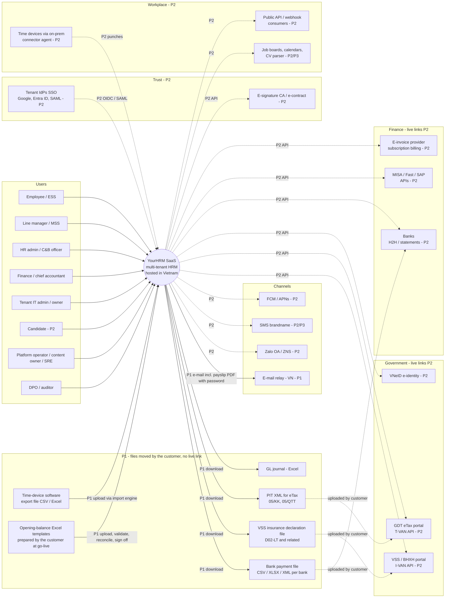
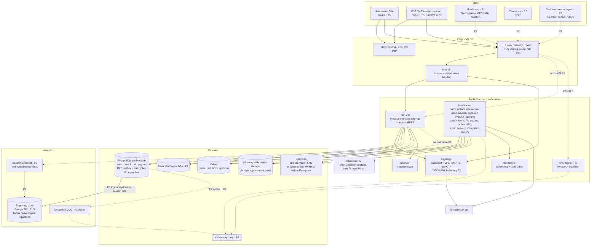
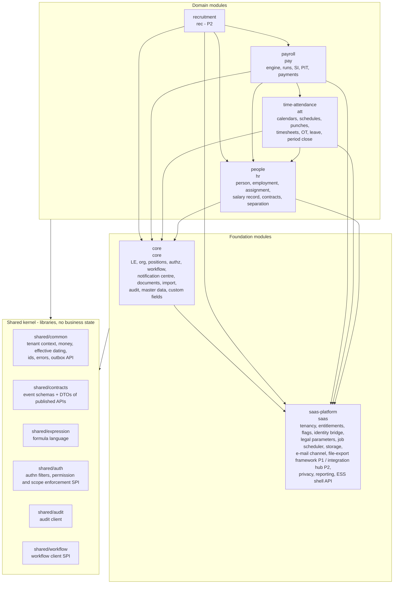
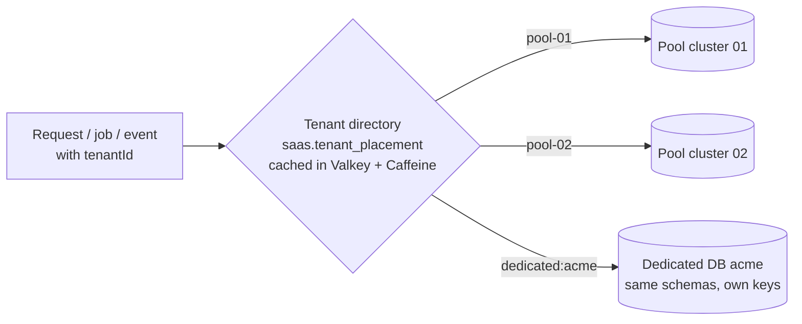
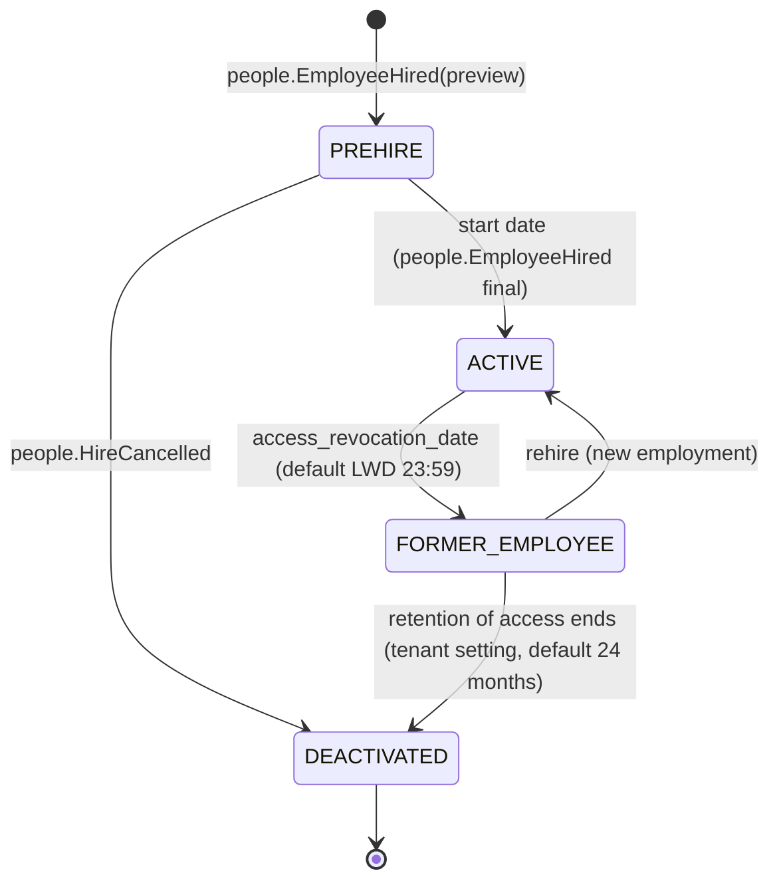
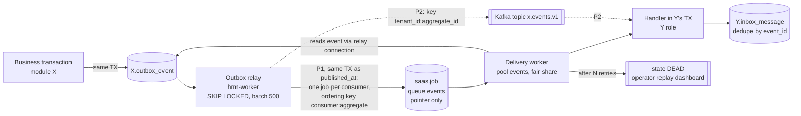
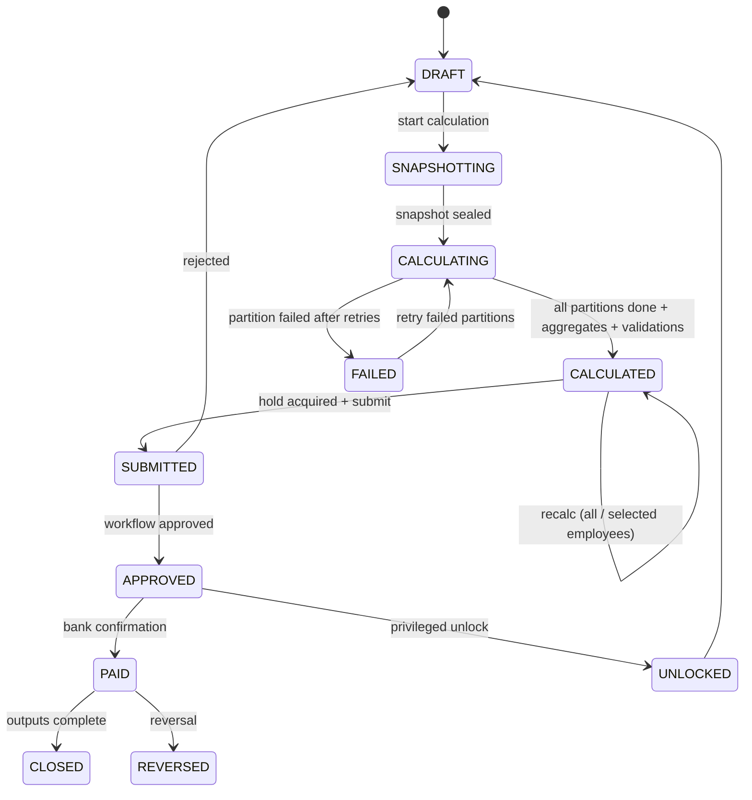
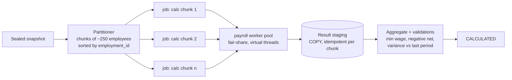
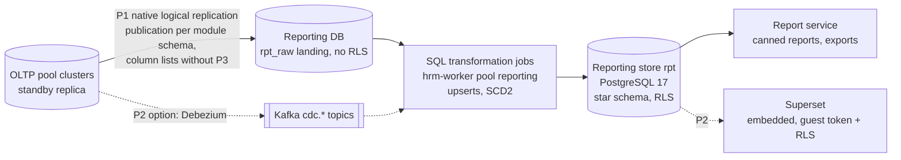
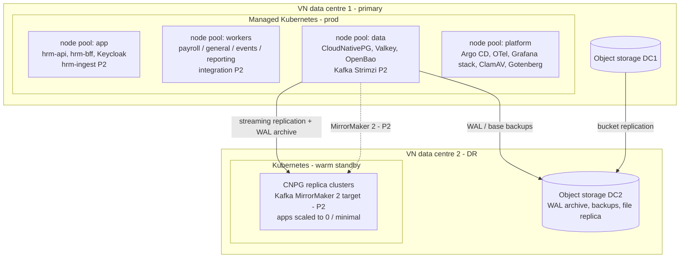

# YourHRM — Solution Architecture Overview (draft)

| Item | Value |
|---|---|
| Document | `docs/02-architecture/architecture-overview.md` |
| Version | **0.3 — 2026-10-16** (round-2 decisions R2-01 … R2-19 and PM interpretations, decision log §7–§7.2, applied; v0.2 applied round 1; v0.1 was the draft for review) |
| Author | Solution architect (with the Data architect for X-01/X-02/D-09) |
| Inputs | [Architecture brief](architecture-brief.md) · [Decision log](../00-project-management/decision-log.md) · [Master BRD](../01-requirements/brd/BRD.md) · [Module BRDs](../01-requirements/brd/modules/) · [Gap analysis](../01-requirements/brd/gap-analysis.md) §5, §6, §7, §9 |
| Companion | Data architecture: `database/postgresql/DESIGN.md` and ADR 0020–0039 (Data architect). This document refers to it as **"see data architecture (DESIGN.md)"** and does not decide data-model questions. |
| ADRs | [0001–0019](adr/) — status per ADR in §18 (accepted ones carry the decision ID) |
| Status | Baseline for SRS and sprint 1. Items that need measurement are marked **[spike]**. Legal values are never quoted here; they live in legal parameter packs. |

**What changed in v0.3 (round 2, decision log §7–§7.2).** **R2-01 / R2-19: Phase 1 has no live external integrations.** Phase 1 keeps e-mail and in-app notifications, **file exports** the customer uploads (bank payment file, VSS insurance declaration file, PIT XML for eTax, GL journal in Excel) and **Excel/CSV imports, including the time-device export file (punch template)**. Moved to Phase 2: the time-device connector agent, its offline buffer, the `hrm-ingest` role and the 500 punches/s target (X-05, SP-3 postponed), Zalo/SMS adapters, e-signature, VNeID, accounting APIs, job boards, public API and webhooks, and the integration-hub runtime (§3.1, §3.2, §7.5, §12; ADR-0016, ADR-0014). Consequently **Kafka is not deployed in Phase 1**: the outbox relay delivers events through ordered delivery jobs on the PostgreSQL job queue and the reporting store is fed by native logical replication; Kafka arrives in Phase 2 behind the same outbox (§7.2, §10.2; ADR-0004 rev. 2, ADR-0012 Amendment 1 — both Proposed). **R2-04:** SSO to Phase 2; Phase 1 = Keycloak username/password + MFA by TOTP or e-mail OTP (§6; ADR-0005). **R2-16:** basic concurrent employment across legal entities (§8.4; DESIGN.md §7.3). **R2-17:** payslips by e-mail as password-protected PDF, password set by the employee in ESS (§9.3, §9.4; ADR-0015). **R2-18:** baseline always-on capabilities and their entitlement design (§5.4; ADR-0003). **R2-11:** X-02 exception list accepted (§3.3). **R2-12:** `SUSPENDED` employees not billable (§17.2). **R2-15:** AR-13 accepted with mitigations (§17.1).

**What changed in v0.2 (decision log 2026-10-16).** X-01: salary amounts are **not** column-encrypted (§13.1). X-02: read-only exception for global reference data (§3.3 rule 4). X-03: period-close hold accepted (§7.4.2). X-04 + OD-9: Phase 1 = core features of each module as responsive web; **no PWA or mobile check-in in Phase 1** — all mobile features are Phase 2; Phase-1 attendance comes from time devices and Excel import (§11.4). X-05: 500 punches/s platform, 50/s per tenant (SP-3 confirms). X-06: three new events in catalogue v1.1. X-07: `saas` schema approved. D-09: **no Oracle migration**; replaced by the generic opening-balance import (§9.6, ADR-0037). OD-1…OD-10: see §17.2.

**Reading guide.** §2 states what drives the architecture. §3 gives the C4 views. §4 lists the technology stack. §5–§13 explain each cross-cutting concern. §14 covers deployment and operations. §15 maps the design to the repository. §16 traces the gap-analysis §9 inputs. §17 lists risks, the decisions taken on 2026-10-16 and next steps.

---

## 1. Scope and baseline

This document is the solution architecture for the MVP — Phase 1: the **core features** of Core, People, T&A and Payroll (X-04), platform tenancy/identity/legal parameters, admin web and responsive ESS/MSS web, and the **opening-balance import** for go-live (D-09; there is no Oracle migration) — and the structural provisions for Phase 2 (Recruitment, **all mobile features** including the native app and GPS/Wi-Fi/selfie check-in, **all live external integrations** (R2-01: time-device connector and ingestion, Zalo/SMS, e-signature, VNeID, accounting APIs, job boards, public API and webhooks), SSO (R2-04), Kafka, dedicated tier, dashboards).

**Phase 1 external surface (R2-01).** Outbound: e-mail through a VN relay only. Everything else leaves the system as a **file the customer downloads and uploads** (bank payment file, VSS declaration file, PIT XML for eTax, GL journal Excel) and enters as an **imported file** (Excel templates, opening balances, time-device export files). No provider credentials, callbacks or outbound API calls exist in Phase 1.

It is designed against the PM baseline in the [architecture brief](architecture-brief.md) and does not challenge it:

| # | Baseline decision | How this architecture applies it |
|---|---|---|
| B1 | Gap-analysis §5 single-owner table | Module map §3.3; every shared engine has exactly one home module |
| B2 | Schemas `saas` (X-07 approved), `core`, `hr`, `att`, `pay`, `rec` + separate reporting store | One backend module per schema; modules never read another module's tables (ADR-0001), except read-only global reference data (X-02, ADR-0021) |
| B3 | Modular monolith; payroll workers and punch ingestion scale separately | One artifact; Phase 1 runtime roles `api` and `worker` (several worker pools); the `ingest` role for live punches is **Phase 2** (R2-01, no live device feed in Phase 1); ADR-0001 Amendment 1 |
| B4 | Shared pool with `tenant_id` + RLS + app guard; Enterprise dedicated DB; VN hosting | Tenant routing layer (§5, ADR-0003); VN-only hosting (ADR-0017) |
| B5 | Outbox per module, canonical envelope, §6 catalogue v1 | Event backbone (§7, ADR-0004 rev. 2): outbox + relay; Phase-1 transport = ordered delivery jobs on PostgreSQL, Kafka in Phase 2 |
| B6 | Effective-dated, versioned legal values; version stamp on each result; reproducible 10 years | Legal Parameter Service (§9.1, ADR-0010) and payroll engine (§8, ADR-0008/0009) |
| B7 | MVP = core features only (X-04); opening-balance import, no Oracle migration (D-09); no mobile features (OD-9); Recruitment P2; no live external integrations (R2-01); no SSO (R2-04) | Phase tags on every component; mobile, PWA, integration-hub runtime, ingest, Kafka and SSO components tagged P2 |

---

## 2. Architecture drivers

### 2.1 Top quality attributes (with numbers)

| # | Driver | Target | Source | Main architectural response |
|---|---|---|---|---|
| D-1 | **Tenant isolation** | 0 cross-tenant incidents; isolation suite blocks release | BR-SAAS-021/023, NFR-CORE-001, NFR-PAY-005, NFR-ATT-010 | Tenant context + RLS + app guard + isolation tests; tenant in every event, job, cache key, object key (§5) |
| D-2 | **Payroll correctness & reproducibility** | 0 VND variance on ≥ 200 golden scenarios; identical recompute for ≥ 10 years; decimal arithmetic | NFR-PAY-002/003/008, NFR-SAAS-017 | Input snapshot, pure formula engine on `BigDecimal`, versioned engine/pack/config stamps (§8) |
| D-3 | **Payroll performance** | 10,000 employees × ~60 elements ≤ 15 min; 1,000 ≤ 2 min; one employee ≤ 5 s | NFR-SAAS-002, NFR-PAY-001 | Partitioned parallel calculation on worker pool; bulk I/O; design target 10k ≤ 5 min to keep 3× headroom (§8.4) |
| D-4 | **Availability** | 99.5% (Enterprise 99.9%); no maintenance on days 25–5; login SLO 99.9% | NFR-SAAS-001, GAP-069 | Stateless pods, rolling releases, local JWT validation, HA PostgreSQL (§14) |
| D-5 | **Interactive latency** | p95 ≤ 500 ms transactional, ≤ 3 s standard reports; authz overhead ≤ 20 ms p95; as-of org tree ≤ 1 s | NFR-SAAS-003, NFR-CORE-002/003 | Cached authorisation snapshot, index-friendly scope predicates, read replicas (§6) |
| D-6 | **Check-in burst** (**Phase 2**, R2-01) | 2,000/min per tenant, 20,000/min platform (≈ 333/s), p95 ack ≤ 1 s; punch-to-timesheet ≤ 5 min; no loss | NFR-SAAS-004, NFR-ATT-001/002 | **Phase 2:** dedicated `ingest` role writing to Kafka; asynchronous processing; X-05 figure (500 punches/s platform, 50/s per tenant) confirmed by SP-3, both postponed to Phase 2 with the live device connector. **Phase 1:** no live punch stream — punches arrive only in imported device-export files (CSV/Excel), processed as chunked import jobs; target: a 2,000-employee monthly file (~250k punches) validated and committed ≤ 10 min, timesheets recomputed ≤ 15 min after commit |
| D-7 | **Scalability & fairness** | ≥ 500 tenants, ≥ 200k employees at launch, 5× without re-architecture; a noisy tenant ≤ 20% of pool capacity | NFR-SAAS-005, NFR-PAY-013 | Horizontal pods, multiple pool DB clusters, fair-share job queue, per-tenant rate limits (§5.5) |
| D-8 | **Peak capacity** | 3× average during days 25–5 and Jan–Mar | NFR-SAAS-021 | HPA on worker queue depth; pre-scaled node pools on a calendar (§14.6) |
| D-9 | **Backup & DR** | RPO ≤ 15 min; RTO ≤ 4 h (Enterprise ≤ 2 h); second VN DC; per-tenant PITR to sandbox | NFR-SAAS-006 | Streaming replica + WAL archive in DC2, GitOps rebuild, quarterly drill (§14.7) |
| D-10 | **Legal agility** | New pack ≥ 7 days before effective date; no code release, no schema change for new values/PIT structure | NFR-SAAS-016, NFR-PAY-007 | Typed, table-capable parameter packs; formulas are configuration (§8, §9.1) |
| D-11 | **Release safety** | Zero-downtime; rollback ≤ 15 min; ≥ every 2 weeks; calc changes behind per-tenant toggles | NFR-SAAS-014/015 | Expand/contract migrations, release rings, calc behaviour versions pinned per tenant (§14.4) |
| D-12 | **Security & privacy** | TLS 1.2+, AES-256, field-level encryption with KMS, per-tenant keys, ASVS L2, logs ≥ 12/24 months in VN, 72 h breach notice | NFR-SAAS-007–010, L15/L16 | Envelope encryption of identifiers, bank accounts and special-category data (not salary amounts, X-01), OpenBao, audit hash chain, consent registry, DSR fan-out (§13) |
| D-13 | **Localisation** | Full vi/en; diacritics in PDF/Excel/bank files; accent-insensitive search; 360 px | NFR-SAAS-012/013, NFR-CORE-011 | ICU message bundles, embedded Vietnamese fonts, `unaccent` + trigram search (§11) |
| D-14 | **Portability** | Full tenant export of 10k employees ≤ 6 h | NFR-SAAS-019 | Export job fanning out per module with a documented format (§9.6) |

### 2.2 Constraints

| # | Constraint | Origin |
|---|---|---|
| C-1 | Java + Spring Boot backend; PostgreSQL; one schema per module (+ `saas`) | Charter §2, brief B2 |
| C-2 | All personal data stored and processed in Vietnam, including logs, backups, search indexes, reporting store, e-mail relays and support tooling | BRD §5.2, L15/L16, RK8 |
| C-3 | Legal values never hard-coded; tagged `[verify-legal]` until consultant sign-off | BRD §1 |
| C-4 | No maintenance on days 25–5 | NFR-SAAS-001 |
| C-5 | Certified third-party providers for e-invoice, I-VAN/T-VAN, e-signature CA, VNeID — **all Phase 2** (R2-01); Phase 1 produces files the customer submits through the official portals | BRD A6 |
| C-6 | No biometric templates stored | BRD A7, NFR-ATT-008 |
| C-7 | Small-to-mid team building the core features of 4 MVP modules + platform; pilot go-live with opening balances loaded from Excel templates (no Oracle migration) within 16 weeks of contract | BRD O4, X-04, D-09 |

### 2.3 Quality attribute scenarios

| # | Attribute | Stimulus | Environment | Response | Measure |
|---|---|---|---|---|---|
| QAS-1 | Isolation | A request carries a valid token for tenant A and a forged id of a tenant-B record | Production, shared pool | App guard rejects; even if the guard is bypassed, RLS returns 0 rows; security event audited | 0 rows leaked; alert ≤ 1 min |
| QAS-2 | Performance | C&B officer starts a FINAL run for 10,000 employees on the 2nd of the month while 50 other tenants calculate | Peak, 3× load | Run is partitioned; tenant receives ≤ 20% of worker slots but at least its floor | ≤ 15 min end-to-end; other tenants' p95 UI ≤ 500 ms |
| QAS-3 | Reproducibility | Labour inspector asks to recompute the March 2027 payslip in 2035 | Engine has moved 8 major versions | Snapshot + stamped engine version reproduce the result | Byte-identical result lines |
| QAS-4 | Legal change | Government issues a new regional minimum wage 45 days before effective date | Normal ops | Content owner publishes a pack after golden tests; runs dated after the effective date pick it up | Pack live ≥ 7 days before effective date; 0 code deployments |
| QAS-5 | Burst (**Phase 2**) | 10,000 workers clock in within 15 min at a garment factory | Shift change | `ingest` acknowledges, Kafka buffers, workers process | p95 ack ≤ 1 s; 0 lost punches; timesheet ≤ 5 min |
| QAS-5a | Punch file (Phase 1) | T&A admin uploads the device-software export of a 2,000-employee site for one month | Normal ops, day 1 of close | Import validates (unknown enrol ids, duplicates, out-of-period rows), commits in chunks, timesheets recompute | ≤ 10 min to commit, 0 duplicate punches on re-upload, exceptions listed per row |
| QAS-6 | Availability | Node or AZ hosting the primary database fails | Day 28 (payroll window) | Operator promotes synchronous standby automatically | Downtime ≤ 60 s; no committed transaction lost |
| QAS-7 | DR | DC1 is lost entirely | Any time | DC2 standby promoted, apps redeployed by GitOps, DNS switched | RPO ≤ 15 min, RTO ≤ 4 h |
| QAS-8 | Consistency | T&A admin re-opens an attendance period after payroll was calculated | Before approval | Run is flagged stale and cannot be approved until recalculated | 0 runs approved on a superseded attendance version |
| QAS-9 | Privacy | DPO approves an erasure request for a former candidate | Normal ops | DSR saga fans out to every module, reporting store and search; legal-hold data retained and reported | Completed ≤ 24 h after expiry (NFR-REC-009); evidence report |
| QAS-10 | Release | A new OT rounding rule ships | Pilot ring | Behaviour hidden behind a calc-behaviour flag until the tenant opts in | No change to existing tenants' results; rollback ≤ 15 min |

---

## 3. C4 views

Diagrams use Mermaid `flowchart` syntax (renders in GitHub/GitLab) rather than the experimental C4 syntax.

### 3.1 System context (C4 level 1)



Solid arrows are Phase 1; dotted arrows are Phase 2 (R2-01). In Phase 1 the only network link to a third party is the VN e-mail relay; all statutory and financial outputs are files the customer downloads and submits through the official portals.

### 3.2 Containers (C4 level 2)



Solid = Phase 1; dotted = Phase 2 (R2-01, R2-04, OD-9).

| Container | Phase | Technology | Scales by | Notes |
|---|---|---|---|---|
| `hrm-api` | P1 | Spring Boot (all modules), virtual threads | CPU / RPS (HPA) | Stateless; serves REST for the SPA (via BFF); mobile app and public API in P2 |
| `hrm-worker` | P1 | Same jar, `role=worker` profile | Job queue depth per pool (KEDA) | Runs payroll partitions, imports (incl. device-export punch files), file exports (bank, VSS, PIT XML, GL), document batches, the outbox relay and **event-delivery jobs** (pool `events`, ADR-0004 rev. 2). Pools `payroll`, `general`, `events`, `reporting` are separate Deployments of the same image; the `integration` pool (connectors) is **P2** |
| `hrm-ingest` | **P2** | Small Spring Boot app (shares `shared/common`, `att` contracts) | RPS | **Not deployed in Phase 1** (decision: no live punch source exists, R2-01; device-export files go through the import engine on the `general` pool). In Phase 2 it authenticates the device-agent credential (mTLS), validates, writes to the `att.punch.raw` Kafka topic keyed by tenant and acks; mobile punches use the same endpoint |
| `hrm-bff` | P1 | Spring Cloud Gateway (server WebMVC) + Spring Security OAuth2 client | RPS | Holds OIDC tokens server side; browser gets an HttpOnly, SameSite cookie (ADR-0014) |
| Keycloak | P1 | Keycloak 26.x, own PostgreSQL DB | Replicas | Single realm with Organizations; password + MFA (TOTP / e-mail OTP) in P1; SSO brokering P2 (R2-04); dedicated realm option for Enterprise (ADR-0005) |
| doc-render | P1 | Gotenberg 8 | Replicas | DOCX→PDF/A for tenant-edited templates |
| Kafka + Apicurio | **P2** | Strimzi / provider-managed | Brokers | Introduced with the live device connector, webhooks or when bus volume exceeds the DB-backed bus (ADR-0004 rev. 2 triggers) |

### 3.3 Components of the modular monolith (C4 level 3)



**Dependency rules** (enforced by Spring Modulith `ApplicationModules.verify()` and ArchUnit in CI; a violation fails the build):

1. Arrows are the **only allowed synchronous (compile-time) dependencies**: `recruitment → payroll → time-attendance → people → core → saas-platform → shared/*`; feature modules may also call `saas-platform` directly (legal parameters, scheduler, storage). Recruitment uses Payroll only for bands and the gross↔net simulator.
2. A module calls another only through its `api` package (Java interfaces + immutable DTOs from `shared/contracts`). Everything under `internal` is invisible to other modules.
3. **Reverse flows use events or SPIs, never imports.** Examples: Core consumes `people.EmployeeHired` through the event schema in `shared/contracts`, not through the People module; Core's workflow SLA uses a `WorkingCalendarProvider` SPI declared in Core and implemented by T&A; T&A learns pay calendars and pay-group assignments from `pay.*` events.
4. **No cross-schema SQL.** Each module's DB role owns its schema; the runtime role of module X has no grant on schema Y (see data architecture (DESIGN.md) for roles and grants). Joins across modules happen in the reporting store only. **Single exception (X-02, accepted 2026-10-16):** every module role may `SELECT` (read-only) the **global reference tables** listed in ADR-0021 — Core `country`, `currency`, `admin_unit`, `admin_unit_mapping`, `bank`, `bank_branch`, `code_list`, `code_value` / `v_code_value_effective`, `exchange_rate`, and the tenant's own `saas.tenant` row. Job enqueue (`saas.job`) and audit append (`audit.audit_event`) are platform plumbing in the same list. **R2-11 (2026-10-16): the complete list — including the tenant override rows of `core.code_value` / `core.exchange_rate` and the two plumbing grants — is accepted as covered by X-02.** The list is guarded by an ArchUnit rule (SQL/jOOQ references) and a DB test (`sys.cross_schema_grant_violations()` returns 0 rows); both fail the build. Legal parameters are **not** in the list: modules use the LPS API.
5. `shared/*` holds no business state and depends on nothing else in the repo.
6. A module's transaction never spans another module's writes. Cross-module consistency is eventual via outbox events or orchestrated by a saga (§7.4).

**Module responsibilities** (per gap-analysis §5):

| Module | Owns (system of record) | Shared engines hosted |
|---|---|---|
| `saas-platform` | Tenants, plans, subscriptions, invoices, entitlements and feature flags, global identity link, IdP config, API clients, legal parameter packs, consent registry, PD inventory, DSR cases, retention schedule, platform audit | Legal Parameter Service; job scheduler/queue (also the Phase-1 event-delivery transport); object storage; channel delivery adapters (e-mail P1; Zalo, SMS, push P2); **file-export framework** (bank, VSS, PIT XML, GL templates; P1) and integration hub runtime and connectors (P2, ADR-0016); go-live onboarding (opening-balance template set, sandbox rehearsal, sign-off; the import engine itself is Core); reporting framework and exports; ESS/MSS shell |
| `core` | Legal entities, locations, org tree, reorg packages, positions + FTE budget, job/grade catalogue, tenant user accounts, roles, data scopes, masking, code lists, global master data, exchange rates, custom fields, settings | Authorisation service; workflow & approvals; notification centre; document service; import engine (incl. opening-balance mode, ADR-0037); audit service and store |
| `people` | Person, employment, assignment, salary record (GROSS/NET), contracts, dependants, bank accounts, work permits, separation, discipline/rewards, appraisal, assets-lite | Mass-change engine (incl. reorg mapping) |
| `time-attendance` | Holiday calendars, schedules and assignments, devices, punches, timesheets, OT, leave, trips/WFH, attendance periods and results | Punch processing pipeline |
| `payroll` | Pay groups and calendars, pay scales/bands, components and formulas, runs and results, SI history, PIT documents (08/CK, authorisations), loans/advances, final settlement, payment and GL outputs | Payroll engine; gross↔net simulator |
| `recruitment` (P2) | Staffing plan, requisitions, openings, candidates, applications, interviews, offers | — |

---

## 4. Technology stack

| Layer | Choice | Version class | Rationale | Alternatives rejected |
|---|---|---|---|---|
| Language/runtime | **Java 25 LTS** — decided (OD-3) | Temurin 25 | Current LTS (Sep 2025); virtual threads, `ScopedValue` (final in 25) for tenant context; long support horizon | Kotlin (team skills); Java 21 is the fallback only if the first spikes (SP-0/SP-1) find a blocker |
| Framework | **Spring Boot 4.0.x** (Spring Framework 7) — decided (OD-3) | 4.0.x; fallback 3.5.x decided at the end of SP-1 | Mandated; Boot 4 is GA since Nov 2025, aligned with Java 25 and Jakarta EE 11 | — |
| Modularity | **Spring Modulith 2.x** + ArchUnit | 2.0.x | Verifies module boundaries, event publication registry, module integration tests, generated docs | Separate microservices (premature), Java modules (JPMS) alone |
| Persistence | Hibernate ORM 7 (JPA) for aggregates; **jOOQ** for read models, bulk payroll I/O and reporting queries; PostgreSQL `COPY` for bulk writes | Hibernate 7.x, jOOQ 3.20+ | Aggregates stay idiomatic; payroll and as-of queries need precise SQL | Pure JPA (bulk perf), MyBatis |
| Migrations | **Flyway Community** (licence accepted 2026-10-16), one location per schema | 11.x | See data architecture (DESIGN.md), ADR-0031 | Flyway Teams/Enterprise (not needed), Liquibase |
| Database | **PostgreSQL 17** (18 when the chosen VN provider/operator supports it) | 17.x | RLS, partitioning, logical replication from standbys (CDC off the primary) | — |
| DB operator | **CloudNativePG** on Kubernetes (or provider-managed PostgreSQL if it offers PITR, logical decoding and RLS-friendly superuser-less roles) | 1.27+ | Same operations on every VN cloud; Barman to S3; replica clusters in DC2 | Patroni (more DIY) |
| Connection pooling | HikariCP in-app; **PgBouncer** (transaction mode) per cluster | — | Tenant context set with `SET LOCAL` per transaction works in transaction mode | Session pooling (connection explosion) |
| Messaging | **Phase 1: no broker** — transactional outbox + polling relay + ordered delivery jobs on the PostgreSQL job queue; JSON Schemas checked in CI. **Phase 2: Apache Kafka 4.x (KRaft)** via **Strimzi** (or provider-managed) + **Apicurio Registry 3** | Kafka 4.0+ (P2) | Phase 1 has no punch stream, webhooks or external consumers (R2-01), so Kafka's ordered logs, replay and buffering are not needed yet; the outbox keeps producers transport-neutral (ADR-0004 rev. 2) | RabbitMQ (no replay, weaker CDC story), Redpanda (licence), NATS JetStream (smaller ecosystem in VN) |
| Cache / rate limiting | **Valkey 8** + Caffeine (in-process) | 8.x | BSD-licensed Redis fork; authz snapshots, LPS hot cache, Bucket4j limits, BFF sessions | Redis 8 (licence ambiguity with providers) |
| Identity | **Keycloak 26.x** | 26.x | Self-hosted in VN; Organizations for multi-tenant, step-up via ACR; **P1: password + MFA by TOTP or e-mail OTP**; OIDC/SAML brokering and WebAuthn **P2** (R2-04, ADR-0005) | Auth0/Entra B2C/Cognito (data outside VN), Zitadel (smaller VN skill base) |
| Secrets / KMS | **OpenBao** (Vault-compatible), transit engine; **software root of trust for the MVP, HSM-backed root before the Enterprise tier** (OD-10) | 2.x | Open-source (MPL), envelope encryption, per-tenant keys, dynamic DB credentials | HashiCorp Vault (BSL), cloud KMS (not available or not VN-resident at every provider) |
| Object storage | Provider **S3-compatible** object storage in VN (Viettel, FPT, VNG, CMC) via AWS SDK v2 | — | Residency; lifecycle rules; cross-site replication | Self-run MinIO (licence/ops) |
| Search | MVP: PostgreSQL `unaccent` + `pg_trgm`. P2: **OpenSearch 2.x** for candidates (500k per tenant, NFR-REC-008) and global search | — | Avoid a second store for MVP | Elasticsearch (licence) |
| Job scheduling | In-house tenant-fair queue on PostgreSQL (`SKIP LOCKED`) + **db-scheduler** for cron triggers | db-scheduler 15.x | Transactional enqueue, per-tenant quotas, suspension-aware (ADR-0011) | Quartz (no fairness), JobRunr Pro (licence), Kafka as work queue (no transactional enqueue) |
| Formula engine | Own **YourHRM Formula Language (YFL)** on ANTLR 4, evaluated over `BigDecimal` | ANTLR 4.13 | Sandboxed by construction, deterministic, Excel-like for C&B users (ADR-0008) | SpEL/MVEL/Groovy (sandbox escape), GraalJS (float semantics), CEL (no decimal type) |
| Workflow | In-house approval engine in Core (ADR-0007) — accepted (OD-4), no BPMN designer | — | Approval semantics are tenant-configured data, not BPMN | Flowable 7, Camunda 8 (licence + ops) |
| Documents | Thymeleaf HTML → **OpenHTMLtoPDF** (PDF/A) for system documents; **poi-tl** DOCX merge + **Gotenberg** for tenant-edited templates; Apache POI SXSSF for Excel; JAXB + XSD validation for eTax/VSS XML | — | Throughput for payslips; Word-editable templates for HR letters and decisions (ADR-0015) | JasperReports (template authoring UX) |
| Reporting | **P1:** native PostgreSQL logical replication (column lists, no P3) → **PostgreSQL reporting store**; P2 option: Debezium 3 → Kafka; **Apache Superset 5** for dashboards (P2, decided OD-5); operational/statutory reports in-app | — | One SQL dialect, RLS in the store; Superset is self-hosted with RLS and embedding (ADR-0012) | ClickHouse (P2 option if volume demands **[spike]**), Power BI/Metabase cloud (residency) |
| Frontend | **React 19 + TypeScript 5**, Vite 7, **Ant Design 5** (themed design system), TanStack Query + Router, React Hook Form + Zod, react-i18next (ICU) | — | Data-dense enterprise UI, mature vi_VN locale, large VN talent pool (ADR-0013; decided OD-2) | Angular 20 (rejected by OD-2), Vue 3 |
| Mobile (P2 only) | **React Native (Expo)** sharing TS API client and i18n. **Phase 1 has no mobile app, no PWA and no browser check-in** (OD-9); ESS is responsive web | Expo SDK current | One language across web/mobile; native GPS/selfie/push | Flutter (second language), Capacitor (weaker native check-in) |
| Edge | **Envoy Gateway** (Kubernetes Gateway API) + provider WAF / ModSecurity-CRS | 1.x | Gateway API standard; global rate limiting; ingress-nginx is retired | Kong OSS, APISIX (both viable for the P2 developer portal) |
| Observability | **OpenTelemetry** SDK/Collector → Grafana **Mimir** (metrics), **Loki** (logs), **Tempo** (traces), Grafana + Faro (RUM), Alertmanager | — | Self-hosted in VN (residency of logs, NFR-SAAS-010) | Datadog/New Relic (data leaves VN) |
| CI/CD | GitLab CI (self-managed, VN) or GitHub Actions with VN-hosted runners; **Argo CD** GitOps; Testcontainers; Renovate | — | Build and test in VN; reproducible deploys | — |
| Security tooling | SpotBugs+FindSecBugs/Semgrep (SAST), OWASP ZAP (DAST), Trivy (images, IaC), OSV/Dependency-Check (SCA), Cosign (signing), SBOM (CycloneDX) | — | NFR-SAAS-009 | — |
| IaC | OpenTofu + Helm; provider-specific modules behind one interface | — | Portability across VN clouds | — |

**Hosting.** Primary: a Vietnamese cloud with ≥ 2 data centres and managed Kubernetes — candidates **Viettel IDC/Viettel Cloud, FPT Cloud, VNG Cloud (vServer/VKS), CMC Cloud**. A hyperscaler with a Vietnam region may be evaluated only if the region is physically in VN and every sub-processor (logs, e-mail, support) is also VN-resident. Selection criteria and the 2-week scoring spike are in §17.3 and ADR-0017; the sponsor decides the provider after SP-7 (OD-1).

---

## 5. Multi-tenancy (application tier)

Data-level isolation (keys, RLS policies, `saas` exemptions, partitioning) is owned by the Data architect — see data architecture (DESIGN.md). This section covers how the application resolves, carries, routes and limits tenants (ADR-0003).

### 5.1 Tenant resolution

| Channel | Resolution | Authority |
|---|---|---|
| Browser (admin, ESS) | Host `{tenantSlug}.yourhrm.vn` → login hint → Keycloak Organization; after login the **`tid` claim** of the token is authoritative. Host and claim must match, otherwise 403 + security event | Token |
| Custom domain (P2/P3) | `saas.tenant_domain` maps host → tenant; cert-manager issues certificates | Token |
| Multi-tenant user (GAP-016) | Tenant switcher re-issues a token for another Organization the identity belongs to; never a header switch | Token |
| Mobile app / public API (both P2) | Bearer token (`tid` claim; API clients are bound to one tenant) | Token |
| Device agent (**P2**) | mTLS client certificate or device credential → tenant + device id (NFR-ATT-010). In Phase 1 device data arrives only as files uploaded in a user session (token) | Credential |
| Operator back-office | Operator token has no `tid`; acting on a tenant needs a **support grant** (consent-based, time-boxed); the grant id becomes part of the context and every action is audited | Grant |
| Jobs and events | `tenant_id` field in the job row / event envelope | Persisted record |

No endpoint accepts a tenant id from the request body or query as the source of truth.

### 5.2 Tenant context propagation

- `TenantContext` (in `shared/common`) is an immutable record `{tenantId, tier, dbCluster, userAccountId, identityId, supportGrantId?, locale, timezone, correlationId}` bound with **`ScopedValue`** for the request. Context propagation (Micrometer) copies it to virtual threads and async executors; code that starts work without a context fails fast.
- **Database:** a `TenantAwareDataSource` sets `SET LOCAL app.tenant_id = …` (and `app.user_id`, `app.support_grant`) at the start of every transaction; RLS policies read these settings. Connections outside a transaction are disallowed for tenant-owned schemas. The app guard (Hibernate filter / jOOQ `VisitListener` adding `tenant_id = ?`) is the second line of defence.
- **Events:** the outbox writer stamps `tenant_id` from the context; consumers re-establish the context from the envelope before any handler code runs.
- **Jobs:** job rows carry `tenant_id`; the worker binds the context per job execution and refuses jobs of suspended tenants (except allow-listed jobs such as payslip access and exports).
- **Caches:** every key is prefixed with `t:{tenantId}:`; a cache wrapper rejects un-prefixed keys for tenant data.
- **Object storage:** key layout `t/{tenantId}/{module}/{yyyy}/{uuid}`; signed URLs are issued only by the Core document service after an authorisation check.
- **Logs/traces/metrics:** `tenant_id` and `correlation_id` in MDC and as span attributes; metrics use tenant as a label only on bounded "per-tenant" dashboards (top-N) to avoid cardinality blow-up.

### 5.3 Pool vs dedicated routing



- `saas.tenant_placement(tenant_id, cluster_id, tier, read_replica_ids, state)` is the routing source; the **`saas` schema lives in a platform cluster**, replicated read-only to each pool cluster where needed (see data architecture (DESIGN.md)).
- Spring `AbstractRoutingDataSource` keyed by `cluster_id`, one Hikari pool per cluster per pod, sized by a formula in ops runbooks. A tenant never spans clusters.
- **Pool sizing rule:** a pool cluster holds up to ~100k employees (≈ 250 SME tenants) **[spike]**; new tenants are placed on the emptiest cluster. Tenant move between clusters (pool → dedicated, rebalancing) is an operator workflow using logical replication filtered by `tenant_id` with a short read-only window outside days 25–5.
- **Dedicated tier (P2):** same image, same migrations, its own database (and optionally own Keycloak realm, own DEKs, own worker pool via node affinity). Migrations run per cluster from a migration controller job; a release is complete when every cluster reports the target schema version.
- **Read replicas:** reports and list exports can be routed to a replica (`@ReadOnlyRoute`); payroll calculation reads from the primary for snapshot consistency.

### 5.4 Entitlements, feature flags and baseline capabilities

- **Entitlements** (`saas`): modules, features, limits (employees, LEs, storage, API calls) per subscription; published by `saas.EntitlementsChanged` and cached per tenant. Enforced by an `@Entitled("payroll.offcycle")` aspect on API and job entry points and by the frontend (menu, route guards) — the backend is authoritative.
- **Feature flags:** OpenFeature Java/JS SDKs with an in-house provider backed by `saas` flag tables (targeting by tenant, ring, plan). Three flag kinds: *release* (temporary), *ops* (kill switches) and *calc behaviour* (long-lived, versioned; §8.6).
- **Baseline-always-on capabilities (GAP-060; set approved by R2-18, 2026-10-16).** These are *not* gated by module subscription, because other modules depend on them at runtime:

| Baseline capability (R2-18) | Feature key | Provided by | Needed by | Exposure without subscription |
|---|---|---|---|---|
| **Core** (org, LE, positions, users/roles, workflow, notifications, documents, import engine, audit) | `baseline.core` | Core | Everything | Always — Core is not sold separately |
| **People basics** — employee master (person, employment, assignment, salary record) | `baseline.people.master` | People | Core, T&A, Payroll, Rec | Read APIs + import; HR UI limited to the master record |
| **Legal parameter packs** | `baseline.legal_params` | SaaS | All | Always (LPS API) |
| **Pay scales / bands** (gap §5 #7) | `baseline.pay.scales_bands` | Payroll | People salary validation, Rec offers | API + catalogue admin |
| **Excel attendance import → standard Attendance Result** | `baseline.att.excel_import` | T&A (import type) | Payroll-without-T&A tenants | Import template producing a `CLOSED` result version, so the period-close protocol is unchanged |

**Entitlement design (ADR-0003 decision 5).** The baseline set lives in the platform table `saas.baseline_capability`, shipped by the release job; only a product decision changes it. The entitlement resolver writes a `source = BASELINE` row in `saas.entitlement` for every tenant and baseline key; the database accepts such a row only as an enabled, tenant-wide grant, and the one-row-per-feature-per-period exclusion stops any plan or override from disabling it (DESIGN.md §7.1). Module subscriptions add `PLAN`/`ADDON` rows for full module features. `@Entitled`, the frontend route guards and `/me/capabilities` read the same resolved rows, so no code path special-cases "baseline".

The entitlement check gates **features and UIs**, never the shared **runtime reference services** that modules call: besides the five capabilities above, these are the T&A holiday calendar / default schedule (`WorkingCalendarProvider` SPI, national calendar from the legal pack) and the Payroll gross↔net simulator API (People NET salaries). They are API-only for tenants without T&A or Payroll and are not separately listed in R2-18 (PM to confirm). The plan catalogue publishes a dependency matrix (e.g. Payroll requires People master + attendance import).

### 5.5 Noisy-neighbour controls (≤ 20% of pool per tenant)

| Resource | Control | Default |
|---|---|---|
| HTTP API | Bucket4j token buckets in Valkey per tenant and per user/API client; Envoy global limit per IP | Tenant: 50 rps sustained, 200 burst (plan-based) |
| Background jobs | Fair-share queue: max concurrent slots per tenant = 20% of pool's slots (floor 2); weighted round-robin across tenants with pending work | §9.5 |
| Payroll workers | Same fair-share on the `payroll` pool; Enterprise may buy reserved slots | — |
| Database | `statement_timeout` per role (API 5 s, report 60 s, job 15 min); per-tenant concurrent report limit; heavy reports on replicas | — |
| Event delivery | P1: delivery jobs in the fair-share `events` pool (same 20% cap); P2 Kafka: topics keyed by `tenant_id`, consumer time budget per batch, producer quota for ingest | — |
| Exports/reports | Max concurrent per tenant (3) and queue; 7-day expiry | — |
| Notifications | Per-tenant send rate per channel; payslip batch throttled to finish ≤ 30 min (NFR-CORE-005) | — |

Saturation per tenant is visible on the operator dashboard (top-N tenants by CPU-time, DB time, queue slots).

---

## 6. Identity and access

### 6.1 Split of responsibilities (GAP-002, GAP-003, GAP-016)

| Concern | Owner | Implementation |
|---|---|---|
| Credentials, password policy, MFA (**P1: TOTP or e-mail OTP**; WebAuthn P2), OTP for former employees | **SaaS** (identity bridge) | Keycloak; MFA mandatory for HR, C&B, finance, tenant-admin and operator roles, tenant setting for ESS |
| SSO federation: OIDC (Google, Entra ID) and SAML **Phase 2** (R2-04: no SSO at the pilot); SCIM P3 | SaaS | Keycloak identity brokering per Organization; SCIM via Keycloak extension or in-app endpoint **[spike]** |
| Sessions, step-up, token issuance, API clients (client credentials, P2) | SaaS | Keycloak sessions; ACR levels `acr=1` (password; SSO from P2), `acr=2` (MFA), `acr=3` (fresh MFA ≤ 5 min) |
| Global identity ↔ tenant user account link | SaaS stores identity; **Core** stores `user_account.identity_id` | One Keycloak user per natural person/e-mail; membership in n Organizations |
| User accounts, roles, permissions, data scopes, field masking | **Core** | Authorisation service (§6.3) |
| API scope → permission/data scope mapping | Core | Mapping table for each API client |

### 6.2 Authentication flows

- **Browser:** SPA → `hrm-bff` → Keycloak (Authorization Code + PKCE, confidential client). Phase 1 login page: username + password, then TOTP or e-mail OTP when MFA applies (R2-04); Phase 2 adds per-tenant SSO buttons through Keycloak identity brokering without changing the BFF or the tokens. The BFF keeps tokens server side (Valkey, encrypted) and issues an HttpOnly, `Secure`, `SameSite=Strict` session cookie; CSRF token for state-changing calls. The BFF forwards a short-lived access token (5 min) to `hrm-api`.
- **Resource server:** `hrm-api` validates JWTs locally using cached JWKS (NFR-CORE-006: no IdP call per request). Claims used: `sub` (identity), `tid`, `org`, `acr`, `amr`, `sid`, `azp`. **No roles or permissions in tokens** — they would go stale and bloat tokens; Core resolves them.
- **Step-up:** bank-account change, payslip PDF download, salary view in bulk, support-grant approval, DSR export require `acr ≥ 2` (or `acr=3`). The API answers `401` with `WWW-Authenticate: … acr_values="3"`; the SPA triggers re-authentication through the BFF.
- **Mobile (P2):** AppAuth (Authorization Code + PKCE), refresh token rotation, device binding, biometric unlock of the local refresh token.
- **Candidates and pre-hires (P2, GAP-052):** passwordless magic link (Keycloak "external subject" realm or signed single-use tokens issued by the app, 30-min idle, NFR-REC-011).
- **Session revocation:** `core.UserStatusChanged(DEACTIVATED)` → SaaS calls Keycloak admin API to log out sessions and disable the user in that Organization; the BFF drops sessions; access tokens expire ≤ 5 min.

### 6.3 Authorisation (Core) — RBAC + data scope + field masking

- **Model:** permission codes (`ppl.employee.read`, `pay.run.approve`, …) grouped into roles; a role assignment carries a **data scope** (SELF, DIRECT_REPORTS, ALL_REPORTS, ORG_SUBTREE(units), LEGAL_ENTITY(ids), LOCATION(ids), CUSTOM(rule)) and an optional **field profile** (masking of salary, bank, CCCD, health). Because salary amounts are not column-encrypted (X-01), the field profile, the DB masking views (`app.mask_level`) and sensitive-read audit are the controls that protect them.
- **Effective authorisation snapshot:** on first request, Core computes `{permissions, scope predicates, field profile}` per user account and caches it (Caffeine L1, 60 s; Valkey L2; invalidated by `core.RoleAssignmentChanged`, `people.AssignmentChanged`, `core.OrgUnitChanged`). Cache hit cost < 1 ms; a cold compute ≤ 20 ms p95 meets NFR-CORE-002.
- **Enforcement points:** (1) `@RequiresPermission` on application services (method security); (2) **scope predicates** translated into index-friendly SQL conditions on `org_path`/closure keys and `employment_id` lists — injected by repositories through a `ScopePredicate` SPI in `shared/auth` (design of closure tables and scope-friendly keys: see data architecture (DESIGN.md)); (3) **field masking** at serialisation (`@Sensitive(category=SALARY)` Jackson module consults the field profile; masked values never leave the server); (4) reports and exports re-use the same predicate, materialised as a per-user scope set in the reporting store (§10.3).
- **Support access:** operator actions run with a support grant; masking defaults to "mask everything sensitive" unless the tenant's grant explicitly allows a category (BR-SAAS support access).
- **Audit:** every permission denial on sensitive resources and every sensitive read (NFR-PPL-006) is written to the audit service.

### 6.4 Former-employee lifecycle (GAP-035, GAP-036)



- Core schedules the downgrade from `people.TerminationScheduled.access_revocation_date` (a scheduler job), and confirms on `people.EmployeeTerminated`.
- `FORMER_EMPLOYEE` role: own payslips, PIT withholding certificates, letters, 08/UQ authorisation (year end); no MSS, no approvals. Pending approvals are reassigned by the workflow engine.
- SSO link is removed (Phase 2, once SSO exists: the tenant IdP no longer vouches for the leaver); login switches to **e-mail OTP** (accepted OD-8; SMS OTP is P3). Personal e-mail must be captured at offboarding (People checklist item, GAP-036).
- `core.UserStatusChanged` drives SaaS (Keycloak) and SCIM (P3).

---

## 7. Integration and eventing

### 7.1 Sync vs async rule

| Use | When | Example |
|---|---|---|
| **Synchronous in-process API** (module `api` interface) | Caller needs the answer to proceed, data is owned elsewhere, and the call follows the allowed dependency direction | Payroll reads Attendance Result v3; People validates salary against Payroll pay scale; any module calls LPS |
| **Domain event** (outbox → bus: delivery jobs in P1, Kafka in P2) | Notify state changes; reverse-direction flows; anything another module must react to | `people.EmployeeHired` → Core, T&A, Payroll |
| **Command via job** | Long-running or retryable work, possibly in another module | Reorg mapping mass change, final settlement run |
| **SPI** (interface owned by caller, implemented by provider) | Foundation module needs data from a feature module synchronously | Core `WorkingCalendarProvider` implemented by T&A |

Because the system is a single deployable, in-process API calls are plain method calls; they are still designed as if remote (DTOs, no entity leakage, idempotent commands) so a module can be extracted later.

### 7.2 Outbox → bus (ADR-0004 rev. 2)

**Decision for Phase 1 (R2-01, ADR-0004 rev. 2 — Proposed): no Kafka.** Kafka was chosen in v0.2 for three loads: business events, the punch burst buffer and CDC to reporting. R2-01 removes the live punch stream, webhooks and every external consumer from Phase 1, and the reporting feed moves to native logical replication (§10.2). What remains is inter-module business events at pilot volume, which the PostgreSQL job queue (built anyway, ADR-0011) carries with transactional enqueue, retries, dead letters, fair share and per-aggregate order. Operating Strimzi, Apicurio and MirrorMaker 2 for that would cost the small team weeks of ops work during the 16-week plan for no Phase-1 benefit. Kafka arrives in Phase 2 behind the same outbox when the first trigger is met: live device ingestion, public webhooks / external consumers, delivery lag above SLO or volume above the measured DB-bus limit (SP-2), or replay needs beyond 7 days.



- **Outbox per module schema** (tables owned by the Data architect — see data architecture (DESIGN.md)). Written in the same transaction as the business change (NFR-PPL-002, NFR-CORE-004/008).
- **Relay:** in-app poller in `hrm-worker` (our own outbox table), leader-less via `FOR UPDATE SKIP LOCKED`, ordered per aggregate by sequence. Works identically for dedicated DBs (one relay loop per cluster). Debezium is **not** on the business-critical path.
- **Phase-1 transport (DB-backed bus):** for every outbox row the relay calls `saas.enqueue_event_delivery()` in the transaction that sets `published_at`, creating one `bus.Deliver` job per subscribed consumer in the cluster-local `saas.job` (queue `events`). `idempotency_key = consumer:event_id`; `ordering_key = consumer:aggregate_id`, and the claim function runs at most one non-terminal job per key, oldest first, so each consumer receives one aggregate's events in commit order. The job carries **only a pointer** (cluster, schema, `event_id`); the delivery worker reads the envelope through the relay connection and invokes the consumer's handler in the consumer module's own transaction, DB role and inbox — so payloads with amounts (`people.SalaryChanged`) never land in `saas.job`, which all module roles of the tenant can read. Subscriptions are declared in code (`@EventConsumer`) and compiled into a registry. Platform-cluster events (`saas.LegalParameterPackPublished`, `core.MasterDataReleased`) are enqueued on every pool and dedicated cluster with the sentinel tenant. SLO: relay lag p95 < 5 s, delivery lag p95 < 10 s.
- **Phase-2 transport (Kafka):** the relay publishes to Kafka instead (`EventTransport` port: `JobQueueTransport` → `KafkaTransport`, switchable per event type during cut-over); outbox, envelope, inbox and handlers are unchanged. Kafka design below.
- **Topics (Phase 2):** one topic per producing module and major schema version (`people.events.v1`, `att.events.v1`, …), 24–48 partitions, key `tenant_id:aggregate_id` (per-aggregate order, tenant spread). Retention 14 days (replay window); compacted `*.state` topics for reference data where useful (e.g. `saas.tenant.state`). Dedicated topics for high volume: `att.punch.raw` (key `tenant_id:device_id`).
- **Envelope** (gap §6, CloudEvents-compatible attribute names in Kafka headers + JSON body):

```json
{
  "event_id": "01J…(ULID)", "event_type": "people.EmployeeHired", "schema_version": "1.2",
  "tenant_id": "…", "legal_entity_id": "…", "occurred_at": "2027-03-01T02:15:00Z",
  "effective_date": "2027-03-01", "producer": "people@2027.03.1", "correlation_id": "…",
  "causation_id": "…", "retro": false, "initial_load": false,
  "subject": { "person_id": "…", "employment_id": "…" },
  "data": { "…": "minimised payload, no secrets, sensitive fields as references" }
}
```

- **Schemas & versioning:** JSON Schema per event in `shared/contracts`; backward compatibility per event type is checked **in CI** in Phase 1 and by **Apicurio** (registered from the repository) once Kafka arrives in Phase 2; additive changes = minor version; breaking change = new `vN` topic, dual-publishing for ≥ 1 release cycle (internal) or ≥ 6 months (public webhooks). Consumer-driven contract tests (Spring Cloud Contract or Pact) run in CI for every catalogue event (People RK4, Rec RK-03).
- **Payload policy:** events carry identifiers and the changed business facts needed by consumers; highly sensitive values (bank account number, CCCD, salary amounts for non-Payroll consumers) are **not** carried — consumers call the owner's API under their own permissions. `people.SalaryChanged` carries amounts only because Payroll is the sole consumer: in Phase 1 the payload is read from the outbox only by the Payroll handler (delivery jobs hold a pointer); in Phase 2 the topic has ACLs restricting it to the payroll consumer group.
- **Idempotent consumers:** inbox table keyed by `(consumer, event_id)`; handlers are idempotent by design (upsert by business key + version check); poison messages → dead letter after exponential retries (1 s … 10 min, 10 attempts) with an operator retry dashboard (NFR-REC-005): job state `DEAD` in Phase 1 (replay within the 7-day outbox window, otherwise re-sync from the owner API), DLT topic in Phase 2.
- **Ordering & effective dating:** consumers must not assume arrival order equals effective order; they apply events by `effective_date` and use aggregate versions to discard stale updates.
- **Initial-load mode:** events produced by the go-live opening-balance import (§9.6, ADR-0037) are flagged `initial_load=true` (this replaces the v0.1 `migration` flag; there is no Oracle migration, D-09); consumers skip side effects (notifications, user invitations, retro triggers) or process with an initial-load handler, and projections are rebuilt by re-sync jobs.
- **Catalogue:** gap-analysis §6 is catalogue **v1**. This architecture adds three events, **accepted as catalogue v1.1 (X-06)**: `att.AttendancePeriodHoldGranted/Released` (§7.4.2), `core.ReorgPackageStatusChanged` (§7.4.4), `people.OnboardingReadinessChanged` (§7.4.1). v0.3 proposes one more for R2-16: `people.PrimaryEmploymentChanged` (person, purpose, employment, valid from/to; consumed by Payroll), to be added to the catalogue by the Integration analyst.

### 7.3 Sagas — style

Sagas are **orchestrated by the module that owns the business outcome**, using a persisted process-manager state machine (Spring StateMachine is *not* used; a small in-house `ProcessManager` base in `shared/common` with a state table, timeouts via the scheduler, and idempotent steps). Choreography is used only where every step is independent and no one needs the overall status.

| Saga | Orchestrator | Style | Timeout / compensation |
|---|---|---|---|
| Hire | People (`HireProcess`) | Orchestrated readiness checklist over choreographed reactions | Start date − 1 WD: alert HR if not ready; `HireCancelled` compensates |
| Period close | Payroll run state machine + T&A period state machine (protocol) | Orchestrated by Payroll with T&A hold/lock commands | Stale detection; unlock is the only reverse path |
| Leaver / final settlement | Payroll (`FinalSettlementProcess`) | Orchestrated, deadline clock | Deadline alerts at 50/80/100%; cancellation on `TerminationCancelled` |
| Reorg | Core (`ReorgPackage`) | Orchestrated | Partial failure → package `ACTIVATED_WITH_ERRORS`, fix-and-retry per employee |
| DSR (privacy) | SaaS (`DsrCase`) | Orchestrated fan-out | Due date; legal-hold exceptions |

### 7.4 Saga details

#### 7.4.1 Hire (Recruitment → People → Core / T&A / Payroll)

1. *(P2)* `rec.CandidateHired` (payload v1, no bank group) → People. *(MVP)* HR creates a direct hire in People.
2. People matches the person (CCCD, passport, tax code, SI number — within the tenant only, NFR-PPL-008), creates the pre-hire employment, assignment, draft contract, salary record, onboarding checklist → `people.HireHandoffProcessed{ACCEPTED|REJECTED}` (to Rec) and `people.EmployeeHired{preview=true}`.
3. Reactions (parallel): Core creates the `PREHIRE` user account and derives manager scope; Payroll assigns the pay group by rule → `pay.PayGroupAssigned`; T&A assigns schedule, calendar and leave policy (needs the pay group) and maps device enrolment; each emits its own `…Assigned` event.
4. People's `HireProcess` listens and keeps a readiness checklist (user, pay group, schedule, contract signed, bank account, tax code) → `people.OnboardingReadinessChanged`; HR sees blockers before the start date.
5. Start date (scheduler, 00:00 ICT): `people.EmployeeHired{preview=false}` → Core activates the user; Payroll includes the employee in the next run; Payroll prepares the D02-LT increase line.
6. Compensation: `people.HireCancelled` → Core deactivates, Payroll ends pay-group link, T&A removes assignments; Rec gets the status.

#### 7.4.2 Period close T&A ↔ Payroll (resolves GAP-027/028; refines gap §7)

States are those of gap §7.1 (`OPEN → IN_REVIEW → CLOSED → LOCKED`; run `DRAFT → CALCULATED → SUBMITTED → APPROVED → PAID → CLOSED`). **Refinement accepted (X-03, 2026-10-16; ADR-0019):** instead of "approve, then roll back approval if T&A rejects the lock" (gap §7.2 step 9), Payroll acquires a **close hold** on the attendance version when the run is *submitted*. While a hold exists, T&A refuses re-open unless the hold is released (which marks the run stale and returns it to `CALCULATED`). The lock on approval can then never fail, so no approval is ever rolled back. The T&A and Payroll BAs update their BRDs and gap §7 accordingly.

```mermaid
sequenceDiagram
  autonumber
  participant SCH as Scheduler (SaaS)
  participant ATT as T&A
  participant PAY as Payroll
  participant PPL as People
  participant WF as Core workflow
  PAY->>ATT: pay.PayCalendarPublished (cut-offs, close deadline, std-day method)
  ATT->>ATT: create period OPEN (LE x pay group)
  SCH->>ATT: D+1 00:00 job
  ATT->>ATT: OPEN -> IN_REVIEW (exception dashboard)
  ATT->>ATT: admin clears exceptions, closes
  ATT-->>PAY: att.AttendancePeriodClosed(version=1, checksum)
  PAY->>PAY: INPUT_CUTOFF: snapshot (People watermark, result v1, LPS pack, config, engine)
  PAY->>ATT: getAttendanceResult(period, v1) [sync API]
  PAY->>PAY: FINAL calculation -> CALCULATED
  PPL-->>PAY: people.SalaryChanged (effective <= period end, after watermark)
  PAY->>PAY: flag "input changed" -> admin recalculates or defers to retro (logged)
  PAY->>ATT: acquireHold(period, v1, runId) [sync, idempotent]
  ATT-->>PAY: hold granted (att.AttendancePeriodHoldGranted)
  PAY->>WF: submit run -> SUBMITTED
  alt T&A needs to re-open while held
    ATT->>PAY: requestRelease(period, runId) [via event]
    PAY->>PAY: run -> CALCULATED, stale=true, hold released
    ATT->>ATT: CLOSED -> OPEN ... re-close -> v2
  end
  WF-->>PAY: core.WorkflowCompleted(APPROVED)
  PAY->>PAY: gate: all periods CLOSED, hold on current version, no stale flag
  PAY-->>ATT: pay.PayrollRunStatusChanged(APPROVED, versions consumed=[v1])
  ATT->>ATT: CLOSED -> LOCKED (version matches hold)
  ATT-->>PAY: att.AttendancePeriodLocked(v1)
  PAY->>PAY: bank file, GL, payables; publish payslips on pay date
  PAY-->>ATT: pay.PayrollRunStatusChanged(PAID / CLOSED)
  Note over ATT,PAY: After LOCKED: any change -> att.RetroDeltaCreated, delta lines in next OPEN period (or off-cycle result for leavers)
  Note over ATT,PAY: Exceptional unlock (privileged + 2nd approval): run UNLOCKED -> T&A LOCKED -> CLOSED (only re-open path). Reversal leaves T&A untouched.
```

Protocol rules:
- Every message carries `(tenant, legal_entity, pay_group, period, result_version, run_id)`; all commands are idempotent on `run_id + version`.
- The hold is a row in `att` (see data architecture (DESIGN.md)); the sync call is in-process, so it is atomic with T&A's state check. If T&A is unavailable, submission is refused (no orphan holds); holds expire only through Payroll actions, never by time.
- A nightly **reconciliation job** compares run states and period states for all tenants and alerts on mismatches (e.g. APPROVED run with CLOSED period because the event is still in the DLT).
- Payroll without T&A subscription: the attendance import produces a `CLOSED` result version, so the same protocol applies (GAP-060).

#### 7.4.3 Leaver / final settlement (resolves GAP-070, GAP-040)

```mermaid
sequenceDiagram
  autonumber
  participant PPL as People
  participant CORE as Core
  participant ATT as T&A
  participant PAY as Payroll
  participant SAAS as SaaS (identity)
  PPL-->>CORE: people.TerminationScheduled(LWD, termination date, access_revocation_date)
  PPL-->>ATT: people.TerminationScheduled
  PPL-->>PAY: people.TerminationScheduled
  CORE->>CORE: schedule user downgrade job
  ATT->>ATT: block leave after LWD, project balance
  PAY->>PAY: open FinalSettlementProcess, start deadline clock from termination date (LPS key settlement_deadline)
  Note over ATT: LWD end of day
  ATT->>ATT: individual early close of leaver attendance
  ATT-->>PAY: att.LeaverAttendanceClosed(final result version, encash/recover days)
  ATT-->>PPL: att.LeaverAttendanceClosed
  Note over PPL: termination date
  PPL-->>PAY: people.EmployeeTerminated(eligibility, periods, bond, advances, assets)
  PPL-->>CORE: people.EmployeeTerminated
  CORE->>CORE: user -> FORMER_EMPLOYEE, reassign approvals
  CORE-->>SAAS: core.UserStatusChanged(FORMER_EMPLOYEE)
  SAAS->>SAAS: enable e-mail OTP login (unlink SSO from P2)
  PAY->>PAY: wait for both inputs (or HR override with reason)
  PAY->>PAY: off-cycle FINAL_SETTLEMENT run: prorated salary, encashment, severance base (Payroll-owned), notice, loans/advances, pro-rata 13th, PIT
  PAY->>CORE: approval workflow
  CORE-->>PAY: core.WorkflowCompleted(APPROVED)
  PAY-->>PPL: pay.FinalSettlementStatusChanged(APPROVED, amounts, deadline)
  PAY->>PAY: payment file; on bank confirmation PAID
  PAY-->>PPL: pay.FinalSettlementStatusChanged(PAID, paid date)
  PAY->>PAY: D02-LT decrease line, SI book closing data
  PPL->>PPL: close separation case, documents, work confirmation
  Note over ATT,PAY: Later T&A change for the leaver -> off-cycle Attendance Result -> correction run
```

`FinalSettlementProcess` raises alerts at 50/80/100% of the deadline; `people.TerminationCancelled` cancels the process and releases the T&A early close (T&A reopens the individual period).

#### 7.4.4 Reorganisation (GAP-053)

1. Core approves a reorg package (effective date, unit changes, position mapping) → state `PENDING_MAPPING` → `core.ReorgActivated{package_id, mapping}`.
2. People runs the mass-change job (worker, chunked, idempotent per employee) creating effective-dated assignments and bulk decisions → `people.AssignmentChanged` per employee → `people.ReorgMappingCompleted{moved, failed}`.
3. Core sets the package `ACTIVE` (0 failures) or `ACTIVATED_WITH_ERRORS` with a per-employee fix list → `core.ReorgPackageStatusChanged`. Org-unit changes and assignment changes become visible together at the effective date because both are effective-dated; as-of queries before that date are unaffected.
4. Downstream: T&A re-evaluates schedule rules; Payroll re-evaluates pay-group rules and cost allocation; authorisation snapshots are invalidated.
5. Back-dated packages crossing an `APPROVED` payroll period require `CORE_REORG_BACKDATE` permission; payroll impact flows as retro.

### 7.5 File exports (Phase 1) and integration hub (Phase 2) — SaaS (ADR-0016 rev.)

**Phase 1 = file-export framework only (R2-01).** No connector, outbound API call, provider credential or inbound callback exists in Phase 1, and the `integration` worker pool is not deployed. `saas-platform/integration` provides a **format-template registry** (bank layouts, VSS file layouts, eTax XSDs, GL mappings — versioned, effective-dated, published without a release, NFR-PAY-010, shared with the statutory template framework §10.3) and **writer ports** (`BankPaymentFileWriter`, `SiDeclarationFileWriter`, `PitDeclarationXmlWriter`, `GlJournalWriter`). Payroll supplies the data; the writer renders and validates (XSD, control totals, checksums) on the `general` pool, the file is stored by the Core document service, downloaded with step-up (bank files) and every generation/download is audited with its template version. The customer uploads the file to the bank, VSS or eTax portal. Inbound files (time-device export, VSS C12) are Core import types owned by the receiving module.

**Phase 2 = integration hub runtime:** anti-corruption adapter per provider on the `integration` pool, outbound calls via jobs with retry/backoff and circuit breakers (Resilience4j), credentials per tenant in OpenBao, request/response archive (PII-redacted) for 90 days, signed inbound callbacks; Phase-1 writers become the payload builders of the API connectors.

| Integration | Phase 1 (R2-01) | Phase 2+ | Mode |
|---|---|---|---|
| Banks (pilot banks) | **Payment file export** (CSV/XLSX/XML per bank, no-diacritics option) uploaded by the customer | H2H/API, statement import | File → API |
| eTax (GDT) | **PIT XML export** (05/KK, 05/QTT + annexes), validated against the XSD, uploaded by the customer; withholding certificates as PDF | T-VAN API, e-withholding certificates via certified provider | File → API |
| VSS | **Insurance declaration file export** (D02-LT and related) uploaded by the customer; C12-TS file import if used | I-VAN API | File → API |
| MISA / Fast / SAP | **GL journal export in Excel** (template) | API push | File → API |
| E-invoice (subscription billing) | — (vendor finance issues invoices outside the platform from the usage report; see §17.1 note) | Certified provider API | API |
| E-signature / e-contract | — | VNPT SmartCA, Viettel MySign, FPT CA (with e-labour contract, R2-10) | API + webhook |
| VNeID | — | Level-2 e-ID verification | API |
| Time devices | **Device-export-file import** (CSV/Excel from the device software, per-vendor column layout; T&A import type) + Excel attendance import — the only Phase-1 attendance sources (OD-9, R2-06) | Live connector agent + offline buffer + `hrm-ingest` (X-05, SP-3); mobile GPS/Wi-Fi/selfie check-in (app) | File → agent → ingest |
| E-mail | **VN SMTP relay** (login, MFA, OTP, notifications, payslip PDF with password) | — | SMTP |
| Zalo OA / ZNS, SMS brandname, push | In-app notifications + e-mail only | ZNS P2, SMS P2/P3, FCM/APNs P2 | API |
| Job boards, calendars, CV parser | — | TopCV, VietnamWorks, ITviec, LinkedIn; Google/M365 calendars | API |
| Public API, webhooks | — | `/public/v1`, signed webhooks (§12) | API |

---

## 8. Payroll engine

Code lives in `backend/src/modules/payroll/engine` (calculation kernel) and `shared/expression` (formula language). Snapshot and result storage design: see data architecture (DESIGN.md). ADR-0008 (formula language) and ADR-0009 (run orchestration).

### 8.1 Run orchestration



`SNAPSHOTTING`, `CALCULATING` and `FAILED` are technical sub-states of `DRAFT → CALCULATED` in gap §7.1 and are shown to users as progress.

### 8.2 Input snapshot

At `INPUT_CUTOFF`/start of a FINAL calculation the run seals an immutable **snapshot**:

| Input | Source | Captured as |
|---|---|---|
| Population | Pay-group membership as of period | Employee list with `employment_id` |
| People data | People API as of period end, **as known at watermark** (bi-temporal) | Salary record (GROSS/NET, agreed net), assignments/cost split, contract, dependants, tax profile, residency, primary-employment designation (R2-16), bank refs |
| Attendance | T&A Attendance Result version(s) | Result version ids + checksum (data copied into snapshot) |
| Variable inputs | Payroll imports/API, rewards, advances, loans | Rows with source ids |
| Legal parameters | LPS `resolveSet(keys, scope, period)` | Pack version + override version + resolved values |
| Configuration | Components, formulas, pay group, rounding | Config version (hash of compiled formula graph) |
| Engine | Build | Engine semantic version + calc-behaviour flags in effect |
| Prior results | Earlier runs in period/tax year | YTD and retro baselines |

The snapshot is the only input of calculation; the engine never reads live tables. This gives determinism, enables recalculation of a single employee in ≤ 5 s (load one employee's snapshot slice), and makes 10-year reproducibility a matter of keeping snapshots, results and the engine version (§8.6).

### 8.3 Formula engine (YFL) — sandbox

- **Language:** Excel-like expressions over typed values — `Decimal` (backed by `BigDecimal`), `Integer`, `Boolean`, `Date`, `Text`, `Table` (brackets) — with functions such as `IF`, `MIN`, `MAX`, `ROUND(x, n, mode)`, `PRORATE`, `BRACKET(table, amount)`, `PARAM("si.cap.multiplier")`, `INPUT("ATT.WORKED_DAYS")`, `ELEMENT("BASIC")`, `YTD("PIT_TAXABLE")`, `CUSTOM_FIELD("…")` (S).
- **Compilation:** ANTLR 4 grammar → typed AST → type check and dependency extraction → **directed acyclic graph** of elements per pay group; cycles rejected at configuration time with a readable error. The compiled graph is cached by config version.
- **Sandbox by construction:** no reflection, no I/O, no loops, no user-defined functions with recursion, no access to Java objects — only whitelisted pure functions. Evaluation budget (max nodes, max depth) enforced. Formulas cannot read another tenant's data because they can only read the snapshot slice passed in.
- **Decimal semantics:** `MathContext` with 34 digits for intermediates; rounding is explicit per element (VND to 0 decimals, mode per component, default `HALF_UP`) — the rule set is a pack/config value `[verify-legal]`. No `double` anywhere in the engine (ArchUnit rule).
- **Shared use:** the same language (without payroll functions) evaluates workflow conditions, eligibility rules (bonus plans, GAP-067) and T&A rule targeting, so users learn one syntax.
- **Testing:** every formula change runs the tenant's preview on sample employees; the vendor golden pack (≥ 200 scenarios) runs on every release and every pack publication (NFR-PAY-008).

### 8.4 Partitioned parallel calculation (target 10,000 employees ≤ 15 min)



- Each chunk job loads its slice with **one bulk query per input type** (no N+1), evaluates the compiled graph per employee in memory, writes results with `COPY` into the run's result staging, and marks the chunk done. Re-running a chunk deletes and rewrites its rows (idempotent).
- **Concurrent employment (GAP-031, R2-16 — basic support in Phase 1):** one person, one employment per legal entity, and an effective-dated **primary employment per purpose** (`PIT_FAMILY_DEDUCTION`, `SOCIAL_INSURANCE`; at most one per person per purpose per period, DESIGN.md §7.3). Each LE withholds PIT on its own payments; only the PIT-primary employment applies the self and dependant deductions; SI is declared only through the SI-primary employment (SI Law 2024 multiple-contract rule `[verify-legal]`). Payroll receives the designation in the snapshot (People API as of period end). The cross-LE annual OT cap is **Phase 2** (R2-08), so in Phase 1 no rule needs both employments in one chunk; the partitioner still sorts by `person_id` so the Phase-2 cross-LE rules can group them.
- **Budget:** 10,000 × 60 elements = 600k evaluations; at a conservative 50 µs/evaluation ≈ 30 CPU-seconds. I/O dominates: ~40 chunks × (load ≈ 1.5 s + write ≈ 1 s). With 8 parallel slots for the tenant, wall-clock ≈ 1–2 min; design target **≤ 5 min** at 3× peak, leaving the 15-min NFR as a hard ceiling. **[spike]** SP-1 validates on reference data (§17.3).
- Progress is published to the UI via the job progress API (SSE).

### 8.5 Retro pay

- Triggered by back-dated People changes (effective date ≤ an approved period), `att.RetroDeltaCreated`, or LPS packs published with a past effective date.
- The engine **recomputes each affected past period** with "as known now" inputs and the parameters of *that* period, compares with the originally approved results, and carries per-element deltas into retro elements of the current run (BR-PAY-076). PIT is re-allocated by the rules in the pack `[verify-legal]`; SI retro adjustments are P2.
- Retro look-back limit is a tenant setting (default 12 months); original results are never modified.

### 8.6 Determinism, versioning and reproducibility

- **Pure function:** `result = engine(version).calculate(snapshot, compiledConfig, params)`. No clock (period dates come from the snapshot), no randomness, stable iteration order (by `employment_id`, element topological order with deterministic tie-break), locale-independent formatting.
- **Stamps on every result:** LPS pack version + override version, config version, engine version, calc-behaviour flags, snapshot id (NFR-SAAS-017).
- **Calc behaviour versions:** a behaviour change (e.g. new rounding of OT hours) is implemented side by side behind a flag `calc.ot.rounding.v2`; tenants are pinned per pay group with an effective period; switching is an explicit tenant action or an announced date (NFR-SAAS-015).
- **Long-term reproducibility:** approved results and snapshots are stored immutably for ≥ 10 years (storage: see data architecture (DESIGN.md)). The engine kernel is a separately versioned artifact; the platform keeps the ability to load an older kernel version from the artifact registry for recompute (`ReproduceRun` admin job) and the golden pack is tagged per kernel version. Recompute compares hashes of result lines.

### 8.7 Net-to-gross solver

- Target: smallest gross `G` (VND integer) such that `net(G) ≥ agreed_net` under the period's parameters, including SI caps, PIT progressive brackets, allowances with independent SI/PIT flags, and the net-guaranteed component scope.
- Method: `net(G)` is monotonic non-decreasing and piecewise linear. Step 1: analytic inversion per PIT bracket/SI-cap segment gives a candidate; step 2: verify with the full engine and correct with bisection on integers within ±10 VND; max 40 iterations; deterministic. If no exact solution exists due to rounding, choose the smallest `G` with `net(G) ≥ target` and record the residual.
- The same solver powers the **gross↔net simulator** API used by People (salary validation) and Recruitment (NET offers) as a baseline capability.

---

## 9. Shared platform services

### 9.1 Legal Parameter Service (SaaS) — API and caching (ADR-0010)

Data model, pack tables and versioning: see data architecture (DESIGN.md). Architecture covers the API and runtime behaviour.

- **Keys** are typed: `SCALAR` (e.g. `si.employee.rate`), `TABLE` (PIT brackets), `MAP` (admin unit → region), `CALENDAR_TEMPLATE` (national holidays). New keys and new table shapes need no schema change (NFR-PAY-007).
- **Scope resolution:** `GLOBAL` → `TENANT` → `LEGAL_ENTITY` → `REGION/LOCATION` overrides, allowed only where the key is flagged "override permitted by law"; overrides are themselves versioned and audited.
- **API (in-process, `saas-platform.api.LegalParameters`):**
  - `ParamValue get(key, Scope scope, LocalDate asOf)` → `{value, type, packVersion, overrideVersion, source}`
  - `ParamSet resolveSet(Set<Key> keys, Scope scope, LocalDate periodStart, LocalDate periodEnd)` → immutable set used by snapshots (handles mid-period changes by returning segments)
  - `PackInfo currentPack(LocalDate asOf)`; `List<PackChange> changesSince(packVersion)`
  - REST mirror under `/api/v1/legal-params` for the operator console and the content-owner tool.
- **Lifecycle:** `DRAFT → IN_TEST (golden pack run) → APPROVED (content owner + consultant) → PUBLISHED (immutable) → SUPERSEDED`. Corrections are new versions; nothing published is edited. Publication emits `saas.LegalParameterPackPublished{version, effective_date, changed_keys}`.
- **Caching:** published packs are immutable, so they are cached **forever by version** (Caffeine, ~ few MB per pack). Only the mapping "date → pack version" and tenant overrides are invalidated, on the publication/override events (Valkey pub/sub fan-out to all pods). Expected `get` latency < 50 µs on hit. Consumers needing a set for a run call `resolveSet` once.
- **Retro trigger:** when a pack with a past effective date is published, LPS lists affected periods; Payroll and T&A raise retro work items for tenants with approved periods in range.

### 9.2 Workflow and approvals (Core) — in-house (ADR-0007)

- Definitions per tenant and request type: ordered steps; approver resolvers (line manager N levels, position holder, role in scope, named user, expression); step modes *sequential*, *any-of*, *all-of* (MVP) and parallel branches (P2); conditions in YFL; SLA in working hours via the T&A calendar SPI; escalation and reminders as scheduler jobs; delegation (manual, auto-suggested from `att.AbsenceChanged`).
- Runtime: `workflow_instance` / `workflow_task` tables in `core`; actions are idempotent commands; outcomes published as `core.WorkflowStepCompleted` and `core.WorkflowCompleted`. Owning modules subscribe and apply business effects in their own transaction.
- Definition versioning: running instances keep their definition version.
- Approvals inbox is a Core ESS/MSS page; email/Zalo action links (P2) use signed, single-use action tokens with step-up for sensitive actions.
- Targets: submit ≤ 500 ms p95, ≥ 50 submissions/s/node (NFR-CORE-004) — trivial for a table-backed engine.

### 9.3 Notification hub

- **Core notification centre:** event codes, templates (vi/en, ICU), recipient resolution with scope, preferences, quiet hours, in-app inbox (SSE for ≤ 5 s delivery), fallback rules, no sensitive data in message bodies (deep links by default; GAP-057). **Single exception (R2-17): payslips** may be sent as a password-protected PDF attachment (§9.4); the message body itself still holds no amounts.
- **SaaS channel adapters:** **Phase 1: e-mail** (VN-hosted SMTP relay with DKIM/SPF/DMARC per sending domain; attachments only for the payslip exception) and the **in-app inbox**. Phase 2: FCM/APNs, Zalo OA/ZNS, SMS brandname (R2-01). Delivery status returned via events; per-tenant rate limits; bounce handling.
- Flow: module → `NotificationRequested` (outbox) → Core renders per recipient/locale → channel job → adapter → status. Payslip publication for 10,000 employees ≤ 30 min (NFR-CORE-005).

### 9.4 Document service and generation (ADR-0015)

- **Core document service:** metadata, record-level access, versions, retention class, legal hold, e-sign orchestration state; files in object storage (SaaS) under the tenant prefix with envelope encryption; malware scan (ClamAV) before availability; signed URLs ≤ 15 min.
- **Generation engines:** (1) system documents at volume (payslips, statutory PDFs, registers): Thymeleaf HTML → OpenHTMLtoPDF, PDF/A-2b, embedded Vietnamese fonts (Noto Sans/Serif, Be Vietnam Pro), ~20 docs/s per worker; (2) tenant-editable letters, decisions (quyết định), contracts: DOCX templates with merge fields (poi-tl) → Gotenberg → PDF/A; (3) Excel via POI SXSSF (streaming); (4) XML for eTax/VSS via JAXB with XSD validation against the configured template version.
- Merge-field registry: modules register merge fields per document type (Core C-13).
- **Payslip e-mail as password-protected PDF (R2-17, sponsor decision; ADR-0015 decision 6).** The archived payslip stays the unencrypted PDF/A (PDF/A forbids encryption). For e-mail, the payslip job builds a separate copy encrypted with **AES-256 (PDF 2.0, revision 6)**, view/print only. **Password rule:** set by the employee in ESS with step-up (`acr ≥ 2`), minimum 8 characters, not built from employee number, date of birth, CCCD or phone; **never sent in any e-mail**, never shown again, never readable or settable by HR or operators (they can only clear it); no default or derived password. Without a password the e-mail carries only the notification and the ESS link. **Key handling:** the password is a P3 value encrypted with the person's subject DEK (OpenBao-wrapped, crypto-shreddable), write-only in the API, decrypted in memory only for one PDF encryption; the per-file owner password is random and discarded; the encrypted copy lives at most 24 h as a transient object for the e-mail adapter. **Audit:** password set/cleared, each e-mail with attachment (recipient, attachment hash), bounces and resends (DESIGN.md §7.5).

### 9.5 Job scheduler and queue (SaaS) (ADR-0011)

- **Queue:** `saas.job` table **per cluster** (decided with the Data architect, DESIGN.md §3.1, so enqueue is in the business transaction) with `ordering_key` for ordered lanes (event delivery) and `tenant_id`, `queue`, `type`, `priority`, `payload`, `state`, `attempts`, `not_before`, `progress`. Workers poll with `FOR UPDATE SKIP LOCKED` using a **fair-share selection**: pick the tenant with pending work and the lowest running-slot ratio, cap per tenant at 20% of the pool's slots (floor 2), priority lanes (interactive > events > payroll > batch). Queue `events` carries the Phase-1 event deliveries (§7.2).
- **Triggers:** db-scheduler for cron and calendar triggers (00:00 ICT effective-dating jobs, NFR-CORE-015; period transitions; reminders; retention).
- **Tenant state:** jobs of `SUSPENDED_LOCKED` tenants are paused; allow-list for payslip/export/DSR jobs.
- **API:** `JobService.submit(type, payload, options)` transactional with the caller's business change; progress via SSE; cancellation; idempotency key.
- **Scaling:** KEDA scales worker Deployments on queue depth per pool.

### 9.6 Import framework (Core) and opening-balance import (ADR-0037)

- **Import engine (Core, GAP-005):** template download (XLSX with validation lists, vi/en) → upload (scan) → parse to staging (`core.import_row`; parsed rows encrypted with a per-job key because they can hold CCCD or bank numbers) → module-registered validators (sync, chunked) → preview with per-row errors → commit via module `ImportHandler` in chunks inside module transactions → undo log (rollback ≤ 24 h if no dependants). Default **all-or-nothing**; partial commit only if the import type declares it. Targets: 50k rows validated ≤ 5 min. Core never reads the owner module's tables; the owner module reads staged rows through Core's API.
- **Time-device export file (R2-01, Phase 1).** T&A registers a punch import type whose template is the CSV/Excel export of the customer's time-device software, with a **column layout per device vendor/software version** (enrol id, punch date-time, terminal id, in/out flag if present; layouts are versioned configuration like the bank templates). Validation: unknown enrol id (enrolment mapping in `att.device`), punch outside the open period, duplicates inside the file; commit writes `att.raw_punch` (`source = IMPORT`, idempotent by `dedup_key`, so overlapping re-uploads are safe) and triggers timesheet recomputation for the affected employees and days. Partial commit is allowed for this type (rejected rows are listed). This is an import, not an integration: no agent, no device credential, no `hrm-ingest`. Summary attendance (days/hours) keeps the separate Excel attendance import producing an Attendance Result (baseline capability, §5.4).
- **No Oracle migration (D-09).** YourHRM is a new system: no extraction toolkit, no migration database, no legacy key maps and no parallel run.
- **Opening-balance mode (go-live, ADR-0037):** a generic, source-agnostic pipeline: **Excel templates → validation → staging tables → reconciliation report → customer sign-off → commit**. Templates: employee master (person, employment, current assignment, salary record, contract, dependants, bank account), **YTD income / PIT / SI** per month of the current tax year, **SI contribution history**, **leave balances**, **loans/advances**. Each template has a control sheet; the owner module computes staged and committed totals (`ReconciliationProvider` SPI) and Core stores the report (`core.import_reconciliation`). Commit is blocked until every check matches (0 VND / 0.0 days / exact counts) or is waived with a reason, and the customer has signed off. The mode bypasses workflow, sets `initial_load=true` on events and stamps rows `source=OPENING_LOAD`.
- **"Opening balance as of the go-live date"** (replaces the v0.1 migrated-history "known date"): every job carries `as_of_date` = go-live date G. Master data is the version valid at G; YTD and SI history are monthly rows before G and are never recalculated; "as known on" queries before the load return the opening view. Rehearsal runs in a **sandbox tenant** with the same files before production.
- **Tenant export (NFR-SAAS-019):** fan-out job per module producing documented JSON Lines + CSV + files, packaged and encrypted; 10k-employee tenant ≤ 6 h.

### 9.7 Audit

Core audit service (shared/audit client): append-only, hash-chained per tenant (tamper evidence), written via outbox in the business transaction (NFR-CORE-008); categories with retention floors (security 2 y, payroll 10 y `[verify-legal]`); platform operator events without tenant go to `saas` audit. Storage, partitioning and hash-chain design: see data architecture (DESIGN.md). Query of one record over a year ≤ 3 s.

---

## 10. Reporting and analytics (ADR-0012)

### 10.1 Three report families

| Family | Examples | Where it runs | Why |
|---|---|---|---|
| **Operational lists** | Employee list, leave balances, timesheet exceptions | OLTP read replica via module APIs, async export if > 5,000 rows | Must be current and use the same scope predicate as screens |
| **Statutory outputs** | D02-LT, 05/KK, 05/QTT, payroll register, labour-usage report, labour book | Owning module, from **approved, versioned** data (snapshots/results) | Authoritative, reproducible, template versions configurable (NFR-PAY-010) |
| **Analytics** | Headcount/turnover, labour cost, OT trends, cross-module dashboards | Reporting store + Superset (P2); standard canned reports in-app (MVP) | Cross-module joins without touching OLTP; peak isolation |

### 10.2 Pipeline (ADR-0012 Amendment 1 — Proposed)



- **Phase-1 feed (R2-01):** native PostgreSQL logical replication — no Kafka, no Kafka Connect. Each OLTP cluster publishes the tables the star schema needs, with **column lists** (PG 15+) that leave out every P3 column; the reporting DB subscribes into the landing schema `rpt_raw` (readable only by the transformation role), and scheduled SQL models build `rpt`. Slots are taken on a standby where the provider supports PG 16+ standby decoding (otherwise on the primary with `max_slot_wal_keep_size`) **[SP-6]**; dedicated-tier DBs get their own subscription. Logical replication does not carry DDL, so every migration of a published table has an `rpt_raw` step (CI check). **Phase-2 option:** Debezium → Kafka `cdc.*` if streaming transforms or a columnar engine need it; the star schema does not change.
- **Freshness** ≤ 15 min (target ≤ 2 min in normal load).
- **Model:** reporting data model (facts/dimensions, SCD2, sensitive-field handling) is the Data architect's — see data architecture (DESIGN.md). Architecture requires: `tenant_id` on every row, RLS on every table, and a **per-user scope table** `report_scope(user_account_id, employment_id)` refreshed from Core authorisation snapshots on change.
- **Sensitive data:** P3 identifiers and bank accounts (CCCD, tax code, SI number, account numbers) are **not loaded** into the store. Salary amounts are plaintext there as in OLTP (X-01) and are reachable only through the reporting service with the payroll-report permission, the per-user scope table and access audit; Superset (P2) sees amounts only in subject areas approved for aggregates (payroll cost cube).
- **Tenant isolation in BI:** Superset is never exposed directly. The app issues an **embedded guest token** per user with RLS clauses `tenant_id = X AND employment_id IN (scope)`; Superset connects with a DB role that has RLS enforced and `app.tenant_id` set per query via a connection mutator. Dashboards are tenant-scoped copies of vendor templates. Isolation tests cover BI.
- **Deletion path:** DSR/retention deletions propagate as replicated deletes (Phase 1) or CDC deletes (Phase-2 option); reporting tables have no independent retention beyond OLTP (QAS-9).
- **Option:** ClickHouse for analytics if volume or latency exceeds PostgreSQL capability **[spike]** (SP-6).

### 10.3 Statutory form rendering

A **statutory template framework** (SaaS, ADR-0012/0015): each form (`D02-LT`, `05/KK-TNCN`, `05/QTT-TNCN` + annexes, `C12-TS` import, labour-usage report) has versioned artifacts — XSD/Excel template, field mapping, validation rules, effective dates — published like legal packs. Modules provide the data via a `StatutoryDataProvider` per form; the framework renders XML/XLSX/PDF and validates before release to the user.

---

## 11. Frontend architecture (ADR-0013)

### 11.1 Structure — no micro-frontends

- **One React + TypeScript codebase** (OD-2), Vite build, two entry points/shells: **Admin web** (HR, C&B, managers, tenant admin) and **ESS/MSS responsive web** (employee & manager self-service; no PWA in Phase 1). Micro-frontends are rejected: one team cadence, one release train, shared design system; module boundaries are enforced by lint rules (eslint-plugin-boundaries) instead.
- Domain feature folders mirror backend modules (`frontend/src/modules/{core,people,time-attendance,payroll,recruitment,saas-platform}`) and are lazy-loaded routes; ESS pages are owned by each module and plugged into the ESS shell through a route/menu registry (GAP-026).
- **API client** generated from the backend OpenAPI 3.1 specs (orval) with TanStack Query hooks; Zod schemas for forms.
- **Entitlements and permissions** fetched once per session (`/me/capabilities`) to drive menus and route guards; the backend remains authoritative.

### 11.2 Design system

- Ant Design 5 themed with YourHRM tokens (colour, typography, density), wrapped in `frontend/src/shared/components` (DataTable with server-side paging/filtering, EffectiveDatedForm with "as of" picker and history drawer, OrgTreePicker, MoneyInput VND, MaskedField, ApprovalTimeline, FileUpload with scan status).
- Storybook for components; visual regression (Playwright) on the design system; WCAG 2.1 AA checks (axe) in CI (NFR-SAAS-011).

### 11.3 i18n and localisation

- react-i18next with ICU messages; namespaces per module; vi (default) and en; no mixed-language UI (NFR-SAAS-013). Locale-aware formatting: VND with `.` thousands separator, no decimals; dates `dd/MM/yyyy`; time zone `Asia/Ho_Chi_Minh` display, UTC transport.
- Accent-insensitive search is server side (`unaccent`), client highlights matches with normalised comparison.
- Translation workflow: keys in repo, translations managed in a self-hosted Tolgee/Weblate instance **[spike]** or in-repo JSON for MVP.

### 11.4 ESS web and mobile (OD-9)

- **Phase 1 (MVP):** responsive ESS/MSS **web** (≥ 360 px, usable in mobile browsers): payslips (step-up for PDF), leave and OT requests, approvals, profile change requests, PIT documents. **No PWA** (no service worker, no install, no offline cache of personal data) and **no check-in from the browser or phone**. Pilot attendance comes from **time-device export files** imported by T&A (CSV/Excel from the device software, §9.6; no live connector in Phase 1, R2-01) and the **Excel attendance import** (T&A import type producing the standard Attendance Result). Sites without devices use the Excel import or correction requests (R2-06).
- **Phase 2 — all mobile features:** React Native (Expo) app for GPS/Wi-Fi/selfie check-in (selfie liveness on device; photos retained 90 days by default, NFR-ATT-008), push notifications, biometric unlock, mock-location detection (NFR-ATT-009). The app reuses the generated TS API client, i18n bundles and design tokens. Cold start ≤ 3 s, ≤ 60 MB (NFR-SAAS-022). Whether a PWA is also offered is a Phase-2 decision. The DPIA for GPS/selfie data is a Phase-2 prerequisite.
- **Career site (P2):** separate SSR app (React Router 7 framework mode) for SEO and < 2 s on 4G (NFR-REC-002), served per tenant subdomain.

---

## 12. API gateway, public API and webhooks (ADR-0014)

- **Edge:** Envoy Gateway (Gateway API) terminates TLS 1.2+/1.3, applies WAF (OWASP CRS), IP rate limits, routes `app.*`/`{tenant}.yourhrm.vn` → BFF (Phase 1); `api.yourhrm.vn` → `hrm-api` public API and `ingest.yourhrm.vn` → `hrm-ingest` (mTLS) are **Phase 2** (R2-01).
- **Internal API:** REST/JSON, OpenAPI 3.1 per module, RFC 9457 problem details, cursor pagination, `If-Match`/ETag for optimistic concurrency, `Idempotency-Key` on POST commands, `asOf` and `knownAt` query parameters for effective-dated resources.
- **Public API (P2):** subset of the internal API under `/public/v1`, OAuth2 client credentials (Keycloak clients created by SaaS per tenant API client, scopes mapped to permissions + data scope by Core), per-client quotas, p95 ≤ 300 ms for single GET, backward compatible within a major, ≥ 6 months deprecation (NFR-SAAS-018). Developer portal: generated docs (Redocly/Scalar) **[spike]** on APISIX/Kong only if monetised API products are needed.
- **Webhooks (P2):** tenant subscribes to a curated subset of catalogue events (PII-minimised payloads, ids + change type); delivery by the integration worker with HMAC-SHA256 signatures (`X-YourHRM-Signature`, timestamp, replay window 5 min), exponential retries for 24 h, delivery log and manual replay, auto-disable after sustained failure, secret rotation.

---

## 13. Security and privacy (PDPL 2025 / Decree 13/2023)

### 13.1 Controls

| Area | Control |
|---|---|
| Transport | TLS 1.3 preferred (1.2 minimum) at edge; inside the cluster no service mesh: Cilium transparent encryption (WireGuard) node-to-node, plus TLS to PostgreSQL, Valkey and the e-mail relay (and Kafka from Phase 2) |
| At rest | Provider volume encryption (AES-256) for DB, Kafka, object storage, backups |
| Field-level | Envelope encryption (AES-256-GCM) for **identifiers** (CCCD/passport, personal and dependants' tax codes, SI number), **bank account numbers** and **special-category data** (religion, ethnicity, health/disability; GPS and selfie references in P2): per-subject data keys (DEKs) wrapped by per-tenant KEKs in OpenBao transit (software root of trust for the MVP, HSM-backed root before the Enterprise tier, OD-10); blind indexes (HMAC) for equality search on CCCD/tax code/SI number. Key hierarchy, rotation and crypto-shredding design: see data architecture (DESIGN.md), ADR-0026 |
| Salary amounts (X-01) | **Not column-encrypted** (it would break SQL totals, GL, reports and payroll speed). Protected by RLS, module DB roles (only `hr`/`pay` roles can read them), masking views (`app.mask_level`, fail closed), API field masking by field profile, step-up for bulk views/exports, Payroll-only event delivery (pointer-only delivery jobs in Phase 1, ACL-restricted topics in Phase 2), and sensitive-read audit (§6.3). Residual risk AR-13 accepted with mitigations (R2-15, §17.1). NFR-PAY-004 "where feasible" is answered by this decision |
| Secrets | OpenBao; Kubernetes workloads authenticate via Kubernetes auth; dynamic PostgreSQL credentials; rotation ≤ 90 days; nothing in repo (gitleaks in CI). **No human access to application credentials (R2-15):** no OpenBao policy lets a person read module DB credentials |
| AppSec | OWASP ASVS L2 checklist per epic; SAST/SCA/container/IaC scans block critical findings; DAST on staging; annual + major-release pen test (NFR-SAAS-009) |
| Supply chain | Signed images (Cosign), SBOM per build, admission policy (Kyverno) allowing only signed images from the VN registry |
| Tenant isolation tests | Automated suite: every API endpoint called with cross-tenant ids; RLS tests per table (with Data architect); jobs/events/caches/storage keys; BI. Release-blocking |
| Logging | PII masking in log appenders (allow-list structured fields); no request bodies logged for sensitive endpoints |
| Admin access | Operators via operator realm with hardware MFA; production DB access only through break-glass (`yhrm_breakglass`, two-person approval, ≤ 4 h) with session recording; **DB access audit (R2-15):** pgaudit on human sessions and break-glass, connection logging for all roles, alert on any module-role login from outside the app pods |

### 13.2 Privacy services (SaaS)

- **Consent registry:** `hasConsent(subject, purpose)` in-process API, cached per subject (60 s, invalidated by `saas.ConsentChanged`); notice versions; withdrawal effects published as events (e.g. in P2, T&A stops GPS capture).
- **PD inventory:** modules register personal-data fields (category, sensitivity, purpose, retention class) as code annotations; build step exports a registry consumed by SaaS (BR-SAAS-079, People data dictionary).
- **DSR fan-out:** `DsrCase` saga: DPO approves → `saas.DataSubjectRequestOpened` → each module's `DataSubjectHandler` (`export`, `rectify`, `restrict`, `erase/anonymise`) runs as a job and reports back with evidence; legal-hold and retention floors (e.g. payroll 10 y) produce explicit "retained because" items; reporting store, search index and object storage covered; backups age out per policy (documented to DPO).
- **Retention scheduler:** nightly jobs per retention class; deletion or anonymisation with verification (NFR-PPL-012).
- **Breach handling:** security events → SIEM rules (Grafana alerting + Wazuh **[spike]**) → incident runbook with 72 h notification timer.
- **Cross-border:** none by default; any non-VN processor (e.g. CV parser) is a per-tenant opt-in with consent and DPIA record (NFR-REC-006).

---

## 14. Deployment and operations (ADR-0017, ADR-0018)

### 14.1 Topology



- Within DC1, PostgreSQL clusters run 1 primary + 1 synchronous standby (different zone/rack) + 1 async replica for reads/CDC; Kafka (Phase 2) 3 brokers (KRaft) across zones, RF 3, `min.insync.replicas=2`.
- Separate Kubernetes clusters for **prod** and **non-prod**; namespaces per environment in non-prod.

### 14.2 Environments

| Env | Purpose | Data | Deploy |
|---|---|---|---|
| `dev` | Developer integration, ephemeral preview per merge request | Synthetic | On merge request |
| `ci` | Testcontainers (PostgreSQL, Keycloak; Kafka from Phase 2) per build | Synthetic | Per build |
| `sit` | Cross-module integration, contract tests, isolation suite | Synthetic + anonymised fixtures | On main |
| `perf` | Load and payroll performance, peak rehearsal | Reference data set (10k, 50k, 200k employees synthetic) | On demand / pre-peak |
| `uat` / `staging` | Customer UAT, release candidate, DAST | Masked copies only (no production PII) | Release candidate |
| `prod` (+ DR) | Production, pilot ring and GA ring | Real | Release train |
| Tenant **sandbox** | Customer configuration and opening-balance import rehearsal | Tenant's own templates loaded through the import engine, inside prod clusters as a separate tenant with the same isolation | Operator |

### 14.3 CI/CD

- Trunk-based development, short-lived branches; pipeline: build (Gradle, Java 25) → unit + Modulith verification + ArchUnit → contract tests → integration tests (Testcontainers) → SAST/SCA/secrets → image build (Jib), SBOM, Cosign sign → push to VN registry (Harbor) → Argo CD sync to `dev`/`sit` → automated isolation + golden payroll suite → promote by Git tag to `uat` → `prod` pilot ring → `prod` GA ring.
- Golden payroll pack and isolation suite are **release gates**; also triggered on every legal pack publication.
- Release cadence 2 weeks (NFR-SAAS-014); release notes vi/en ≥ 3 WD before (NFR-SAAS-015); no production releases days 25–5 except hotfixes approved by the payroll owner.

### 14.4 Zero-downtime releases and migrations

- Rolling updates with readiness gates; `api`, `worker` (and `ingest` from Phase 2) versions N and N+1 must coexist (workers drain jobs gracefully; job payloads versioned).
- **Expand/contract** schema migrations (Flyway): expand in release N (additive, nullable, backfill as a job), switch reads/writes in N+1, contract in N+2. Long backfills run as tenant-fair jobs. Migrations are applied per cluster by a migration Job before the rollout; pool and dedicated clusters are migrated in waves. Details of DDL conventions: see data architecture (DESIGN.md).
- Event schemas follow the same expand/contract rule.
- **Rollback ≤ 15 min:** redeploy previous image via Argo CD; schema is backward compatible by construction; feature flags as the first rollback lever.
- **Per-tenant toggles:** release flags and calc-behaviour flags (§5.4, §8.6); rings: internal tenant → pilot → early adopters → all.

### 14.5 Observability

- OpenTelemetry Java agent/SDK + Micrometer; OTel Collector (DaemonSet + gateway) → Mimir/Loki/Tempo in VN; Grafana dashboards per module and per tenant (top-N), Faro for frontend RUM.
- **SLOs:** API availability 99.5% (99.9% Enterprise), login 99.9%, p95 latency 500 ms, payroll run duration, event relay lag p95 < 5 s, event delivery lag p95 < 10 s, `DEAD` deliveries = 0 (DLT size = 0 in Phase 2), reporting replication freshness < 15 min, import throughput (punch file ≤ 10 min, QAS-5a); punch ack p95 1 s from Phase 2. Multi-window burn-rate alerts.
- Business monitors: period-close reconciliation mismatches, final settlement deadline breaches, failed statutory file validations, LPS pack effective without publication.
- Retention: logs ≥ 12 months, security logs ≥ 24 months, in VN (NFR-SAAS-010); PII masked.

### 14.6 Capacity and peaks

- HPA (CPU) for `api`/`bff` (and `ingest` in Phase 2); KEDA on queue depth per pool (and Kafka lag in Phase 2) for workers; cluster autoscaler.
- **Calendar pre-scaling** (NFR-SAAS-021): days 24–6 and Jan–Mar node pools scaled to 3× baseline; load test before each season in `perf`.
- Initial sizing for launch (500 tenants, 200k employees) — to be validated in SP-1/SP-2: 2 pool PostgreSQL clusters (16 vCPU / 128 GB primary each, + standby + replica), platform cluster (8/32), reporting store (16/64), Kafka 3 × (8/32) from Phase 2 only, app nodes 6 × (8/32) baseline scaling to 18 at peak.

### 14.7 Backup and DR (RPO 15 min / RTO 4 h)

| Layer | Mechanism | RPO | RTO contribution |
|---|---|---|---|
| PostgreSQL | CNPG streaming replica cluster in DC2 (seconds lag) + WAL archive to DC2 object storage (`archive_timeout` 5 min) + daily base backup, 35-day retention; per-tenant PITR to sandbox via restore + logical extract (see data architecture (DESIGN.md)) | ≤ 5 min (≤ 15 min guaranteed) | Promote replica ≤ 15 min |
| Events | **Phase 1:** outbox rows and delivery jobs are PostgreSQL rows and fail over with the cluster (same RPO); consumers are idempotent (inbox). **Phase 2 (Kafka):** MirrorMaker 2 to DC2; outbox tables retain published events 7 days, so the relay can **re-publish** any gap after failover | P1 = PostgreSQL; P2 ≈ 0 (replayable) | P1 none extra; P2 ≤ 30 min |
| Object storage | Cross-site bucket replication | ≤ 15 min | — |
| Keycloak | Its DB replicated like the others | ≤ 5 min | ≤ 15 min |
| OpenBao | Raft snapshots to DC2 hourly + DR replication **[spike]** | ≤ 60 min (keys rarely change; new DEKs are also wrapped and stored with data) | ≤ 30 min |
| Apps | GitOps: Argo CD in DC2 syncs the same manifests; images mirrored to DC2 registry | n/a | ≤ 60 min |
| DNS | Low-TTL records, scripted switch | — | ≤ 15 min |

Total runbook ≤ 2 h for planned drills, well inside RTO 4 h; Enterprise (≤ 2 h) gets a hot standby with apps pre-scaled in DC2. Quarterly DR drill and restore test (NFR-SAAS-006).

### 14.8 Cost considerations

- Biggest cost drivers: PostgreSQL nodes (memory), DR duplication, observability storage, peak over-provisioning. Mitigations: workers on cheaper burstable/spot-like capacity where the provider offers it; DC2 apps scaled to near zero (warm standby); log sampling and tiered retention; reporting store on standard storage.
- Open-source stack avoids per-seat licence costs (Keycloak, Superset, Grafana, OpenBao; Kafka from Phase 2). Phase 1 runs no Kafka cluster and no integration pool, which removes 3 broker nodes and their DR mirror from the launch bill. The main paid items are the VN cloud, the VN e-mail relay, certified providers (Phase 2: e-invoice, T-VAN/I-VAN, e-sign, SMS/ZNS), pen tests, and the HSM only before the Enterprise tier (OD-10).
- A provider quote for the §14.6 sizing at two VN providers is part of SP-7. The target infrastructure cost per employee per month and the Enterprise price floor are **deferred by the sponsor** (OD-6: "calculate later"); SP-7 quotes are kept so the figure can be computed when requested.

---

## 15. Code structure mapped to the repository

```
backend/
  build.gradle.kts / settings.gradle.kts      # Gradle multi-project; one subproject per folder below
  src/app/                                     # (new) Spring Boot application: bootstrap, role profiles api|worker, wiring only
  src/ingest/                                  # Phase 2: hrm-ingest application (thin); not created in Phase 1
  src/modules/
    saas-platform/                             # (new) tenancy, entitlements/flags, identity bridge, legal params,
                                               #       scheduler + event-delivery transport, storage, e-mail channel,
                                               #       file-export framework (P1) / integration hub (P2), privacy,
                                               #       reporting framework, go-live onboarding, ESS shell API
    core/                                      # org, LE, positions, authz service, workflow engine, notification centre,
                                               # documents, import engine (incl. opening-balance mode), audit store,
                                               # master data, custom fields
    people/
    time-attendance/
    payroll/
      engine/                                  # calculation kernel (separately versioned artifact), solver, partitioner
    recruitment/                               # P2
  src/shared/
    common/                                    # TenantContext, Money/VND, effective-dating types, ids (ULID),
                                               # errors, outbox writer API, ProcessManager base, test fixtures
    contracts/                                 # (new) event JSON Schemas + generated records, published API DTOs
    expression/                                # (new) YFL grammar, compiler, evaluator
    auth/                                      # JWT resource-server config, @RequiresPermission, ScopePredicate SPI,
                                               # @Sensitive masking module (decisions come from core)
    audit/                                     # audit client API (store implementation lives in core)
    workflow/                                  # workflow client API + SPIs (engine implementation lives in core)
  tests/
    unit/  integration/                        # cross-module integration and isolation suites
```

Inside each module (package root `vn.yourhrm.<module>`):

```
<module>/
  api/            # public interfaces, commands/queries, DTOs (only package visible to other modules)
  api/spi/        # SPIs the module needs others to implement
  internal/
    domain/       # aggregates, value objects, domain services (no Spring)
    application/  # use cases, transactions, permission checks, outbox publishing
    infra/        # JPA/jOOQ repositories, Flyway migrations (db/migration/<schema>), event consumers (transport-neutral), adapters
    web/          # REST controllers, OpenAPI
    jobs/         # job handlers
  src/test/       # module tests (Spring Modulith @ApplicationModuleTest)
```

```
frontend/
  src/app/                       # (new) shells: admin, ess; routing, providers
  src/modules/<module>/          # pages, feature components, module API hooks, i18n namespace, ESS page registrations
  src/modules/saas-platform/     # (new) tenant admin, subscription, legal params console (operator), privacy
  src/shared/components/         # design system wrappers
  src/shared/layouts/            # AdminLayout, EssLayout
  src/shared/services/           # generated API client, auth/BFF session, i18n, feature flags, telemetry
  tests/                         # Playwright e2e, visual regression
```

Repo-level: `infra/` (OpenTofu, Helm charts, Argo CD apps, environment values), `tests/` (k6/Gatling performance, cross-system e2e), `scripts/` (dev tooling, opening-balance template generator and sample files), `database/postgresql/` (Data architect).

---

## 16. Traceability — gap-analysis §9 architecture inputs

| # | Finding | Addressed by | Section / ADR | Remaining for Data architect / open |
|---|---|---|---|---|
| A-1 | Sixth schema `saas` (approved X-07); RLS exemptions; audit placement | `saas-platform` module owns `saas`; platform cluster + routing directory; Core audit store, platform audit in `saas`; read-only reference exception X-02 | §3.3, §5.3, §9.7; ADR-0001, ADR-0003, ADR-0021 | Done in DESIGN.md (RLS exemptions, tenant-scoped platform rows, audit partitioning) |
| A-2 | One event backbone, envelope, versioned contracts | Outbox per module + in-app relay; Phase 1 ordered delivery jobs on PostgreSQL, Phase 2 Kafka + Apicurio; envelope; CI contract tests; sync-vs-event rule; catalogue v1 + 3 additions (v1.1, X-06) + `people.PrimaryEmploymentChanged` proposed | §7.1–7.2; ADR-0004 rev. 2 | Outbox/inbox and `saas.job` lanes (DESIGN.md); Integration analyst adds the events to gap §6 |
| A-3 | Effective dating / bi-temporality / snapshots | `asOf`/`knownAt` API conventions; payroll snapshot with watermark; stamped versions; kernel versioning for 10-y recompute | §8.2, §8.6, §12; ADR-0009 | Temporal pattern and snapshot storage (DESIGN.md) |
| A-4 | Period-close distributed protocol | Unified states, **close hold** on submit, idempotent lock/unlock, stale detection, nightly reconciliation | §7.4.2; ADR-0019 | Accepted (X-03); T&A and Payroll BAs update their BRDs |
| A-5 | Identity vs authorisation | Keycloak (SaaS) authN; Core authZ snapshot ≤ 20 ms; claims; step-up via ACR; FORMER_EMPLOYEE lifecycle; support grant masking | §6; ADR-0005, ADR-0006 | Scope-friendly keys / closure tables (DESIGN.md) |
| A-6 | Single Legal Parameter Service | Typed keys, scope overrides, `get`/`resolveSet` API, immutable packs cached by version, retro trigger, stamps | §9.1; ADR-0010 | Pack tables and versioning (DESIGN.md) |
| A-7 | Entitlements vs runtime dependencies | Baseline-always-on capabilities; entitlements gate features not reference services; attendance import → standard result | §5.4; ADR-0003 | PM to publish the dependency matrix in the plan catalogue |
| A-8 | One home per shared engine | Import incl. opening-balance mode (Core; go-live onboarding orchestration SaaS), notification centre (Core) + channels (SaaS), documents (Core) over storage (SaaS), scheduler (SaaS), audit (Core); per-tenant quotas | §3.3, §9; ADR-0011, ADR-0015, ADR-0016 | Job table placement (platform vs per cluster) |
| A-9 | Privacy cross-cutting | Consent API + cache, PD inventory annotations, DSR saga with module handlers, retention scheduler, envelope encryption via OpenBao for identifiers/bank/special-category data (salary amounts protected by access controls, X-01), deletion path incl. reporting/search | §13; ADR-0017, ADR-0026 | Key hierarchy, crypto-shredding, retention tables (DESIGN.md) |
| A-10 | Reporting store and ingestion vs OLTP peaks | Phase 1: native logical replication (column lists) → PG reporting store; punch files via the import engine. Phase 2: optional Debezium → Kafka; punch pipeline via `ingest` + Kafka with one capacity figure (500/s platform, 50/s tenant; X-05, SP-3 confirms); Superset with RLS; peak pre-scaling | §2.1 D-6, §10, §14.6; ADR-0012 Amendment 1 | Reporting model (DESIGN.md) |

Other gaps resolved here: GAP-002/003/016 (§6), GAP-005/007/008/010/034 (§9, §10), GAP-027/028/070 (§7.4), GAP-036 (§6.4), GAP-058 (§2.1 D-6), GAP-060 (§5.4), GAP-069 (§14.5: login 99.9% is an internal SLO).

---

## 17. Risks, decisions and next steps

### 17.1 Architecture risks

| # | Risk | Likelihood / impact | Mitigation |
|---|---|---|---|
| AR-1 | RLS + `SET LOCAL` + PgBouncer transaction mode has a hidden performance or correctness issue at 200k employees | M / H | SP-2 RLS performance spike; app guard as second layer; query plans reviewed per module |
| AR-2 | Payroll formula language too limited for real customer formulas, or too slow | M / H | SP-1 performance + SP-4 coverage using the pilot's pay-rule documents (no Oracle source, D-09); escape hatch = vendor-coded functions added per release (never tenant code) |
| AR-3 | Modular monolith boundaries erode under deadline pressure | H / M | Modulith verification + ArchUnit + no cross-schema grants in CI; architecture review per epic |
| AR-4 | ~~Kafka operations burden for a small team~~ — **deferred to Phase 2** (no Kafka in Phase 1, ADR-0004 rev. 2). Residual: Phase-2 introduction | L / M | Strimzi or provider-managed Kafka; transport-neutral consumers; cut-over per event type |
| AR-5 | VN cloud provider lacks a managed service we assumed (HSM, S3 replication, managed K8s maturity) | M / H | SP-7 provider evaluation; operators (CNPG, Strimzi) keep us portable |
| AR-6 | Spring Boot 4 / Java 25 library lag (e.g. Keycloak adapters, Debezium, jOOQ) | L / M | SP-0 skeleton and SP-1; fallback Boot 3.5 + Java 21 decided once at the end of SP-1 (OD-3) |
| AR-7 | ~~Close-hold refinement not accepted by BAs~~ — **closed** (X-03 accepted). Residual: BRDs/gap §7 not updated before SRS | L / M | PM tracks the BRD update; ADR-0019 is the reference |
| AR-8 | Reporting store leaks across tenants via BI tool misconfiguration | L / H | Superset never exposed directly; RLS in DB; BI included in isolation suite |
| AR-9 | 10-year reproducibility relies on loading old engine kernels | M / M | Kernel as versioned artifact with frozen dependencies; yearly "reproduce old run" drill |
| AR-10 | Data residency breach via SaaS tooling (e-mail, monitoring, error tracking, CI) | M / H | Self-hosted stack in VN; vendor inventory reviewed by DPO; egress allow-list at network level |
| AR-11 | Opening balances wrong or late (mid-year go-live needs YTD PIT/SI, SI history, leave, loans from Excel; D-09) | M / H | Templates and validators in sprint 1–2; sandbox rehearsal; reconciliation gate with customer sign-off before commit (ADR-0037) |
| AR-12 | Phase-1 attendance depends on files: sites without devices have no check-in channel (OD-9, R2-06), and device sites depend on the customer exporting files from the device software (R2-01) | M / M | Excel attendance import producing the standard Attendance Result; device-export template per pilot device software tested in SP-9; export cadence (at least per pay period, ideally daily) agreed in the pilot runbook; exception dashboard shows days without punches |
| AR-13 | Salary amounts readable by holders of `hr`/`pay` DB credentials (X-01 accepted risk) | L / H | **Accepted with mitigations (R2-15, 2026-10-16); DPO records it in the DPIA.** (1) Secrets vault: OpenBao dynamic PostgreSQL credentials, short TTL, rotation ≤ 90 days; (2) **no human access to application credentials** — module roles are issued only to workloads through Kubernetes auth; people use break-glass only (two-person approval, ≤ 4 h, session recording); (3) **DB access audit** — pgaudit on human and break-glass sessions, connection logging for all roles, alert on a module-role login from outside the app pods; plus masking views and sensitive-read audit |
| AR-14 | DB-backed event bus (Phase 1) saturates: `saas.job` bloat or delivery lag at peak (payroll publication, large imports) | M / M | Pointer-only jobs, batch claims, partial indexes, daily purge of finished jobs, `events` pool scaled by KEDA; SLO relay lag p95 < 5 s, delivery lag p95 < 10 s; measured in SP-2; Kafka trigger defined (ADR-0004 rev. 2) |
| AR-15 | Without SSO (R2-04) and with password-protected payslips (R2-17), password resets become the main support load in the first month | M / L | Self-service reset by e-mail; ESS flow to set the payslip password; "no payslip password" list for HR before the first publication; support FAQ |

### 17.2 Decisions taken (decision log, 2026-10-16)

All open decisions of v0.1 are closed. Data-architecture decisions (D-01 … D-16) are recorded in DESIGN.md §15.

| # | Decision | Effect on this architecture | ADR |
|---|---|---|---|
| X-01 | Salary amounts **not** column-encrypted; identifiers, bank accounts and special-category data encrypted; amounts protected by RLS, module roles, masking views and access audit | §13.1 corrected (v0.1 wrongly listed salary amounts as encrypted); §6.3, §10.2 | ADR-0026 (DA) |
| X-02 | Read-only exception: module roles may `SELECT` Core/SaaS **global** reference tables; explicit list + ArchUnit/DB tests | §3.3 rule 4 | ADR-0001, ADR-0021, ADR-0035 |
| X-03 | Period-close payroll **hold** accepted | §7.4.2; BAs update BRDs | ADR-0019 |
| X-04 | MVP cut to core features per module; all mobile features to Phase 2 | §1, B7 | — |
| X-05 | Ingestion capacity 500 punches/s platform, 50/s per tenant — **postponed to Phase 2 by R2-01** | §2.1 D-6; SP-3 (Phase 2) confirms | ADR-0001 (ingest role, Phase 2) |
| X-06 | Three new events in catalogue v1.1 | §7.2 | ADR-0019 |
| X-07 | `saas` schema approved | B2 | ADR-0003, ADR-0020 |
| OD-1 | Provider chosen after the 2-week VN cloud evaluation (SP-7) | §4 Hosting, §17.3 | ADR-0017 (stays Proposed until SP-7) |
| OD-2 | React + TypeScript + Ant Design | §4, §11 | ADR-0013 |
| OD-3 | Java 25 + Spring Boot 4; Java 21 + Boot 3.5 fallback decided after the first spike (SP-1; SP-0 checks library fit) | §4 | ADR-0002 |
| OD-4 | In-house workflow engine, no BPMN designer | §4, §9.2 | ADR-0007 |
| OD-5 | Superset for Phase-2 dashboards | §4, §10 | ADR-0012 |
| OD-6 | Cost target per employee per month deferred ("calculate later") | §14.8 | — |
| OD-7 | (= X-03) close hold | §7.4.2 | ADR-0019 |
| OD-8 | Former-employee login by e-mail OTP; personal e-mail captured at offboarding | §6.4 | ADR-0005 |
| OD-9 | **No PWA or mobile check-in in Phase 1**; all mobile in Phase 2; Phase-1 attendance = time-device export files + Excel import (refined by R2-01) | §3.2, §4, §7.5, §11.4 | ADR-0013 |
| OD-10 | Software root of trust for the MVP; HSM before the Enterprise tier | §4, §13.1 | ADR-0017, ADR-0026 |
| D-09 | No Oracle migration; generic opening-balance import | §1, §3.1, §7.2, §9.6, §14.2 | ADR-0037 supersedes ADR-0033 |
| D-10 | Billable = active person at month end per legal entity | Billing usage job (SaaS); see DESIGN.md §11 | — |

**Round 2 (decision log §7–§7.2, 2026-10-16):**

| # | Decision | Effect on this architecture | ADR |
|---|---|---|---|
| R2-01 / R2-19 | No live external integrations in Phase 1; Option B cuts | Phase markers in §3.1/§3.2; file-export framework only (§7.5); device-export file import (§9.6); no `hrm-ingest`, no `integration` pool, no Kafka in Phase 1 (§7.2, §10.2, §14); X-05 / SP-3 / QAS-5 / D-6 → Phase 2; public API and webhooks Phase 2 (§12) | ADR-0016 rev., ADR-0014 rev., ADR-0004 rev. 2 (Proposed), ADR-0001 Amendment 1 (Proposed), ADR-0002 Amendment 1 (Proposed), ADR-0012 Amendment 1 (Proposed), ADR-0017 rev. |
| R2-04 | SSO to Phase 2; pilot = username/password + MFA | §4, §6.1, §6.2, §6.4 | ADR-0005 (accepted, amended) |
| R2-06 | Desktop web check-in → P2 (Excel import or corrections instead) | §11.4, AR-12 | — |
| R2-08 | Cross-entity annual OT cap stays P2 | §8.4 | — |
| R2-11 | X-02 exception list (incl. override rows and plumbing grants) accepted | §3.3 rule 4 | ADR-0021 (accepted) |
| R2-12 | (a) `SUSPENDED` not billable; (b) unanswered → D-10 stands (billed per legal entity) | Billing usage job; DESIGN.md §11 | — |
| R2-15 | AR-13 accepted with mitigations (secrets vault, no human access to app credentials, DB access audit) | §13.1, §17.1 AR-13 | ADR-0017 rev. |
| R2-16 | Basic concurrent employment across LEs | §8.2, §8.4; `hr.primary_employment` (DESIGN.md §7.3); event `people.PrimaryEmploymentChanged` proposed | — (DA D-13) |
| R2-17 | Payslip e-mail as password-protected PDF; Core deep-link rule relaxed for payslips | §9.3, §9.4 | ADR-0015 rev. (technical design Proposed), ADR-0026 |
| R2-18 | Baseline always-on capabilities (Core, People basics, legal parameters, pay scales/bands, Excel attendance import) | §5.4 entitlement design | ADR-0003 (accepted, decision 5 updated) |

**Open points raised by v0.3 (for the PM):** (1) E-invoicing of YourHRM's own subscription invoices was a "certified provider API" in v0.2; under R2-01 it is treated as Phase 2 and vendor finance issues the pilot invoices outside the platform from the usage report — confirm, or list it as the one allowed Phase-1 API integration. (2) The holiday-calendar/schedule API and the gross↔net simulator remain runtime reference services available to all tenants (§5.4) although R2-18 does not list them — confirm. (3) E-withholding (PIT) certificates in Phase 1 are PDFs; electronic issuance via a certified provider is Phase 2 — the Payroll BA should check whether the pilot's tax office requires e-certificates for the 2027 tax year `[verify-legal]`.

### 17.3 Next steps — spikes and proofs of concept

| # | Spike | Question | Exit criterion | Duration |
|---|---|---|---|---|
| SP-0 | Walking skeleton | Java 25 + Boot 4 + Modulith + Keycloak (password + TOTP / e-mail OTP) + BFF + CNPG work end to end on a VN provider; X-02 grant guard and ArchUnit rule in CI; **no Kafka** (R2-01) | Hello-tenant flow with RLS, outbox → relay → `bus.Deliver` job → consumer with inbox, deployed by Argo CD | 2 weeks |
| SP-1 | Payroll engine performance | YFL + partitioned calc meets 10k ≤ 5 min (design) / 15 min (NFR) with 60 elements incl. SI caps, PIT, net-to-gross for 20% NET employees | Measured on 10k and 50k synthetic; one-employee recalc ≤ 5 s; **closes OD-3** (Java 25/Boot 4 kept or fallback) | 3 weeks |
| SP-2 | RLS performance and DB-backed bus (with Data architect) | Overhead of RLS + `SET LOCAL` + PgBouncer at 200k employees / 500 tenants; scope predicates ≤ 20 ms; **event bus on `saas.job`**: relay + ordered delivery throughput and bloat at 10× pilot volume (payroll publication of 10k employees, a 50k-row import) | p95 overhead < 10% on reference queries; relay lag p95 < 5 s and delivery lag p95 < 10 s at the test load; measured limit recorded as the Kafka trigger (ADR-0004 rev. 2) | 2 weeks + 3 days |
| SP-3 | Punch ingestion — **postponed to Phase 2** (R2-01) | 500 punches/s platform sustained, 50/s per tenant, 1,000/s burst, ack p95 ≤ 1 s, device-agent offline buffer replay | k6 test green; zero loss in chaos test; **confirms X-05** | 1 week (Phase 2) |
| SP-4 | Pilot formula coverage | Express the pilot's pay policies (from its pay-rule documents and sample payslips, not Oracle) in YFL | ≥ 95% expressible without new functions; list of needed functions | 2 weeks (with Payroll BA) |
| SP-5 | Document generation throughput | 10k payslip PDF/A with Vietnamese fonts ≤ 10 min **plus the AES-256 password-protected e-mail copy** (R2-17; PDFBox, opens in common VN mail clients and phone PDF viewers); DOCX→PDF fidelity of pilot templates | Measured; 10k encrypted payslip e-mails ≤ 30 min (NFR-CORE-005) | 1 week |
| SP-6 | Reporting store | **Phase 1:** native logical replication with column lists from a standby on the chosen provider (freshness, DDL handling, slot monitoring). **P2-prep:** BI RLS with guest token, PG vs ClickHouse for 5-year payroll facts | Decision note (closes ADR-0012 Amendment 1) | 1 week (P1) + 2 weeks (P2-prep) |
| SP-7 | VN cloud evaluation | Managed K8s, S3 replication, KMS (HSM option for the Enterprise tier), PG extensions and logical replication (D-07), two DCs, network, price | Scored matrix + quotes for 2 providers; **sponsor decides OD-1** | 2 weeks |
| SP-8 | Keycloak multi-tenant | Organizations + step-up ACR + **MFA by TOTP and e-mail OTP** (built-in authenticator or vetted extension) + OTP for former employees, 500 orgs; per-org IdP brokering only as a Phase-2 check (R2-04) | Working flows; admin API automation | 1 week |
| SP-9 | Device-export file formats (new, R2-01) | Collect real export files from the pilot's time-device software (e.g. ZKTeco / Hikvision tools), define the column layouts, enrol-id mapping and dedup rule | Layout configs for every pilot site; a month of real files imported with 0 duplicates and all rejects explained | 1 week (with T&A BA) |

---

## 18. ADR index

Solution-architecture ADRs (0001–0019). Data-architecture ADRs (0020–0039) are indexed in DESIGN.md §16; ADR-0033 (Oracle migration) is superseded by ADR-0037 (opening-balance import).

| ADR | Title | Status |
|---|---|---|
| [0001](adr/0001-modular-monolith.md) | Modular monolith with Spring Modulith and separately scaled runtime roles | Accepted (2026-10-16, brief baseline 3; X-02 exception); **Amendment 1 Proposed** (R2-01: `ingest` role → Phase 2) |
| [0002](adr/0002-technology-baseline.md) | Technology baseline (Java 25, Spring Boot 4, PostgreSQL 17) | Accepted (2026-10-16, OD-3); **Amendment 1 Proposed** (R2-01: Kafka/Apicurio → Phase 2) |
| [0003](adr/0003-application-multi-tenancy.md) | Application-tier multi-tenancy: resolution, context, routing, quotas, baseline capabilities | Accepted (2026-10-16, brief baseline 4; X-07; decision 5 updated per R2-18, accepted) |
| [0004](adr/0004-event-backbone-outbox-kafka.md) | Event backbone: outbox and in-app relay; DB-backed bus in Phase 1, Kafka in Phase 2 | Proposed (rev. 2, R2-01) |
| [0005](adr/0005-identity-keycloak-authn-authz-split.md) | Keycloak identity; SaaS authenticates, Core authorises | Accepted (2026-10-16, brief baseline 1; OD-8; R2-04 SSO → Phase 2) |
| [0006](adr/0006-authorisation-enforcement.md) | Authorisation enforcement: cached snapshot, scope predicates, field masking | Proposed |
| [0007](adr/0007-workflow-engine-in-house.md) | In-house workflow and approval engine in Core | Accepted (2026-10-16, OD-4) |
| [0008](adr/0008-payroll-formula-language.md) | Payroll formula language (YFL) on ANTLR and BigDecimal | Proposed |
| [0009](adr/0009-payroll-run-orchestration.md) | Payroll run orchestration: snapshot and partitioned parallel calculation | Proposed |
| [0010](adr/0010-legal-parameter-service.md) | Legal Parameter Service API and caching | Proposed |
| [0011](adr/0011-job-scheduler.md) | Tenant-fair job scheduler on PostgreSQL (also the Phase-1 event transport) | Proposed (rev. R2-01) |
| [0012](adr/0012-reporting-architecture.md) | Reporting: replication-fed PostgreSQL reporting store, Superset, statutory framework | Accepted (2026-10-16, OD-5); **Amendment 1 Proposed** (R2-01: native logical replication in Phase 1) |
| [0013](adr/0013-frontend-stack.md) | Frontend: React, TypeScript, Ant Design; no micro-frontends; responsive ESS web in Phase 1, React Native in Phase 2 | Accepted (2026-10-16, OD-2; OD-9) |
| [0014](adr/0014-bff-gateway-public-api.md) | BFF, edge gateway; public API and webhooks in Phase 2 | Proposed (rev. R2-01) |
| [0015](adr/0015-document-generation.md) | Document generation engines; password-protected payslip PDF by e-mail | Proposed (rev.; R2-17 decision accepted, technical design Proposed) |
| [0016](adr/0016-integration-hub.md) | Integration hub — Phase 1 file-export framework only, hub runtime Phase 2 | Proposed (rev. R2-01) |
| [0017](adr/0017-hosting-kubernetes-dr.md) | Hosting in Vietnam on Kubernetes, secrets and DR | Proposed (provider after SP-7, OD-1; OD-10 key-root part decided; R2-15 credential rule accepted; Kafka/MirrorMaker → P2) |
| [0018](adr/0018-observability.md) | Observability with OpenTelemetry and self-hosted Grafana stack | Proposed |
| [0019](adr/0019-saga-protocols.md) | Saga protocols: period close with close hold, leaver, hire, reorg | Accepted (2026-10-16, X-03; X-06) |
